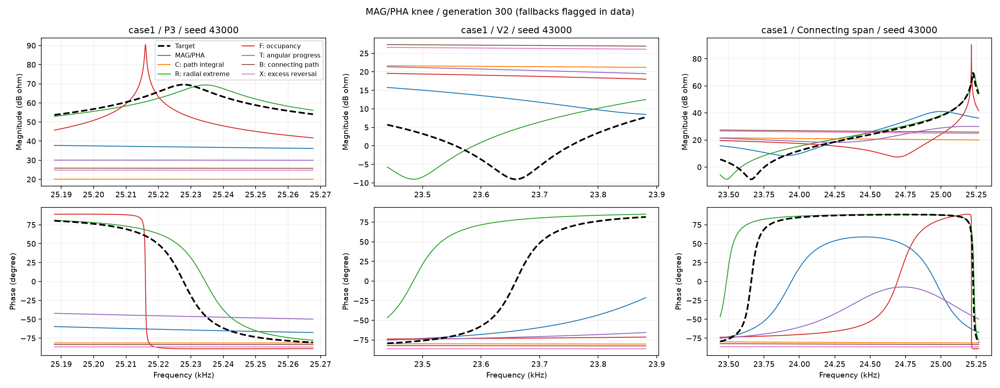

# 从结构缺陷提取一组指标：距离之外，还应该检查什么？

2026年10月11日。候选公式保持冻结；下文第三步证据与链接已按MAG/PHA膝点新版替换。168个嵌套电路seed是第二步来源；第三步三轮252个任务分别解读，不合并成功率。没有上传网站。

**上一轮筛出了C这一个有初步正向证据的方案，但还没有形成一组能分别解释缺陷的指标。** 现在建议保留C作整体轨迹参考，再增加五个有不同职责的成员：径向极值、频率分布、角度进程、跨窗连接、额外往返。它们组成候选组，不是五个已经证明有效的新目标。

其中跨窗连接是C的覆盖范围扩展；径向、角度指标从同一条三维曲线提取特征，部分信息有重叠。不能把改名、换合并方式都算成独立发现，也不能为了凑数量保留无用项。

## 1. 先重新看：结构到底错在哪里？

把三维曲线想成一根沿频率方向前进的细线。它到频率轴的距离是阻抗幅值，绕轴的方向是相位。现有结果至少区分出下面五种问题：

|缺陷|已有曲线中的证据|指标需要单独回答什么|
|---|---|---|
|伸出不足或过头，谷没有靠近轴|新版Case1各方法均未稳定恢复；F固定seed 43000出现远高于目标的窄尖峰|它究竟伸到了多远？不能只问整体像不像|
|有峰，但位置、展开范围不对|新版R的43000谷位置偏差约2.39个目标宽度；T的43002峰仍偏约0.51个峰宽|结构沿频率轴出现在哪里、占了多长、两侧怎样分布？|
|幅值过关，相位转向仍错误|嵌套电路三级网络倍率0.25：8个seed中7个幅值全合格，这7个仍有相位事件不合格|这条线绕轴转了多少、在哪段转、向哪边转？|
|峰谷分开看还不够，中间走错路线|Case1两个局部辅助窗口之间有约23.88—25.19 kHz的连接段；部分曲线该段相位偏差很大|两个局部结构是不是由正确路线连接？|
|多出起伏、绕行或反向折回|新版三级网络B组每seed多出一对窗口外峰谷；修好指定区间仍可能留下额外结构|候选是否增加了目标没有的往返？|

“位置、高度、宽度不合格”可能同时发生，不能将数量相加当成不同失败seed。“未匹配”也只表示规定匹配范围内没有合适事件，不等于曲线在所有频率都没有峰。

相位事件检查基于变化速度，会检出角度不大的局部起伏。上表说明幅值和相位需要分别检查，**并不证明每个相位事件失败都具有很大实际影响**。后续角度指标要根据真实转角和测量可靠性筛选，不能只因导数很尖就给它很高权重。

这些证据说明规定搜索条件下存在困难，不证明MSE理论上不能拟合。Case1正确参数处仍有零误差解。

## 2. 这次“一组指标”具体包括什么？

|成员|通俗名称|主要职责|定位|
|---|---|---|---|
|G₀|局部顺序累计三维偏差，即前轮C|整段局部轨迹是否贴合|保留已有初步证据的参考方案|
|Gᵣ|径向极值误差|峰伸得够不够、谷靠轴够不够|优先候选，补充高度/深度信息|
|G𝒇|多层径向占据分布误差|频率位置、展开宽度与左右分布|优先候选，补充沿频率轴的结构信息|
|Gθ|有方向的角度进程误差|相位转角、转向位置、转变范围和方向|优先候选，补充绕轴变化信息|
|Gᵦ|跨窗口连接轨迹误差|峰谷之间的路线、相对位置与衔接|C的配对跨窗扩展，先诊断覆盖范围|
|Gₓ|额外往返量|不该出现的起伏和反向折回|低优先级正则项，证据较少、与Gθ可能重叠|

前轮A、B、C只指前轮方案；这里统一用G下标命名，避免把旧稿中另一个“C”与累计距离混用。

**一组不等于把六个分数一起加进去。** 先用这些分数描述同一条曲线的不同缺陷；优化时保留MAG/PHA，再分别验证一个成员是否有增益。只有证明互补，才测试小组合。

## 3. Gᵣ：单独检查“伸出多少”，并处理高低不对称

### 为什么有必要？

在原始Ω距离里，3000 Ω目标峰变成1500 Ω差1500 Ω，变成6000 Ω差3000 Ω。但两者分别是缩小一半、放大一倍。原始距离天然更重罚后一种，不是计算错误。

我们可以从三维曲线读出径向极值，再比较正数之比的对数。这样半倍和两倍的高度偏差有相同绝对分数。**只是把“比例偏差”变成对称分数，没有把对数幅值当成负半径，也没有改变原始实部、虚部曲线。**

峰读出指定区域内的最大半径，谷读出最小半径。不能只在目标中心取一个点：很窄的峰稍微错位，就会把“高度错”和“位置错”混在一起。

### 能解决什么，不能解决什么？

它直接区分峰矮、峰高、谷浅、谷深，计算较便宜。它仍利用幅值信息，与MAG的区别在于**局部极值与相对比例**，不是发现了另一种物理量。

同高度的宽峰、窄峰可能得一样分数；单调曲线的端点也可能给出正确极值，却没有正确的峰形。所以它应与G𝒇及基础目标一起看，不单独作为结构恢复的证明。可靠极值提取和尖峰采样仍是前提。

## 4. G𝒇：检查曲线在哪些频率“占住了目标的高度层”

### 怎么理解？

对目标峰画三条固定高度线：峰顶、峰顶下3 dB、峰顶下6 dB。沿频率从左往右记录曲线有多大程度达到这些层。对谷则看谷底、谷底上3 dB、谷底上6 dB，以及曲线有多大程度进入这些低幅值层。

这张记录同时包含几件事：峰往右搬，记录也往右搬；峰变宽，达到某一层的范围变长；左侧拖尾、右侧很陡，两侧记录会变得不对称。

不直接用“超过就1、没超过就0”的硬开关，而用固定平滑过渡，让略低于高度线的曲线也有可变化的分数。最后比较从左到右的累计记录，**不能把每条候选的总量都缩成1**，否则“占得太少”会被消掉。

### 为什么不是原来的平均距离改个名字？

它比较的是径向结构在频率轴上的分布，不是同频点Re/Im残差。它有明确的缺陷解释：欠缺多少、落在何处、展开多少。但它与Gᵣ有重叠，是否确实提供额外引导，要通过Gᵣ单独与Gᵣ＋G𝒇的对照判断。

采集范围必须在开跑前由目标确定。可将现有很窄的检查窗口与较宽的邻事件区间分层使用，不能随着候选峰漂移而把评分窗口免费搬过去。峰完全漂出指定范围时，平滑记录也可能失去有效引导；它不是能把任意远处的峰自动拉回的保证。

## 5. Gθ：检查“绕轴的过程”，不只比一支箭头

### 为什么前轮B还不够？

前轮B用三档前后弦看方向和长度，加入后没有稳定超过A。我们不应再把相似的导数误差换个名字重复试。

这里改看沿频率前进时累积的正向转角和反向转角，分别记账。目标转过180°而候选只转过30°，总量不同；总量相同但转得很宽，进程不同；先顺时针转一圈又转回来，不能靠净转角相抵消。

还要加绝对角度锚定：整段曲线朝向都错了、变化量却相同，仍应扣分。只比较转角增量会漏掉恒定相位偏移。

这是从原始三维曲线中提取绕频率轴的变化过程；不是把幅值归一化后就不再检查大小。Gᵣ/G₀仍保留径向要求。

### 风险是什么？

真实数据中，低阻抗处相位不可靠，差分也可能放大噪声。必须使用目标和测量不确定性确定的可靠频段与平滑尺度，不准因为候选不好就将该段屏蔽。细小相位起伏不能用很小的目标转角分母放大成首要任务。

它仍可能与局部PHA高度相关；我们要检验的是频率进程与方向分解有没有额外价值，不因为名字带“角度”就认定它不同于PHA。

## 6. Gᵦ：把峰谷中间那段路线也放进去

### 这次新复算看到了什么？

Case1的V2辅助窗口结束于约23.881 kHz，P3窗口开始于约25.188 kHz，中间没有进入前轮局部辅助目标。**MAG/PHA一直覆盖它；这里只是新增辅助评分的覆盖空隙。**

新版固定seed 43000的局部幅相与连接区间如图。MAG/PHA基础组未恢复峰谷，R出现明显转向与位置偏差，F出现过高窄峰，其他部分方法的径向伸出不足。逐seed局部相位与全频结构另列检查，不用一个端点或净转角代替整段轨迹。

看端点或净变化，可能漏掉中间的绕行。新版B在三级网络的局部改善与窗口外多余峰谷同时出现，说明连接区间与全频保护需要分别处理。

局部相位改善也可能伴随整体误差退步。因此不能把“修连接段”认定为唯一缺失环节。

### 怎么提取成指标？

先在目标中确定相邻的谷峰或峰谷配对。检查整个配对区间：包含左结构、连接段和右结构。沿用C的顺序累计思想，但给左右结构和连接段分别一个固定份额，防止长连接段把窄峰冲淡。连接段按两个目标3 dB核心之间的区间定义，不只看旧辅助窗口是否有空隙；若核心重叠或某个宽度不可靠，不强行制造第三块，改用事先规定的两块划分或暂不启用。

阻抗尺度由目标确定，可在两个结构的尺度之间固定插值，避免几千Ω的峰掩盖几Ω的谷。频率错位仍限制并付出代价，不能为了连接起来就免费移动峰谷。

这主要是**覆盖范围与成对关系的扩展**，不是全新的距离理论。若Gθ已经消除了连接段问题，Gᵦ未必还有必要；需要单独对照。

## 7. Gₓ：检查额外往返，但不要只要求曲线“平滑”

从低频到高频，一段理应持续向外伸展的曲线，如果先伸出、再缩回、再伸出，就多走了路。可以记录径向和角度的累计变化量，再减去端点净变化量，得到往返部分。

按目标的可靠转折点分段，检查候选是否比目标多出显著往返。对于理论无噪声目标可以细查；实测必须规定噪声允许量和分辨尺度。

这是一项结构正则，不是完整拟合误差。全平的错误曲线可能没有任何往返，因此它不能独立引导恢复峰。目标本来有的转弯也不该被惩罚。

目前额外事件不是最普遍的缺陷，而且Gθ也能看见部分额外角度往返，故将它列为低优先级。若后续诊断显示与其他成员冗余，应删掉，不为保持指标数量而保留。

## 8. 怎样使用一组，而不丢掉可解释性？

第一层是描述：每条代表输出一张结构成绩单，如“径向高度好、频率分布差、角度进程差、连接段差”。分数不要立刻压成一个总数。

第二层是验证：在已有曲线上检查目标与自身为零、半倍/两倍径向偏差是否对称、错位/变宽/额外折回是否有预期反应，并检查采样稳定性。这只是评分诊断，不证明优化有效。

第三层才是优化：MAG/PHA保留，分别加入Gᵣ、G𝒇、Gθ或Gᵦ，与同seed基线和保留的C比较。单项有证据后，再测两个确有互补的组合。不要直接变成七八个目标，否则搜索和保留规则同时大变，很难知道谁有帮助。

每个事件分别留分数，聚合另列为设计问题：取平均可能相互补偿，取最大可能让较小项缺乏作用。这里不假定存在一个同时解决这两种问题的通用合并公式。将结构容差标准化、引入约束或分阶段搜索，都需要另冻结并单独对照。

全曲线质量仍独立检查。混合支路前轮C的4/4合格不能取消两个好起跑的幅相退步；局部新指标也不能天然保证保护MAG/PHA。

## 9. 四个主线问题，这组分别怎样回答？

|问题|现在更具体的工作|
|---|---|
|哪类结构反复难恢复？|用径向、频率分布、角度进程、连接段和额外往返分别分类，不再只有“距离大”|
|什么条件使它更难？|区分极值统计、覆盖范围、进程表示和聚合影响；不把多参数搜索失败都归给MSE|
|指标能否改善？|保留C作参考，逐项配对验证新成员，检查单项与组合是否带来真实增益|
|能否推广，代价是什么？|预注册尺度和选解，另用未参与开发的条件验证；报告可靠采样、频点及实际耗时|

当前优先顺序建议是：**Gᵣ与G𝒇针对Case1峰高/宽度联动；Gθ针对幅值过关但相位仍错；Gᵦ针对Case1窗口间连接；Gₓ暂放后面。** 不把任意曲线都强行套入同样一组权重。

下面给出能复算的候选公式；它们仍要经过评分诊断与正式冻结，不能直接当成已经验证的优化目标。

## 附录：候选公式与需要冻结的设置

### 共用定义

令u＝log10(f)，r(u)＝√[(Re Z)²＋(Im Z)²]，φ(u)为可靠且一致展开的相位。每个结构的区间Iₖ、目标中心uₖ*、宽度wₖ*和阻抗尺度Sₖ由目标固定，t＝(u−uₖ*)/wₖ*。

qₖ(t)＝(t, Re Z/Sₖ, Im Z/Sₖ)。所有候选沿用这些尺度，不分别旋转、平移、缩放。Gᵣ、G𝒇、Gθ、Gₓ是从这条三维线提取特征，**它们不全是三坐标欧氏距离，也不全是数学上能唯一识别曲线的距离**。

若r低于可靠测量范围，不用未经验证的相位。理论计算的正半径下限εₖ也须由目标尺度固定；不能用候选的最大值设置。以下r可写作max(r,εₖ)，这是数值约定，不是实测相位可恢复的证明。

### Gᵣ：径向极值

峰的Rₖ＝maxᵤ∈Iₖ r(u)，谷的Rₖ＝minᵤ∈Iₖ r(u)，目标同样取Rₖ*。建议初版：

\[
G_{r,k}=\frac{|\ln(R_k/R_k^*)|}{\ln(10)\,3/20}.
\]

分母对应3 dB径向比例，便于解释，开跑前固定。半倍和两倍都是|ln 2|；位置和宽度不能由这个分数单独识别。若用软极值替代，温度与对极窄峰的偏差要另外核验。

### G𝒇：保留总量的径向占据累计

ℓ∈{0,3,6} dB。峰：aₖℓ＝Rₖ*10⁻ˡ⁄²⁰、sₖ＝+1；谷：aₖℓ＝Rₖ*10ˡ⁄²⁰、sₖ＝−1。设固定平滑宽度τ，例如先讨论1 dB对应的ln(10)/20，不用结果调它：

\[
b_{k\ell}(t)=\operatorname{sigmoid}\!\left(s_k\ln[r(t)/a_{k\ell}]/\tau\right),\quad
A_{k\ell}(t)=\int_{t_L}^t b_{k\ell}(v)\,dv.
\]

Lₖ＝tᵣ−tₗ、Mₖℓ*＝Aₖℓ*(tᵣ)，定义：

\[
G_{f,k}=\frac13\sum_\ell
\frac{\int_{t_L}^{t_R}|A_{k\ell}(t)-A_{k\ell}^*(t)|\,dt}
{L_k M_{k\ell}^*}.
\]

只用目标总量作分母，不用候选总量，因此不会把缺失的结构归一化成正确大小。这里是自定义累计记录误差，不直接称为标准Wasserstein距离，也不允许优化一个免费平移来消除位置差异。

### Gθ：正反转角进程＋绝对朝向

在目标确定的可靠区间，ν₊＝max(dφ/dt,0)、ν₋＝max(−dφ/dt,0)，A₊/₋(t)＝∫ν₊/₋ dv。使用解析导数或在提前固定的分辨尺度上计算增量；有限数据不临时加密出细节。

Θₖ＝max(∫|dφ*/dt|dt, Θ₀)，其中Θ₀是预注册角度下限。n(t)＝(cos φ, sin φ)。一个明确初版是：

\[
G_{\theta,k}=
\frac{\int(|A_+-A_+^*|+|A_--A_-^*|)dt}{L_k\Theta_k}
+\frac1{L_k}\int\|n(t)-n^*(t)\|\,dt.
\]

系数1是候选起点，未证明合适。第二项防止恒定朝向错误，第一项保留转向与进程；不能将正反转角先相减再比较。目标小转角是否启用、Θ₀、可靠区间和平滑尺度均须冻结。

### Gᵦ：整段配对的受限路径累计

区间覆盖配对左结构、桥段、右结构。外端可沿用左、右辅助窗口外端；内部分界使用左结构的右3 dB交点和右结构的左3 dB交点。三块具有正长度时固定各占一份，形成正的目标测度dμ(u)，而不是按总点数平均。若交点重叠，事先改成按目标中心中点切分的两块；交点不可靠则不启用此三块版本。Sᵦ(u)在两个目标局部尺度之间按log尺度作固定插值，区间外延沿用端部尺度。

用qᵦ＝(固定归一化频率, Re Z/Sᵦ(u), Im Z/Sᵦ(u))，沿用C的有序完整路径。对一条匹配边，权重Δs＝(Δμ目标＋Δμ候选)/2，累计梯形边距离平方，分母固定为整个配对测度：

\[
G_{b,k}=\sqrt{\min_{\mathcal L}
\frac{\sum_{e\in\mathcal L}(d_e^2+d_{e'}^2)\Delta s_e/2}
{\mu(I_k)}}.
\]

μ是固定在频率轴上的同一个权重函数，候选一侧也不按候选结构重定权。顺序、端点与固定频率错位限制仍保留；边跨越三块边界时按测度积分计算。该版本须重新核验路径动态规划与非均匀网格，不能把原C的程序核验当成新版本已经通过。

### Gₓ：额外往返正则

按目标可靠转折点分段，对a(t)＝ln r(t)或φ(t)计算：

\[
B_j(a)=\frac{\operatorname{TV}_{I_j}(a)-|a(t_R)-a(t_L)|}{2},\quad
G_x=\frac1J\sum_j\sum_{a\in\{\ln r,\phi\}}
\frac{[B_j(a)-B_j(a^*)-\xi_{j,a}]_+}{D_{j,a}}.
\]

TV是实际累计变化量，有限序列用Σ|aᵢ₊₁−aᵢ|；不额外乘频点间隔，也不因自适应网格点更多就作点数平均。D为目标固定尺度，ξ为噪声允许量。分辨尺度不足或噪声未处理时TV不可靠，不能靠盲目加密求它。

它只处罚比目标多的往返，曲线完全变平也可能得0；因此是辅助正则，不能叫完整曲线距离，也不能替代G₀或基础目标。

### 正式优化前还需固定哪些选择？

采集区间及窄/宽层、极值提取、τ、有效相位结构筛选与Θ₀、桥段划分与频率错位限制、TV分辨尺度及噪声允许量、跨事件聚合、组合系数、选解、seed与预算。以上公式明确了成员看什么，但这些设置尚未作为下一批优化协议冻结。本轮没有用新指标得分冒充优化效果。

## 文献边界与复算入口

曲线的变化过程可参考[欧氏曲线弹性度量研究](https://arxiv.org/abs/2209.09862)；其中涉及形状注册，我们这里不消去具有物理意义的频率位置。关于总量与位置区别，可参考[非平衡最优运输研究](https://arxiv.org/abs/2211.08775)中对不同总量正测度的讨论；本稿G𝒇是自定义累计误差，没有直接实现该文的运输模型。

这些文献提供数学设计背景，不提供本组指标改善阻抗拟合的证据。候选公式为本任务提出，效果需要配对验证。

[现行结构与指标结果](../output/mse_structure_step3_knee_20261011/REPORT.md)；[逐seed结果](../output/mse_structure_step3_knee_20261011/REPRESENTATIVES.csv)；[现行复算代码](../experiments/mse_structure_step3_knee_20261011/reselect.py)。旧选解的结构盘点已弃用。

## 五类候选已完成本轮独立配对筛查

第三步三轮252条最终代表已按膝点重新选解和复核，见[通俗结论](../output/mse_structure_step3_knee_20261011/FINDINGS.md)与[现行选解约定](../experiments/mse_structure_step3_knee_20261011/PROTOCOL.md)。最新轮T在梯形重点3/4过关且幅相改善，C在混合支路重点4/4但仅3/4幅相不退步，B在三级网络重点4/4且幅相改善但每seed多出窗口外峰谷。Case1仍不稳定，X当前较弱。原指标定义未修改；未验证组合或泛化。
