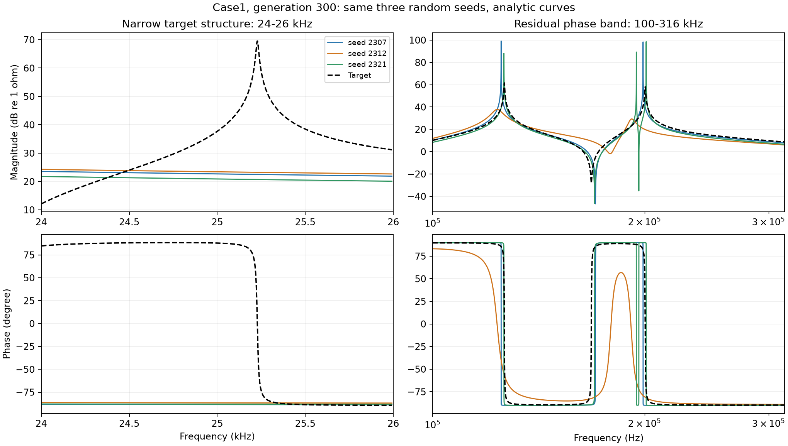

# 从零理解：我们为什么研究阻抗曲线，以及这轮实验发现了什么

这份说明写给第一次接触这个问题的人，不要求你学过电路、复数或优化算法。先理解我们在做什么，再看实验数字；公式放在最后，需要时再读。

本文对应2026年10月8日完成的“双目标优化过程诊断”和此前的“加密采样验证”。它是本地阅读说明，网站继续使用正式研究报告。这里没有新增实验，也没有改变原实验的数据。

## 1. 我们到底想解决什么问题？

设想我们手里有一组电路测试数据。我们想找到一张电路图，并给图上的元件填上合适的数值，让这个电路算出来的表现尽量接近测试数据。

当前实验主要处理后半件事：**电路的连接方式已经给定，让程序调整各个元件的参数，使算出来的曲线接近目标曲线。**

可以把它理解成调一套有很多旋钮的设备。我们知道希望它表现成什么样，也知道哪些旋钮能调，但不知道各个旋钮应该拧到哪里。程序会不断尝试，计算每次尝试的结果，再保留较好的方案。

现在的问题是：程序觉得“较好”的曲线，是否真的把我们关心的细节也做好了？例如，一个关键的尖峰会不会没了，而总体分数看起来仍不错？

所以，当前阶段不是急着再造一个分数，而是先检查：**现有分数下降时，曲线究竟在什么地方变好了，又在什么地方仍有问题。**

## 2. 电路参数、阻抗和曲线是什么关系？

### 先认识三个元件

当前模型主要使用三类元件：

| 元件 | 直观理解 | 参数单位 |
| --- | --- | --- |
| 电阻 R | 消耗电能，限制电流 | 欧姆，记作Ω |
| 电感 L | 利用磁场储存能量，对变化的电流作出响应 | 亨利，记作H |
| 电容 C | 利用电场储存能量，对变化的电压作出响应 | 法拉，记作F |

元件如何连接，称为**电路结构**；每个R、L、C具体取多少，称为**电路参数**。即使元件数值相同，换一种连接方式，电路表现也可能不同。

交流电不是一直保持同样大小和方向，而是在反复变化。**频率f**表示每秒变化多少个周期，单位是Hz。1kHz就是每秒1000个周期，1MHz就是每秒100万个周期。

电感和电容对不同频率的响应不同，因此同一个电路在低频和高频下可能表现得很不一样。改变一个或多个元件参数，就会改变这些响应，进而改变我们看到的曲线。

这也解释了为什么不能简单地把多个元件各自造成的曲线变化相加：电路中的元件共同起作用，组合后的关系可能是非线性的。某些简单电路可以相加，但不能默认所有结构都这样。

### 阻抗可以先理解为两个信息

**阻抗描述交流电压和交流电流之间的关系。** 初学时可以先记住它包含两件事：

1. **幅值**：电压幅度与电流幅度的比值。相同电压幅度下，阻抗幅值越大，电流幅度越小。
2. **相位**：电压和电流在一个周期中是否同步，以及谁领先、领先多少。这里采用“电压相位减电流相位”的定义。

相位用角度描述。例如，一个完整周期对应360°，四分之一个周期对应90°。程序中的部分公式使用另一种角度单位“弧度”，180°等于π弧度；只是单位不同，不是另一个物理量。

改变频率，在每个频率上都算出这两个信息，就得到两张常见的阻抗图：

- 横轴是频率，纵轴是阻抗幅值：观察幅值随着频率怎样变化。
- 横轴是频率，纵轴是相位：观察电压和电流的先后关系怎样变化。

两张图描述的是同一条阻抗曲线的两个方面。不能只看到幅值贴合，就认为整个阻抗已经拟合好了。

### 图上的对数坐标是什么意思？

我们的频率跨度很大。若横轴从100Hz一直画到100万Hz，直接使用普通刻度，低频部分会挤在一起。因此常用对数刻度：100、1000、10000这几个位置间隔相同，表示频率每次扩大10倍。

幅值通常也转换为dB后显示。在本实验使用的约定中，以1Ω为参考：1Ω对应0dB，10Ω对应20dB，100Ω对应40dB。这样既能看大幅值，也能看小幅值；0dB不代表阻抗为零。

**频率轴用对数刻度、幅值换成dB、用什么公式打分，是三件不同的事。** 图画在对数坐标上，不会自动让程序的误差公式也变成对数形式。本轮MAG的误差确实是在dB幅值上计算的。

## 3. “拟合”具体是怎么进行的？

实验中有两类曲线：

| 名称 | 从哪里来 | 在实验中做什么 |
| --- | --- | --- |
| 目标曲线 | 已知电路计算，或实际测量 | 作为希望接近的参照 |
| 拟合曲线 | 把程序当前选的参数放进电路模型计算 | 检查这套参数表现如何 |

程序每尝试一套R、L、C参数，就能算出一条拟合曲线。随后，它把拟合曲线与目标比较，给出误差分数。再利用这些分数产生新的参数组合，继续尝试。

这样的搜索称为**优化**。它并不是每次都能直接算出正确答案，也不保证运行到某一代就一定找到最优参数。

另外，**曲线很接近，不一定意味着每个元件参数都已经还原正确。** 在有限频率范围或有限测点上，不同参数组合可能产生接近的响应。这轮主要检查曲线拟合情况，没有证明所有元件参数都能被唯一确定。

## 4. MAG、PHA、MSE和“双目标”是什么意思？

MAG是幅值，PHA是相位。**MSE是“均方误差”**，可以用一句话理解：

> 在每个检查点计算“拟合值减目标值”，把差值平方，再取平均。

例如，三个检查点上的误差分别是1、2、3，MSE就是(1²+2²+3²)/3，约为4.67。差值平方后都非负，正负误差不会互相抵消；较大的误差也会受到更重的惩罚。

这轮使用两个基础分数：

- **MAG MSE**：幅值转换成dB后，计算均方误差。
- **PHA MSE**：相位用弧度表示，计算均方误差。

它们越小，表示相应方面越接近目标。但是两个分数的单位不同，不能直接拿大小判断“幅值比相位差多少倍”。

**双目标优化**就是让程序同时努力降低这两个分数。困难在于，一套参数可能幅值更好、相位稍差；另一套可能相位更好、幅值稍差。这时没有天然唯一的“最好”。

因此，程序会保留一批各有优势、相互不能全面胜出的方案。这批方案通常叫“非支配前沿”。初学时，把它理解为“一组需要取舍的较好答案”即可。

### 那为什么最后仍只画一条代表曲线？

为了看清过程，我们需要从每个seed、每个阶段的这批答案中挑一条代表曲线。本轮主图的规则是：在前沿中，选择“MAG MSE＋α×PHA MSE”最小的方案。

α是用来权衡两项误差的系数，Case1取25.12，Case2取17.38。这种加权分数与此前的WSMSE对应。

**这里的加权只用于从双目标结果中挑选展示对象。程序搜索时仍同时优化MAG和PHA两个目标。** 不能因为主图用加权分数选解，就把这轮称为WSMSE单目标优化。

我们还使用了另一种更关注两项平衡的选法，检查结论是否依赖选解规则。这一点很重要：换一条代表曲线，某些局部结构的判断确实可能变化。

## 5. 为什么平均分变好了，某个尖峰还可能没做好？

先看一个假设例子，下面的数字只是帮助理解，不是实验结果。

假设有100个检查点：

| 拟合方案 | 各点误差 | MSE |
| --- | --- | --- |
| A | 99个点误差为0，只有1个点误差为10 | 1 |
| B | 100个点误差都为1 | 1 |

两者的平均分完全一样，但误差分布不同。A可能在某个很窄的尖峰附近错得很明显；B可能是整条曲线都稍有偏差。

这不是说MSE一定会忽略尖峰。平方运算本来就会加重对大误差的惩罚。问题是：**一个分数把整条曲线压缩成一个数字，会丢掉“哪里错、怎样错”的信息。** 最后哪个方案分数更好，还取决于误差大小、检查点数量和权重。

对于阻抗曲线，我们除了总分，还关心这些细节：

| 曲线细节 | 通俗解释 |
| --- | --- |
| 峰、谷是否存在 | 目标有一个凸起或凹陷，拟合曲线有没有对应结构？ |
| 位置是否正确 | 凸起是否出现在正确频率，而不是偏到旁边？ |
| 宽度是否正确 | 目标是很窄的尖峰，拟合出来是否变成很宽的山包？ |
| 相位转变是否正确 | 相位发生明显变化的地方，其位置和变化过程是否接近目标？ |
| 局部误差是否集中 | 是否有一小段始终拟合较差，被其他较好的部分掩盖？ |

本轮把这些细节单独检查了一遍。**检查某个细节，并不等于已经把它加入优化目标。** 当前它们只是用来找问题的诊断项目。

## 6. 这轮实验怎样安排？

### 两个例子：Case1与Case2

Case只是“测试例子”的编号。

- **Case1**：由已知电路和参数计算出目标。我们可以在需要的频率上重新计算，查看原先两个检查点之间有没有隐藏细节。
- **Case2**：目标来自实测数据。我们知道测点上的数值，但没有测点之间的真实值，不能把插值画出的线当成那里已经测到了的真实曲线。

因此，两者不能完全用同样的方法解释。Case1适合检查计算和采样是否漏掉细节；Case2还需要考虑测量数据和模型是否相容。

### seed和“代”是什么？

**seed是随机过程的编号。** 搜索初始参数、产生新参数时有随机因素；换seed，相当于换一套随机尝试过程。在相同程序和设置下，重复使用同一个seed，是为了复现相同的随机过程。

**一代是一次搜索更新。** 程序不是只维护一套参数，而是维护很多套候选参数；每一代产生和筛选新方案。本轮运行到300代。

两个Case各运行100个seed，每20代记录一次：20、40、60……300，共15个阶段。

后台分析全部100个seed；图中随机固定展示2307、2312、2321三个seed。它们在查看结果前就选好了，避免事后只挑最好看的例子。

本轮沿用既有100个seed的设置，重新运行以记录中间过程，末代结果与原运行逐项一致。它是对优化过程的追踪，不是换了一批新seed进行独立验证。

### 为什么图中不平均曲线？

如果两条曲线的尖峰分别在略有差别的位置，把它们平均后，可能出现一个变矮、变宽的峰。这条平均曲线还未必能由其中任何一套参数产生。

所以，我们把各seed的曲线分别画出来，再与目标比较。**可以平均每条曲线的误差数值，但不把平均曲线当作某次优化的实际答案。**

## 7. 实际发现了什么？

### 发现一：程序仍在进步，不能说已经完全优化不动

下面用RMSE展示整体误差。RMSE可以先理解为“误差分数开平方”，更容易用dB和角度阅读；越小越好。

这些数值是先给每个seed的代表曲线计算误差，再对100个seed取平均，**不是平均曲线的误差**。采用本轮主图的选解规则。

| 例子 | 幅值误差：20代→300代 | 相位误差：20代→300代 |
| --- | --- | --- |
| Case1 | 8.71dB → 4.21dB | 56.10° → 24.13° |
| Case2 | 4.57dB → 2.54dB | 29.97° → 16.95° |

甚至只看200代到300代，两项整体误差仍在下降，配对统计检查也支持这个方向。

这说明：当前300代的结果还存在继续改善的空间。**不能根据末代仍有缺陷，就说MAG/PHA在理论上无法拟合这些结构。**

这里的RMSE是在另一个用于检查曲线的网格和频率权重上计算的，与程序训练时的等权测点MSE不完全相同。阅读旧表格时，不要把两者直接混用。两个Case的目标和频率范围也不同，不能只凭表中误差大小判断哪个电路更容易。

### 发现二：整体进步没有消除所有局部缺陷

到300代时，Case1的100个seed中，有73个仍至少缺少一个按本轮规则识别的幅值峰谷。Case2的100个seed都有这类缺失。

这两个数字的意思是“在这些运行中，按当前诊断规则检查，仍发现了问题”，不是说73%的所有电路都会失败，也不是说程序只能拟合出27%的曲线。

Case2的“峰谷”来自测点曲线的阈值识别，可能包含测量细节，不能直接解释成电路少了几个真实谐振。

这里的“阈值”就是识别细节时设定的最低变化要求：本轮幅值事件使用1dB阈值，相位事件使用5°阈值，并按频率位置等规则寻找对应事件。换阈值或匹配规则，计数可能改变，因此这些数目需要连同规则一起理解。

相位变化结构也有类似情况：**主图选解规则下，200代到300代的相位结构漏失没有确认稳定改善。** 这与“相位整体误差下降”并不矛盾：已有部分可以拟合得更准，但某个缺失的变化过程仍没有恢复。

更换平衡选解规则后，Case2这一项有改善证据。因此，这个判断需要附上选解规则，不能扩大成“所有双目标结果都不改善”。

### 发现三：误差不是平均散布在所有频率上

Case1末代的相位平方误差约84%集中在两段：10–31.6kHz，以及100–316kHz。Case2约76%集中在17.2–110MHz。

你可以把它理解为：我们现在知道了几块需要重点检查的区域，不必只盯着一个总分。

这些比例是相位平方误差的份额，不是“这些区域的电路有84%错误”，也不是它们占了84%的所有测点。为什么这些地方更难，需要继续区分采样、模型、搜索和评分的影响。

具体曲线可见[Case1结构与阶段图](../output/dual_trajectory_20261008/case1.md)和[Case2结构与阶段图](../output/dual_trajectory_20261008/case2.md)。先看电路和参数，再看目标线与彩色拟合线的差别，不必一开始读完全部统计表。

### 用一张实际图理解“局部细节仍没做好”

下面是Case1运行到300代的局部放大图。黑色虚线是目标，蓝、橙、绿三条线分别来自三个固定seed，都是独立曲线。



初次阅读可以先只看左列：

- **左上是幅值**：目标在约25.23kHz有一个明显尖峰，但三条拟合线在这里都比较平，说明这个目标细节没有恢复。
- **左下是相位**：目标从接近＋90°转到接近−90°，而三条拟合线在这段基本保持在−90°附近，说明相位变化过程也没有恢复。

这张图具体展示了哪里仍有偏差。它只展示三个seed的一小段频率，不能单独证明所有运行都如此；前面的100个seed统计用于补充这个限制。图中Magnitude表示幅值，Phase表示相位，Frequency表示频率，Target表示目标。

## 8. 有缺陷，不一定都是评分方法的问题

至少有三类原因需要分开看。

### 第一类：检查点太稀，关键细节根本没看见

可以想象沿着一条山路每隔很远拍一张照片。两张照片都在平地，并不能证明它们之间没有一座很窄的山峰。

电路曲线也类似。Case1在约25.23kHz有一个很窄的目标峰，原先180个检查点形成的连线没有充分表达它，与更细的计算结果最大相差约40.49dB。

这时程序拿到的评分信息本身就不完整。不能把“没有被充分检查的细节没有做好”全部解释成“优化目标设计错了”。

我们做了加密采样实验。Case1检查点增加到731个后，目标连线的最大幅值表达误差降到约0.10dB。

**但目标看清楚了，不代表搜索结果一定全面变好。** 在8个原本有采样缺口的电路上，双目标真值加密组相对原采样组，整体幅值误差平均增加约0.122dB，相位误差平均下降约0.270°。这里出现了取舍，不能宣布加密使所有方面都改善。

还要检查拟合曲线本身：程序产生的新参数可能生成新的极窄尖峰，恰好躲在检查点之间。目标曲线和拟合曲线都需要看清楚；只把目标的采样做好，仍可能遗漏候选曲线的问题。

加密实验只对可以重新计算真实目标的电路进行。Case2没有点间真值，本轮没有假装通过插值就得到了真实的新测点。

### 第二类：当前电路模型可能做不出目标中的某个细节

Case2在16MHz的一个目标点，相位为107°。当前只含正值R、L、C的无源输入阻抗模型，相位范围为−90°到90°。无论怎样调这些元件，该点都至少相差17°。

“无源”在这里指这些元件不能主动产生能量；这是当前模型的一项能力限制，不是所有电路都只能有这个相位范围。

这像是让一个只能转到90°的旋钮达到107°：继续调参无法消除这17°的差距，需要检查目标与模型的关系。

不过，这个单点限制远不足以解释Case2全部误差。我们也没有确认该点来自测量噪声、数据处理，还是其他原因。不能因此直接宣布数据错误，更不能把它当成删除数据的理由。

### 第三类：看得见、模型也能做到，但当前搜索或评分还没做好

这才是后续设计辅助指标时要重点检查的情况。例如：目标峰已经被充分表达，模型也有能力形成它，但多次搜索后仍经常漏掉它，或者峰的宽度一直不对。

即使出现这种情况，也要区分“搜索还不够充分”和“平均分没有充分引导局部结构”。这轮还没有把两者完全分开。

## 9. 下一步怎样做才有依据？

我们目前得到的是**问题线索**，还不是已经验证有效的新指标。

较合理的顺序是：

1. 对Case1这类理论电路，分别检查目标和拟合曲线的细节，必要时自适应加密。对离线实测目标，不能把插值当作新测量；仍可加密计算候选电路，查看它在测点之间的预测，但那里是否正确还需要额外证据。
2. 对实测数据，先检查当前模型的能力限制，并补充来源明确、与研究问题相符的公开测量。更多数据不等于更多同类型电路，不能把电池等数据直接当成当前RLC模型的验证。
3. 保留MAG/PHA两个基础目标，选择一个反复出现的局部缺陷，试一个针对它的辅助指标。
4. 使用相同seed、初始化和搜索预算，对比“基础目标”与“基础目标＋辅助指标”。在共同检查标准下评价，并同时查看局部结构和整体误差。

例如，若反复缺峰，可以试“是否存在对应峰”的约束；若峰存在但总是过宽，可以试宽度误差；若相位误差集中在某一段，可以试局部相位误差。它们现在都是待验证的候选，并非已经证明有效的方案。

**不能只看新指标自己下降了多少。** 还要问：目标细节是否更接近？幅值或相位是否明显变差？换seed后是否仍有改善？这样才能知道它是在帮助拟合，还是把曲线拉向了另一个不合适的方向。

2026年10月8日补充：已做一次本地采样诊断，并下载有来源记录的公开RLC实测数据。通俗结果与现实限制见[采样可行性与实测数据准备](../output/sampling_feasibility_20261008/REPORT.md)。诊断验证的是候选曲线能否被看清楚，尚未证明优化效果改善。

## 10. 阅读完整报告时，几个容易误解的说法

| 报告中的说法 | 应当怎样理解 |
| --- | --- |
| 误差下降 | 在指定评分方式下变好了，不等于所有局部结构都修复 |
| 漏峰、漏相位事件 | 按设定阈值识别的曲线细节没有匹配上，不一定等于真实物理结构缺失 |
| 区间跨过零 | 统计检查还不能确认改善方向，不等于已经证明完全没有效果 |
| 未确认稳定改善 | 当前实验证据不足，不能自动改写成“这个方法无效” |
| 加密采样 | 在更多频率上检查，既可能补目标信息，也增加了每次计算成本 |
| 最优、最好 | 必须说明是哪种选解规则、哪个阶段和哪些候选中的最好 |
| 300代的末代结果 | 有限搜索预算下的答案，不等于理论上能达到的最终极限 |

配对比较是把同一个seed在两个条件或两个阶段的结果一一对照，再看差值。例如，加密采样比较同seed的两次运行；200代到300代的比较，则看同一次运行前后两个阶段。这样比直接混合不对应的结果，更有助于减少随机过程造成的干扰。报告中的95%区间来自对这些配对结果的重复抽样，用来描述统计不确定性；它不是“下次运行有95%概率改善”的保证。

## 11. 想看公式时，再读这一小段

可以跳过本节，不影响前面的理解。

阻抗常写成复数Z=Re Z＋j Im Z。Re和Im是表示阻抗的两个坐标，不是电路里两只独立元件。它们与幅值、相位的关系是：

```text
Re Z = |Z| × cos θ
Im Z = |Z| × sin θ
```

所以，“频率f、实部Re Z、虚部Im Z”的三维曲线，与“频率—幅值、频率—相位”的两张图，是描述同一个阻抗响应的不同方式。

我们此前使用的原始平均距离，在同一个频率上比较目标与拟合，因此频率坐标的差为零。它实际计算：

```text
每个频点的距离 = √[(Re Z − Re Z目标)² + (Im Z − Im Z目标)²]
原始平均距离 = 对这些频点距离取平均，单位Ω
```

它不是在三维图中任意找最近的点，也不是按屏幕上看见的线间距离计算。频率坐标没有换算成欧姆参与加法。

当前双目标的公式则是：

```text
幅值 A = 20 × log10(|Z| / 1Ω)
MAG MSE = 平均[(A拟合 − A目标)²]，单位dB²
PHA MSE = 平均[(θ拟合 − θ目标)²]，θ使用弧度，单位rad²
主图代表解：从双目标前沿中取MAG MSE + α × PHA MSE最小的解
```

原始距离与MAG/PHA使用不同尺度衡量差异。因此，一个方案可以原始欧姆距离更小，却有更大的dB幅值误差或相位误差。这本身并不矛盾；应先确认在比较哪一种“接近”。

## 12. 原始材料在哪里？

建议先读完本文，再按需要打开下面的材料，不必同时看所有文件。

- [双目标过程完整报告](../output/dual_trajectory_20261008/REPORT.md)：实验设置、选解规则和阶段曲线入口。
- [全部100个seed的结构发现](../output/dual_trajectory_20261008/FINDINGS.md)：具体频段、峰谷诊断和配对区间。
- [加密采样实验报告](../output/sampling_refinement_20261007/REPORT.md)：采样怎样改变、在哪些方面有收益或取舍。
- [Case2模型限制核查](../output/dual_trajectory_20261008/MODEL_LIMITS.md)：107°目标点与当前模型的关系。

本文解释这些材料中的已有结果。此处没有证明MAG/PHA存在无法克服的理论缺陷，也没有证明某个新辅助指标已经有效。
