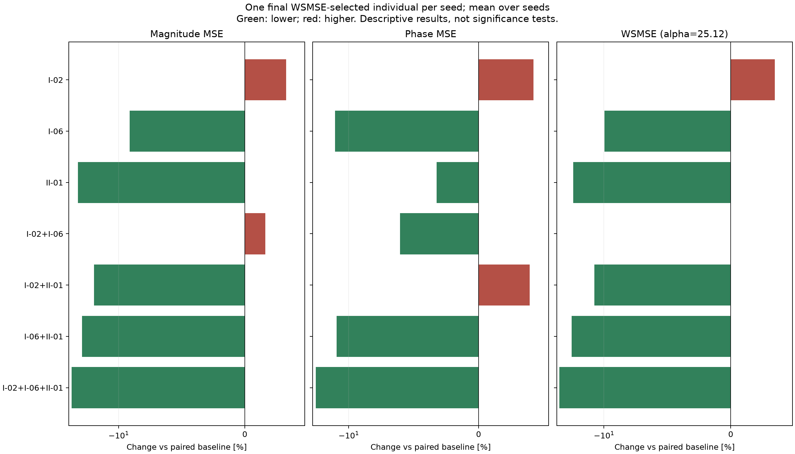

# Case I：固定三指标集合的新 seed 验证

完成 800 次运行；每组 100 seeds，种群 200，300 代。
最终选解：每个 seed 从最后一代完整种群中取幅值 MSE + 25.12 × 相位 MSE 最小的一个个体；相同分数取最早行。
两个 MSE 来自同一个被选中的个体，再跨 seed 等权平均。不是分别取幅值/相位最优，也不是前沿均值。
WSMSE 只参与只读统计，不参与 NSGA-II 交配或幸存选择；进化仍使用两个独立主目标及该组辅助损失。
两项跨 seed 均值都低于配对基线的非基线组：4 / 7。
本表是均值比较；配对置信区间、整体比较调整和敏感性诊断见 STABILITY.md。WSMSE 下降不保证其两个分量都下降。

|编号|辅助指标|幅值 MSE 均值|相位 MSE 均值|WSMSE 均值|幅值变化 %|相位变化 %|WSMSE变化 %|两项同降seed数|
|---|---|---:|---:|---:|---:|---:|---:|---:|
|BASE|双主目标基线|12.4205|0.133282|15.7686|0.000|0.000|0.000|0/100|
|I-02|目标转折区域覆盖：5-of-6|12.828|0.138915|16.3175|3.281|4.227|3.481|35/100|
|I-06|中文PDF峰谷一致性（最近匹配、均值）|11.2865|0.11586|14.1969|-9.130|-13.072|-9.967|44/100|
|II-01|局部特征频移误差|9.58897|0.128986|12.8291|-22.797|-3.223|-18.641|52/100|
|I-02+I-06|目标转折区域覆盖：5-of-6＋中文PDF峰谷一致性（最近匹配、均值）|12.6221|0.125212|15.7675|1.623|-6.054|-0.007|37/100|
|I-02+II-01|目标转折区域覆盖：5-of-6＋局部特征频移误差|10.3764|0.138531|13.8563|-16.457|3.939|-12.127|43/100|
|I-06+II-01|中文PDF峰谷一致性（最近匹配、均值）＋局部特征频移误差|9.80987|0.116359|12.7328|-21.019|-12.697|-19.252|48/100|
|I-02+I-06+II-01|目标转折区域覆盖：5-of-6＋中文PDF峰谷一致性（最近匹配、均值）＋局部特征频移误差|9.18929|0.107783|11.8968|-26.015|-19.131|-24.554|52/100|

完整结果：paired_summary.csv 同时保留 wsmse_selected、primary_front、full_front 三种口径；selected_individuals.csv 保留每个 seed 实际选中的参数和误差。
默认使用重新构造的 180 点对数均匀网格；中文 PDF 原 401 点坐标缺失，归一化尺度与原文不同。不能将本结果称为原 401 点实验的精确复现。
选解权重在正式实验前固定为 25.12，未按结果调整。本次没有重跑英文论文五项的组合实验。
