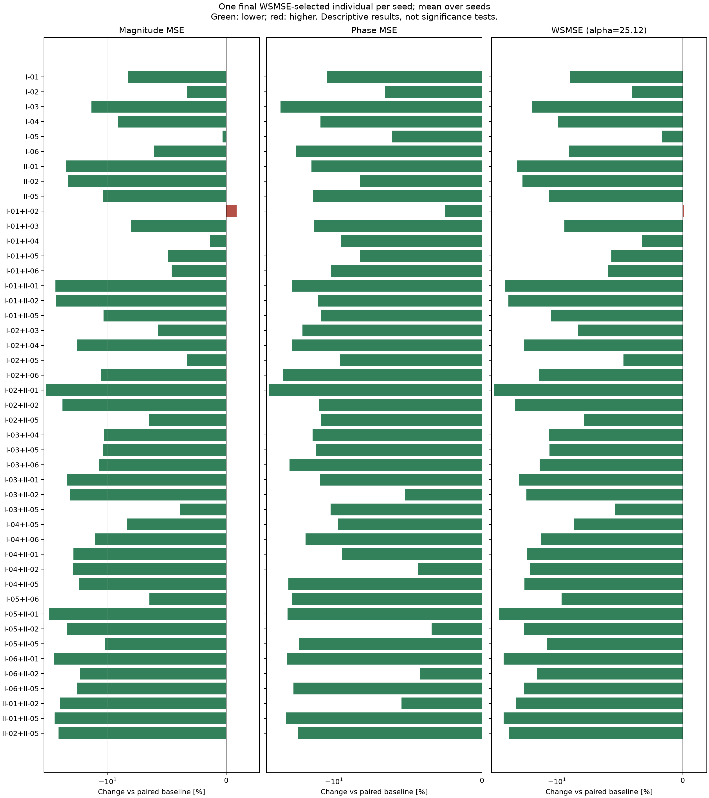

# Case I：九个候选辅助目标的完整两两组合筛选

新增 3300 次运行，复用 1300 次历史运行；每组 100 seeds，种群 200，300 代。
九个指标由旧 seed 下两项均值同时下降选出。完整检查 36 个配对，其中三个配对复用此前已完成结果；本轮仍是探索性筛选，不是新 seed 独立验证。
最终选解：每个 seed 从最后一代完整种群中取幅值 MSE + 25.12 × 相位 MSE 最小的一个个体；相同分数取最早行。
两个 MSE 来自同一个被选中的个体，再跨 seed 等权平均。不是分别取幅值/相位最优，也不是前沿均值。
WSMSE 只参与只读统计，不参与 NSGA-II 交配或幸存选择；进化仍使用两个独立主目标及该组辅助损失。
两项跨 seed 均值都低于配对基线的组合：35 / 36。
这是描述性结果，未做统计显著性检验；WSMSE 下降不保证其两个分量都下降。

|编号|辅助指标|幅值 MSE 均值|相位 MSE 均值|WSMSE 均值|幅值变化 %|相位变化 %|WSMSE变化 %|两项同降seed数|
|---|---|---:|---:|---:|---:|---:|---:|---:|
|BASE|双主目标基线|13.4495|0.153877|17.3148|0.000|0.000|0.000|0/100|
|I-01|全局转折数量：至少5个|12.3351|0.136392|15.7612|-8.286|-11.363|-8.973|42/100|
|I-02|目标转折区域覆盖：5-of-6|13.0056|0.143797|16.6177|-3.300|-6.551|-4.026|42/100|
|I-03|电抗过零方向一致性|11.5392|0.115017|14.4284|-14.203|-25.254|-16.670|54/100|
|I-04|全局电抗过零数量：至少10次|12.2203|0.134368|15.5956|-9.139|-12.678|-9.929|50/100|
|I-05|全局转折数量：至少4个|13.4058|0.144498|17.0355|-0.325|-6.095|-1.613|44/100|
|I-06|中文PDF峰谷一致性（最近匹配、均值）|12.6301|0.124199|15.7499|-6.092|-19.287|-9.038|42/100|
|II-01|局部特征频移误差|10.1392|0.131126|13.4331|-24.612|-14.785|-22.418|52/100|
|II-02|转变速度相对误差|10.2826|0.141199|13.8296|-23.546|-8.239|-20.129|47/100|
|II-05|95% Hausdorff距离|11.9728|0.131801|15.2837|-10.979|-14.346|-11.731|45/100|
|I-01+I-02|全局转折数量：至少5个＋目标转折区域覆盖：5-of-6|13.5653|0.150032|17.3341|0.861|-2.499|0.111|35/100|
|I-01+I-03|全局转折数量：至少5个＋电抗过零方向一致性|12.3665|0.132195|15.6873|-8.052|-14.091|-9.400|44/100|
|I-01+I-04|全局转折数量：至少5个＋全局电抗过零数量：至少10次|13.2622|0.13923|16.7597|-1.392|-9.518|-3.206|41/100|
|I-01+I-05|全局转折数量：至少5个＋全局转折数量：至少4个|12.7853|0.141208|16.3325|-4.938|-8.233|-5.673|45/100|
|I-01+I-06|全局转折数量：至少5个＋中文PDF峰谷一致性（最近匹配、均值）|12.8293|0.137598|16.2858|-4.611|-10.579|-5.943|40/100|
|I-01+II-01|全局转折数量：至少5个＋局部特征频移误差|9.30076|0.122217|12.3709|-30.847|-20.575|-28.553|50/100|
|I-01+II-02|全局转折数量：至少5个＋转变速度相对误差|9.321|0.133587|12.6767|-30.696|-13.186|-26.787|55/100|
|I-01+II-05|全局转折数量：至少5个＋95% Hausdorff距离|11.9809|0.134491|15.3593|-10.919|-12.598|-11.294|50/100|
|I-02+I-03|目标转折区域覆盖：5-of-6＋电抗过零方向一致性|12.6737|0.127254|15.8703|-5.768|-17.301|-8.343|43/100|
|I-02+I-04|目标转折区域覆盖：5-of-6＋全局电抗过零数量：至少10次|10.8536|0.121924|13.9164|-19.301|-20.765|-19.628|56/100|
|I-02+I-05|目标转折区域覆盖：5-of-6＋全局转折数量：至少4个|13.0041|0.139115|16.4987|-3.311|-9.593|-4.714|40/100|
|I-02+I-06|目标转折区域覆盖：5-of-6＋中文PDF峰谷一致性（最近匹配、均值）|11.8845|0.116466|14.8101|-11.636|-24.312|-14.466|46/100|
|I-02+II-01|目标转折区域覆盖：5-of-6＋局部特征频移误差|8.38195|0.10678|11.0643|-37.678|-30.607|-36.100|61/100|
|I-02+II-02|目标转折区域覆盖：5-of-6＋转变速度相对误差|9.87407|0.134074|13.242|-26.584|-12.870|-23.522|50/100|
|I-02+II-05|目标转折区域覆盖：5-of-6＋95% Hausdorff距离|12.5739|0.134608|15.9553|-6.510|-12.522|-7.852|39/100|
|I-03+I-04|电抗过零方向一致性＋全局电抗过零数量：至少10次|11.9882|0.131571|15.2933|-10.865|-14.496|-11.675|47/100|
|I-03+I-05|电抗过零方向一致性＋全局转折数量：至少4个|11.9635|0.132707|15.2971|-11.049|-13.758|-11.653|47/100|
|I-03+I-06|电抗过零方向一致性＋中文PDF峰谷一致性（最近匹配、均值）|11.8189|0.120717|14.8514|-12.123|-21.550|-14.228|50/100|
|I-03+II-01|电抗过零方向一致性＋局部特征频移误差|10.1973|0.134298|13.5709|-24.181|-12.724|-21.623|45/100|
|I-03+II-02|电抗过零方向一致性＋转变速度相对误差|10.4284|0.14587|14.0926|-22.463|-5.204|-18.610|51/100|
|I-03+II-05|电抗过零方向一致性＋95% Hausdorff距离|12.9243|0.137533|16.3791|-3.905|-10.622|-5.404|37/100|
|I-04+I-05|全局电抗过零数量：至少10次＋全局转折数量：至少4个|12.3227|0.138932|15.8127|-8.377|-9.713|-8.675|50/100|
|I-04+I-06|全局电抗过零数量：至少10次＋中文PDF峰谷一致性（最近匹配、均值）|11.6844|0.128697|14.9173|-13.124|-16.364|-13.847|49/100|
|I-04+II-01|全局电抗过零数量：至少10次＋局部特征频移误差|10.6251|0.139324|14.1249|-21.000|-9.458|-18.423|45/100|
|I-04+II-02|全局电抗过零数量：至少10次＋转变速度相对误差|10.6126|0.14719|14.31|-21.093|-4.346|-17.354|45/100|
|I-04+II-05|全局电抗过零数量：至少10次＋95% Hausdorff距离|10.952|0.120009|13.9666|-18.569|-22.010|-19.338|51/100|
|I-05+I-06|全局转折数量：至少4个＋中文PDF峰谷一致性（最近匹配、均值）|12.5762|0.122199|15.6458|-6.493|-20.587|-9.639|45/100|
|I-05+II-01|全局转折数量：至少4个＋局部特征频移误差|8.67531|0.119414|11.675|-35.497|-22.396|-32.572|57/100|
|I-05+II-02|全局转折数量：至少4个＋转变速度相对误差|10.2131|0.148628|13.9466|-24.063|-3.411|-19.453|50/100|
|I-05+II-05|全局转折数量：至少4个＋95% Hausdorff距离|12.0268|0.1256|15.1819|-10.578|-18.376|-12.319|51/100|
|I-06+II-01|中文PDF峰谷一致性（最近匹配、均值）＋局部特征频移误差|9.19675|0.11906|12.1875|-31.620|-22.627|-29.612|57/100|
|I-06+II-02|中文PDF峰谷一致性（最近匹配、均值）＋转变速度相对误差|11.0154|0.14746|14.7196|-18.098|-4.170|-14.989|49/100|
|I-06+II-05|中文PDF峰谷一致性（最近匹配、均值）＋95% Hausdorff距离|10.8286|0.122819|13.9138|-19.487|-20.184|-19.643|53/100|
|II-01+II-02|局部特征频移误差＋转变速度相对误差|9.66436|0.1455|13.3193|-28.143|-5.444|-23.076|51/100|
|II-01+II-05|局部特征频移误差＋95% Hausdorff距离|9.22396|0.118478|12.2001|-31.418|-23.005|-29.540|57/100|
|II-02+II-05|转变速度相对误差＋95% Hausdorff距离|9.55678|0.125192|12.7016|-28.943|-18.641|-26.643|49/100|

## 组合与组成它的单指标及两指标组合比较

|组合|比较对象|幅值均值变化 %|相位均值变化 %|两项均值同降|
|---|---|---:|---:|---|
|I-01+I-02|I-01|9.973|10.000|否|
|I-01+I-02|I-02|4.304|4.336|否|
|I-01+I-03|I-01|0.255|-3.078|否|
|I-01+I-03|I-03|7.170|14.935|否|
|I-01+I-04|I-01|7.516|2.081|否|
|I-01+I-04|I-04|8.526|3.619|否|
|I-01+I-05|I-01|3.650|3.531|否|
|I-01+I-05|I-05|-4.628|-2.276|是|
|I-01+I-06|I-01|4.007|0.884|否|
|I-01+I-06|I-06|1.577|10.788|否|
|I-01+II-01|I-01|-24.599|-10.393|是|
|I-01+II-01|II-01|-8.270|-6.794|是|
|I-01+II-02|I-01|-24.435|-2.057|是|
|I-01+II-02|II-02|-9.352|-5.391|是|
|I-01+II-05|I-01|-2.871|-1.394|是|
|I-01+II-05|II-05|0.067|2.041|否|
|I-02+I-03|I-02|-2.552|-11.504|是|
|I-02+I-03|I-03|9.832|10.639|否|
|I-02+I-04|I-02|-16.546|-15.211|是|
|I-02+I-04|I-04|-11.183|-9.261|是|
|I-02+I-05|I-02|-0.011|-3.256|是|
|I-02+I-05|I-05|-2.996|-3.725|是|
|I-02+I-06|I-02|-8.620|-19.007|是|
|I-02+I-06|I-06|-5.903|-6.226|是|
|I-02+II-01|I-02|-35.551|-25.742|是|
|I-02+II-01|II-01|-17.332|-18.567|是|
|I-02+II-02|I-02|-24.078|-6.762|是|
|I-02+II-02|II-02|-3.973|-5.046|是|
|I-02+II-05|I-02|-3.319|-6.390|是|
|I-02+II-05|II-05|5.021|2.130|否|
|I-03+I-04|I-03|3.891|14.392|否|
|I-03+I-04|I-04|-1.899|-2.082|是|
|I-03+I-05|I-03|3.677|15.380|否|
|I-03+I-05|I-05|-10.759|-8.160|是|
|I-03+I-06|I-03|2.424|4.956|否|
|I-03+I-06|I-06|-6.422|-2.803|是|
|I-03+II-01|I-03|-11.629|16.764|否|
|I-03+II-01|II-01|0.572|2.419|否|
|I-03+II-02|I-03|-9.627|26.824|否|
|I-03+II-02|II-02|1.417|3.308|否|
|I-03+II-05|I-03|12.004|19.576|否|
|I-03+II-05|II-05|7.947|4.349|否|
|I-04+I-05|I-04|0.838|3.396|否|
|I-04+I-05|I-05|-8.079|-3.852|是|
|I-04+I-06|I-04|-4.385|-4.220|是|
|I-04+I-06|I-06|-7.487|3.622|否|
|I-04+II-01|I-04|-13.054|3.688|否|
|I-04+II-01|II-01|4.792|6.252|否|
|I-04+II-02|I-04|-13.156|9.542|否|
|I-04+II-02|II-02|3.209|4.243|否|
|I-04+II-05|I-04|-10.379|-10.686|是|
|I-04+II-05|II-05|-8.526|-8.947|是|
|I-05+I-06|I-05|-6.188|-15.432|是|
|I-05+I-06|I-06|-0.427|-1.611|是|
|I-05+II-01|I-05|-35.287|-17.359|是|
|I-05+II-01|II-01|-14.438|-8.932|是|
|I-05+II-02|I-05|-23.816|2.859|否|
|I-05+II-02|II-02|-0.676|5.262|否|
|I-05+II-05|I-05|-10.286|-13.078|是|
|I-05+II-05|II-05|0.451|-4.705|否|
|I-06+II-01|I-06|-27.184|-4.138|是|
|I-06+II-01|II-01|-9.296|-9.202|是|
|I-06+II-02|I-06|-12.784|18.728|否|
|I-06+II-02|II-02|7.126|4.434|否|
|I-06+II-05|I-06|-14.264|-1.112|是|
|I-06+II-05|II-05|-9.557|-6.815|是|
|II-01+II-02|II-01|-4.684|10.962|否|
|II-01+II-02|II-02|-6.013|3.046|否|
|II-01+II-05|II-01|-9.027|-9.646|是|
|II-01+II-05|II-05|-22.959|-10.109|是|
|II-02+II-05|II-02|-7.059|-11.336|是|
|II-02+II-05|II-05|-20.179|-5.014|是|

完整结果：paired_summary.csv 同时保留 wsmse_selected、primary_front、full_front 三种口径；selected_individuals.csv 保留每个 seed 实际选中的参数和误差。
默认使用重新构造的 180 点对数均匀网格；中文 PDF 原 401 点坐标缺失，归一化尺度与原文不同。不能将本结果称为原 401 点实验的精确复现。
选解权重在正式实验前固定为 25.12，未按结果调整。本次没有重跑英文论文五项的组合实验。
