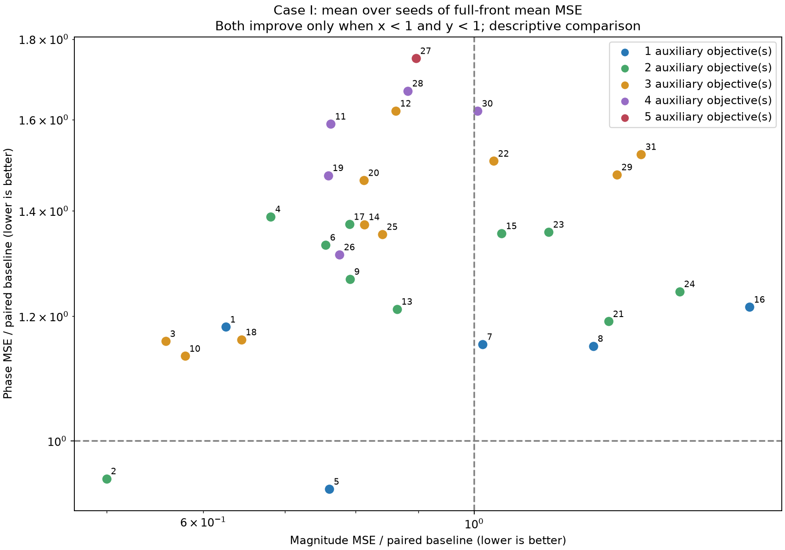

# Case I 双主目标正式实验结果

任务状态：complete；完成 3200 次，失败 0 次。
配置：每组 100 seeds，种群 200，300 代。

主口径：每个 seed 的完整目标空间最终非支配前沿上，对两项主目标分别求均值，然后跨 seed 等权平均，与同 seed 的纯双主目标基线比较。
百分比为两组均值之比减一；负值表示降低。此处是描述性统计，不代表统计显著性，也不代表每个 seed 都改善。

完整配对且两项均值都降低的辅助组：2 / 31。
其自身三项组合和三个两项子组合均满足两项均值降低的三元集合：未发现。

|图编号|辅助组|配对 seeds|幅值 MSE 均值|相位 MSE 均值|幅值变化 %|相位变化 %|同 seed 两项都下降次数|
|---|---|---|---|---|---|---|---|
|1|DTW|100|12.2026|0.158532|-37.391|18.165|41|
|2|DTW+LFP|100|9.74483|0.12699|-50.001|-5.346|51|
|3|DTW+LFP+LMEP|100|10.8947|0.155244|-44.101|15.714|40|
|4|DTW+LMEP|100|13.2841|0.186292|-31.842|38.856|33|
|5|LFP|100|14.8359|0.125074|-23.880|-6.774|44|
|6|LFP+LMEP|100|14.7297|0.178725|-24.425|33.216|34|
|7|LMEP|100|19.8017|0.15456|1.598|15.204|31|
|8|PTC|100|24.4005|0.154149|25.194|14.898|35|
|9|PTC+DTW|100|15.4187|0.170017|-20.890|26.726|36|
|10|PTC+DTW+LFP|100|11.3002|0.151904|-42.021|13.225|46|
|11|PTC+DTW+LFP+LMEP|100|14.8709|0.213321|-23.701|59.003|27|
|12|PTC+DTW+LMEP|100|16.8124|0.217416|-13.739|62.055|27|
|13|PTC+LFP|100|16.8534|0.162726|-13.529|21.291|37|
|14|PTC+LFP+LMEP|100|15.8434|0.184152|-18.710|37.261|27|
|15|PTC+LMEP|100|20.5255|0.181748|5.312|35.469|28|
|16|SS|100|32.762|0.163212|68.095|21.653|32|
|17|SS+DTW|100|15.4061|0.18422|-20.955|37.312|36|
|18|SS+DTW+LFP|100|12.5652|0.155609|-35.531|15.986|43|
|19|SS+DTW+LFP+LMEP|100|14.801|0.197851|-24.059|47.472|26|
|20|SS+DTW+LMEP|100|15.83|0.196439|-18.780|46.420|26|
|21|SS+LFP|100|25.1128|0.159809|28.849|19.117|30|
|22|SS+LFP+LMEP|100|20.2201|0.20205|3.745|50.602|24|
|23|SS+LMEP|100|22.4341|0.182131|15.105|35.755|23|
|24|SS+PTC|100|28.7158|0.166965|47.335|24.450|30|
|25|SS+PTC+DTW|100|16.394|0.181534|-15.886|35.310|32|
|26|SS+PTC+DTW+LFP|100|15.122|0.17621|-22.412|31.341|34|
|27|SS+PTC+DTW+LFP+LMEP|100|17.4615|0.234797|-10.409|75.010|25|
|28|SS+PTC+DTW+LMEP|100|17.201|0.223888|-11.745|66.879|26|
|29|SS+PTC+LFP|100|25.5187|0.198072|30.932|47.636|25|
|30|SS+PTC+LFP+LMEP|100|19.6145|0.217404|0.638|62.046|25|
|31|SS+PTC+LMEP|100|26.6998|0.204069|36.992|52.107|18|
|—|baseline|100|19.4901|0.134162|0.000|0.000|0|

仅按双主目标重筛的前沿结果另见 paired_summary.csv 中 primary_front 行，不与上述 full_front 混用。
频率默认是重新构造的 180 点对数均匀网格；原文频率坐标缺失。原始辅助项使用误差形式，不使用倒数形式；具体实现约定见代码 README。
各 seed 的完整种群、参数、目标、逐代历史均保留在对应分组目录。manifest.json 保存实际配置与代码/环境指纹。
