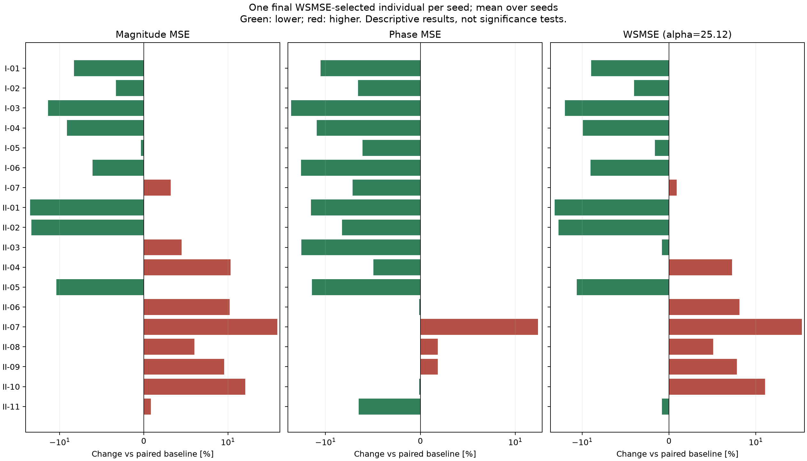

# Case I：18 项单辅助目标的 WSMSE 选解结果

完成 1900 次运行；每组 100 seeds，种群 200，300 代。
最终选解：每个 seed 从最后一代完整种群中取幅值 MSE + 25.12 × 相位 MSE 最小的一个个体；相同分数取最早行。
两个 MSE 来自同一个被选中的个体，再跨 seed 等权平均。不是分别取幅值/相位最优，也不是前沿均值。
WSMSE 只参与只读统计，不参与 NSGA-II 交配或幸存选择；进化仍使用两个独立主目标及该组辅助损失。
两项跨 seed 均值都低于配对基线的单辅助组：9 / 18。
这是描述性结果，未做统计显著性检验；WSMSE 下降不保证其两个分量都下降。

|编号|辅助指标|幅值 MSE 均值|相位 MSE 均值|WSMSE 均值|幅值变化 %|相位变化 %|WSMSE变化 %|两项同降seed数|
|---|---|---:|---:|---:|---:|---:|---:|---:|
|BASE|双主目标基线|13.4495|0.153877|17.3148|0.000|0.000|0.000|0/100|
|I-01|全局转折数量：至少5个|12.3351|0.136392|15.7612|-8.286|-11.363|-8.973|42/100|
|I-02|目标转折区域覆盖：5-of-6|13.0056|0.143797|16.6177|-3.300|-6.551|-4.026|42/100|
|I-03|电抗过零方向一致性|11.5392|0.115017|14.4284|-14.203|-25.254|-16.670|54/100|
|I-04|全局电抗过零数量：至少10次|12.2203|0.134368|15.5956|-9.139|-12.678|-9.929|50/100|
|I-05|全局转折数量：至少4个|13.4058|0.144498|17.0355|-0.325|-6.095|-1.613|44/100|
|I-06|中文PDF峰谷一致性（最近匹配、均值）|12.6301|0.124199|15.7499|-6.092|-19.287|-9.038|42/100|
|I-07|全局电抗过零数量：至少8次|13.8822|0.142884|17.4715|3.218|-7.144|0.905|40/100|
|II-01|局部特征频移误差|10.1392|0.131126|13.4331|-24.612|-14.785|-22.418|52/100|
|II-02|转变速度相对误差|10.2826|0.141199|13.8296|-23.546|-8.239|-20.129|47/100|
|II-03|窗口约束DTW|14.0523|0.124332|17.1755|4.482|-19.200|-0.805|38/100|
|II-04|Soft-DTW散度|14.903|0.146241|18.5765|10.807|-4.962|7.287|35/100|
|II-05|95% Hausdorff距离|11.9728|0.131801|15.2837|-10.979|-14.346|-11.731|45/100|
|II-06|Sobolev H1误差|14.8624|0.15368|18.7228|10.505|-0.128|8.132|33/100|
|II-07|去平移空间形状误差|19.5083|0.182352|24.089|45.049|18.505|39.123|27/100|
|II-08|转折事件弱位置误差|14.2589|0.156727|18.1959|6.018|1.852|5.088|37/100|
|II-09|转折存在性与过量事件惩罚|14.7334|0.156699|18.6697|9.546|1.834|7.825|38/100|
|II-10|去局部频移后的相对形变|15.7292|0.15371|19.5904|16.950|-0.109|13.142|32/100|
|II-11|目标转折区域覆盖：4-of-6|13.5635|0.143881|17.1778|0.848|-6.496|-0.792|48/100|

完整结果：paired_summary.csv 同时保留 wsmse_selected、primary_front、full_front 三种口径；selected_individuals.csv 保留每个 seed 实际选中的参数和误差。
默认使用重新构造的 180 点对数均匀网格；中文 PDF 原 401 点坐标缺失，归一化尺度与原文不同。不能将本结果称为原 401 点实验的精确复现。
选解权重在正式实验前固定为 25.12，未按结果调整。本次没有重跑英文论文五项的组合实验。
