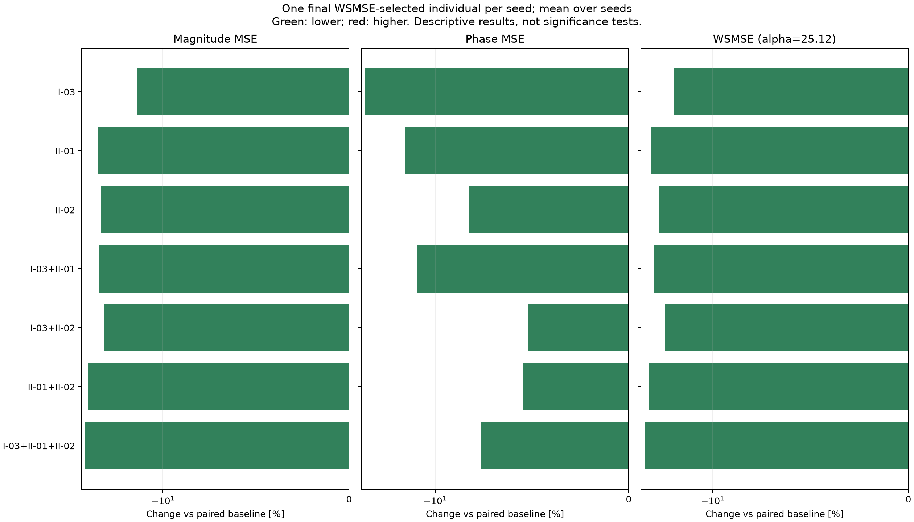

# Case I：三个候选辅助目标的两两与三指标组合结果

新增 400 次运行，复用 baseline 和三个单指标的 400 次运行；每组 100 seeds，种群 200，300 代。
最终选解：每个 seed 从最后一代完整种群中取幅值 MSE + 25.12 × 相位 MSE 最小的一个个体；相同分数取最早行。
两个 MSE 来自同一个被选中的个体，再跨 seed 等权平均。不是分别取幅值/相位最优，也不是前沿均值。
WSMSE 只参与只读统计，不参与 NSGA-II 交配或幸存选择；进化仍使用两个独立主目标及该组辅助损失。
两项跨 seed 均值都低于配对基线的组合：4 / 4。
这是描述性结果，未做统计显著性检验；WSMSE 下降不保证其两个分量都下降。

|编号|辅助指标|幅值 MSE 均值|相位 MSE 均值|WSMSE 均值|幅值变化 %|相位变化 %|WSMSE变化 %|两项同降seed数|
|---|---|---:|---:|---:|---:|---:|---:|---:|
|BASE|双主目标基线|13.4495|0.153877|17.3148|0.000|0.000|0.000|0/100|
|I-03|电抗过零方向一致性|11.5392|0.115017|14.4284|-14.203|-25.254|-16.670|54/100|
|II-01|局部特征频移误差|10.1392|0.131126|13.4331|-24.612|-14.785|-22.418|52/100|
|II-02|转变速度相对误差|10.2826|0.141199|13.8296|-23.546|-8.239|-20.129|47/100|
|I-03+II-01|电抗过零方向一致性＋局部特征频移误差|10.1973|0.134298|13.5709|-24.181|-12.724|-21.623|45/100|
|I-03+II-02|电抗过零方向一致性＋转变速度相对误差|10.4284|0.14587|14.0926|-22.463|-5.204|-18.610|51/100|
|II-01+II-02|局部特征频移误差＋转变速度相对误差|9.66436|0.1455|13.3193|-28.143|-5.444|-23.076|51/100|
|I-03+II-01+II-02|电抗过零方向一致性＋局部特征频移误差＋转变速度相对误差|9.52766|0.142156|13.0986|-29.160|-7.617|-24.350|46/100|

## 组合与组成它的单指标及两指标组合比较

|组合|比较对象|幅值均值变化 %|相位均值变化 %|两项均值同降|
|---|---|---:|---:|---|
|I-03+II-01|I-03|-11.629|16.764|否|
|I-03+II-01|II-01|0.572|2.419|否|
|I-03+II-02|I-03|-9.627|26.824|否|
|I-03+II-02|II-02|1.417|3.308|否|
|II-01+II-02|II-01|-4.684|10.962|否|
|II-01+II-02|II-02|-6.013|3.046|否|
|I-03+II-01+II-02|I-03|-17.432|23.595|否|
|I-03+II-01+II-02|II-01|-6.032|8.412|否|
|I-03+II-01+II-02|II-02|-7.342|0.678|否|
|I-03+II-01+II-02|I-03+II-01|-6.567|5.851|否|
|I-03+II-01+II-02|I-03+II-02|-8.637|-2.546|是|
|I-03+II-01+II-02|II-01+II-02|-1.415|-2.298|是|

完整结果：paired_summary.csv 同时保留 wsmse_selected、primary_front、full_front 三种口径；selected_individuals.csv 保留每个 seed 实际选中的参数和误差。
默认使用重新构造的 180 点对数均匀网格；中文 PDF 原 401 点坐标缺失，归一化尺度与原文不同。不能将本结果称为原 401 点实验的精确复现。
选解权重在正式实验前固定为 25.12，未按结果调整。本次没有重跑英文论文五项的组合实验。
