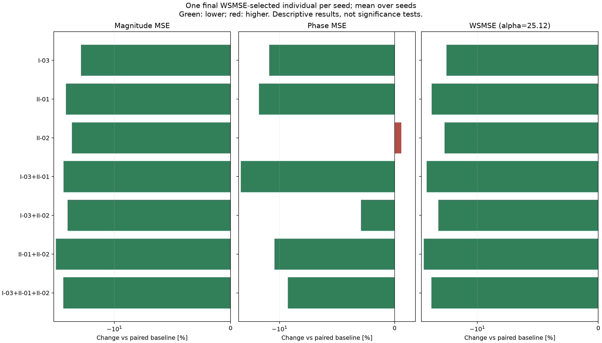

# Case I：固定三指标集合的新 seed 验证

完成 800 次运行；每组 100 seeds，种群 200，300 代。
最终选解：每个 seed 从最后一代完整种群中取幅值 MSE + 25.12 × 相位 MSE 最小的一个个体；相同分数取最早行。
两个 MSE 来自同一个被选中的个体，再跨 seed 等权平均。不是分别取幅值/相位最优，也不是前沿均值。
WSMSE 只参与只读统计，不参与 NSGA-II 交配或幸存选择；进化仍使用两个独立主目标及该组辅助损失。
两项跨 seed 均值都低于配对基线的非基线组：6 / 7。
本表是均值比较；配对置信区间、整体比较调整和敏感性诊断见 STABILITY.md。WSMSE 下降不保证其两个分量都下降。

|编号|辅助指标|幅值 MSE 均值|相位 MSE 均值|WSMSE 均值|幅值变化 %|相位变化 %|WSMSE变化 %|两项同降seed数|
|---|---|---:|---:|---:|---:|---:|---:|---:|
|BASE|双主目标基线|14.2839|0.150204|18.057|0.000|0.000|0.000|0/100|
|I-03|电抗过零方向一致性|11.3021|0.131341|14.6014|-20.875|-12.559|-19.137|51/100|
|II-01|局部特征频移误差|10.1468|0.126455|13.3233|-28.963|-15.811|-26.215|50/100|
|II-02|转变速度相对误差|10.6528|0.151099|14.4484|-25.421|0.596|-19.984|45/100|
|I-03+II-01|电抗过零方向一致性＋局部特征频移误差|9.90752|0.114712|12.7891|-30.639|-23.629|-29.174|62/100|
|I-03+II-02|电抗过零方向一致性＋转变速度相对误差|10.2951|0.145813|13.9579|-27.925|-2.924|-22.701|51/100|
|II-01+II-02|局部特征频移误差＋转变速度相对误差|9.11847|0.133393|12.4693|-36.163|-11.192|-30.945|56/100|
|I-03+II-01+II-02|电抗过零方向一致性＋局部特征频移误差＋转变速度相对误差|9.88155|0.136265|13.3045|-30.820|-9.280|-26.319|48/100|

完整结果：paired_summary.csv 同时保留 wsmse_selected、primary_front、full_front 三种口径；selected_individuals.csv 保留每个 seed 实际选中的参数和误差。
默认使用重新构造的 180 点对数均匀网格；中文 PDF 原 401 点坐标缺失，归一化尺度与原文不同。不能将本结果称为原 401 点实验的精确复现。
选解权重在正式实验前固定为 25.12，未按结果调整。本次没有重跑英文论文五项的组合实验。
