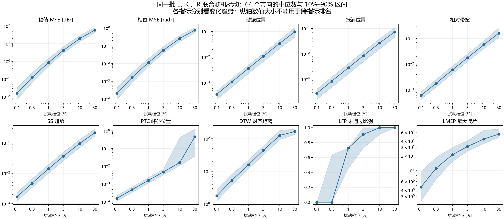
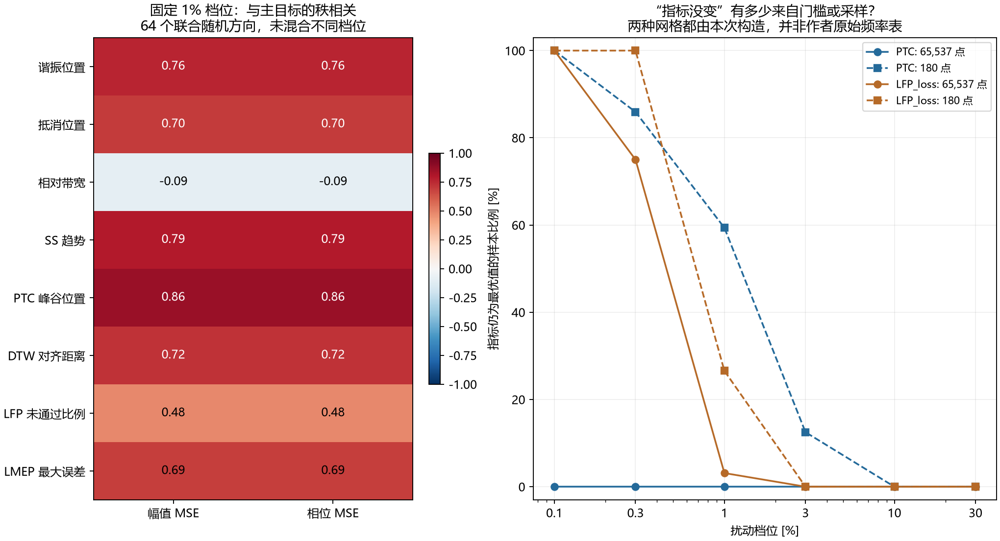

# Case I：论文五个辅助目标与三个物理指标的扰动对比

这次比较支持一个收敛的判断：**目前最值得保留作基准的是论文 PTC；新提出的谐振位置和抵消位置指标，尚未显示出超越它的理由。相对带宽提供了不同的响应方向，但是否值得与 PTC 组合，仍待优化实验。**

这里的“基准”不是最优辅助目标排名。相关性强弱只描述局部样本的共同变化，不能证明“捷径个体”保留能力，更不能证明组合后会改善两个 MSE。

## 1. 比较了什么

复用之前全部 **1,801 组参数**：1 组目标、216 组单参数扰动、48 组结构化扰动、1,536 组随机扰动。扰动档位为 0.1%、0.3%、1%、3%、10%、30%；每类随机扰动有 64 个固定方向。原始参数、两个 MSE 和三个物理指标逐字段核对，全部一致。

参数规则仍为 θ=θ*exp[ln(1+p/100)d]，max|d|=1；负方向是除以 1+p/100，不是加法意义的 −p%。随机 R、L、C、联合扰动分别取样，同一类的方向跨档位保持一致。

两个主目标保持幅值 dB MSE、相位 rad MSE。本次不运行 NSGA-II、不调整目标权重、不测试组合优化。

## 2. 论文公式如何落地

依据英文论文第 3—5 页 Table I、式 (3)—(8)、Algorithm 1 和第 6 页 Table V。频率按原文用 x=log10(f/Hz)。

|目标|通俗解释|本次报告的最小化量|
|---|---|---|
|SS|各频段的上升、下降、转折是否相似|趋势编码绝对差之和 / N|
|PTC|幅值峰、谷有没有到正确频率附近|同一区间内所有同类峰谷的位置惩罚之和|
|DTW|允许在频率方向对齐后，两条谱还有多大幅值差|最短路径上的绝对 dB 差之和|
|LFP|从低频起，连续有多少段已达到精度门槛|1 − 连续通过段数 / 11；同时保存原始段数|
|LMEP|最差那个频率点偏离多少|最大绝对 dB 差|

原文除 LFP 外用误差倒数作为最大化适应度，这里展示倒数前的误差，避免目标处出现无穷大。该转换保持单项优劣排序，**不意味着把它放入算法后拥挤距离等数值行为也完全等价**。

具体约定：

- 五个辅助目标中的 Z 按幅值 dB 实现；原文未逐项完整标注通道与单位，这是本次实现约定，并非已核对作者源码。
- SS：THk=8、β=0.4、μ=0.5。Fx=s{1+β[1−2/(1+exp(μsΔk))]}；Fy=s{1+3β/[2(1+exp(−μs(Δk−2sTHk)))]}，符号选择按 Table I。N 点只能形成 N−2 个双斜率编码，末两项不补造，分母仍按式 (6) 取 N；等于门槛时归平缓区。
- PTC：γ=0.41；对每个目标峰/谷的邻域，累加 exp(γ|Δx|/4)−1；无同类匹配罚 0.41。邻域按目标相邻峰谷的 log 频率中点划分。不采用中文实验稿的“只取最近同类，再对目标数平均”的变体。
- 峰谷以相邻采样值判定，平顶取右端，不额外加原文未规定的显著性门槛，不做位置插值。因此极小峰移可能量化为零。
- LFP：每段幅值 MSE <1.6 才通过，从低频第一段累计，遇失败停止。所有目标共有 11 段；原文未说明恰好等于门槛的处理，本次算失败。
- DTW：按原文 ND=60，无窗口限制、无额外频率距离、无路径长度归一化，局部代价是绝对幅值差。

**采样边界：**主对比的 SS/PTC/LFP/LMEP 与两个 MSE 使用相同的 65,537 点对数均匀频率网格（100 Hz—1 MHz）。DTW 在同频段直接重算 60 个对数均匀点。另算 180 点的前四项与 180 点 DTW，检查采样影响。论文 NM=180，但未提供频率坐标；这些均为本次构造的网格，**本报告不是原始实验的精确复现**。SS 包含相邻斜率之差，本身随采样分辨率改变，不应把加密简单称为“收敛到同一个指标”。

原有三个物理指标用加密网格括根后数值细化，PTC 用离散峰谷，提取精度并不等价。因此不能把物理指标在更小偏差上的响应，直接解释为其物理内容更优。

## 3. 扰动增大时，五个指标如何变化

下表只看 L、C、R 联合随机扰动，各档位 64 个方向的中位数。不同指标单位、归一化方式不同，不能用数值大小横向排名。

|扰动|幅值 MSE (dB²)|相位 MSE (rad²)|SS|PTC|DTW (dB 累计)|LFP 未通过比例|LMEP (dB)|
|---|---|---|---|---|---|---|---|
|0.1%|0.015993|0.00021197|0.0016749|0.0001564|1.7813|0|4.6085|
|0.3%|0.12251|0.0016234|0.004693|0.00047548|5.3469|0|11.15|
|1%|0.85588|0.01133|0.014057|0.0016017|15.679|0.72727|21.005|
|3%|4.2125|0.055758|0.036307|0.0047469|44.139|0.90909|30.847|
|10%|19.533|0.25927|0.09695|0.016298|126.3|1|43.83|
|30%|58.75|0.76648|0.21673|0.45162|165.75|1|55.246|

多数指标中位数随扰动增大而增大，但这并不代表每条轨迹都单调。64 个联合随机方向中：

|指标|出现非单调变化的方向数 / 64|
|---|---|
|谐振位置|0|
|抵消位置|0|
|相对带宽|0|
|SS 趋势|0|
|PTC 峰谷位置|0|
|DTW 对齐距离|13|
|LFP 未通过比例|0|
|LMEP 最大误差|15|

“非单调”指同一方向参数偏差变大时，某一档辅助误差反而下降（容差 1e−10）。DTW 的对齐路径、LMEP 的最差点会变化，60 点采样也可能影响 DTW；本实验没有分离这些原因。它们是值得记录的现象，不能据此判定指标不适合进化搜索。论文恰恰允许辅助目标与当前 MSE 的排序不完全一致。

针对 LMEP 的全部 15 次下降，把频率网格进一步加密到 262,145 点后，15 次仍然下降。因此在这些样本上，该现象没有随本次网格加密消失；复核数据见 LMEP_nonmonotonic_recheck.csv。

## 4. 固定 1% 扰动，谁在区分不同方向

|辅助目标|与幅值 MSE 的 Spearman 相关|与相位 MSE 的 Spearman 相关|
|---|---|---|
|谐振位置|0.761|0.761|
|抵消位置|0.703|0.703|
|相对带宽|-0.094|-0.094|
|SS 趋势|0.793|0.793|
|PTC 峰谷位置|0.860|0.860|
|DTW 对齐距离|0.721|0.721|
|LFP 未通过比例|0.477|0.477|
|LMEP 最大误差|0.694|0.694|

两个相关系数恰好一致，是因为**这 64 个样本中两个主目标的排序相同**，不是双主目标在一般情况下等价，也不能当作两份独立的支持证据。

PTC 与谐振位置、抵消位置指标的相关系数分别为
0.888、
0.792。
这说明在当前电路和局部扰动范围，它们有明显重叠。尚不能以“物理解释更直接”为由，把新位置指标当成 PTC 的实证升级。

带宽与两个主目标的相关均约 −0.094，表现不同，但“不同”不自动等于“互补有效”。它可能捕捉了 MSE 较不敏感的参数变化，也可能在组合时保留与当前主目标改善关系较弱的个体。

## 5. 小偏差下，要区分物理盲区与采样盲区

每行仍为 64 个联合随机样本：

|扰动|PTC=0（65,537 点）|PTC=0（180 点）|LFP 满分（65,537 点）|
|---|---|---|---|
|0.1%|0|64|64|
|0.3%|0|55|48|
|1%|0|38|2|

180 点网格下，0.1% 扰动的 PTC 全为零，1% 时仍有 38/64 为零；加密后同批联合扰动均可被 PTC 区分为非零。**这个例子反映的是离散峰位置的分辨率，不能直接归罪于 PTC 的物理依据。**

LFP 在 0.1% 档全部满分，0.3% 档有 48/64 满分。它本来就是达标计数，足够接近后会失去进一步分辨率；这与谱有没有细小物理差异是两件事。

60 点与 180 点 DTW 在 1% 联合扰动下的排名相关为
0.798。
DTW 的累计量还随点数改变，不能直接比较两个分辨率的绝对值来判断谁更灵敏。

## 6. 通过有物理含义的成组扰动看区别

下表采用正方向 10% 档。整体频移是 L、C 同乘 1.1；整体阻抗缩放是 R、L 同乘 1.1、C 除 1.1。

|扰动|幅值 MSE|相位 MSE|谐振位置|抵消位置|带宽|SS|PTC|DTW|LFP 损失|LMEP|
|---|---|---|---|---|---|---|---|---|---|---|
|整体频率移动|66.164|0.87684|0.09531|0.09531|2.2194e-10|0.2512|0.85827|243.4|1|55.182|
|整体阻抗乘 1.1|0.68534|4.8514e-30|0|0|0|1.287e-11|0|48.643|0|0.82785|
|L 乘 1.1、C 除 1.1|0.68478|6.9966e-05|9.9391e-06|1.2975e-05|0.0954|0.00099575|0|49.165|0|1.6554|
|仅 R 乘 1.1|0.0048316|6.366e-05|8.2121e-06|1.0721e-05|0.095384|0.00096097|0|0.62005|0|0.82785|

最有解释力的是两种情形：

1. **只把全部 R 乘 1.1：**PTC 和 LFP 仍为零，但带宽误差约 0.0954；SS、DTW、LMEP 也能感受到变化。带宽确实能表达峰谷位置不明显移动时的阻尼变化，但这种响应并非只有它能提供。
2. **整个阻抗乘 1.1：**三个物理指标、PTC、SS（数值误差范围内）都不变；DTW、LMEP 会变化，幅值 MSE 也会变化。这个尺度方向是前述位置/带宽指标的共同盲区，不过主目标本身仍能负责它，不能据此要求每个辅助目标覆盖所有误差。

仅 R 随机扰动的 64 个方向，从 0.1% 到 30% 的全部档位，LFP 都保持满分。这进一步说明它不适合承担这个案例中阻尼细调的连续评价任务。

## 7. 对下一步筛选的含义

当前应聚焦 **“PTC 看位置，另一项是否能补充位置近似正确时的剩余偏差”**，而不是同时引入几个高度重叠的位置指标。

可以保留 PTC 作为现有位置特征基准，带宽作为待检验补充；SS、LMEP 作为论文中现有的对照。这里没有足够证据声称 PTC+带宽有效，更没有证据承诺某组三个目标的任意两结合、三结合都有效。最终仍须在不改算法的条件下，相对双主目标基线验证两个 MSE。

本次只回答“参数偏离时，指标怎样响应”，不证明候选解能经少量调参迅速改善，也未覆盖噪声、Case II 或真实电路。

## 8. 复现与核验

- 计算脚本：../compare_paper.py；本报告生成脚本：../build_comparison_report.py。
- 完整结果：all_runs.csv、all_runs.jsonl；样本编号 sample_id 对应原始 JSONL 行序。
- 分组统计：summary.csv；固定档位相关：correlations.csv；轨迹单调性：monotonicity.csv。
- 采样检查：sampling_sensitivity.csv、resolution_check.csv；参数与约定：config.json。
- checks.json 记录目标零误差、11 段满分、SS 平移不变性/符号/转折检查、DTW 对齐测试、原始字段一致性。
- 24 个选定样本把网格加密至 131,073 点，LMEP 最大绝对变化为 0.23676 dB。该检查只限定这些样本的数值误差，不证明全部指标无采样影响。
- 原始样本 SHA256：99c3ad93da1a4c43e3235524aeb642ab79a25a1fe4238a302a454d727a4e9966。

来源：Feature-Engineering_Enabled_Multi-Objective_Evolutionary_Impedance_Fitting_Technique.pdf，
第 2 页 log10 频率约定，第 3—5 页辅助目标定义，第 6 页 Case I 参数与超参数。
