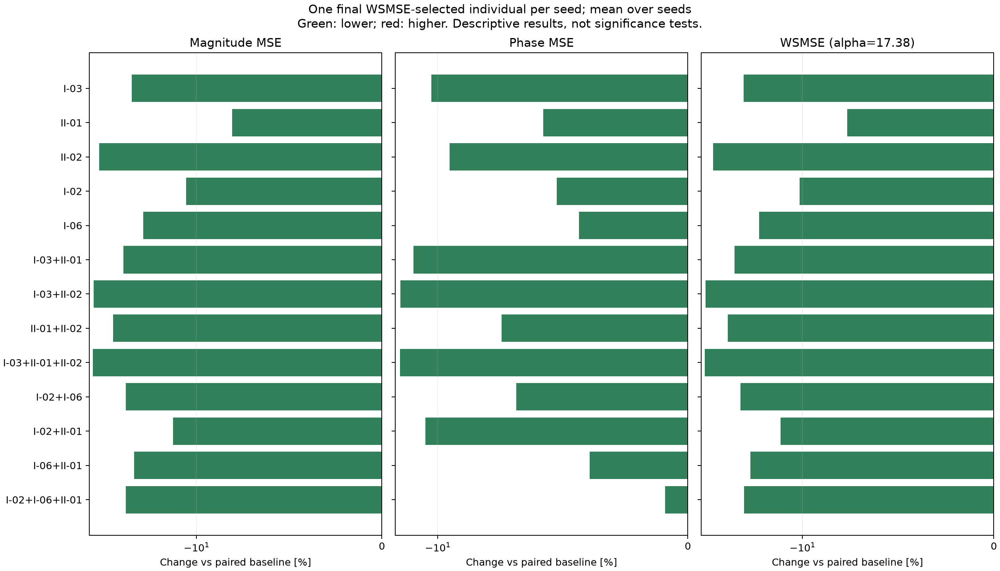

# Case II：Case1两套三指标集合的组合迁移检验

新增 800 次，复用 600 次；每组 100 seeds，种群 150，300 代。
最终选解：每个 seed 从最后一代完整种群中取幅值 MSE + 17.38 × 相位 MSE 最小的一个个体；相同分数取最早行。
两个 MSE 来自同一个被选中的个体，再跨 seed 等权平均。不是分别取幅值/相位最优，也不是前沿均值。
WSMSE 只参与只读统计，不参与 NSGA-II 交配或幸存选择；进化仍使用两个独立主目标及该组辅助损失。
两项跨 seed 均值都低于配对基线的组合：8 / 8。
均值表是描述性结果；配对置信区间和敏感性检查见 STABILITY.md。WSMSE 下降不保证两个分量都下降。

|编号|辅助指标|幅值 MSE 均值|相位 MSE 均值|WSMSE 均值|幅值变化 %|相位变化 %|WSMSE变化 %|两项同降seed数|
|---|---|---:|---:|---:|---:|---:|---:|---:|
|BASE|双主目标基线|7.07721|0.0911206|8.66088|0.000|0.000|0.000|0/100|
|I-03|电抗过零方向一致性|5.34564|0.0813914|6.76022|-24.467|-10.677|-21.945|55/100|
|II-01|局部特征频移误差|6.50565|0.0858554|7.99782|-8.076|-5.778|-7.656|47/100|
|II-02|转变速度相对误差|4.37606|0.0824476|5.809|-38.167|-9.518|-32.928|57/100|
|I-02|目标转折区域覆盖：5-of-6|6.25894|0.0863379|7.75949|-11.562|-5.249|-10.408|49/100|
|I-06|中文PDF峰谷一致性（最近匹配、均值）|5.59869|0.0871555|7.11346|-20.891|-4.351|-17.867|53/100|
|I-03+II-01|电抗过零方向一致性＋局部特征频移误差|5.13449|0.0794679|6.51564|-27.450|-12.788|-24.769|53/100|
|I-03+II-02|电抗过零方向一致性＋转变速度相对误差|4.14951|0.0777729|5.5012|-41.368|-14.648|-36.482|58/100|
|II-01+II-02|局部特征频移误差＋转变速度相对误差|4.84117|0.0843292|6.30681|-31.595|-7.453|-27.180|56/100|
|I-03+II-01+II-02|电抗过零方向一致性＋局部特征频移误差＋转变速度相对误差|4.11953|0.0777194|5.4703|-41.792|-14.707|-36.839|59/100|
|I-02+I-06|目标转折区域覆盖：5-of-6＋中文PDF峰谷一致性（最近匹配、均值）|5.19996|0.084874|6.67507|-26.525|-6.855|-22.929|53/100|
|I-02+II-01|目标转折区域覆盖：5-of-6＋局部特征频移误差|6.09721|0.080788|7.5013|-13.847|-11.339|-13.389|50/100|
|I-06+II-01|中文PDF峰谷一致性（最近匹配、均值）＋局部特征频移误差|5.40542|0.0875391|6.92685|-23.622|-3.931|-20.021|47/100|
|I-02+I-06+II-01|目标转折区域覆盖：5-of-6＋中文PDF峰谷一致性（最近匹配、均值）＋局部特征频移误差|5.20555|0.0902882|6.77476|-26.446|-0.914|-21.777|46/100|

完整结果：paired_summary.csv 同时保留 wsmse_selected、primary_front、full_front 三种口径；selected_individuals.csv 保留每个 seed 实际选中的参数和误差。
使用用户提供CSV的全部201点（40 Hz–110 MHz），不平滑、不插值。论文使用96点且图示频段较窄，因此这是论文预算和电路上的双主目标扩展，不是论文原实验的精确复现。
选解权重按论文Case2固定为17.38。18项采用中文PDF原公式，包括数量阈值按目标事件数封顶的规则；名称中的5-of-6不是对Case2事件数量的预设。

当前原公式仅检出2个目标转折（均在低频端）。本轮仅新增8个组合，复用baseline和5个单指标共6组；未调整辅助指标定义。

本地校订：更正了末段沿用单指标模板的组数说明，所有实验数值保持服务器原报告不变。迁移结论与备份状态见 RESULT_NOTES.md。
