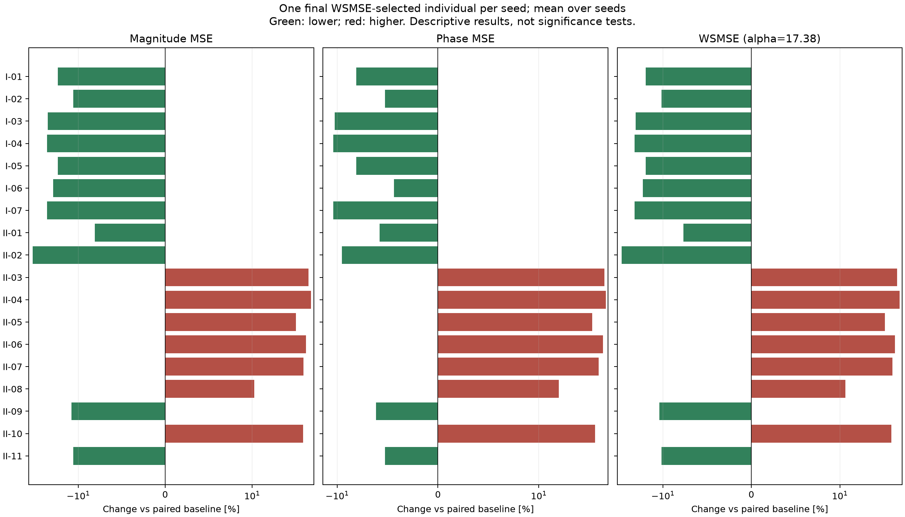

# Case II：18 项单辅助目标的 WSMSE 选解结果

完成 1900 次运行；每组 100 seeds，种群 150，300 代。
最终选解：每个 seed 从最后一代完整种群中取幅值 MSE + 17.38 × 相位 MSE 最小的一个个体；相同分数取最早行。
两个 MSE 来自同一个被选中的个体，再跨 seed 等权平均。不是分别取幅值/相位最优，也不是前沿均值。
WSMSE 只参与只读统计，不参与 NSGA-II 交配或幸存选择；进化仍使用两个独立主目标及该组辅助损失。
两项跨 seed 均值都低于配对基线的单辅助组：11 / 18。
均值表是描述性结果；配对置信区间和敏感性检查见 STABILITY.md。WSMSE 下降不保证两个分量都下降。

|编号|辅助指标|幅值 MSE 均值|相位 MSE 均值|WSMSE 均值|幅值变化 %|相位变化 %|WSMSE变化 %|两项同降seed数|
|---|---|---:|---:|---:|---:|---:|---:|---:|
|BASE|双主目标基线|7.07721|0.0911206|8.66088|0.000|0.000|0.000|0/100|
|I-01|全局转折数量：至少5个|5.78115|0.0837326|7.23642|-18.313|-8.108|-16.447|54/100|
|I-02|目标转折区域覆盖：5-of-6|6.25894|0.0863379|7.75949|-11.562|-5.249|-10.408|49/100|
|I-03|电抗过零方向一致性|5.34564|0.0813914|6.76022|-24.467|-10.677|-21.945|55/100|
|I-04|全局电抗过零数量：至少10次|5.29962|0.0810748|6.7087|-25.117|-11.025|-22.540|56/100|
|I-05|全局转折数量：至少4个|5.78115|0.0837326|7.23642|-18.313|-8.108|-16.447|54/100|
|I-06|中文PDF峰谷一致性（最近匹配、均值）|5.59869|0.0871555|7.11346|-20.891|-4.351|-17.867|53/100|
|I-07|全局电抗过零数量：至少8次|5.29962|0.0810748|6.7087|-25.117|-11.025|-22.540|56/100|
|II-01|局部特征频移误差|6.50565|0.0858554|7.99782|-8.076|-5.778|-7.656|47/100|
|II-02|转变速度相对误差|4.37606|0.0824476|5.809|-38.167|-9.518|-32.928|57/100|
|II-03|窗口约束DTW|10.7833|0.139487|13.2076|52.367|53.079|52.497|8/100|
|II-04|Soft-DTW散度|11.0963|0.141042|13.5476|56.789|54.786|56.423|8/100|
|II-05|95% Hausdorff距离|9.65549|0.126455|11.8533|36.431|38.777|36.860|11/100|
|II-06|Sobolev H1误差|10.5417|0.137728|12.9355|48.953|51.149|49.355|6/100|
|II-07|去平移空间形状误差|10.3051|0.132661|12.6108|45.610|45.588|45.606|9/100|
|II-08|转折事件弱位置误差|7.82827|0.106286|9.67553|10.612|16.644|11.715|36/100|
|II-09|转折存在性与过量事件惩罚|6.21764|0.0855229|7.70403|-12.146|-6.143|-11.048|53/100|
|II-10|去局部频移后的相对形变|10.2621|0.129174|12.5072|45.003|41.761|44.410|9/100|
|II-11|目标转折区域覆盖：4-of-6|6.25894|0.0863379|7.75949|-11.562|-5.249|-10.408|49/100|

完整结果：paired_summary.csv 同时保留 wsmse_selected、primary_front、full_front 三种口径；selected_individuals.csv 保留每个 seed 实际选中的参数和误差。
使用用户提供CSV的全部201点（40 Hz–110 MHz），不平滑、不插值。论文使用96点且图示频段较窄，因此这是论文预算和电路上的双主目标扩展，不是论文原实验的精确复现。
选解权重按论文Case2固定为17.38。18项采用中文PDF原公式，包括数量阈值按目标事件数封顶的规则；名称中的5-of-6不是对Case2事件数量的预设。

当前原公式仅检出2个目标转折（均在低频端）。数量阈值封顶后，I-01与I-05等价，I-02与II-11等价；这四组不能算作四个相互独立的指标证据。本轮保留全部18个标签，不据此调整特征定义。
