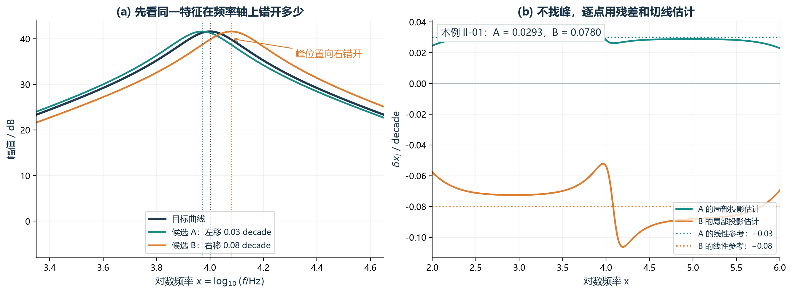
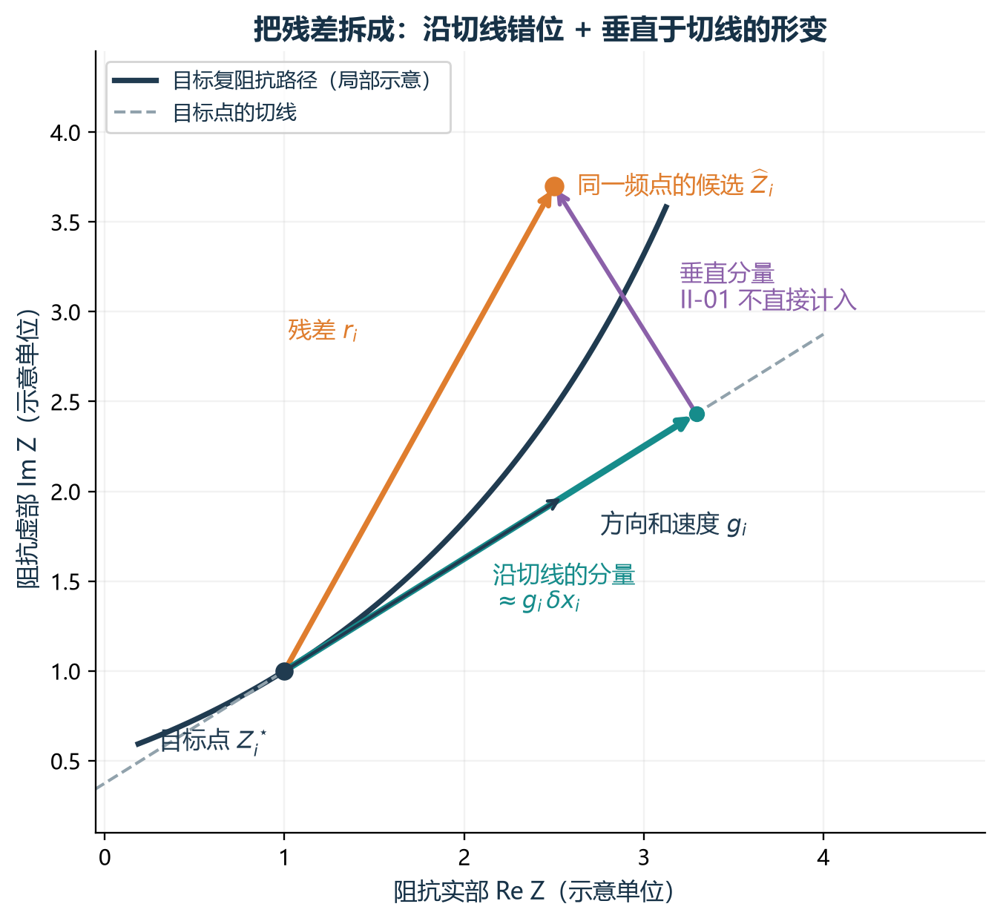
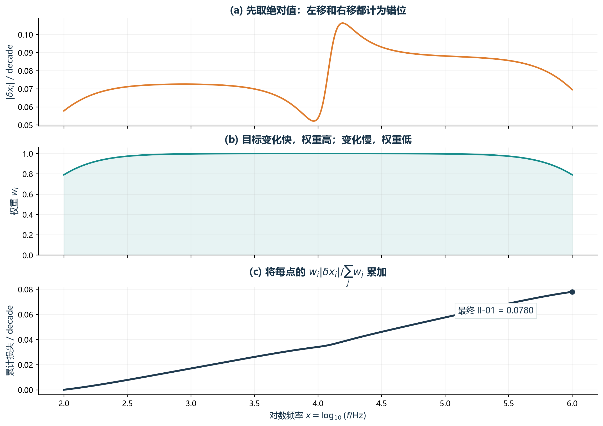
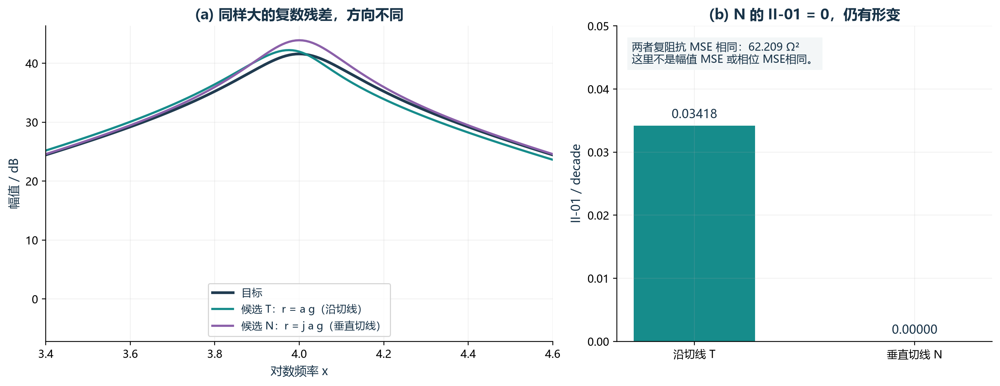

# Case II 指标解释讲稿

> 正文覆盖全部 23 个辅助指标，并说明两个主目标。五个重点指标讲得更细，其余指标也都有可直接说出口的解释；可按汇报时间分段讲述。

## 开场：这轮实验到底想解决什么

老师好，这一轮实验的目的不是单纯增加更多指标，而是想找到一套数量尽量少、含义互补，而且确实能改善最终拟合结果的优化目标。

原来的两个主目标是幅值 MSE 和相位 MSE。它们回答的是：拟合曲线在每个频率点上，幅值和相位平均差了多少。

但是只看平均误差，会漏掉一些结构问题。比如：

- 电抗从容性变成感性时，转换方向可能错了；
- 曲线转变的位置虽然大致正确，但变化得过快或者过慢；
- 平均误差不大，但某一小段频率的误差特别大；
- 两条曲线的形状相似，只是局部在频率轴上错开了一点。

所以我测试辅助指标，不是因为主 MSE 没有用，而是想让辅助指标补充主 MSE 没有明确表达的结构信息。

我最后把“有用”分成两类：

第一类是参与优化的指标。它们不仅有物理或几何含义，而且加入优化后，幅值和相位误差在独立随机种子上都能稳定下降。

第二类是诊断指标。它们可以帮助解释结果哪里有问题，但加入优化以后没有继续带来收益，所以不再增加为 Pareto 目标。

这份讲稿会把首轮 I/II 系列 18 项、论文 P 系列 5 项逐个说清楚。当前常规数据下，最终保留 I-03 和 II-02 参与优化；II-01、P-03、P-05 主要用于检查结果。只有在确认高噪声时，P-03 和 P-05 才作为备用优化组合。

---

## 一、先说两个主目标：幅值 MSE 和相位 MSE

幅值 MSE 是先把阻抗幅值换成 dB，再计算拟合幅值和目标幅值在所有频率点上的平方误差平均值。

它的意思很直接：整条曲线的幅值平均拟合得好不好。

相位 MSE 是把拟合相位和目标相位逐点相减，再对平方误差求平均。

它的意思是：整条曲线的相位平均拟合得好不好。

这两个指标必须一直保留，因为其他辅助指标都只描述曲线的某一部分特征，不能代替总体幅值和相位误差。

一句话概括：

> 幅值和相位 MSE 管总体拟合质量，辅助指标管具体结构有没有拟合对。

### 老师追问时：为什么不只用幅值和相位 MSE？

可以回答：

> 因为 MSE 是逐点平均。不同类型的结构错误可能得到相近的 MSE。例如，一条曲线可能平均误差不大，但容感转换方向错了，或者过渡区太宽。辅助指标的作用是把这些结构错误单独暴露出来，给优化提供额外的选择方向。

---

## 二、I-03：电抗过零方向一致性

### 1. 一句话先说清楚

> I-03 检查的是：目标曲线在某个频段从容性变成感性，或者从感性变成容性时，拟合曲线有没有在对应频段发生同方向的转换。

### 2. 这个指标为什么和电路有关

阻抗可以写成实部加虚部，也就是 Z=R+jX。

在我们采用的符号约定下：

- X 小于 0 表示容性；
- X 大于 0 表示感性。

所以 X 穿过 0，就表示阻抗的无功性质在容性和感性之间发生了一次转换。

但是只数过零次数还不够。目标曲线可能是从负到正，也就是从容性转到感性；拟合曲线如果从正到负，虽然也过零，但方向是反的。

I-03 就是在避免这种“次数相同，但转换方向错误”的情况。

### 3. 公式实际在算什么

第一步，检查相邻两个频率点的电抗符号位是否变化。如果变化，就记为一次过零。

第二步，用相邻频率点的中点作为过零位置，并根据电抗是上升还是下降，记录方向是正向还是反向。

第三步，根据目标曲线的过零位置，把频率范围划分成若干区域。对于目标中的每一次过零，只要拟合曲线在对应区域内找到一次同方向过零，就认为这个目标事件匹配成功。

最后，I-03 的损失就是“没有匹配成功的目标过零事件所占的比例”。所以这个值越小，说明正确保留下来的容感转换越多。

### 4. 它为什么有用

I-03 提供的是离散的结构信息，也就是“该不该发生一次转换”和“转换方向对不对”。这是幅值和相位 MSE 没有直接表达的。

在 Case II 的 seeds 200–399 单指标实验中，I-03 让幅值 MSE 下降 14.702%，相位 MSE 下降 6.644%。和 II-02 组合以后，下降扩大到 38.374% 和 12.480%。

### 5. 它不能说明什么

I-03 不能说明过零点的精确位置是否正确，只要落在对应区域内就可以。

它也不惩罚额外过零，所以可能出现目标事件都匹配了，但拟合曲线又多出其他交叉。

另外，过零反映的是整体容感平衡变化，不能把某一次过零直接等同于某一个唯一元件或某一条支路。

### 老师追问时：I-03 和“过零次数”有什么区别？

可以回答：

> 过零次数只回答有几次交叉，I-03 还要求交叉出现在对应频段，而且方向与目标一致。因此 I-03 比单纯计数多保留了频率区域和方向两部分信息。

### 老师追问时：为什么不用插值求真正的零点？

可以回答：

> 当前实现用相邻采样点中点作为过零位置，目的是保持计算简单和稳定。它主要检查区域和方向，不追求精确零点位置。如果以后要研究过零位置误差，可以再加入插值，但那是另一个更精细的指标。

---

## 三、II-02：转变速度相对误差

### 1. 一句话先说清楚

> II-02 检查的是：复阻抗曲线沿着对数频率轴变化得有多快，拟合曲线的转变是否过陡或者过缓。

### 2. 这里的“速度”是什么意思

这里不是时间速度，而是阻抗对 log10 频率的导数。

我先令 x=log10 f，然后计算复阻抗 Z 对 x 的导数。这个导数同时包含实部和虚部的变化。再对复导数取模，就得到阻抗曲线在复平面中，频率每变化一个 decade 时走得有多快。

因此，II-02 比较的不是单独的幅值曲线斜率，而是复阻抗轨迹的变化速度。

### 3. 公式实际在算什么

对每一个频率点：

- 先计算目标曲线的速度，也就是目标复导数的模；
- 再计算拟合曲线的速度；
- 计算二者的绝对差；
- 用目标速度加一个稳定项作分母，得到相对误差；
- 最后对所有频率点取平均。

稳定项取目标速度尺度的 5%。它的作用是防止目标曲线在平坦区域速度接近 0 时，分母太小，把很小的数值误差无限放大。

### 4. 为什么使用对数频率

阻抗数据跨越很多数量级。如果直接对 Hz 求导，高频段和低频段的尺度会很不均衡。

用 log10 f 后，比较的是每一个十倍频程内阻抗变化了多少，更符合宽频阻抗曲线的表达方式。

### 5. 它为什么有用

幅值和相位 MSE 只看每个点差了多少，但不能明确区分转变区域是太宽、太窄、太陡还是太缓。

II-02 直接约束变化速度，所以能补充曲线过渡过程的信息。

在 seeds 200–399 的单指标实验中，II-02 让幅值 MSE 下降 33.980%，相位 MSE 下降 6.757%。它对幅值误差的改善很明显。

### 6. 它不能说明什么

II-02 只比较速度大小，不比较导数方向。

如果某个点的拟合导数正好是目标导数的相反数，两者的模仍然相同，这个点的 II-02 损失可以是 0，但曲线方向其实是错的。

所以 II-02 不能单独使用，它正好需要 I-03 提供方向和转换结构信息。

II-02 也不能直接解释成某个电阻、电感、电容、阻尼或带宽参数的误差。它描述的是曲线行为，不是单个参数。

### 老师追问时：II-02 和普通斜率误差有什么区别？

可以回答：

> 普通斜率可能只对幅值或某一个坐标求导。II-02 对复阻抗 Z 求导，再取复导数的模，因此同时考虑实部和虚部在复平面中的变化速度。

### 老师追问时：稳定项会不会改变指标含义？

可以回答：

> 它主要在目标速度接近 0 的平坦区起作用，避免相对误差发散。在变化明显的区域，目标速度远大于稳定项，指标仍接近普通相对速度误差。并且稳定项只由目标计算，所有候选共用同一个尺度。

---

## 四、为什么最终是 I-03 + II-02

这两个指标互补，而不是重复。

I-03 关注的是离散结构：有没有发生容感转换，方向对不对。

II-02 关注的是连续动态：曲线变化得有多快，过渡区是否过陡或过缓。

一个管方向和事件，一个管速度和形状变化。

可以用一句比较形象的话概括：

> I-03 告诉优化“应该往哪边转”，II-02 告诉优化“转得多快比较合适”。

这个组合在三批独立随机种子上都让幅值和相位同时下降：

- seeds 0–99：幅值下降 42.669%，相位下降 14.381%；
- seeds 100–199：幅值下降 40.529%，相位下降 13.823%；
- seeds 200–399：幅值下降 38.374%，相位下降 12.480%。

最后一批 200 个 seeds 做了多重比较校正，幅值和相位的改善仍然同时成立。

因此，我选择它们不是因为某一批均值最好看，而是因为它们信息互补，而且换随机种子后还能重复出现双指标改善。

### 老师追问时：为什么三批下降比例不完全一样？

可以回答：

> 优化是随机过程，不同 seed 批次的基线难度和搜索结果会有波动。这里更重要的是三批结果的方向一致，幅值和相位都下降，而不是要求三个百分比完全相同。

### 老师追问时：这能证明对所有电路都有效吗？

可以回答：

> 不能。目前证据支持当前 Case II、完整频段和充分采样条件。Case I 和 Case II 的最佳组合已经表现出差异，所以还需要在第三种电路和更多实测数据上验证泛化性。

---

## 五、II-01：局部特征频移误差

### 1. 一句话先说清楚

> II-01 检查的是：当前复阻抗残差中，有多少可以解释成目标曲线沿频率方向发生了局部错位。

### 2. 公式背后的想法

假设拟合曲线和目标曲线形状接近，只是在频率轴上轻微移动了一点。

在小位移情况下，目标曲线移动以后产生的变化，可以近似写成目标曲线的切向，也就是目标导数，乘以一个局部频移量 δx。

因此，我把拟合残差投影到目标曲线的切线方向上。投影系数 δx 就表示：要沿 log10 频率方向移动多少，才能解释这一部分残差。

然后对 δx 的绝对值做加权平均。目标曲线变化明显的位置权重大，平坦位置权重小。

### 3. 这个值怎么解释

II-01 的单位是 decade。

例如 |δx|=0.1，表示对应的频率比例大约是 10 的 0.1 次方，也就是 1.259 倍。

但是这个值只是在局部线性近似下的“可解释频移”，不能直接说真实谐振峰就移动了 1.259 倍。

### 4. 为什么它不参与最终优化

II-01 有解释价值，但实验没有支持把它作为第三个辅助目标。

I-03 + II-02 的结果是幅值下降 38.374%、相位下降 12.480%。

加入 II-01 后，变成幅值下降 35.061%、相位下降 9.615%，两项都弱了一些。

所以我的结论是：II-01 适合在优化完成后检查局部频移问题，但当前不增加为独立 Pareto 目标。

### 5. 它不能说明什么

它没有真正检测峰值位置，也不等于真实谐振频率误差。

只有在位移较小、局部形状相近时，这个解释比较直观。如果曲线发生强烈形变、位移很大，或者目标曲线局部很平，局部线性近似就会变弱。

### 老师追问时：既然 II-01 单指标有用，为什么组合里不用？

可以回答：

> 单指标有解释性或者能改善某一项，不代表加入已有组合后仍有增量价值。II-01 与现有目标可能存在信息重叠或竞争。独立比较显示，加入它以后最终幅值和相位收益都变弱，所以保留为诊断量更合适。

---

## 六、P-03：60 点无窗口 DTW

### 1. 一句话先说清楚

> P-03 检查的是：允许局部频率错位以后，拟合幅值曲线的整体形状还像不像目标曲线。

### 2. DTW 的直观含义

普通逐点误差要求同一个频率点和同一个频率点比较。

DTW，也就是动态时间规整，允许目标曲线上的一个点和拟合曲线附近的多个点进行保序匹配。

这里虽然名字里有“时间”，实际对齐的是频率序列。它不会打乱频率顺序，只允许局部拉伸或压缩。

所以如果两条曲线的峰谷形状接近，只是局部在频率轴上错开一点，DTW 不会像严格逐点误差那样立刻给出很大的惩罚。

### 3. 本实现具体怎么算

先在 log10 频率轴上取 60 个等距点，把目标和拟合的幅值 dB 都插值到这个网格。

局部代价是两个幅值点的绝对差。

动态规划每一步可以从左、上或者左上方到达，累计选择总代价最小的保序路径。

最后 P-03 就是走到第 60 个点时的累计代价。

本实现没有窗口限制，也没有除以路径长度，所以它和旧 PDF 中的三维窗口 DTW 不是同一个指标，数值也不能直接比较。

### 4. 它为什么有用，又为什么不放进常规组合

在 seeds 200–399 中，P-03 单指标让幅值下降 13.042%，相位下降 13.725%。

但是把 P-03 加到 I-03 + II-02 后，结果变成幅值下降 33.939%、相位下降 9.801%，弱于原来的两指标组合。

所以常规数据下，我把 P-03 用作整体形状诊断，不把它继续加进优化。

### 老师追问时：P-03 只看幅值，为什么相位也可能下降？

可以回答：

> 因为优化的是同一组电路参数。参数改变会同时影响幅值和相位。P-03 虽然直接约束幅值形状，但可能通过参数耦合间接改善相位。这是实验结果，不代表 P-03 本身在数学上直接测量了相位。

### 老师追问时：为什么只插值到 60 点？

可以回答：

> 这是当前论文指标复现和 Case II 实现采用的固定设置，目的是在保留全局形状的同时降低动态规划成本。60 点不是物理常数，之后可以做敏感性分析，但当前结论只对这一实现负责。

---

## 七、P-05：最大局部幅值误差

### 1. 一句话先说清楚

> P-05 检查的是：整条幅值曲线中，误差最大的那个频率点到底差了多少。

### 2. 为什么平均 MSE 之外还要看最大误差

MSE 对所有频率点求平均。

如果绝大多数频率点误差很小，只有一小段误差很大，平均值可能仍然不高。

P-05 直接取所有频率点绝对幅值误差的最大值，相当于给局部最坏情况施加压力，避免严重的局部失败被平均值掩盖。

### 3. 为什么它和 P-03 配对

P-03 关注允许错位后的整体形状，P-05 关注最差的局部点。

可以概括成：

> P-03 管全局像不像，P-05 管局部最坏点有没有失控。

两者都不直接约束相位，所以相位 MSE 仍然必须作为主目标。

### 4. 它的实验表现和使用限制

在论文五指标的 100-seed 单指标实验中，P-05 让幅值下降 31.166%，相位下降 10.467%。

但是严格多重校正以后，相位单指标证据不足，所以我没有把 P-05 单独确定为常规方案。

另外，最大值指标对单点异常和噪声峰比较敏感。从公式本身看，它有追逐异常点的风险。

因此，我不把它解释成天然抗噪声。我们只能说：在已经定义好的高噪声实验中，P-03 + P-05 这个组合经过独立验证，表现比默认组合更稳定。

### 老师追问时：既然 P-05 对噪声敏感，为什么高噪声时反而使用它？

可以回答：

> 从公式上，P-05 确实对异常点敏感，所以不能先验地说它抗噪声。选择它的依据是条件化实验结果：在 0.5 dB/2° 的高噪声设置和独立 seeds 500–599 中，P-03 + P-05 同时通过了幅值和相位的严格检验。这个结论只适用于当前验证过的噪声条件，不推广到任意噪声。

---

## 八、高噪声时为什么改用 P-03 + P-05

在高噪声实验中，I-03 + II-02 的平均结果仍然下降，但相位在严格多重校正后证据变弱。

这可以理解为：I-03 依赖过零事件，II-02 依赖导数速度，这两类量都容易受噪声影响。

而 P-03 允许局部错位后比较全局形状，P-05 控制最坏局部误差。两者组合在独立 seeds 500–599 中：

- 幅值下降 36.166%；
- 相位下降 11.949%；
- 加权总误差下降 31.746%；
- 幅值和相位都通过严格检验。

所以高噪声时可以把它作为条件型备选。

这里要强调：不是看到哪组均值最低就临时更换，而是先根据数据质量判断是否属于高噪声场景，再使用事先独立验证过的方案。

---

## 九、为什么不继续增加第三、第四个辅助目标

多目标优化里，目标数增加以后，解之间更容易互不支配，选择压力会被分散。

如果新增目标与已有目标重复或者冲突，就可能让优化花更多精力平衡辅助目标，反而削弱对幅值和相位主误差的改善。

实验结果也是这样：

- I-03 + II-02：幅值下降 38.374%，相位下降 12.480%；
- 加入 II-01：变成 35.061% 和 9.615%；
- 加入 P-03：变成 33.939% 和 9.801%。

所以不是指标越多越好。

我的筛选原则是：

> 有物理或几何含义，只说明它值得计算；只有加入以后还能在独立实验中带来增量收益，才说明它值得作为优化目标。

### 老师追问时：是不是三目标一定比双目标差？

可以回答：

> 不能这么概括。这里只能说，在当前候选和当前 Case II 中，测试过的第三个辅助目标没有提供稳定增量。其他电路或其他互补指标仍可能适合三目标组合，需要重新验证。

---

## 十、其余 18 个辅助指标逐项口述

前面已经详细讲过 I-03、II-01、II-02、P-03、P-05。下面按 PDF 清单，把其余 18 项也逐个解释。我不会把某项指标说成“好”或“坏”；先说明它具体测什么，再看实验是否支持把它用于当前方案。

### I-01 全局转折数量：至少 5 个

I-01 看的是拟合阻抗轨迹有没有保留足够多的明显转折。程序先在归一化的频率、阻抗实部和虚部组成的三维路径上找转角较大的点，再计算拟合曲线距离“至少 5 个”还差几个。它能防止主要动态变化被拟合成过于平滑的一条曲线，但只达到数量门槛还不够，转折可能都落在错误频段，也可能出现额外转折。

### I-02 目标转折区域覆盖：5-of-6

I-02 把目标曲线检测到的 6 个主要转折分别划成频率区域，问拟合曲线是否至少覆盖其中 5 个。这样比 I-01 多检查了转折大致出现在哪些频段。它仍不检查区域里的精确位置、转角大小和多余事件。“5-of-6”是首轮 Case I 的数据命名，不应假设 Case II 也恰好有 6 个转折。

### I-04 全局电抗过零数量：至少 10 次

I-04 数拟合电抗的符号变化，要求过零次数达到首轮设定的 10 次。它的直观目的，是防止容性和感性转换被漏掉太多次。它不看过零在哪个频段，也不看从负到正还是从正到负，因此比 I-03 粗略。

### I-05 全局转折数量：至少 4 个

I-05 与 I-01 的计算方法相同，只把要求从 5 个放宽到 4 个。它给复杂曲线保留一个较低的转折数量下限。门槛更松也意味着更多候选会同样得到零损失，指标对这些候选就无法继续排序。

### I-06 幅值峰谷一致性 PTC（首轮实现）

I-06 在幅值 dB 曲线上找峰和谷，要求拟合曲线在目标峰谷对应的频段出现同类型事件，并对频率位置偏差计分。它关心“哪里有峰、哪里有谷”，比只看逐点 MSE 更直接地描述响应形状。它没有比较峰高、谷深和宽度，也没有单独惩罚额外峰谷。这里是首轮 I-06 的实现，后面的 P-02 虽然也叫 PTC，检测和计分规则不同。

### I-07 全局电抗过零数量：至少 8 次

I-07 与 I-04 同族，但只要求达到 8 次过零。它提供更宽松的容感转换次数下限。它仍然不管过零位置和方向，达到 8 次以后就没有进一步区分能力。

### II-03 窗口约束 DTW

II-03 把目标和拟合曲线都表示为归一化三维阻抗路径，再用动态规划寻找顺序不颠倒的匹配。它只允许索引相差最多 4 个点，最后用累计距离除以所选路径的步数。它回答的是“小范围错位以后两条阻抗轨迹有多接近”。这里的 4 是采样点索引，不是 4 Hz；它也不同于只比较 60 点幅值、没有窗口且不除路径长度的 P-03。

### II-04 Soft-DTW 散度

II-04 也比较三维路径，但它用平滑最小值综合多条接近最优的对齐路径，并扣除目标与自身、拟合与自身的项，得到非负的修正量。可以把它理解为“比硬选择一条 DTW 路径更平滑的形状距离”。它说明几何相似性，不能直接指认哪个元件参数错了；计算也比简单逐点指标更重。

### II-05 95% Hausdorff 距离

II-05 把两条三维曲线看成点集。对目标每个点找最近的拟合点，反过来也做一次，然后取两边最近距离的 95% 分位数中较大的一边。这样主要检查“大部分点离另一条曲线有多远”，比取绝对最坏点对少数异常点更宽容。它没有保序匹配，因此两条曲线点集接近，也不保证频率变化过程完全一致。

### II-06 Sobolev H1 误差

II-06 同时比较对应位置和一阶导数。位置项要求两条归一化阻抗路径靠近，导数项要求变化趋势靠近。它把“点的位置”和“走向”放在一起检查，但也因此容易与主误差或速度类指标提供重叠信息；单看这个数值不能归因到某个电路元件。

### II-07 去平移空间形状误差

II-07 先计算拟合和目标在阻抗实部、虚部上的逐点差，再分别减去这些差的中位数，最后看剩余差异。直观地说，它先忽略整条曲线共同的复阻抗平移，再问形状是否相似。如果拟合曲线只是整体上移或右移，该指标可以很小；所以它必须和保留绝对误差的主目标一起看。

### II-08 转折事件弱位置误差

II-08 先检查每个目标转折区域中有没有拟合转折。区域里没有事件时罚得重；有事件但位置偏了一点时，只加较轻的位置罚项。它表达的是“先要出现主要转折，再慢慢校正频率位置”。它不比较转折强度和类型，也不专门惩罚额外事件。

### II-09 转折存在性与过量事件惩罚

II-09 的第一部分统计有多少目标转折区域没有被覆盖，第二部分轻度惩罚拟合曲线转折总数超过目标。它同时防止遗漏结构和产生过多转折。这个过量惩罚按全局总数计算，不能保证每个区域的事件都一一对应，也不能直接解释为多了几个电路支路。

### II-10 去局部频移后的相对形变

II-10 和 II-01 是一对。II-01 先估计复阻抗残差中多少像局部频率平移；II-10 把这部分从残差中减掉，再看剩余的形状误差。它回答“如果允许一小段频率错位，曲线本身还差多少”。因为使用的是局部一阶近似，形变很大时不能把剩余项理解为严格的物理法向误差。

### II-11 目标转折区域覆盖：4-of-6

II-11 与 I-02 使用同样的转折区域，只把覆盖门槛从 5 个降到 4 个。它容许更多目标区域没有转折，是更松的结构要求。它不指定必须覆盖哪 4 个区域，也不检查精确位置；达到门槛后就不再区分候选。

### P-01 趋势编码相似性（SS）

P-01 在幅值 dB 曲线上先计算相邻频率的斜率，再看斜率变化，把上升、下降及明显趋势变化编码成一串数。拟合与目标编码越不一样，损失越大。它想比较的是曲线“往哪边走、何处改变走向”，而不是逐点幅值大小。编码需要阈值，靠近阈值的小变化可能突然改变类别；在当前 Case II 的单指标实验中，它也没有显示稳定收益。

### P-02 论文峰谷位置一致性（PTC）

P-02 也找幅值曲线的峰和谷，并用目标事件的位置划出区域。在每个目标区域内，它查找同类拟合峰谷：没有就给缺失代价，有就按位置偏差累计代价。它关注峰谷的类型和频率位置，但不直接比较峰高和谷深。与 I-06 不同，P-02 的峰谷检测及区域内代价累计按论文指标的 Case II 代码实现，不能把两个 PTC 当成完全相同的一个数。

### P-04 低频连续达标段数（LFP）

P-04 用目标峰谷把频段分区，从低频开始逐段检查幅值均方误差是否低于设定阈值。只要某一段未达标，后面即使单独达标，也不再算进“从低频连续达标”的段数。它强调从低频向高频逐步保持拟合质量，能区分“前面连续做好”与“只在后面零散做好”。它依赖分段和阈值设定，不是一个全频段平均误差。

把这些指标全部说完以后，我会回到同一个筛选原则：指标有清楚含义，只是候选资格；是否进入最终优化组合，要看独立实验对幅值和相位有没有增量收益。

## 十一、连续缺频为什么还没有解决

连续缺少一段频率和随机少几个点不是同一个问题。

事件指标、导数指标和 DTW 都需要曲线在关键频段有足够信息。连续缺失一整段以后，真实的过零、转变速度或者峰谷结构可能根本没有被观测到。

在连续缺失 20% 频段时：

- I-03 + II-02 的幅值和相位分别恶化 6.347% 和 12.083%；
- P-03 + P-05 虽然均值下降 10.812% 和 4.059%，但严格检验没有通过。

所以当前结论不是继续堆指标，而是优先补测。无法补测时，退回双主目标基线，并明确说明数据覆盖不足。

---

## 结尾：一分钟总结

这一轮指标筛选最后得到的是一个分层方案。

第一层是两个主误差：幅值 MSE 和相位 MSE，它们负责总体拟合质量。

第二层是常规数据下参与优化的两个辅助指标：

- I-03 检查容性和感性转换的方向；
- II-02 检查复阻抗沿对数频率变化的速度。

它们一个提供离散结构，一个提供连续动态，所以组合后有互补性，并且已经在三批独立随机种子上重复得到幅值和相位同时下降。

第三层是诊断指标：

- II-01 解释局部频率错位；
- P-03 检查允许错位后的整体幅值形状；
- P-05 检查最差频点的幅值误差。

这些指标有解释价值，但常规条件下没有证据支持全部加入优化。高噪声时，P-03 + P-05 是经过独立验证的备用组合。

所以这轮工作的主线不是找到最多的指标，而是找到一套最少、互补、能够重复验证的目标组合。

---

# 老师快速追问答法

## 1. 你能不能不用公式，说清楚五个重点指标？

> I-03 看容感转换方向；II-02 看曲线转变快慢；II-01 看误差像不像频率错位；P-03 看允许错位后的整体幅值形状；P-05 看最差频点的幅值误差。

## 2. 为什么 I-03 和 II-02 能放在一起？

> I-03 是事件和方向，II-02 是连续速度，信息不重复。一个防止转错方向，一个防止转得太快或太慢。

## 3. 为什么 II-01 有意义但不用来优化？

> 它能解释局部频移，但加入 I-03 + II-02 后，幅值和相位收益都变弱，所以保留为诊断量，不增加优化维数。

## 4. 为什么 P-03 和 P-05 平时不用，高噪声时用？

> 常规数据下它们没有超过 I-03 + II-02；高噪声的独立实验中，P-03 + P-05 同时通过幅值和相位的严格检验，所以只作为条件型备选。

## 5. 为什么辅助指标只看幅值，也可能改善相位？

> 因为所有目标共同优化同一组电路参数。参数同时决定幅值和相位，所以幅值结构约束可以通过参数耦合间接影响相位，但这不是指标直接测量相位。

## 6. 指标改善是否等于参数更准确？

> 不等于。参数分布更集中、碰边界更少，只能说明跨 seed 结果更稳定。Case II 没有真实参数，因此不能证明参数恢复更准确。

## 7. 为什么不同 Case 的最佳指标不一样？

> 不同电路、频率范围和曲线结构会改变指标提供的信息量。指标不是普适冠军，只能在具体数据条件下通过独立实验筛选。

## 8. 你怎么判断“稳定改善”？

> 每个方案和同 seed 的基线配对比较，用 20,000 次配对 bootstrap 检查均值差，并进行多重比较校正。幅值和相位的调整区间都低于 0，才称为严格双通过。

## 9. 当前方案最需要补什么实验？

> 第一，把 I-03 + II-02 放到第三种电路和更多实测数据上验证；第二，单独研究连续缺失频段的位置和宽度，而不是继续增加辅助目标。

## 10. 最核心的一句话是什么？

> 我们不是在找一个单独最强的指标，而是在找一组信息互补、目标数尽量少、能够在独立实验中重复改善幅值和相位的优化目标。

---

# 备用：原首轮 18 个指标的一句话速答

> 正文“其余 18 个辅助指标逐项口述”已经覆盖全部候选。下面这张速答卡用于被打断时快速回忆，和正文不是两套不同定义。

## 第一层级 I-01 至 I-07

### I-01 全局转折数量：至少 5 个

> 看拟合曲线有没有保留至少 5 个明显转折，只管数量，不管转折出现在哪个频段，也不惩罚转折过多。

### I-02 目标转折区域覆盖：5-of-6

> 把目标的 6 个主要转折分成 6 个频率区域，要求拟合曲线至少覆盖其中 5 个；它比纯计数多看了粗略位置，但不看区域内的精确位置和转折强度。

### I-03 电抗过零方向一致性

> 看目标的每次容感转换，拟合曲线是否在对应频段按相同方向发生；它看区域和方向，不看精确零点，也不罚额外交叉。

### I-04 全局电抗过零数量：至少 10 次

> 看拟合电抗是否至少发生 10 次符号变化，只管过零数量，不管位置和方向。

### I-05 全局转折数量：至少 4 个

> 和 I-01 相同，但要求更松，只要 4 个转折；更容易得到零损失，也更容易失去区分度。

### I-06 幅值峰谷一致性 PTC

> 看目标幅值曲线中的峰和谷，是否在对应频段出现同类型的拟合峰谷，并惩罚位置偏差；它不比较峰高、谷深和峰宽。

### I-07 全局电抗过零数量：至少 8 次

> 和 I-04 相同，但要求降到至少 8 次；约束更宽松，仍然不看位置和方向。

## 第二层级 II-01 至 II-11

### II-01 局部特征频移误差

> 把复阻抗残差投影到目标曲线切向，估计有多少误差像是局部频率错位；它是局部线性解释，不是真实峰位检测。

### II-02 转变速度相对误差

> 比较目标和拟合复阻抗对 log10 频率的导数模，检查曲线转变得过快还是过慢；它只看速度大小，不看导数方向。

### II-03 窗口约束 DTW

> 在归一化三维阻抗路径上允许最多 4 个采样索引的局部错位，再寻找保序的最小累计距离；它看几何形状，不直接对应具体参数。

### II-04 Soft-DTW 散度

> 用平滑最小值综合多条接近最优的对齐路径，并用自相似项消除偏置；它仍然是几何相似性指标，计算更复杂，也不能直接解释成某个电路机理。

### II-05 95% Hausdorff 距离

> 把两条曲线看成点集，比较双向最近距离的 95% 分位数；它减弱少数极端点的影响，但不要求匹配顺序，也不能保证最差点接近。

### II-06 Sobolev H1 误差

> 同时比较曲线位置和一阶导数，既要求对应点接近，也要求变化趋势接近；它信息较多，但可能与主误差和速度指标重叠。

### II-07 去平移空间形状误差

> 先去掉拟合曲线相对目标曲线的整体实部、虚部平移，再比较剩余形状；它主动忽略整体偏置，只看形状变化。

### II-08 转折事件弱位置误差

> 优先保证每个目标转折区域里存在拟合转折，再用较小权重惩罚区域内的位置偏差；它不比较转折类型和强度。

### II-09 转折存在性与过量事件惩罚

> 一方面惩罚没有覆盖目标转折区域，另一方面轻度惩罚拟合曲线产生过多转折；它是事件数量保护，不是参数诊断。

### II-10 去局部频移后的相对形变

> 先从复阻抗残差中去掉可以由局部频移解释的切向部分，再测量剩余形变；它看“频移以外还错了多少”，不能定位具体元件。

### II-11 目标转折区域覆盖：4-of-6

> 和 I-02 相同，但只要求覆盖 4 个目标区域；约束更松，不要求必须覆盖哪 4 个，也不看精确位置和额外事件。

## 如果老师问：清单列了 23 个辅助指标，为什么最终只把两个加入常规优化？

> 清单要完整记录测试过什么，所以有首轮 I/II 系列 18 项和论文 P 系列 5 项。选优化目标却要看独立实验中能否让幅值、相位同时稳定改善。当前常规数据下，I-03 和 II-02 满足这一要求；II-01、P-03、P-05 更适合诊断或高噪声备用。其他指标并不是没有数学意义，而是现有证据不足以支持继续增加为优化目标。

---

# 附录：全部指标的 TeX 公式与通俗讲解

下面的公式对应本项目 Case II 实验代码实际计算的损失，都是越小越好；P 系列是论文指标在 Case II 频率采样和实测目标上的实现，不应直接当作原论文逐字公式。

每个指标都按同一个顺序讲：

1. 先把公式读出来；
2. 解释这一条公式里第一次出现的符号；
3. 用接近伪代码的步骤说明程序怎么计算；
4. 最后说公式整体在检查什么、不能说明什么。

这样汇报时不需要一上来解释全部数学细节。可以先念“整体意义”，老师追问时再展开“符号”和“计算步骤”。

## 共用记号和事件提取

这一部分不是新的指标，而是后面所有公式共用的“词典”。汇报时可以先说：为了避免每讲一个指标都重新解释符号，我先统一说明频率、目标曲线、候选曲线、归一化尺度和事件是怎么定义的。

### 1. 原始数据和四种常用表示

在第 \(i\) 个频点，\(f_i>0\)，目标阻抗为 \(Z_i^\star\)，候选阻抗为 \(\widehat Z_i\)。星号 \(\star\) 表示“目标”，帽子 \(\widehat{\phantom Z}\) 表示“当前候选或拟合结果”。令 \(N\) 为频点总数，\(i=1,\ldots,N\) 是频点编号。

~~~tex
\begin{aligned}
x_i&=\log_{10}f_i,\qquad
u_i=\frac{x_i-x_1}{x_N-x_1},\\
A_i(Z)&=20\log_{10}|Z_i|,\qquad
\phi_i(Z)=\arg Z_i,\qquad
p_i(Z)=\left(u_i,\frac{\Re Z_i}{s_R},\frac{\Im Z_i}{s_I}\right).
\end{aligned}
~~~

**这组公式可以这样讲：**同一条阻抗曲线，后面会用到四种表示。\(x_i\) 是对数频率，\(u_i\) 是压到 0 到 1 的频率位置，\(A_i\) 和 \(\phi_i\) 分别是 dB 幅值与相位，\(p_i\) 则把频率、实部和虚部合成一个三维路径点。

**每个符号具体是什么意思：**

- \(x_i=\log_{10}f_i\)：把频率换成以 10 为底的对数。频率从 100 Hz 变到 1000 Hz，在 \(x\) 轴上正好增加 1，所以后面说的“1 decade”就是频率相差 10 倍。
- \(u_i\)：把整个 log 频率范围线性压到 0 到 1。这样频率坐标和阻抗坐标能放在同一个几何距离里比较。
- \(|Z_i|\)：复阻抗的模；\(A_i(Z)\) 是 dB 幅值。代码在取对数前给零幅值加极小下限，避免出现 \(\log 0\)。
- \(\arg Z_i\)：复数的相角，单位是弧度。
- \(\Re Z_i,\Im Z_i\)：复阻抗的实部和虚部；虚部也就是这里所说的电抗。
- \(s_R,s_I\)：从目标谱得到的实部、虚部尺度，用来归一化，防止数值较大的坐标完全控制距离。
- \(p_i(Z)\)：第 \(i\) 个频点对应的三维点，三个坐标依次是归一化频率、归一化实部和归一化虚部。把所有 \(p_i\) 按频率顺序连起来，就是后面使用的“三维阻抗路径”。

这里的复阻抗可以写成 \(Z=\Re Z+\mathrm j\Im Z\)。\(\Re Z\) 是实部，\(\Im Z\) 是虚部，也就是后面说的电抗；\(\mathrm j\) 是虚数单位，满足 \(\mathrm j^2=-1\)。

### 2. 实部、虚部为什么要分别归一化

~~~tex
\begin{aligned}
\operatorname{ptp}(v)&=\max_i v_i-\min_i v_i,\\
\operatorname{std}(v)&=\sqrt{\frac1N\sum_{i=1}^{N}(v_i-\bar v)^2},
\qquad \bar v=\frac1N\sum_{i=1}^{N}v_i,\\
s_R&=\max\{\operatorname{ptp}(\Re Z^\star),
\operatorname{std}(\Re Z^\star),10^{-12}\},\\
s_I&=\max\{\operatorname{ptp}(\Im Z^\star),
\operatorname{std}(\Im Z^\star),10^{-12}\},\\
S_x&=x_N-x_1.
\end{aligned}
~~~

**这组公式可以这样讲：**实部和虚部的数值范围可能差很多。如果直接算三维距离，数值较大的那一维会把其他维度盖住。因此，实部除以 \(s_R\)，虚部除以 \(s_I\)，先把两维放到相近尺度。

- \(\operatorname{ptp}\) 是 peak-to-peak，也就是一组数的最大值减最小值，反映整段数据的跨度。
- \(\operatorname{std}\) 是标准差，反映数据通常围绕均值波动多大；\(\bar v\) 是均值。
- \(s_R\) 在“目标实部跨度、目标实部标准差、\(10^{-12}\)”中取最大值；\(s_I\) 对目标虚部做同样处理。
- 同时看跨度和标准差，是为了让尺度在不同曲线形态下更稳定。\(10^{-12}\) 是数值保护下限；如果一维几乎不变，也不会出现除以 0。
- 这些尺度只由目标曲线 \(Z^\star\) 计算。所有候选曲线都共用同一把尺子，不能为每个候选单独缩放。
- \(S_x=x_N-x_1\) 是整个 log 频率跨度，后面用它把位置误差变成无量纲相对距离。

### 3. 后面反复出现的数学记号

- \(\sum\)：把所有项加起来；\(\frac1N\sum\) 就是取平均。
- \(|a|\)：如果 \(a\) 是实数，表示绝对值；\(|Z|\) 若 \(Z\) 是复数，表示复数的模。
- \(\|v\|_2\)：向量的欧氏长度，即各分量平方和再开根号。
- \(a\cdot b\)：向量点积；夹角越小，点积越接近 1。
- \(\min,\max\)：取最小值、最大值。
- \((a)_+=\max(a,0)\)：只保留正数部分；如果 \(a<0\)，就当成 0。
- \(\mathbf1\{\text{条件}\}\)：指示函数。条件成立返回 1，不成立返回 0。
- \(\varnothing\)：空集；\(A\cap B=\varnothing\) 表示两个集合没有共同元素。
- \(\exists\) 表示“存在”，\(\nexists\) 表示“不存在”。
- \(|E|\)：集合 \(E\) 里元素的数量，不是绝对值。
- \(\operatorname{median}\)：中位数；比均值更不容易被少数极端值带偏。
- \(Q_{0.95}\)：95% 分位数。可以理解为把数据从小到大排好，取大约第 95% 位置的数。
- \(\exp(a)=e^a\)：指数函数，小偏差时增长慢，偏差大时惩罚会明显变快。

这里最容易混淆的是竖线：\(|a|\) 可能是绝对值，\(|Z|\) 可能是复数的模，\(|E|\) 还可能是集合元素个数。要结合竖线里面放的是实数、复数还是集合来判断。

### 4. 转折角是怎么计算的

I/II 系列的转折事件不是肉眼随便挑出来的，而是先把阻抗写成三维路径，再计算相邻路径段之间的夹角。

~~~tex
t_i=\frac{p_{i+1}-p_i}{\|p_{i+1}-p_i\|_2},\qquad
\theta_i=\arccos\!\left(\operatorname{clip}(t_{i-1}\!\cdot t_i,-1,1)\right),
\quad \tau_\star=Q_{0.95}(\{\theta_i^\star\}),\quad
\tau_{\rm fit}=0.20\min_{j\in E_\star}\theta_j^\star .
~~~

**转折角公式里的新符号：**

- \(t_i\)：从路径点 \(p_i\) 指向 \(p_{i+1}\) 的单位方向向量。分母 \(\|p_{i+1}-p_i\|_2\) 把长度除掉，只保留方向。
- \(t_{i-1}\cdot t_i\)：相邻两段方向的点积。两段同向时接近 1，垂直时接近 0，反向时接近 -1。
- \(\operatorname{clip}(v,-1,1)\)：把 \(v\) 限制在 \([-1,1]\) 内。伪代码是：若 \(v<-1\) 就令 \(v=-1\)；若 \(v>1\) 就令 \(v=1\)。理论上两个单位向量的点积本来就在这个范围内，但浮点误差可能算出 1.0000000002；不做 clip，\(\arccos\) 会报无效值。
- \(\arccos\)：反余弦函数，把点积换成夹角 \(\theta_i\)。夹角越大，路径在这个位置转得越明显。
- \(\tau_\star\)：目标曲线的转折角阈值，取所有目标转角的 95% 分位数。
- \(E_\star\)：最后保留下来的目标转折事件集合；\(\tau_{\rm fit}\) 是检测候选转折时使用的阈值。

候选曲线的阈值没有自己重新取分位数，而是设成目标保留事件中最小转角的 20%。这样目标和所有候选仍然由目标曲线提供同一个参照，不会出现每个候选自己降低标准的情况。

### 5. 局部峰和 NMS 怎样得到最终事件

~~~tex
\begin{aligned}
\mathcal C_{\rm turn}
&=\{i:\theta_i>\theta_{i-1},\ \theta_i\ge\theta_{i+1},\ \theta_i\ge\tau\},\\
E(\tau)&=\operatorname{NMS}_{\Delta i\ge4}
\bigl(\mathcal C_{\rm turn};\ \mathrm{priority}=\theta_i\downarrow\bigr),\\
E_\star&=E(\tau_\star),\qquad E_{\rm fit}=E(\tau_{\rm fit}).
\end{aligned}
~~~

**这组公式可以这样讲：**先找超过阈值的局部峰，再做一次“相邻事件去重”，最后分别得到目标事件集合 \(E_\star\) 和候选事件集合 \(E_{\rm fit}\)。

- \(\mathcal C_{\rm turn}\) 是转折候选集合。\(\theta_i>\theta_{i-1}\) 且 \(\theta_i\ge\theta_{i+1}\) 表示 \(i\) 点是局部峰；\(\theta_i\ge\tau\) 表示它还必须超过当前阈值。
- \(\operatorname{NMS}\) 是 non-maximum suppression，可以理解为“只留附近最明显的峰”。程序先按 \(\theta_i\) 从大到小排序，所以公式中的 \(\theta_i\downarrow\) 表示降序。
- \(\Delta i\ge4\) 表示两个最终事件至少相隔 4 个采样索引。如果新候选离已经保留的事件不足 4 个点，就把它丢掉，避免同一个转折被重复计数。
- 最后再按频率从低到高排列事件。NMS 的筛选顺序按角度，输出顺序按频率，这两个顺序不要混淆。

**转折事件提取的伪代码：**

~~~text
输入：按频率排序的三维路径点 p[1...N]
1. 对每一段求单位方向 t[i]
2. 对每个内部点求 theta[i] = arccos(clip(t[i-1]·t[i], -1, 1))
3. 只保留 theta 的局部峰，并要求超过阈值
4. 按转角从大到小挑选；与已选事件相距不足 4 个采样索引的候选丢弃
5. 最后按频率顺序排列，得到事件集合 E
~~~

### 6. 目标事件怎样划分负责区域

设目标共有 \(m\) 个事件，按频率排列后的位置是 \(u_1^\star,\ldots,u_m^\star\)。区域边界和区域定义为：

~~~tex
\begin{aligned}
e_0&=0,\qquad e_m=1,\\
e_j&=\frac{u_j^\star+u_{j+1}^\star}{2},\qquad j=1,\ldots,m-1,\\
R_j&=[e_{j-1},e_j],\qquad j=1,\ldots,m.
\end{aligned}
~~~

**这组公式可以这样讲：**相邻两个目标事件的中点作为分界线，每个目标事件负责自己附近的一段频率范围。第一个区域从归一化频率 0 开始，最后一个区域到 1 结束。

- \(e_j\) 是第 \(j\) 条内部边界，不是事件本身。
- \(R_j\) 是第 \(j\) 个目标事件负责的区域。
- 后面说“覆盖某个目标事件”，通常不是要求候选事件和目标事件落在完全相同的采样点，而是要求候选事件落入对应的 \(R_j\)。
- 这种区域匹配允许小范围位置偏差，但也意味着“落在区域里”不等于位置完全准确；需要精确位置时，另有位置误差指标处理。

### 7. 电抗过零事件和方向怎么记录

~~~tex
\begin{aligned}
E_X(Z)&=\left\{\frac{u_i+u_{i+1}}2:
\operatorname{signbit}(\Im Z_i)\ne
\operatorname{signbit}(\Im Z_{i+1})\right\},\\
d_i(Z)&=
\begin{cases}
+1,&\Im Z_i<\Im Z_{i+1},\\
-1,&\Im Z_i\ge\Im Z_{i+1}.
\end{cases}
\end{aligned}
~~~

**这组公式可以这样讲：**如果相邻两个采样点的电抗符号不同，就认为它们中间发生一次过零。当前实现不做线性插值，而是把两个归一化频率的中点作为过零位置；同时用电抗上升还是下降记录转换方向。

- \(E_X(Z)\) 是曲线 \(Z\) 的电抗过零事件集合。
- \(\operatorname{signbit}(v)\) 只检查数值的符号位：负数返回 1，非负数返回 0。相邻两点的结果不同，就表示跨过了正负号边界。
- \((u_i+u_{i+1})/2\) 是当前实现记录的过零位置。它是采样区间中点，不是通过插值求出的精确零点。
- \(d_i=+1\) 表示电抗由较小值走向较大值，对跨零事件来说就是负到正；\(d_i=-1\) 表示正到负。
- \(d_i\in\{-1,+1\}\) 中的大括号表示集合，这里只允许两个方向值。

**过零事件的伪代码：**

~~~text
for i = 1 ... N-1:
    如果 Im(Z[i]) 和 Im(Z[i+1]) 符号不同:
        过零位置 = (u[i] + u[i+1]) / 2
        若 Im(Z[i]) < Im(Z[i+1])，方向记为 +1（负到正）
        否则方向记为 -1（正到负）
~~~

最后可以用一句话收住这一部分：后面的指标没有重新定义频率、尺度、转折和过零，而是在这些统一记号上分别计算“数量够不够、区域有没有覆盖、位置差多少、方向对不对或曲线变化速度是否一致”。

### M-01 幅值 dB 均方误差

~~~tex
L_{\rm mag}=\frac{1}{N}\sum_{i=1}^{N}
\left[A_i(\widehat Z)-A_i(Z^\star)\right]^2 .
~~~

**本式新符号：**\(L_{\rm mag}\) 是幅值损失；下标 mag 是 magnitude 的缩写。\(A_i(\widehat Z)\) 和 \(A_i(Z^\star)\) 分别是候选曲线和目标曲线在第 \(i\) 个频点的 dB 幅值。

**计算步骤：**逐点计算“候选 dB 幅值减目标 dB 幅值” → 每个差值平方 → 把 \(N\) 个平方误差相加 → 除以 \(N\)。

**整体意义：**它回答“所有频点的幅值平均差多少”。平方会让大偏差得到更重的惩罚，单位是 dB\(^2\)。

**容易误解的地方：**它只看逐点平均结果，不会明确告诉我们峰谷是否错位、转折是否缺失，也可能掩盖少数很差的频点。

### M-02 相位弧度均方误差

~~~tex
L_{\rm phase}=\frac{1}{N}\sum_{i=1}^{N}
\left[\phi_i(\widehat Z)-\phi_i(Z^\star)\right]^2 .
~~~

**本式新符号：**\(L_{\rm phase}\) 是相位损失；\(\phi_i(\widehat Z)\) 和 \(\phi_i(Z^\star)\) 是第 \(i\) 个频点的候选相位和目标相位。

**计算步骤：**逐点求相位差 → 平方 → 求平均。

**整体意义：**它回答“所有频点的相位平均差多少”，单位是 rad\(^2\)。

**容易误解的地方：**当前实现直接减 \(\arg Z\)，没有额外做 \(-\pi\) 与 \(+\pi\) 的环绕修正。若数据恰好跨过相角边界，数值差可能看起来很大，解释时要单独检查。

## I 系列：离散结构指标

### I-01 全局转折数量：至少 5 个

~~~tex
m=|E_\star|,\quad n=|E_{\rm fit}|,\quad q=\min(5,m),\qquad
L_{\rm I01}=\frac{(q-n)_+}{q},\quad (a)_+=\max(a,0).
~~~

**本式新符号：**\(E_\star\) 是目标转折集合，\(E_{\rm fit}\) 是候选转折集合；\(m,n\) 分别是两者的事件数；\(q\) 是实际采用的数量门槛。因为目标本身可能不足 5 个事件，所以用 \(q=\min(5,m)\)。

**计算步骤：**检测目标和候选转折 → 数出 \(m,n\) → 令门槛 \(q=\min(5,m)\) → 计算缺少数量 \(q-n\) → 若已经达到门槛就用正部函数截成 0 → 再除以 \(q\) 变成比例。

**整体意义：**它只问“候选曲线有没有足够多的明显转折”。0 表示数量达标，1 表示一个要求的转折都没有。

**容易误解的地方：**数量够不等于位置对；多余转折也不受罚。

### I-02 目标转折区域覆盖：5-of-6

~~~tex
c=\sum_{j=1}^{m}\mathbf1\{E_{\rm fit}\cap R_j\ne\varnothing\},
\quad q=\min(5,m),\qquad L_{\rm I02}=\frac{(q-c)_+}{q}.
~~~

**本式新符号：**\(R_j\) 是第 \(j\) 个目标转折负责的频率区域；\(E_{\rm fit}\cap R_j\ne\varnothing\) 表示这个区域里至少有一个候选转折；\(c\) 是被覆盖的目标区域数。

**计算步骤：**按目标转折的相邻中点划区域 → 对每个 \(R_j\) 判断是否有候选转折 → 有则指示函数记 1 → 把所有 1 加起来得到 \(c\) → 按门槛 \(q=\min(5,m)\) 计算还差多少比例。

**整体意义：**它比 I-01 多问了一层：“转折不仅数量够，而且大致出现在应该出现的频段吗？”

**容易误解的地方：**5-of-6 是 Case I 的原始名称。Case II 实际会按目标检测到的 \(m\) 截断，不强行假设有 6 个转折；它也不比较转角大小或精确位置。实现中公共边界可以同时属于相邻两个区域。

### I-03 电抗过零方向一致性

~~~tex
L_{\rm I03}=\frac{1}{m_X}\sum_{j=1}^{m_X}
\mathbf1\!\left\{\nexists\,e\in E^{X}_{\rm fit}\cap R_j^X:
d(e)=d_j^\star\right\}.
~~~

**本式新符号：**\(m_X\) 是目标电抗过零事件数；\(E_{\rm fit}^X\) 是候选过零事件集合；\(R_j^X\) 是第 \(j\) 个目标过零的频率区域；\(d(e)\) 是候选事件方向，\(d_j^\star\) 是目标方向。\(+1\) 表示电抗由负变正，\(-1\) 表示由正变负。

**计算步骤：**检测目标过零并划区域 → 对每个目标区域查找候选过零 → 只接受方向和目标相同的事件 → 找不到时指示函数记 1，找到时记 0 → 对全部目标过零取平均。

**整体意义：**它计算“目标容感转换中，有多大比例没有被候选以正确方向复现”。因此 0 最好，1 表示全部没对上。

**容易误解的地方：**它只要求落在同一区域，不要求精确频率相同；也不比较过零点附近的幅值。

### I-04 全局电抗过零数量：至少 10 次

~~~tex
m_X=|E_X^\star|,\quad n_X=|E_X^{\rm fit}|,\quad
q=\min(10,m_X),\qquad L_{\rm I04}=\frac{(q-n_X)_+}{q}.
~~~

**本式新符号：**\(E_X^\star,E_X^{\rm fit}\) 是目标和候选的电抗过零集合；\(m_X,n_X\) 是各自的过零次数；\(q=\min(10,m_X)\) 是实际门槛。

**计算步骤：**数目标过零和候选过零 → 门槛取 10 与目标次数的较小值 → 计算候选还缺几次 → 达标后截为 0 → 除以门槛。

**整体意义：**它只检查“候选是否保留了足够多次容性/感性切换”。

**容易误解的地方：**它不看位置和方向；用无意义的额外过零凑够数量，也可能得到 0。

### I-05 全局转折数量：至少 4 个

~~~tex
q=\min(4,|E_\star|),\qquad
L_{\rm I05}=\frac{(q-|E_{\rm fit}|)_+}{q}.
~~~

**本式新符号：**全部符号沿用 I-01，只把门槛从 5 改为 4。

**计算步骤：**与 I-01 完全相同，唯一变化是 \(q=\min(4,|E_\star|)\)。

**整体意义：**它是更宽松的“转折数量是否够”。

**容易误解的地方：**门槛更低意味着更容易得到 0，也更容易失去区分能力；位置、方向和多余事件仍然不管。

### I-06 幅值峰谷一致性 PTC（首轮实现）

~~~tex
\begin{aligned}
L_{\rm I06}&=\frac{1}{m_P}\sum_{j=1}^{m_P}
\begin{cases}
\exp\!\left(\gamma\,d_j/S_x\right)-1,
&\text{目标区域内存在同类候选峰或谷},\\
\gamma,&\text{否则},
\end{cases}
\\
d_j&=\min_{e\in E_{j,\rm same}}|x(e)-x_j^\star|,
\qquad \gamma=0.41 .
\end{aligned}
~~~

**本式新符号：**\(m_P\) 是目标峰谷数；\(E_{j,\rm same}\) 是第 \(j\) 个目标峰谷区域中、与目标同类型的候选峰谷集合；\(x_j^\star\) 是目标峰谷的 log 频率位置；\(d_j\) 是最近同类候选峰谷的距离；\(S_x=x_N-x_1\) 是整个 log 频率跨度；\(\gamma=0.41\) 是缺失和位置惩罚的固定系数。

**特殊计算方法：**首轮峰谷检测要求中心点比两侧相邻点至少突出 0.2 dB。\(\exp(\gamma d/S_x)-1\) 在位置差很小时接近 0，距离越大增长越快；除以 \(S_x\) 是把位置差按总频率跨度归一化。

**计算步骤：**检测目标和候选峰谷 → 用目标峰谷中点划区域 → 对每个目标峰谷只找同为峰或同为谷的候选 → 有匹配就取最近位置差并算指数代价 → 没匹配直接罚 0.41 → 对所有目标峰谷取平均。

**整体意义：**它问“目标的每个峰或谷，候选是否在相近频段出现同类峰谷”。

**容易误解的地方：**它不比较峰高、谷深和宽度；I-06 只取最近事件并求平均，而 P-02 会把区域内所有同类事件的代价相加。

### I-07 全局电抗过零数量：至少 8 次

~~~tex
q=\min(8,m_X),\qquad L_{\rm I07}=\frac{(q-n_X)_+}{q}.
~~~

**本式新符号：**全部符号沿用 I-04，只把数量门槛从 10 改为 8。

**计算步骤：**与 I-04 相同，使用 \(q=\min(8,m_X)\)。

**整体意义：**它是更宽松的过零数量下限。

**容易误解的地方：**仍然不检查过零位置和方向；达到门槛以后再增加过零不会改变损失。

## II 系列：连续几何与局部误差指标

### II-01 局部特征频移误差

~~~tex
\begin{aligned}
g_i&=\frac{dZ^\star}{dx}(x_i),\quad r_i=\widehat Z_i-Z_i^\star,\\
\varepsilon_v&=0.05\,\operatorname{median}_{|g_i|>0}|g_i|,\\
\delta x_i&=\frac{\Re(r_i\overline{g_i})}{|g_i|^2+\varepsilon_v^2},
\quad w_i=\frac{|g_i|^2}{|g_i|^2+\varepsilon_v^2},\\
L_{\rm II01}&=\frac{\sum_iw_i|\delta x_i|}{\sum_iw_i}.
\end{aligned}
~~~

**本式新符号：**\(g_i=dZ^\star/dx\) 是目标复阻抗随 log 频率的局部变化方向和速度；\(r_i=\widehat Z_i-Z_i^\star\) 是复阻抗残差；\(\overline{g_i}\) 是 \(g_i\) 的复共轭；\(\Re(r_i\overline{g_i})\) 是把残差投影到目标切线方向所需的内积形式；\(\varepsilon_v\) 是防止分母接近零的稳定项；\(\delta x_i\) 是估计的局部 log 频移；\(w_i\) 是可信度权重。

**特殊计算方法：**复数投影可以理解为“残差中有多少分量顺着目标曲线的切线方向”。导数用数值差分计算，内部点用相邻点，端点用二阶单侧差分。\(\varepsilon_v\) 取非零目标速度中位数的 5%，既防除零，也避免平坦区域产生巨大虚假频移。

**计算步骤：**求目标导数 \(g_i\) → 求候选与目标的复数残差 \(r_i\) → 把残差投影到 \(g_i\) 得到 \(\delta x_i\) → 在目标变化慢的位置降低权重 \(w_i\) → 对 \(|\delta x_i|\) 做加权平均。

**整体意义：**它回答“候选误差有多少看起来只是曲线沿频率轴局部向左或向右错了一点”。单位是 decade，例如 0.1 decade 对应频率比例约为 \(10^{0.1}\)。

**容易误解的地方：**这是基于一阶导数的局部近似，不是真正检测峰位，也不能直接解释成某个元件参数偏了多少。

**配图讲解：按照论文的曲线对比和计算过程说明。**下面四张图是专门构造的无噪声示例，用来说明数学定义。图中评分直接调用当前 II-01 实现，不能当作 Case II 优化实验结果。

**图 1 可以这样讲：**“深蓝是目标，青色候选向左错了 0.03 decade，橙色候选向右错了 0.08 decade。现有代码分别给出约 0.0293 和 0.0780，能区分这个例子中的错位大小。左图画幅值便于看峰，计算时用的却是完整复阻抗。右图是逐点估计，不必先检测峰。”

右移 \(h\) 的候选写成 \(\widehat Z(x)=Z^\star(x-h)\)，所以残差近似为 \(-h g\)，\(\delta x\) 为负；左移时为正。最后取绝对值，两边都计为误差。0.08 decade 的设定移动量，对应峰频率乘以 \(10^{0.08}\approx1.2023\)。

**图 2 可以这样讲：**“横轴是实部，纵轴是虚部。橙色残差连接同一频点的目标与候选。青色部分顺着目标切线，可以近似解释为局部频率错位；紫色部分垂直于切线，更像其他形变。II-01 主要测青色部分。”

这个投影可以由下面的最小二乘问题得到。\(d\) 是实数，表示待估计的局部 log 频率距离；\(\varepsilon_v^2d^2\) 是抑制过大估计的稳定项：

~~~tex
\begin{aligned}
Z^\star(x_i+d)&\approx Z_i^\star+g_i d,\\
\delta x_i&=\arg\min_{d\in\mathbb R}
\left\{|r_i-g_i d|^2+\varepsilon_v^2d^2\right\}
=\frac{\Re(r_i\overline{g_i})}{|g_i|^2+\varepsilon_v^2}.
\end{aligned}
~~~

若 \(r_i=r_R+\mathrm j r_I\)、\(g_i=g_R+\mathrm j g_I\)，分子就是 \(r_Rg_R+r_Ig_I\)，即二维点积。分母将阻抗残差换成频率距离。图中青色箭头示意普通投影；带稳定项时 \(g_i\delta x_i\) 会向零收缩。

**图 3 可以这样讲：**“上图先对局部频移取绝对值，避免左右互相抵消。中图是目标导数决定的权重，变化慢的地方推断频移不可靠，权重低些。下图把每点的加权贡献累加，最右端就是最终指标。”

~~~tex
c_i=\frac{w_i|\delta x_i|}{\sum_{j=1}^{N}w_j},\qquad
C_k=\sum_{i=1}^{k}c_i,\qquad C_N=L_{\rm II01}.
~~~

\(c_i\) 是第 \(i\) 点的贡献，\(C_k\) 是前 \(k\) 点的累计贡献。这两个符号只是画图时拆开加权平均的辅助记号；没有低频提前停止规则，也不是论文 LFP 的连续达标段数。

**图 4 可以这样讲：**“青色候选的残差沿切线，紫色候选垂直于切线。两者每点的复数残差大小一样，但紫色的 II-01 接近零，曲线却仍然有误差。因此，这项为零只能说明没测到沿切线的频移，不能说拟合完全正确。”

图中构造 \(r_T=a g\)、\(r_N=\mathrm j a g\)，\(a=0.035\) decade。乘以 \(\mathrm j\) 把向量旋转 90°，所以两者模相同，而 \(\Re(r_N\overline g)=0\)。当前代码算得 II-01 分别约为 0.03418 和 0；相同的是复阻抗 MSE（约 62.209 Ω²），不是两个主目标 MSE 相同。两条候选是线性化说明例子，未声称由合法电路参数生成，也不证明哪条更值得用于优化。

**这一指标最后可以这样收住：**“II-01 给出的是局部频移的近似解释。频移太大、曲线结构变化或目标导数受噪声影响时，估计可能不准。它需要和幅值、相位 MSE 一起看，是否适合参与优化还要由独立实验判断。”

完整的论文配图方法对照与逐图说明见 [II-01 图解](../archive/LOCAL_ONLY.md#ref-14083ccaf23d)。

### II-02 转变速度相对误差

~~~tex
\begin{aligned}
g_i^\star&=\frac{dZ^\star}{dx}(x_i),\quad
\widehat g_i=\frac{d\widehat Z}{dx}(x_i),\\
L_{\rm II02}&=\frac{1}{N}\sum_{i=1}^{N}
\frac{\left||\widehat g_i|-|g_i^\star|\right|}
{|g_i^\star|+\varepsilon_v}.
\end{aligned}
~~~

**本式新符号：**\(g_i^\star\) 是目标导数，\(\widehat g_i\) 是候选导数；\(|g_i|\) 是复数导数的模，可以理解为路径沿 log 频率前进时的“速度”；\(\varepsilon_v\) 沿用 II-01 的稳定项。

**计算步骤：**分别对目标和候选求 \(dZ/dx\) → 取导数模 → 算两种速度的绝对差 → 除以“目标速度加稳定项”得到相对误差 → 对所有频点取平均。

**整体意义：**它检查曲线的响应变化是过快还是过慢。它不关心导数指向哪边，所以与检查容感转换方向的 I-03 互补。

**容易误解的地方：**“速度”不是时间速度，而是阻抗随 \(\log_{10}f\) 的变化率；只比较导数模意味着两个方向相反但速度相同的点，这一项本身可能看不出来。

### II-03 窗口约束 DTW

~~~tex
\begin{aligned}
c_{ij}&=\|p_i(Z^\star)-p_j(\widehat Z)\|_2,\quad |i-j|\le4,\\
D_{ij}&=c_{ij}+\min(D_{i-1,j-1},D_{i-1,j},D_{i,j-1}),\\
L_{\rm II03}&=\frac{D_{NN}}{|\pi^\star|}.
\end{aligned}
~~~

**本式新符号：**\(c_{ij}\) 是目标第 \(i\) 个三维路径点与候选第 \(j\) 个路径点的欧氏距离；\(D_{ij}\) 是走到网格位置 \((i,j)\) 时的最小累计代价；\(\pi^\star\) 是最终选择的最优对齐路径，\(|\pi^\star|\) 是这条路径包含的匹配步数。

**特殊计算方法：DTW 动态规划。**

**计算步骤：**下面的伪代码就是公式的逐步执行方式：

~~~text
D[0,0] = 0；其他边界 = 无穷大
for i = 1 ... N:
    只遍历满足 |i-j| <= 4 的 j
    c = distance(target[i], fit[j])
    D[i,j] = c + min(
        D[i-1,j-1],   # 两边同时前进
        D[i-1,j],     # 目标前进，候选暂不前进
        D[i,j-1]      # 候选前进，目标暂不前进
    )
记录被选前驱，从而得到最优路径步数
返回 D[N,N] / 路径步数
~~~

**整体意义：**它允许两条曲线在频率索引上做小范围拉伸和压缩，再比较归一化频率、实部和虚部组成的整体路径形状。

**容易误解的地方：**窗口 4 指采样索引差，不是 4 Hz；程序先按累计距离选路径，再用步数归一化。它不同于 P-03 的 60 点、无窗口、仅 dB 幅值 DTW。

### II-04 Soft-DTW 散度

~~~tex
\begin{aligned}
\operatorname{smin}_{\gamma}(a,b,c)
&=-\gamma\log\!\left(e^{-a/\gamma}+e^{-b/\gamma}+e^{-c/\gamma}\right),\\
S_{ij}&=\|p_i-q_j\|_2^2+
\operatorname{smin}_{0.10}(S_{i-1,j-1},S_{i-1,j},S_{i,j-1}),
\quad |i-j|\le10,\\
L_{\rm II04}&=
\sqrt{\max\!\left\{\frac{S(p,q)-S(p,p)/2-S(q,q)/2}{N},0\right\}}.
\end{aligned}
~~~

**本式新符号：**\(\operatorname{smin}_\gamma\) 是“平滑最小值”；普通 \(\min\) 只保留最小前驱，而它让接近最优的几条路径也有少量贡献。\(\gamma\) 控制平滑程度，当前固定为 0.10；\(S(p,q)\) 表示路径 \(p,q\) 的 Soft-DTW 累计代价。

**特殊计算方法：**先把三种前驱代价 \(a,b,c\) 变成 \(e^{-a/\gamma},e^{-b/\gamma},e^{-c/\gamma}\)，代价越小权重越大，再用负对数转回代价。实现时会先减去三者最小值再计算指数，避免数值上溢或下溢。路径只允许 \(|i-j|\le10\)。

**计算步骤：**用三维距离平方作为局部代价 → 用平滑最小值递推 \(S(p,q)\) → 同样计算 \(S(p,p)\) 和 \(S(q,q)\) → 从交叉代价中减掉两个自相似代价的一半 → 除以 \(N\) → 由于浮点误差可能略小于 0，先用 \(\max(\cdot,0)\) 截断 → 开方。

**整体意义：**它测两条三维路径在允许柔性对齐后的整体差异，同时减少 Soft-DTW 自身的偏置。

**容易误解的地方：**它仍是几何相似度，不直接对应某个电路元件；窗口 10 也是采样索引。

### II-05 95% Hausdorff 距离

~~~tex
d_i^{\star\to c}=\min_j\|p_i^\star-\widehat p_j\|_2,\quad
d_j^{c\to\star}=\min_i\|\widehat p_j-p_i^\star\|_2,\qquad
L_{\rm II05}=\max\!\left(Q_{0.95}(\{d_i^{\star\to c}\}),
Q_{0.95}(\{d_j^{c\to\star}\})\right).
~~~

**本式新符号：**\(d_i^{\star\to c}\) 是“目标第 \(i\) 点到所有候选点的最近距离”；\(d_j^{c\to\star}\) 是反方向的最近距离；箭头只表示从哪一组点出发查最近邻。\(Q_{0.95}\) 沿用前面的 95% 分位数。

**计算步骤：**目标每个点都找最近候选点 → 得到一组距离并取 95% 分位数 → 候选每个点反过来找最近目标点 → 也取 95% 分位数 → 两个方向取较大值。

**整体意义：**它要求两组路径点的大部分都能在另一条曲线上找到近邻，同时不让极少数异常点完全支配结果。

**容易误解的地方：**它把曲线当无序点集，不要求频率顺序一致；95% 分位数意味着最差约 5% 点不会直接决定指标。

### II-06 Sobolev H1 误差

~~~tex
E_0=\frac1N\sum_i\|\widehat p_i-p_i^\star\|_2^2,\quad
E_1=\frac{\frac1N\sum_i
\left\|\frac{d\widehat p}{du}(u_i)-\frac{dp^\star}{du}(u_i)\right\|_2^2}
{\max\left(\frac1N\sum_i\left\|\frac{dp^\star}{du}(u_i)\right\|_2^2,10^{-12}\right)},
\qquad L_{\rm II06}=\sqrt{E_0+E_1}.
~~~

**本式新符号：**\(E_0\) 是路径位置误差；\(E_1\) 是一阶导数误差；\(d p/du\) 表示三维路径随归一化频率 \(u\) 的变化率；\(10^{-12}\) 是数值保护下限，防止目标导数能量为零时除零。

**计算步骤：**逐点算候选路径与目标路径的平方距离并平均，得到 \(E_0\) → 两条路径分别对 \(u\) 求导 → 逐点算导数差平方并平均 → 除以目标导数自身的平均能量，得到无量纲的 \(E_1\) → 将 \(E_0+E_1\) 开方。

**整体意义：**它同时要求“点的位置接近”和“曲线的走向接近”，相当于位置误差与一阶平滑误差的组合。

**容易误解的地方：**两部分相加不代表它们具有完全相同的物理单位；这是经过路径归一化和导数能量归一化后的数学距离，也可能与主 MSE、II-02 信息重叠。

### II-07 去平移空间形状误差

~~~tex
\Delta_i=\left(
\frac{\Re(\widehat Z_i-Z_i^\star)}{s_R'},
\frac{\Im(\widehat Z_i-Z_i^\star)}{s_I'}\right),\quad
b=\left(\operatorname{median}_i\Delta_{i,1},
\operatorname{median}_i\Delta_{i,2}\right),\qquad
L_{\rm II07}=\frac1N\sum_i\|\Delta_i-b\|_2 .
~~~

**本式新符号：**\(\Delta_i\) 是归一化后的二维复阻抗残差，只含实部和虚部，不含频率坐标；\(s_R',s_I'\) 是目标实部、虚部各自的极差；\(\Delta_{i,1},\Delta_{i,2}\) 是 \(\Delta_i\) 的两个分量；\(b\) 是所有残差点在两维上的分量中位数。

**特殊计算方法：**这里用中位数而不是均值估计整体平移，使少数异常点不容易把平移量带偏。

**计算步骤：**求每个频点的实部、虚部残差 → 分别除以目标坐标跨度 → 两个分量各取中位数得到平移 \(b\) → 每个残差向量减去 \(b\) → 求剩余向量长度并平均。

**整体意义：**先允许候选曲线在复平面里整体平移，再比较平移后剩余的形状差异。

**容易误解的地方：**如果候选曲线只是整体偏移，这个指标可能很小，所以必须与保留绝对误差的主目标一起使用。

### II-08 转折事件弱位置误差

~~~tex
\ell_j=
\begin{cases}
1,&E_{\rm fit}\cap R_j=\varnothing,\\
0.10\min\!\left(\dfrac{\min_{e\in E_{\rm fit}\cap R_j}|u(e)-u_j^\star|}
{|R_j|},1\right),&\text{否则},
\end{cases}
\qquad L_{\rm II08}=\frac1m\sum_{j=1}^{m}\ell_j .
~~~

**本式新符号：**\(\ell_j\) 是第 \(j\) 个目标转折区域的局部损失；\(u_j^\star\) 是目标转折位置；\(|R_j|\) 是该区域在归一化频率轴上的宽度。

**计算步骤：**若 \(R_j\) 内没有候选转折，\(\ell_j=1\) → 若有，就找离目标转折最近的候选 → 用位置差除以区域宽度 → 用 \(\min(\cdot,1)\) 把相对偏差封顶为 1 → 再乘 0.10 → 对所有区域平均。

**整体意义：**它把“事件有没有”放在第一优先级；只要事件存在，位置误差最多罚 0.10，因此位置只是弱约束。

**容易误解的地方：**它不比较转角强弱和类型，也不惩罚目标区域之外的额外转折。

### II-09 转折存在性与过量事件惩罚

~~~tex
c=\sum_{j=1}^{m}\mathbf1\{E_{\rm fit}\cap R_j\ne\varnothing\},
\quad n=|E_{\rm fit}|,\qquad
L_{\rm II09}=\frac{m-c}{m}
+0.10\,\frac{(n-m)_+}{m}.
~~~

**本式新符号：**\(c\) 是被候选转折覆盖的目标区域数；\(n=|E_{\rm fit}|\) 是候选转折总数；\(m\) 是目标转折总数。第一项计算遗漏比例，第二项只在 \(n>m\) 时启动。

**计算步骤：**数被覆盖区域 \(c\) → 用 \((m-c)/m\) 算漏掉比例 → 算多余数量 \((n-m)_+\) → 除以 \(m\) 后乘 0.10 作为轻罚 → 两项相加。

**整体意义：**它同时防止“漏掉目标结构”和“人为制造太多转折”，但后者惩罚较轻。

**容易误解的地方：**额外事件按全局总数统计，不能保证每个目标区域一一对应；某个区域多个事件可能被总数项捕捉，但不会逐个配对。

### II-10 去局部频移后的相对形变

~~~tex
r_i=\widehat Z_i-Z_i^\star,\quad
\delta x_i=\frac{\Re(r_i\overline{g_i})}{|g_i|^2+\varepsilon_v^2},
\quad s_Z=\max(\operatorname{median}_i|Z_i^\star|,10^{-12}),\qquad
L_{\rm II10}=\frac{\frac1N\sum_i|r_i-g_i\delta x_i|}{s_Z}.
~~~

**本式新符号：**\(r_i,g_i,\delta x_i\) 沿用 II-01；\(g_i\delta x_i\) 是用目标切线解释的局部频移分量；\(s_Z\) 是目标阻抗模的中位数，下限 \(10^{-12}\) 用于防除零。

**计算步骤：**求复阻抗残差 \(r_i\) → 按 II-01 算局部频移 \(\delta x_i\) → 用 \(g_i\delta x_i\) 重建“可由频移解释的残差” → 从原残差中减去 → 对剩余复数残差的模取平均 → 除以目标典型阻抗 \(s_Z\)。

**整体意义：**它回答“把可以解释为局部频率错位的部分扣掉以后，曲线自身还剩多少形变”。

**容易误解的地方：**这是局部一阶近似；当候选和目标相差很大时，剩余项不能严格叫物理法向误差。

### II-11 目标转折区域覆盖：4-of-6

~~~tex
c=\sum_{j=1}^{m}\mathbf1\{E_{\rm fit}\cap R_j\ne\varnothing\},
\quad q=\min(4,m),\qquad L_{\rm II11}=\frac{(q-c)_+}{q}.
~~~

**本式新符号：**全部符号沿用 I-02，门槛改为 \(q=\min(4,m)\)。

**计算步骤：**仍然按目标事件划区域并统计覆盖数 \(c\)，再算距离“至少覆盖 4 个”还差多少比例。

**整体意义：**它是比 I-02 更宽松的目标转折区域覆盖要求。

**容易误解的地方：**4-of-6 是 Case I 名称，Case II 会按实际目标事件数截断；它不指定必须覆盖哪 4 个，也不比较精确位置或多余事件。

## P 系列：论文指标在 Case II 的实现

### P-01 趋势编码相似性（SS）

~~~tex
\begin{aligned}
k_i(Z)&=\frac{A_{i+1}(Z)-A_i(Z)}{x_{i+1}-x_i},\\
s_i(Z)&=F(k_i,k_{i+1};T=8,\beta=0.4,\mu=0.5),\\
L_{\rm P01}&=\frac1N\sum_{i=1}^{N-2}
|s_i(\widehat Z)-s_i(Z^\star)|.
\end{aligned}
~~~

**本式新符号：**\(k_i(Z)\) 是相邻两个频点之间的 dB 幅值斜率；\(s_i(Z)\) 是由相邻斜率编码得到的趋势符号；\(F\) 是分段编码函数；\(T=8\) 是判断明显趋势的斜率阈值；\(\beta=0.4\) 控制附加强度；\(\mu=0.5\) 控制 sigmoid 变化快慢。

**特殊计算方法：sigmoid 与分段编码。**\(\sigma(t)=1/(1+e^{-t})\) 会把任意实数平滑压到 0 和 1 之间。斜率没有明显趋势时编码为 0；明显上升或下降时编码接近 \(+1\) 或 \(-1\)；从明显负斜率跨到明显正斜率，或反过来时，用更强的反转编码。

**计算步骤：**把幅值变成 dB → 对 log 频率求相邻斜率 \(k_i\) → 每两个相邻斜率送入分段函数 \(F\) 得到趋势序列 \(s_i\) → 逐项比较候选与目标趋势编码 → 绝对差求和 → 按实现除以原始频点数 \(N\)。

**整体意义：**它不问幅值具体是多少，而是问“哪里上升、哪里下降、哪里发生明显反转”是否一致。

**容易误解的地方：**这是离散编码，阈值附近很小的斜率变化可能让类别跳变；公式有 \(N-2\) 个编码项，但实现分母仍使用原始频点数 \(N\)。

~~~tex
F(a,b)=
\begin{cases}
d\!\left[1+1.5\beta\,\sigma\!\left(\mu d[(b-a)-2dT]\right)\right],
&\text{跨过正负阈值的反转},\\
d\!\left[1+\beta(2\sigma(\mu d(b-a))-1)\right],
&\text{明显正/负趋势},\\
0,&\text{其余}.
\end{cases}
~~~

**分段函数怎么读：**这里 \(a=k_i,b=k_{i+1}\)，\(d=+1\) 表示正趋势或由负转正，\(d=-1\) 表示负趋势或由正转负；\(\land\) 表示“并且”，\(\lor\) 表示“或者”。“明显负趋势”按代码是 \((b<-T\land a\le T)\lor(a<-T\land b\le T)\)；“明显正趋势”是 \((b>T\land a\ge-T)\lor(a>T\land b\ge-T)\)。跨越正负阈值的反转分支优先于普通正/负趋势分支。

### P-02 论文峰谷位置一致性（PTC）

~~~tex
L_{\rm P02}=\sum_{j=1}^{m_P}
\begin{cases}
\displaystyle\sum_{e\in E_{j,\rm same}}
\left[\exp\!\left(\gamma\frac{|x(e)-x_j^\star|}{S_x}\right)-1\right],
&E_{j,\rm same}\ne\varnothing,\\
\gamma,&E_{j,\rm same}=\varnothing,
\end{cases}
\qquad \gamma=0.41,\quad S_x=x_N-x_1 .
~~~

**本式新符号：**\(E_{j,\rm same}\) 是第 \(j\) 个目标峰谷区域内、与目标同类型的全部候选峰谷；\(e\) 是其中一个候选事件；\(x(e)\) 是该事件位置；\(x_j^\star\) 是目标峰谷位置；\(S_x\) 是总 log 频率跨度；\(\gamma=0.41\) 是固定惩罚强度。

**特殊计算方法：**目标相邻峰谷的中点形成半开区域 \([{\rm left},{\rm right})\)，避免普通内部边界被重复归属。峰由“中心不低于左侧且严格高于右侧”检测，谷反过来；这里没有 I-06 的 0.2 dB 突出量要求。

**计算步骤：**检测目标峰谷 → 用中点划区域 → 对每个目标事件查找区域内全部同类候选事件 → 没有就加 \(\gamma\) → 有则对每个事件计算归一化位置差的指数代价并全部相加 → 再对所有目标事件求和。

**整体意义：**它检查峰谷类型和位置是否一致，并且同一区域出现多个同类峰谷时会累计惩罚。

**容易误解的地方：**它不除以目标峰谷数，也不只取最近事件；因此数值尺度与 I-06 不同。它不比较峰高、谷深或峰宽。

### P-03 60 点无窗口 DTW

~~~tex
\begin{aligned}
\widetilde x_k&=x_1+\frac{k-1}{59}(x_N-x_1),\quad k=1,\dots,60,\\
\widetilde A_k(Z)&=\operatorname{interp}
\left(A_i(Z);x_i\to \widetilde x_k\right),\\
D_{ij}&=|\widetilde A_i(\widehat Z)-\widetilde A_j(Z^\star)|
+\min(D_{i-1,j-1},D_{i-1,j},D_{i,j-1}),\\
L_{\rm P03}&=D_{60,60}.
\end{aligned}
~~~

**本式新符号：**\(\widetilde x_k\) 是在整个 log 频率范围内均匀放置的第 \(k\) 个新频率点，共 60 点；\(\operatorname{interp}\) 是线性插值，根据原始相邻点估计新位置的幅值；\(\widetilde A_k\) 是插值后的 dB 幅值；\(D_{ij}\) 是 DTW 累计代价。

**特殊计算方法：线性插值。**若新位置 \(\widetilde x\) 位于原始 \(x_a,x_b\) 之间，就按距离做加权平均：

~~~tex
\widetilde A=A_a+\frac{\widetilde x-x_a}{x_b-x_a}(A_b-A_a).
~~~

**计算步骤：**在 log 频率上建立 60 个等间距点 → 目标和候选都线性插值到这些点 → 用 dB 幅值绝对差作为局部代价 → 按 DTW 的三种前驱递推 → 返回 \(D_{60,60}\)。

**整体意义：**它允许局部频率轴拉伸或压缩以后，比较两条幅值曲线的整体形状。

**容易误解的地方：**它没有 \(|i-j|\) 窗口，输出是累计绝对 dB 差，也不除以路径长度；它只使用幅值，不直接比较相位。不要与 II-03 混用。

### P-04 低频连续达标段数（LFP）

~~~tex
e_j=\frac1{|B_j|}\sum_{i\in B_j}
[A_i(\widehat Z)-A_i(Z^\star)]^2,\quad
c=\sum_{j=1}^{m_P}\prod_{k=1}^{j}\mathbf1\{e_k<1.6\},
\qquad L_{\rm P04}=1-\frac{c}{m_P}.
~~~

**本式新符号：**\(B_j\) 是由目标峰谷中点切出的第 \(j\) 个频段；\(|B_j|\) 是这一段包含的频点数；\(e_j\) 是这一段的 dB 幅值 MSE；乘积 \(\prod_{k=1}^{j}\) 表示从第 1 段到第 \(j\) 段的所有达标指示值相乘；\(c\) 是从低频开始连续达标的段数。

**特殊计算方法：前缀连乘。**每个指示函数只有 0 或 1。只要前面某一段不达标出现 0，后续所有前缀乘积都会变成 0，因此后面的零散好段不能补回来。

**计算步骤：**下面的伪代码与前缀连乘等价：

~~~text
c = 0
仍保持连续 = true
for 频段 j 从低频到高频:
    计算本段 MSE e[j]
    如果 e[j] < 1.6 且“仍保持连续”:
        c = c + 1
    否则:
        仍保持连续 = false
返回 1 - c / 总段数
~~~

**整体意义：**它奖励“从低频开始一段接一段地拟合好”，而不是只看全频平均或后面零散的好频段。

**容易误解的地方：**1.6 的单位是 dB\(^2\)，且判断是严格小于；结果强烈依赖目标峰谷如何分段和这个固定阈值。

### P-05 最大局部幅值误差（LMEP）

~~~tex
L_{\rm P05}=\max_{1\le i\le N}
|A_i(\widehat Z)-A_i(Z^\star)|.
~~~

**本式新符号：**没有新增复杂符号；\(\max_{1\le i\le N}\) 表示在全部频点中只取最大的 dB 幅值绝对误差。

**计算步骤：**逐点算候选与目标的 dB 幅值绝对差 → 找出最大值 → 作为最终损失。

**整体意义：**它专门盯住最差频点，防止“平均看起来很好，但某个局部偏差特别大”。

**容易误解的地方：**只看一个最大值，所以对单点异常、高噪声尖峰和测量毛刺很敏感。实验中高噪声条件下某个组合有效，是独立验证得到的条件性结论，不能反过来说这个公式天然抗噪。

## 公式核对范围

上述 M/I/II 公式对照 `experiments/case2_dual_pdf18/objectives.py`，P 系列对照 `experiments/case2_paper5_combinations/objectives.py`；讲稿中涉及的“常规方案”和“高噪声备选”属于实验结论，和公式的数学定义是两件事。PDF 只放这套公式、符号和作用解释；实验百分比仍只在 HTML 汇报里展示。
