# Case II 保留指标：公式、配图与讲稿

本版保留 19 项：2 个主目标、12 个 I/II 辅助指标、5 个论文指标。按本次筛选要求，移除预设事件数量门槛的六项指标；编号保留原编号，方便与代码和已有实验对照。

每一项先说明公式与符号，再用目标和候选曲线说明计算对象，最后交代哪些误差它看得到、哪些看不到。图中使用的是受控合成曲线或明确列出的事件位置，不是 Case II 优化结果。大部分评分直接调用现有代码；事件层示例明确标注。

II-09 使用目标数据的实际事件数量；P-04 统计从低频开始连续达标的范围，没有预设必须达到几段。它们与本次移除的固定数量门槛不同。

窗口、分位数、突出量、平滑参数、误差阈值和惩罚权重都沿用当前实现。配图说明的是计算含义，不证明这些参数最优，也不证明指标能改善优化结果。最终仍以独立实验中幅值、相位误差能否改善来筛选。

## 共用记号和事件提取

这一部分不是新的指标，而是后面所有公式共用的“词典”。汇报时可以先说：为了避免每讲一个指标都重新解释符号，我先统一说明频率、目标曲线、候选曲线、归一化尺度和事件是怎么定义的。

### 1. 原始数据和四种常用表示

在第 \(i\) 个频点，\(f_i>0\)，目标阻抗为 \(Z_i^\star\)，候选阻抗为 \(\widehat Z_i\)。星号 \(\star\) 表示“目标”，帽子 \(\widehat{\phantom Z}\) 表示“当前候选或拟合结果”。令 \(N\) 为频点总数，\(i=1,\ldots,N\) 是频点编号。

~~~tex
\begin{aligned}
x_i&=\log_{10}f_i,\qquad
u_i=\frac{x_i-x_1}{x_N-x_1},\\
A_i(Z)&=20\log_{10}|Z_i|,\qquad
\phi_i(Z)=\arg Z_i,\qquad
p_i(Z)=\left(u_i,\frac{\Re Z_i}{s_R},\frac{\Im Z_i}{s_I}\right).
\end{aligned}
~~~

**这组公式可以这样讲：**同一条阻抗曲线，后面会用到四种表示。\(x_i\) 是对数频率，\(u_i\) 是压到 0 到 1 的频率位置，\(A_i\) 和 \(\phi_i\) 分别是 dB 幅值与相位，\(p_i\) 则把频率、实部和虚部合成一个三维路径点。

**每个符号具体是什么意思：**

- \(x_i=\log_{10}f_i\)：把频率换成以 10 为底的对数。频率从 100 Hz 变到 1000 Hz，在 \(x\) 轴上正好增加 1，所以后面说的“1 decade”就是频率相差 10 倍。
- \(u_i\)：把整个 log 频率范围线性压到 0 到 1。这样频率坐标和阻抗坐标能放在同一个几何距离里比较。
- \(|Z_i|\)：复阻抗的模；\(A_i(Z)\) 是 dB 幅值。代码在取对数前给零幅值加极小下限，避免出现 \(\log 0\)。
- \(\arg Z_i\)：复数的相角，单位是弧度。
- \(\Re Z_i,\Im Z_i\)：复阻抗的实部和虚部；虚部也就是这里所说的电抗。
- \(s_R,s_I\)：从目标谱得到的实部、虚部尺度，用来归一化，防止数值较大的坐标完全控制距离。
- \(p_i(Z)\)：第 \(i\) 个频点对应的三维点，三个坐标依次是归一化频率、归一化实部和归一化虚部。把所有 \(p_i\) 按频率顺序连起来，就是后面使用的“三维阻抗路径”。

这里的复阻抗可以写成 \(Z=\Re Z+\mathrm j\Im Z\)。\(\Re Z\) 是实部，\(\Im Z\) 是虚部，也就是后面说的电抗；\(\mathrm j\) 是虚数单位，满足 \(\mathrm j^2=-1\)。

### 2. 实部、虚部为什么要分别归一化

~~~tex
\begin{aligned}
\operatorname{ptp}(v)&=\max_i v_i-\min_i v_i,\\
\operatorname{std}(v)&=\sqrt{\frac1N\sum_{i=1}^{N}(v_i-\bar v)^2},
\qquad \bar v=\frac1N\sum_{i=1}^{N}v_i,\\
s_R&=\max\{\operatorname{ptp}(\Re Z^\star),
\operatorname{std}(\Re Z^\star),10^{-12}\},\\
s_I&=\max\{\operatorname{ptp}(\Im Z^\star),
\operatorname{std}(\Im Z^\star),10^{-12}\},\\
S_x&=x_N-x_1.
\end{aligned}
~~~

**这组公式可以这样讲：**实部和虚部的数值范围可能差很多。如果直接算三维距离，数值较大的那一维会把其他维度盖住。因此，实部除以 \(s_R\)，虚部除以 \(s_I\)，先把两维放到相近尺度。

- \(\operatorname{ptp}\) 是 peak-to-peak，也就是一组数的最大值减最小值，反映整段数据的跨度。
- \(\operatorname{std}\) 是标准差，反映数据通常围绕均值波动多大；\(\bar v\) 是均值。
- \(s_R\) 在“目标实部跨度、目标实部标准差、\(10^{-12}\)”中取最大值；\(s_I\) 对目标虚部做同样处理。
- 同时看跨度和标准差，是为了让尺度在不同曲线形态下更稳定。\(10^{-12}\) 是数值保护下限；如果一维几乎不变，也不会出现除以 0。
- 这些尺度只由目标曲线 \(Z^\star\) 计算。所有候选曲线都共用同一把尺子，不能为每个候选单独缩放。
- \(S_x=x_N-x_1\) 是整个 log 频率跨度，后面用它把位置误差变成无量纲相对距离。

### 3. 后面反复出现的数学记号

- \(\sum\)：把所有项加起来；\(\frac1N\sum\) 就是取平均。
- \(|a|\)：如果 \(a\) 是实数，表示绝对值；\(|Z|\) 若 \(Z\) 是复数，表示复数的模。
- \(\|v\|_2\)：向量的欧氏长度，即各分量平方和再开根号。
- \(a\cdot b\)：向量点积；夹角越小，点积越接近 1。
- \(\min,\max\)：取最小值、最大值。
- \((a)_+=\max(a,0)\)：只保留正数部分；如果 \(a<0\)，就当成 0。
- \(\mathbf1\{\text{条件}\}\)：指示函数。条件成立返回 1，不成立返回 0。
- \(\varnothing\)：空集；\(A\cap B=\varnothing\) 表示两个集合没有共同元素。
- \(\exists\) 表示“存在”，\(\nexists\) 表示“不存在”。
- \(|E|\)：集合 \(E\) 里元素的数量，不是绝对值。
- \(\operatorname{median}\)：中位数；比均值更不容易被少数极端值带偏。
- \(Q_{0.95}\)：95% 分位数。可以理解为把数据从小到大排好，取大约第 95% 位置的数。
- \(\exp(a)=e^a\)：指数函数，小偏差时增长慢，偏差大时惩罚会明显变快。

这里最容易混淆的是竖线：\(|a|\) 可能是绝对值，\(|Z|\) 可能是复数的模，\(|E|\) 还可能是集合元素个数。要结合竖线里面放的是实数、复数还是集合来判断。

### 4. 转折角是怎么计算的

I/II 系列的转折事件不是肉眼随便挑出来的，而是先把阻抗写成三维路径，再计算相邻路径段之间的夹角。

~~~tex
t_i=\frac{p_{i+1}-p_i}{\|p_{i+1}-p_i\|_2},\qquad
\theta_i=\arccos\!\left(\operatorname{clip}(t_{i-1}\!\cdot t_i,-1,1)\right),
\quad \tau_\star=Q_{0.95}(\{\theta_i^\star\}),\quad
\tau_{\rm fit}=0.20\min_{j\in E_\star}\theta_j^\star .
~~~

**转折角公式里的新符号：**

- \(t_i\)：从路径点 \(p_i\) 指向 \(p_{i+1}\) 的单位方向向量。分母 \(\|p_{i+1}-p_i\|_2\) 把长度除掉，只保留方向。
- \(t_{i-1}\cdot t_i\)：相邻两段方向的点积。两段同向时接近 1，垂直时接近 0，反向时接近 -1。
- \(\operatorname{clip}(v,-1,1)\)：把 \(v\) 限制在 \([-1,1]\) 内。伪代码是：若 \(v<-1\) 就令 \(v=-1\)；若 \(v>1\) 就令 \(v=1\)。理论上两个单位向量的点积本来就在这个范围内，但浮点误差可能算出 1.0000000002；不做 clip，\(\arccos\) 会报无效值。
- \(\arccos\)：反余弦函数，把点积换成夹角 \(\theta_i\)。夹角越大，路径在这个位置转得越明显。
- \(\tau_\star\)：目标曲线的转折角阈值，取所有目标转角的 95% 分位数。
- \(E_\star\)：最后保留下来的目标转折事件集合；\(\tau_{\rm fit}\) 是检测候选转折时使用的阈值。

候选曲线的阈值没有自己重新取分位数，而是设成目标保留事件中最小转角的 20%。这样目标和所有候选仍然由目标曲线提供同一个参照，不会出现每个候选自己降低标准的情况。

### 5. 局部峰和 NMS 怎样得到最终事件

~~~tex
\begin{aligned}
\mathcal C_{\rm turn}
&=\{i:\theta_i>\theta_{i-1},\ \theta_i\ge\theta_{i+1},\ \theta_i\ge\tau\},\\
E(\tau)&=\operatorname{NMS}_{\Delta i\ge4}
\bigl(\mathcal C_{\rm turn};\ \mathrm{priority}=\theta_i\downarrow\bigr),\\
E_\star&=E(\tau_\star),\qquad E_{\rm fit}=E(\tau_{\rm fit}).
\end{aligned}
~~~

**这组公式可以这样讲：**先找超过阈值的局部峰，再做一次“相邻事件去重”，最后分别得到目标事件集合 \(E_\star\) 和候选事件集合 \(E_{\rm fit}\)。

- \(\mathcal C_{\rm turn}\) 是转折候选集合。\(\theta_i>\theta_{i-1}\) 且 \(\theta_i\ge\theta_{i+1}\) 表示 \(i\) 点是局部峰；\(\theta_i\ge\tau\) 表示它还必须超过当前阈值。
- \(\operatorname{NMS}\) 是 non-maximum suppression，可以理解为“只留附近最明显的峰”。程序先按 \(\theta_i\) 从大到小排序，所以公式中的 \(\theta_i\downarrow\) 表示降序。
- \(\Delta i\ge4\) 表示两个最终事件至少相隔 4 个采样索引。如果新候选离已经保留的事件不足 4 个点，就把它丢掉，避免同一个转折被重复计数。
- 最后再按频率从低到高排列事件。NMS 的筛选顺序按角度，输出顺序按频率，这两个顺序不要混淆。

**转折事件提取的伪代码：**

~~~text
输入：按频率排序的三维路径点 p[1...N]
1. 对每一段求单位方向 t[i]
2. 对每个内部点求 theta[i] = arccos(clip(t[i-1]·t[i], -1, 1))
3. 只保留 theta 的局部峰，并要求超过阈值
4. 按转角从大到小挑选；与已选事件相距不足 4 个采样索引的候选丢弃
5. 最后按频率顺序排列，得到事件集合 E
~~~

### 6. 目标事件怎样划分负责区域

设目标共有 \(m\) 个事件，按频率排列后的位置是 \(u_1^\star,\ldots,u_m^\star\)。区域边界和区域定义为：

~~~tex
\begin{aligned}
e_0&=0,\qquad e_m=1,\\
e_j&=\frac{u_j^\star+u_{j+1}^\star}{2},\qquad j=1,\ldots,m-1,\\
R_j&=[e_{j-1},e_j],\qquad j=1,\ldots,m.
\end{aligned}
~~~

**这组公式可以这样讲：**相邻两个目标事件的中点作为分界线，每个目标事件负责自己附近的一段频率范围。第一个区域从归一化频率 0 开始，最后一个区域到 1 结束。

- \(e_j\) 是第 \(j\) 条内部边界，不是事件本身。
- \(R_j\) 是第 \(j\) 个目标事件负责的区域。
- 后面说“覆盖某个目标事件”，通常不是要求候选事件和目标事件落在完全相同的采样点，而是要求候选事件落入对应的 \(R_j\)。
- 这种区域匹配允许小范围位置偏差，但也意味着“落在区域里”不等于位置完全准确；需要精确位置时，另有位置误差指标处理。

### 7. 电抗过零事件和方向怎么记录

~~~tex
\begin{aligned}
E_X(Z)&=\left\{\frac{u_i+u_{i+1}}2:
\operatorname{signbit}(\Im Z_i)\ne
\operatorname{signbit}(\Im Z_{i+1})\right\},\\
d_i(Z)&=
\begin{cases}
+1,&\Im Z_i<\Im Z_{i+1},\\
-1,&\Im Z_i\ge\Im Z_{i+1}.
\end{cases}
\end{aligned}
~~~

**这组公式可以这样讲：**如果相邻两个采样点的电抗符号不同，就认为它们中间发生一次过零。当前实现不做线性插值，而是把两个归一化频率的中点作为过零位置；同时用电抗上升还是下降记录转换方向。

- \(E_X(Z)\) 是曲线 \(Z\) 的电抗过零事件集合。
- \(\operatorname{signbit}(v)\) 只检查数值的符号位：负数返回 1，非负数返回 0。相邻两点的结果不同，就表示跨过了正负号边界。
- \((u_i+u_{i+1})/2\) 是当前实现记录的过零位置。它是采样区间中点，不是通过插值求出的精确零点。
- \(d_i=+1\) 表示电抗由较小值走向较大值，对跨零事件来说就是负到正；\(d_i=-1\) 表示正到负。
- \(d_i\in\{-1,+1\}\) 中的大括号表示集合，这里只允许两个方向值。

**过零事件的伪代码：**

~~~text
for i = 1 ... N-1:
    如果 Im(Z[i]) 和 Im(Z[i+1]) 符号不同:
        过零位置 = (u[i] + u[i+1]) / 2
        若 Im(Z[i]) < Im(Z[i+1])，方向记为 +1（负到正）
        否则方向记为 -1（正到负）
~~~

最后可以用一句话收住这一部分：后面的指标没有重新定义频率、尺度、转折和过零，而是在这些统一记号上分别计算“数量够不够、区域有没有覆盖、位置差多少、方向对不对或曲线变化速度是否一致”。

## 两个主目标

### M-01 幅值 dB 均方误差

~~~tex
L_{\rm mag}=\frac{1}{N}\sum_{i=1}^{N}
\left[A_i(\widehat Z)-A_i(Z^\star)\right]^2 .
~~~

**本式新符号：**\(L_{\rm mag}\) 是幅值损失；下标 mag 是 magnitude 的缩写。\(A_i(\widehat Z)\) 和 \(A_i(Z^\star)\) 分别是候选曲线和目标曲线在第 \(i\) 个频点的 dB 幅值。

**计算步骤：**逐点计算“候选 dB 幅值减目标 dB 幅值” → 每个差值平方 → 把 \(N\) 个平方误差相加 → 除以 \(N\)。

**整体意义：**它回答“所有频点的幅值平均差多少”。平方会让大偏差得到更重的惩罚，单位是 dB\(^2\)。

**容易误解的地方：**它只看逐点平均结果，不会明确告诉我们峰谷是否错位、转折是否缺失，也可能掩盖少数很差的频点。

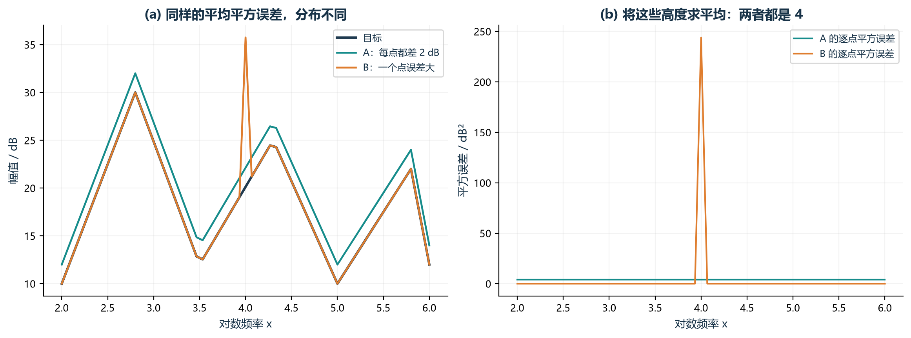

**配图怎么读：**均匀偏差和单点尖峰可以得到相同的幅值 MSE；右图显示实际被平均的平方误差。

**指着图可以这样讲：**“先在每个频点求 dB 幅值差，平方后平均。大误差惩罚更重，但最后只有一个平均数，相同数值不代表误差分布相同。”

**图中边界与设置：**主目标描述总体幅值误差，不能单靠它分辨最差点或峰谷错位。

### M-02 相位弧度均方误差

~~~tex
L_{\rm phase}=\frac{1}{N}\sum_{i=1}^{N}
\left[\phi_i(\widehat Z)-\phi_i(Z^\star)\right]^2 .
~~~

**本式新符号：**\(L_{\rm phase}\) 是相位损失；\(\phi_i(\widehat Z)\) 和 \(\phi_i(Z^\star)\) 是第 \(i\) 个频点的候选相位和目标相位。

**计算步骤：**逐点求相位差 → 平方 → 求平均。

**整体意义：**它回答“所有频点的相位平均差多少”，单位是 rad\(^2\)。

**容易误解的地方：**当前实现直接减 \(\arg Z\)，没有额外做 \(-\pi\) 与 \(+\pi\) 的环绕修正。若数据恰好跨过相角边界，数值差可能看起来很大，解释时要单独检查。

## I 系列：离散结构指标

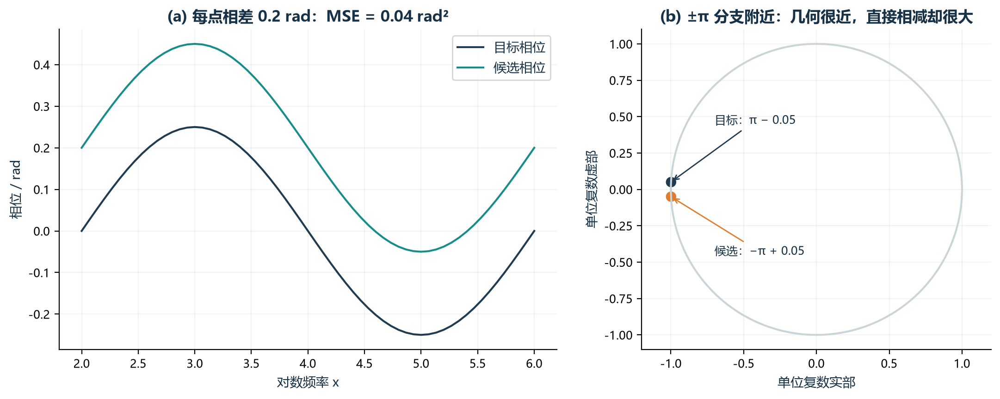

**配图怎么读：**左图说明逐点相位差的平方平均；右图展示 angle 的 ±π 分支边界。

**指着图可以这样讲：**“这项是弧度相位直接相减，再平方平均。右图两个点其实只隔 0.1 rad，但直接相减约为 6.18 rad；当前实现没有对相位差做环绕修正。”

**图中边界与设置：**跨 ±π 时需检查相位分支，不能把直接相位差与最短圆周相位差当作同一种计算。

## I 系列：结构与峰谷

### I-03 电抗过零方向一致性

~~~tex
L_{\rm I03}=\frac{1}{m_X}\sum_{j=1}^{m_X}
\mathbf1\!\left\{\nexists\,e\in E^{X}_{\rm fit}\cap R_j^X:
d(e)=d_j^\star\right\}.
~~~

**本式新符号：**\(m_X\) 是目标电抗过零事件数；\(E_{\rm fit}^X\) 是候选过零事件集合；\(R_j^X\) 是第 \(j\) 个目标过零的频率区域；\(d(e)\) 是候选事件方向，\(d_j^\star\) 是目标方向。\(+1\) 表示电抗由负变正，\(-1\) 表示由正变负。

**计算步骤：**检测目标过零并划区域 → 对每个目标区域查找候选过零 → 只接受方向和目标相同的事件 → 找不到时指示函数记 1，找到时记 0 → 对全部目标过零取平均。

**整体意义：**它计算“目标容感转换中，有多大比例没有被候选以正确方向复现”。因此 0 最好，1 表示全部没对上。

**容易误解的地方：**它只要求落在同一区域，不要求精确频率相同；也不比较过零点附近的幅值。

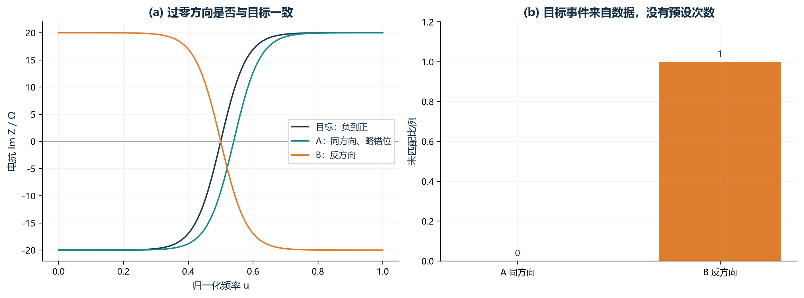

**配图怎么读：**目标曲线有一次负到正的过零；候选 A 区域和方向都匹配，B 的方向相反。这个“一次”来自本例目标，不是规定数量。

**指着图可以这样讲：**“用目标过零划区域，再查每个区域内是否存在同方向候选过零。没匹配到的比例就是损失。”

**图中边界与设置：**区域内的精确零点偏差和额外过零不直接受罚；目标事件数由数据决定。

### I-06 幅值峰谷一致性 PTC（首轮实现）

~~~tex
\begin{aligned}
L_{\rm I06}&=\frac{1}{m_P}\sum_{j=1}^{m_P}
\begin{cases}
\exp\!\left(\gamma\,d_j/S_x\right)-1,
&\text{目标区域内存在同类候选峰或谷},\\
\gamma,&\text{否则},
\end{cases}
\\
d_j&=\min_{e\in E_{j,\rm same}}|x(e)-x_j^\star|,
\qquad \gamma=0.41 .
\end{aligned}
~~~

**本式新符号：**\(m_P\) 是目标峰谷数；\(E_{j,\rm same}\) 是第 \(j\) 个目标峰谷区域中、与目标同类型的候选峰谷集合；\(x_j^\star\) 是目标峰谷的 log 频率位置；\(d_j\) 是最近同类候选峰谷的距离；\(S_x=x_N-x_1\) 是整个 log 频率跨度；\(\gamma=0.41\) 是缺失和位置惩罚的固定系数。

**特殊计算方法：**首轮峰谷检测要求中心点比两侧相邻点至少突出 0.2 dB。\(\exp(\gamma d/S_x)-1\) 在位置差很小时接近 0，距离越大增长越快；除以 \(S_x\) 是把位置差按总频率跨度归一化。

**计算步骤：**检测目标和候选峰谷 → 用目标峰谷中点划区域 → 对每个目标峰谷只找同为峰或同为谷的候选 → 有匹配就取最近位置差并算指数代价 → 没匹配直接罚 0.41 → 对所有目标峰谷取平均。

**整体意义：**它问“目标的每个峰或谷，候选是否在相近频段出现同类峰谷”。

**容易误解的地方：**它不比较峰高、谷深和宽度；I-06 只取最近事件并求平均，而 P-02 会把区域内所有同类事件的代价相加。

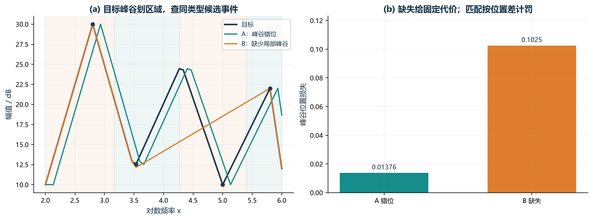

**配图怎么读：**黑点为目标峰谷；浅色区域按相邻目标事件的中点划分。比较位置错位与结构缺失。

**指着图可以这样讲：**“I-06 在每个区域只取最近的同类峰谷，计算指数位置代价，最后对目标事件取平均。”

**图中边界与设置：**0.2 dB 邻点突出量和 0.41 惩罚系数为当前设置，未证明最优；不比较峰高或谷深。

## II 系列：连续几何与局部误差

### II-01 局部特征频移误差

~~~tex
\begin{aligned}
g_i&=\frac{dZ^\star}{dx}(x_i),\quad r_i=\widehat Z_i-Z_i^\star,\\
\varepsilon_v&=0.05\,\operatorname{median}_{|g_i|>0}|g_i|,\\
\delta x_i&=\frac{\Re(r_i\overline{g_i})}{|g_i|^2+\varepsilon_v^2},
\quad w_i=\frac{|g_i|^2}{|g_i|^2+\varepsilon_v^2},\\
L_{\rm II01}&=\frac{\sum_iw_i|\delta x_i|}{\sum_iw_i}.
\end{aligned}
~~~

**本式新符号：**\(g_i=dZ^\star/dx\) 是目标复阻抗随 log 频率的局部变化方向和速度；\(r_i=\widehat Z_i-Z_i^\star\) 是复阻抗残差；\(\overline{g_i}\) 是 \(g_i\) 的复共轭；\(\Re(r_i\overline{g_i})\) 是把残差投影到目标切线方向所需的内积形式；\(\varepsilon_v\) 是防止分母接近零的稳定项；\(\delta x_i\) 是估计的局部 log 频移；\(w_i\) 是可信度权重。

**特殊计算方法：**复数投影可以理解为“残差中有多少分量顺着目标曲线的切线方向”。导数用数值差分计算，内部点用相邻点，端点用二阶单侧差分。\(\varepsilon_v\) 取非零目标速度中位数的 5%，既防除零，也避免平坦区域产生巨大虚假频移。

**计算步骤：**求目标导数 \(g_i\) → 求候选与目标的复数残差 \(r_i\) → 把残差投影到 \(g_i\) 得到 \(\delta x_i\) → 在目标变化慢的位置降低权重 \(w_i\) → 对 \(|\delta x_i|\) 做加权平均。

**整体意义：**它回答“候选误差有多少看起来只是曲线沿频率轴局部向左或向右错了一点”。单位是 decade，例如 0.1 decade 对应频率比例约为 \(10^{0.1}\)。

**容易误解的地方：**这是基于一阶导数的局部近似，不是真正检测峰位，也不能直接解释成某个元件参数偏了多少。

**配图讲解：按照论文的曲线对比和计算过程说明。**下面四张图是专门构造的无噪声示例，用来说明数学定义。图中评分直接调用当前 II-01 实现，不能当作 Case II 优化实验结果。

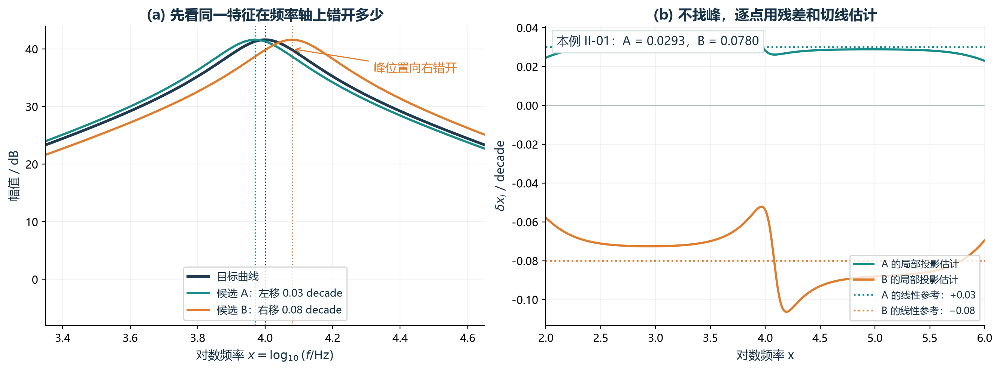

**图 1 可以这样讲：**“深蓝是目标，青色候选向左错了 0.03 decade，橙色候选向右错了 0.08 decade。现有代码分别给出约 0.0293 和 0.0780，能区分这个例子中的错位大小。左图画幅值便于看峰，计算时用的却是完整复阻抗。右图是逐点估计，不必先检测峰。”

右移 \(h\) 的候选写成 \(\widehat Z(x)=Z^\star(x-h)\)，所以残差近似为 \(-h g\)，\(\delta x\) 为负；左移时为正。最后取绝对值，两边都计为误差。0.08 decade 的设定移动量，对应峰频率乘以 \(10^{0.08}\approx1.2023\)。

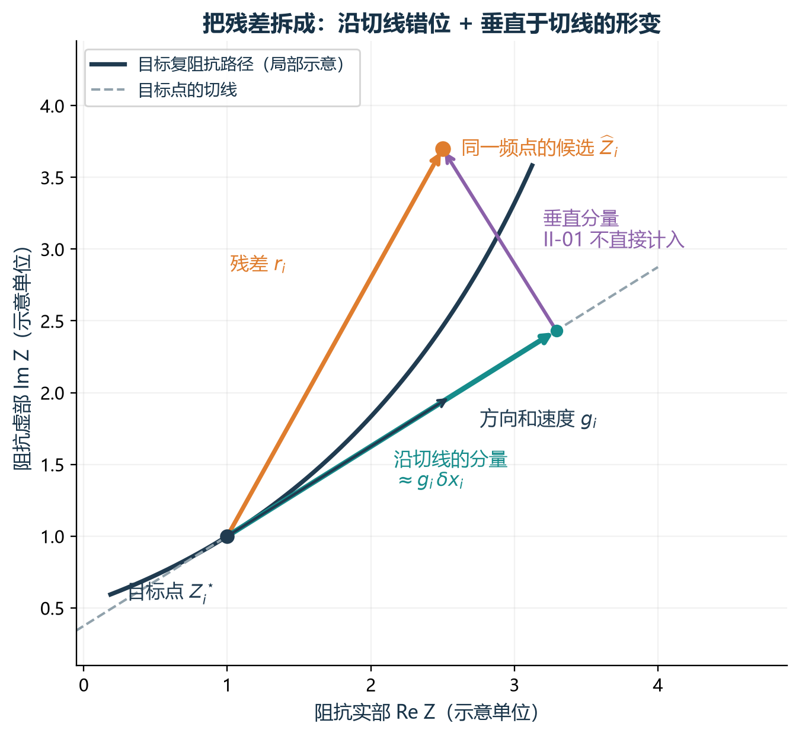

**图 2 可以这样讲：**“横轴是实部，纵轴是虚部。橙色残差连接同一频点的目标与候选。青色部分顺着目标切线，可以近似解释为局部频率错位；紫色部分垂直于切线，更像其他形变。II-01 主要测青色部分。”

这个投影可以由下面的最小二乘问题得到。\(d\) 是实数，表示待估计的局部 log 频率距离；\(\varepsilon_v^2d^2\) 是抑制过大估计的稳定项：

~~~tex
\begin{aligned}
Z^\star(x_i+d)&\approx Z_i^\star+g_i d,\\
\delta x_i&=\arg\min_{d\in\mathbb R}
\left\{|r_i-g_i d|^2+\varepsilon_v^2d^2\right\}
=\frac{\Re(r_i\overline{g_i})}{|g_i|^2+\varepsilon_v^2}.
\end{aligned}
~~~

若 \(r_i=r_R+\mathrm j r_I\)、\(g_i=g_R+\mathrm j g_I\)，分子就是 \(r_Rg_R+r_Ig_I\)，即二维点积。分母将阻抗残差换成频率距离。图中青色箭头示意普通投影；带稳定项时 \(g_i\delta x_i\) 会向零收缩。

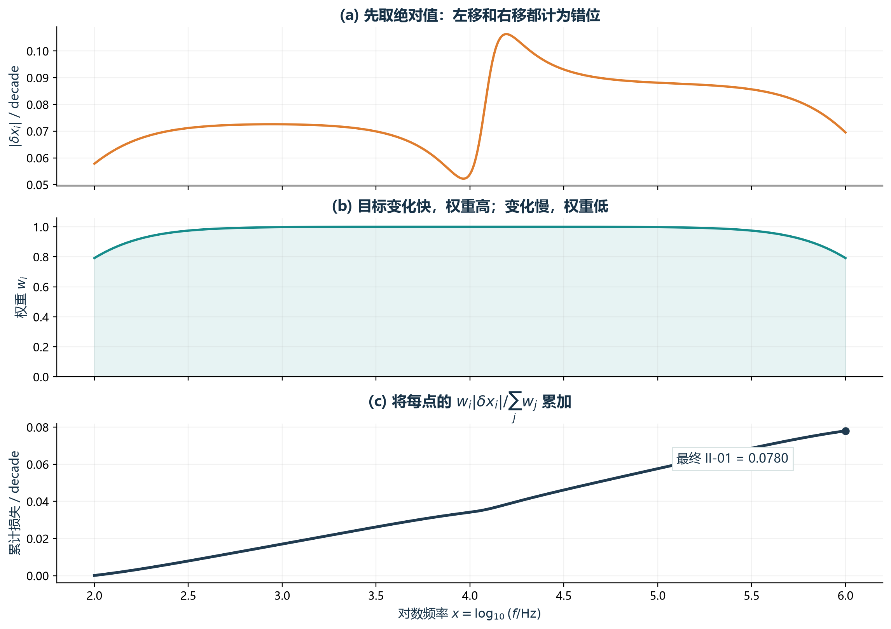

**图 3 可以这样讲：**“上图先对局部频移取绝对值，避免左右互相抵消。中图是目标导数决定的权重，变化慢的地方推断频移不可靠，权重低些。下图把每点的加权贡献累加，最右端就是最终指标。”

~~~tex
c_i=\frac{w_i|\delta x_i|}{\sum_{j=1}^{N}w_j},\qquad
C_k=\sum_{i=1}^{k}c_i,\qquad C_N=L_{\rm II01}.
~~~

\(c_i\) 是第 \(i\) 点的贡献，\(C_k\) 是前 \(k\) 点的累计贡献。这两个符号只是画图时拆开加权平均的辅助记号；没有低频提前停止规则，也不是论文 LFP 的连续达标段数。

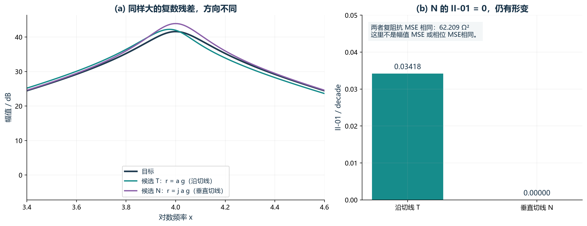

**图 4 可以这样讲：**“青色候选的残差沿切线，紫色候选垂直于切线。两者每点的复数残差大小一样，但紫色的 II-01 接近零，曲线却仍然有误差。因此，这项为零只能说明没测到沿切线的频移，不能说拟合完全正确。”

图中构造 \(r_T=a g\)、\(r_N=\mathrm j a g\)，\(a=0.035\) decade。乘以 \(\mathrm j\) 把向量旋转 90°，所以两者模相同，而 \(\Re(r_N\overline g)=0\)。当前代码算得 II-01 分别约为 0.03418 和 0；相同的是复阻抗 MSE（约 62.209 Ω²），不是两个主目标 MSE 相同。两条候选是线性化说明例子，未声称由合法电路参数生成，也不证明哪条更值得用于优化。

**这一指标最后可以这样收住：**“II-01 给出的是局部频移的近似解释。频移太大、曲线结构变化或目标导数受噪声影响时，估计可能不准。它需要和幅值、相位 MSE 一起看，是否适合参与优化还要由独立实验判断。”

完整的论文配图方法对照与逐图说明见 [II-01 图解](../archive/LOCAL_ONLY.md#ref-14083ccaf23d)。

### II-02 转变速度相对误差

~~~tex
\begin{aligned}
g_i^\star&=\frac{dZ^\star}{dx}(x_i),\quad
\widehat g_i=\frac{d\widehat Z}{dx}(x_i),\\
L_{\rm II02}&=\frac{1}{N}\sum_{i=1}^{N}
\frac{\left||\widehat g_i|-|g_i^\star|\right|}
{|g_i^\star|+\varepsilon_v}.
\end{aligned}
~~~

**本式新符号：**\(g_i^\star\) 是目标导数，\(\widehat g_i\) 是候选导数；\(|g_i|\) 是复数导数的模，可以理解为路径沿 log 频率前进时的“速度”；\(\varepsilon_v\) 沿用 II-01 的稳定项。

**计算步骤：**分别对目标和候选求 \(dZ/dx\) → 取导数模 → 算两种速度的绝对差 → 除以“目标速度加稳定项”得到相对误差 → 对所有频点取平均。

**整体意义：**它检查曲线的响应变化是过快还是过慢。它不关心导数指向哪边，所以与检查容感转换方向的 I-03 互补。

**容易误解的地方：**“速度”不是时间速度，而是阻抗随 \(\log_{10}f\) 的变化率；只比较导数模意味着两个方向相反但速度相同的点，这一项本身可能看不出来。

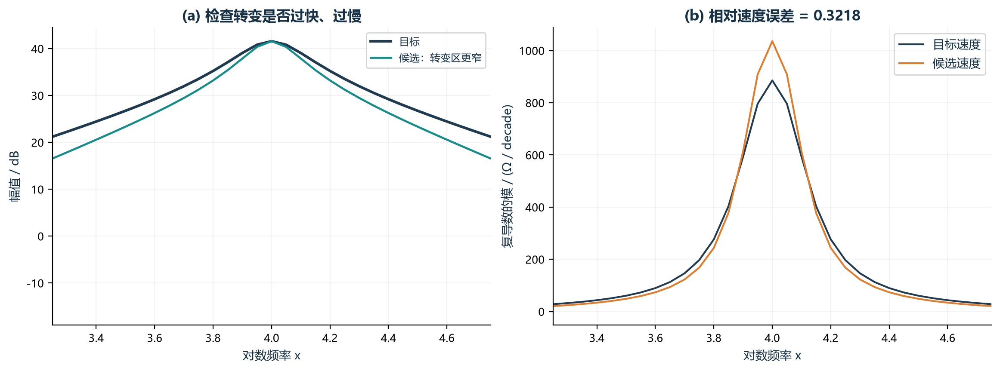

**配图怎么读：**幅值图帮助看到过渡宽度；右图画实际使用的复导数模，候选压窄后速度发生变化。

**指着图可以这样讲：**“对完整复阻抗求 log 频率导数，取模得到变化速度；两者速度差除以目标速度加稳定项，再平均。”

**图中边界与设置：**只比较速度大小，不比较方向；0.05 稳定项比例需要独立检验。

### II-03 窗口约束 DTW

~~~tex
\begin{aligned}
c_{ij}&=\|p_i(Z^\star)-p_j(\widehat Z)\|_2,\quad |i-j|\le4,\\
D_{ij}&=c_{ij}+\min(D_{i-1,j-1},D_{i-1,j},D_{i,j-1}),\\
L_{\rm II03}&=\frac{D_{NN}}{|\pi^\star|}.
\end{aligned}
~~~

**本式新符号：**\(c_{ij}\) 是目标第 \(i\) 个三维路径点与候选第 \(j\) 个路径点的欧氏距离；\(D_{ij}\) 是走到网格位置 \((i,j)\) 时的最小累计代价；\(\pi^\star\) 是最终选择的最优对齐路径，\(|\pi^\star|\) 是这条路径包含的匹配步数。

**特殊计算方法：DTW 动态规划。**

**计算步骤：**下面的伪代码就是公式的逐步执行方式：

~~~text
D[0,0] = 0；其他边界 = 无穷大
for i = 1 ... N:
    只遍历满足 |i-j| <= 4 的 j
    c = distance(target[i], fit[j])
    D[i,j] = c + min(
        D[i-1,j-1],   # 两边同时前进
        D[i-1,j],     # 目标前进，候选暂不前进
        D[i,j-1]      # 候选前进，目标暂不前进
    )
记录被选前驱，从而得到最优路径步数
返回 D[N,N] / 路径步数
~~~

**整体意义：**它允许两条曲线在频率索引上做小范围拉伸和压缩，再比较归一化频率、实部和虚部组成的整体路径形状。

**容易误解的地方：**窗口 4 指采样索引差，不是 4 Hz；程序先按累计距离选路径，再用步数归一化。它不同于 P-03 的 60 点、无窗口、仅 dB 幅值 DTW。

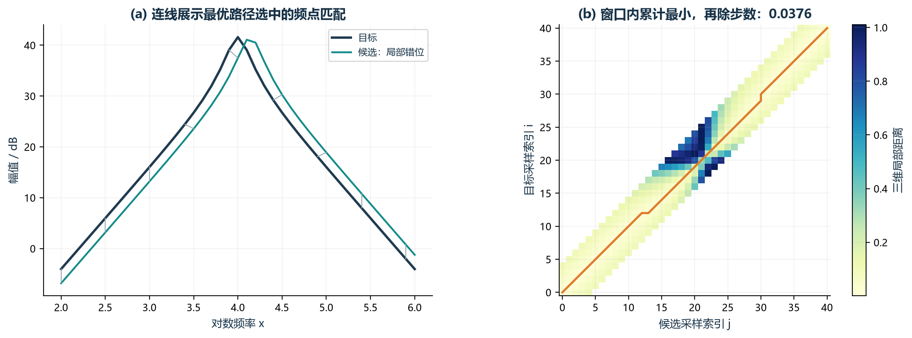

**配图怎么读：**左图连线是三维距离最优路径在幅值图上的投影；右图灰白带外区域不允许匹配，橙线为所选路径。

**指着图可以这样讲：**“允许频点在窗口内错位匹配，以累计三维距离最小来选路径，再按路径步数归一化。”

**图中边界与设置：**窗口 4 是采样索引差，随网格改变含义；图不能证明该窗口最优。

### II-04 Soft-DTW 散度

~~~tex
\begin{aligned}
\operatorname{smin}_{\gamma}(a,b,c)
&=-\gamma\log\!\left(e^{-a/\gamma}+e^{-b/\gamma}+e^{-c/\gamma}\right),\\
S_{ij}&=\|p_i-q_j\|_2^2+
\operatorname{smin}_{0.10}(S_{i-1,j-1},S_{i-1,j},S_{i,j-1}),
\quad |i-j|\le10,\\
L_{\rm II04}&=
\sqrt{\max\!\left\{\frac{S(p,q)-S(p,p)/2-S(q,q)/2}{N},0\right\}}.
\end{aligned}
~~~

**本式新符号：**\(\operatorname{smin}_\gamma\) 是“平滑最小值”；普通 \(\min\) 只保留最小前驱，而它让接近最优的几条路径也有少量贡献。\(\gamma\) 控制平滑程度，当前固定为 0.10；\(S(p,q)\) 表示路径 \(p,q\) 的 Soft-DTW 累计代价。

**特殊计算方法：**先把三种前驱代价 \(a,b,c\) 变成 \(e^{-a/\gamma},e^{-b/\gamma},e^{-c/\gamma}\)，代价越小权重越大，再用负对数转回代价。实现时会先减去三者最小值再计算指数，避免数值上溢或下溢。路径只允许 \(|i-j|\le10\)。

**计算步骤：**用三维距离平方作为局部代价 → 用平滑最小值递推 \(S(p,q)\) → 同样计算 \(S(p,p)\) 和 \(S(q,q)\) → 从交叉代价中减掉两个自相似代价的一半 → 除以 \(N\) → 由于浮点误差可能略小于 0，先用 \(\max(\cdot,0)\) 截断 → 开方。

**整体意义：**它测两条三维路径在允许柔性对齐后的整体差异，同时减少 Soft-DTW 自身的偏置。

**容易误解的地方：**它仍是几何相似度，不直接对应某个电路元件；窗口 10 也是采样索引。

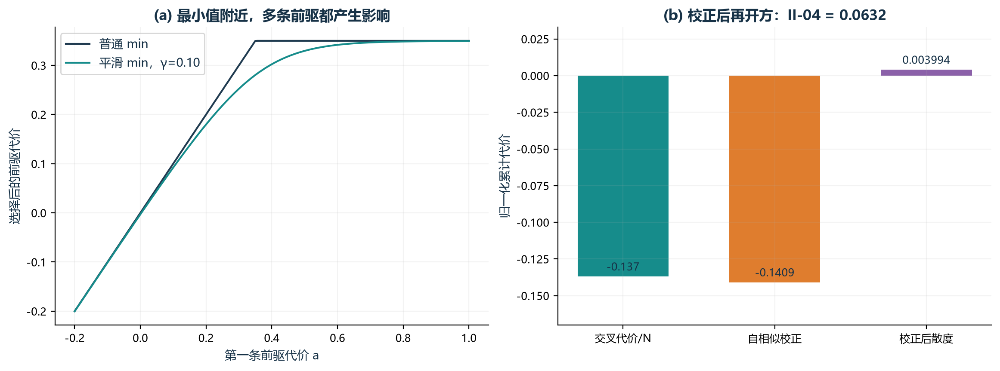

**配图怎么读：**左图固定另外两个前驱代价，展示普通 min 与平滑 min 的区别；右图展示交叉代价减去自相似项。

**指着图可以这样讲：**“Soft-DTW 平滑地综合接近最优的路径。先算目标与候选的代价，再减去双方自匹配代价的一半，按点数归一化并开方。”

**图中边界与设置：**软代价本身可为负，因此不直接当距离。γ=0.10 和窗口 10 都是当前设置。

### II-05 95% Hausdorff 距离

~~~tex
d_i^{\star\to c}=\min_j\|p_i^\star-\widehat p_j\|_2,\quad
d_j^{c\to\star}=\min_i\|\widehat p_j-p_i^\star\|_2,\qquad
L_{\rm II05}=\max\!\left(Q_{0.95}(\{d_i^{\star\to c}\}),
Q_{0.95}(\{d_j^{c\to\star}\})\right).
~~~

**本式新符号：**\(d_i^{\star\to c}\) 是“目标第 \(i\) 点到所有候选点的最近距离”；\(d_j^{c\to\star}\) 是反方向的最近距离；箭头只表示从哪一组点出发查最近邻。\(Q_{0.95}\) 沿用前面的 95% 分位数。

**计算步骤：**目标每个点都找最近候选点 → 得到一组距离并取 95% 分位数 → 候选每个点反过来找最近目标点 → 也取 95% 分位数 → 两个方向取较大值。

**整体意义：**它要求两组路径点的大部分都能在另一条曲线上找到近邻，同时不让极少数异常点完全支配结果。

**容易误解的地方：**它把曲线当无序点集，不要求频率顺序一致；95% 分位数意味着最差约 5% 点不会直接决定指标。

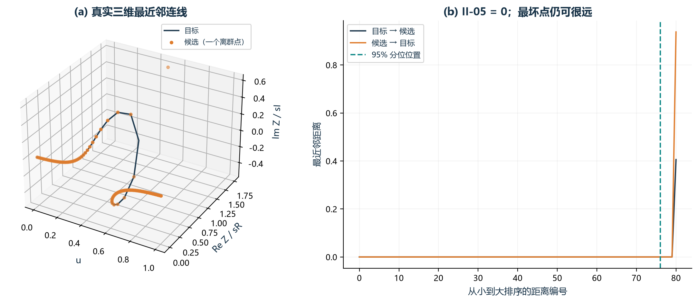

**配图怎么读：**一个离群点占比不足 5%，95% 分位距离在本例为零，但最坏点距离很大。左图距离包含 u、实部和虚部三个坐标。

**指着图可以这样讲：**“两个方向都找最近邻，各取 95% 分位数，再取较大的一个。它主要看大部分路径点有没有近邻。”

**图中边界与设置：**忽略最差尾部是设计选择，不代表异常点已修复；不按序匹配。95% 尚需敏感性验证。

### II-06 Sobolev H1 误差

~~~tex
E_0=\frac1N\sum_i\|\widehat p_i-p_i^\star\|_2^2,\quad
E_1=\frac{\frac1N\sum_i
\left\|\frac{d\widehat p}{du}(u_i)-\frac{dp^\star}{du}(u_i)\right\|_2^2}
{\max\left(\frac1N\sum_i\left\|\frac{dp^\star}{du}(u_i)\right\|_2^2,10^{-12}\right)},
\qquad L_{\rm II06}=\sqrt{E_0+E_1}.
~~~

**本式新符号：**\(E_0\) 是路径位置误差；\(E_1\) 是一阶导数误差；\(d p/du\) 表示三维路径随归一化频率 \(u\) 的变化率；\(10^{-12}\) 是数值保护下限，防止目标导数能量为零时除零。

**计算步骤：**逐点算候选路径与目标路径的平方距离并平均，得到 \(E_0\) → 两条路径分别对 \(u\) 求导 → 逐点算导数差平方并平均 → 除以目标导数自身的平均能量，得到无量纲的 \(E_1\) → 将 \(E_0+E_1\) 开方。

**整体意义：**它同时要求“点的位置接近”和“曲线的走向接近”，相当于位置误差与一阶平滑误差的组合。

**容易误解的地方：**两部分相加不代表它们具有完全相同的物理单位；这是经过路径归一化和导数能量归一化后的数学距离，也可能与主 MSE、II-02 信息重叠。

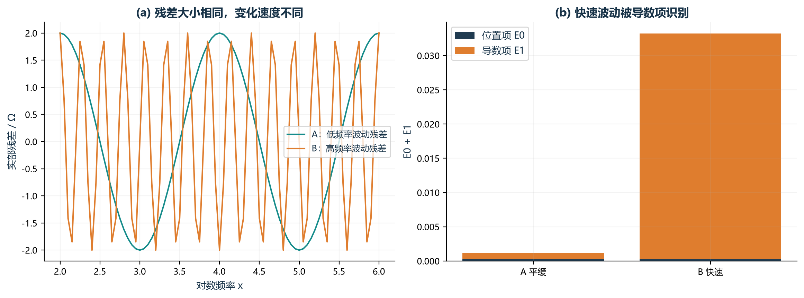

**配图怎么读：**两个候选的归一化位置平方误差相同，快速波动者导数误差更大；最终对两项之和开方。

**指着图可以这样讲：**“先要求点的位置接近，再要求一阶导数接近。即使点误差相同，快速抖动也会得到更高损失。”

**图中边界与设置：**导数项容易受噪声和采样影响；与主 MSE、速度误差可能重叠。

### II-07 去平移空间形状误差

~~~tex
\Delta_i=\left(
\frac{\Re(\widehat Z_i-Z_i^\star)}{s_R'},
\frac{\Im(\widehat Z_i-Z_i^\star)}{s_I'}\right),\quad
b=\left(\operatorname{median}_i\Delta_{i,1},
\operatorname{median}_i\Delta_{i,2}\right),\qquad
L_{\rm II07}=\frac1N\sum_i\|\Delta_i-b\|_2 .
~~~

**本式新符号：**\(\Delta_i\) 是归一化后的二维复阻抗残差，只含实部和虚部，不含频率坐标；\(s_R',s_I'\) 是目标实部、虚部各自的极差；\(\Delta_{i,1},\Delta_{i,2}\) 是 \(\Delta_i\) 的两个分量；\(b\) 是所有残差点在两维上的分量中位数。

**特殊计算方法：**这里用中位数而不是均值估计整体平移，使少数异常点不容易把平移量带偏。

**计算步骤：**求每个频点的实部、虚部残差 → 分别除以目标坐标跨度 → 两个分量各取中位数得到平移 \(b\) → 每个残差向量减去 \(b\) → 求剩余向量长度并平均。

**整体意义：**先允许候选曲线在复平面里整体平移，再比较平移后剩余的形状差异。

**容易误解的地方：**如果候选曲线只是整体偏移，这个指标可能很小，所以必须与保留绝对误差的主目标一起使用。

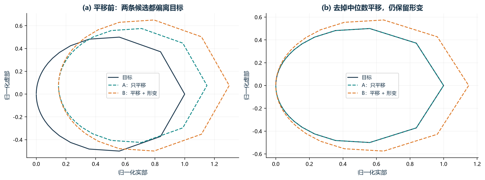

**配图怎么读：**左图含整体平移，右图按实部、虚部残差中位数去掉平移。A 与目标重合；B 仍有形状差异。

**指着图可以这样讲：**“把整条候选相对目标的恒定偏移先扣除，计算剩余残差长度的平均。”

**图中边界与设置：**纯平移可得到零损失，即使绝对阻抗差很大；要结合主目标使用。

### II-08 转折事件弱位置误差

~~~tex
\ell_j=
\begin{cases}
1,&E_{\rm fit}\cap R_j=\varnothing,\\
0.10\min\!\left(\dfrac{\min_{e\in E_{\rm fit}\cap R_j}|u(e)-u_j^\star|}
{|R_j|},1\right),&\text{否则},
\end{cases}
\qquad L_{\rm II08}=\frac1m\sum_{j=1}^{m}\ell_j .
~~~

**本式新符号：**\(\ell_j\) 是第 \(j\) 个目标转折区域的局部损失；\(u_j^\star\) 是目标转折位置；\(|R_j|\) 是该区域在归一化频率轴上的宽度。

**计算步骤：**若 \(R_j\) 内没有候选转折，\(\ell_j=1\) → 若有，就找离目标转折最近的候选 → 用位置差除以区域宽度 → 用 \(\min(\cdot,1)\) 把相对偏差封顶为 1 → 再乘 0.10 → 对所有区域平均。

**整体意义：**它把“事件有没有”放在第一优先级；只要事件存在，位置误差最多罚 0.10，因此位置只是弱约束。

**容易误解的地方：**它不比较转角强弱和类型，也不惩罚目标区域之外的额外转折。

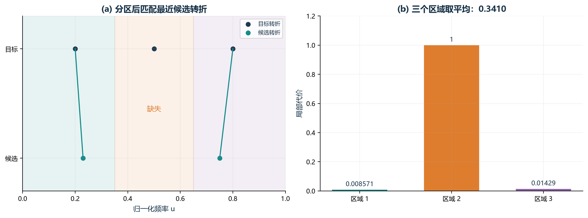

**配图怎么读：**事件层示例：目标位置构成三个负责区域；中间区域缺失，另两个区域只按最近位置偏差轻罚。

**指着图可以这样讲：**“不要求事先达到某个数量。每个实际目标区域都检查：没有事件罚 1，有事件再按相对距离乘 0.10。”

**图中边界与设置：**0.10 表示存在性比位置更重要，是当前权衡系数；不检查转折强弱和类型。

### II-09 转折存在性与过量事件惩罚

~~~tex
c=\sum_{j=1}^{m}\mathbf1\{E_{\rm fit}\cap R_j\ne\varnothing\},
\quad n=|E_{\rm fit}|,\qquad
L_{\rm II09}=\frac{m-c}{m}
+0.10\,\frac{(n-m)_+}{m}.
~~~

**本式新符号：**\(c\) 是被候选转折覆盖的目标区域数；\(n=|E_{\rm fit}|\) 是候选转折总数；\(m\) 是目标转折总数。第一项计算遗漏比例，第二项只在 \(n>m\) 时启动。

**计算步骤：**数被覆盖区域 \(c\) → 用 \((m-c)/m\) 算漏掉比例 → 算多余数量 \((n-m)_+\) → 除以 \(m\) 后乘 0.10 作为轻罚 → 两项相加。

**整体意义：**它同时防止“漏掉目标结构”和“人为制造太多转折”，但后者惩罚较轻。

**容易误解的地方：**额外事件按全局总数统计，不能保证每个目标区域一一对应；某个区域多个事件可能被总数项捕捉，但不会逐个配对。

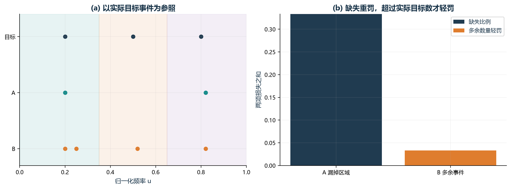

**配图怎么读：**事件层示例：目标有三个事件是本例数据事实，不是门槛。A 漏一区域，B 全覆盖但总数多一个。

**指着图可以这样讲：**“缺失比例看未覆盖区域，轻罚项看候选总数是否超过目标实际总数；两项相加。”

**图中边界与设置：**总数比较不能保证一一配对。0.10 是当前轻罚权重，尚需检验。

### II-10 去局部频移后的相对形变

~~~tex
r_i=\widehat Z_i-Z_i^\star,\quad
\delta x_i=\frac{\Re(r_i\overline{g_i})}{|g_i|^2+\varepsilon_v^2},
\quad s_Z=\max(\operatorname{median}_i|Z_i^\star|,10^{-12}),\qquad
L_{\rm II10}=\frac{\frac1N\sum_i|r_i-g_i\delta x_i|}{s_Z}.
~~~

**本式新符号：**\(r_i,g_i,\delta x_i\) 沿用 II-01；\(g_i\delta x_i\) 是用目标切线解释的局部频移分量；\(s_Z\) 是目标阻抗模的中位数，下限 \(10^{-12}\) 用于防除零。

**计算步骤：**求复阻抗残差 \(r_i\) → 按 II-01 算局部频移 \(\delta x_i\) → 用 \(g_i\delta x_i\) 重建“可由频移解释的残差” → 从原残差中减去 → 对剩余复数残差的模取平均 → 除以目标典型阻抗 \(s_Z\)。

**整体意义：**它回答“把可以解释为局部频率错位的部分扣掉以后，曲线自身还剩多少形变”。

**容易误解的地方：**这是局部一阶近似；当候选和目标相差很大时，剩余项不能严格叫物理法向误差。

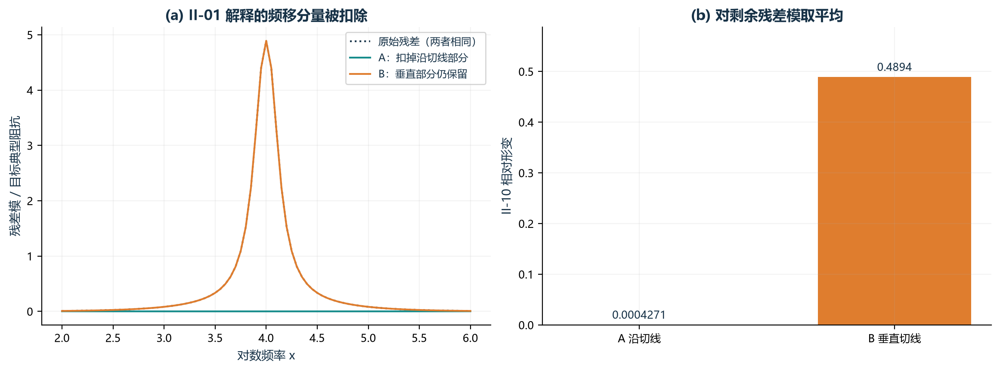

**配图怎么读：**沿切线与垂直切线的残差大小相同，扣除频移分量后，垂直形变仍被保留。

**指着图可以这样讲：**“先按 II-01 算局部频移，再从复残差扣掉 gδx；剩余长度按目标典型阻抗归一化。”

**图中边界与设置：**稳定项使切向残差不能被完全去掉；曲线相差大时不能严格解释为物理法向误差。

## P 系列：论文指标

### P-01 趋势编码相似性（SS）

~~~tex
\begin{aligned}
k_i(Z)&=\frac{A_{i+1}(Z)-A_i(Z)}{x_{i+1}-x_i},\\
s_i(Z)&=F(k_i,k_{i+1};T=8,\beta=0.4,\mu=0.5),\\
L_{\rm P01}&=\frac1N\sum_{i=1}^{N-2}
|s_i(\widehat Z)-s_i(Z^\star)|.
\end{aligned}
~~~

**索引范围：**N 个频点形成 N−1 个斜率，进一步形成 N−2 个相邻斜率对；求和上限为 N−2，分母仍按当前代码取原始频点数 N。

**本式新符号：**\(k_i(Z)\) 是相邻两个频点之间的 dB 幅值斜率；\(s_i(Z)\) 是由相邻斜率编码得到的趋势符号；\(F\) 是分段编码函数；\(T=8\) 是判断明显趋势的斜率阈值；\(\beta=0.4\) 控制附加强度；\(\mu=0.5\) 控制 sigmoid 变化快慢。

**特殊计算方法：sigmoid 与分段编码。**\(\sigma(t)=1/(1+e^{-t})\) 会把任意实数平滑压到 0 和 1 之间。斜率没有明显趋势时编码为 0；明显上升或下降时编码接近 \(+1\) 或 \(-1\)；从明显负斜率跨到明显正斜率，或反过来时，用更强的反转编码。

**计算步骤：**把幅值变成 dB → 对 log 频率求相邻斜率 \(k_i\) → 每两个相邻斜率送入分段函数 \(F\) 得到趋势序列 \(s_i\) → 逐项比较候选与目标趋势编码 → 绝对差求和 → 按实现除以原始频点数 \(N\)。

**整体意义：**它不问幅值具体是多少，而是问“哪里上升、哪里下降、哪里发生明显反转”是否一致。

**容易误解的地方：**这是离散编码，阈值附近很小的斜率变化可能让类别跳变；公式有 \(N-2\) 个编码项，但实现分母仍使用原始频点数 \(N\)。

~~~tex
F(a,b)=
\begin{cases}
d\!\left[1+1.5\beta\,\sigma\!\left(\mu d[(b-a)-2dT]\right)\right],
&\text{跨过正负阈值的反转},\\
d\!\left[1+\beta(2\sigma(\mu d(b-a))-1)\right],
&\text{明显正/负趋势},\\
0,&\text{其余}.
\end{cases}
~~~

**分段函数怎么读：**这里 \(a=k_i,b=k_{i+1}\)，\(d=+1\) 表示正趋势或由负转正，\(d=-1\) 表示负趋势或由正转负；\(\land\) 表示“并且”，\(\lor\) 表示“或者”。“明显负趋势”按代码是 \((b<-T\land a\le T)\lor(a<-T\land b\le T)\)；“明显正趋势”是 \((b>T\land a\ge-T)\lor(a>T\land b\ge-T)\)。跨越正负阈值的反转分支优先于普通正/负趋势分支。

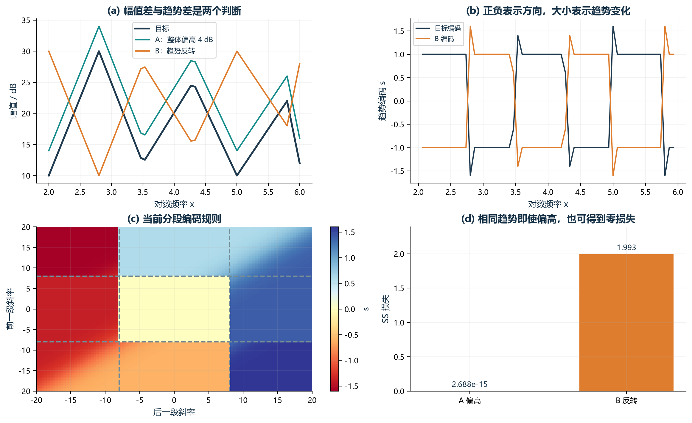

**配图怎么读：**按论文 SS 的曲线对比与斜率色彩图画法，展示幅值偏移、趋势编码、编码规则与最终评分。

**指着图可以这样讲：**“先求相邻 dB 斜率，再由连续两段斜率编码趋势；比较目标和候选编码的绝对差并平均。”

**图中边界与设置：**幅值整体偏移不改变斜率，可得到零 SS；T=8、β=0.4、μ=0.5 为当前设置。

### P-02 论文峰谷位置一致性（PTC）

~~~tex
L_{\rm P02}=\sum_{j=1}^{m_P}
\begin{cases}
\displaystyle\sum_{e\in E_{j,\rm same}}
\left[\exp\!\left(\gamma\frac{|x(e)-x_j^\star|}{S_x}\right)-1\right],
&E_{j,\rm same}\ne\varnothing,\\
\gamma,&E_{j,\rm same}=\varnothing,
\end{cases}
\qquad \gamma=0.41,\quad S_x=x_N-x_1 .
~~~

**本式新符号：**\(E_{j,\rm same}\) 是第 \(j\) 个目标峰谷区域内、与目标同类型的全部候选峰谷；\(e\) 是其中一个候选事件；\(x(e)\) 是该事件位置；\(x_j^\star\) 是目标峰谷位置；\(S_x\) 是总 log 频率跨度；\(\gamma=0.41\) 是固定惩罚强度。

**特殊计算方法：**目标相邻峰谷的中点形成半开区域 \([{\rm left},{\rm right})\)，避免普通内部边界被重复归属。峰由“中心不低于左侧且严格高于右侧”检测，谷反过来；这里没有 I-06 的 0.2 dB 突出量要求。

**计算步骤：**检测目标峰谷 → 用中点划区域 → 对每个目标事件查找区域内全部同类候选事件 → 没有就加 \(\gamma\) → 有则对每个事件计算归一化位置差的指数代价并全部相加 → 再对所有目标事件求和。

**整体意义：**它检查峰谷类型和位置是否一致，并且同一区域出现多个同类峰谷时会累计惩罚。

**容易误解的地方：**它不除以目标峰谷数，也不只取最近事件；因此数值尺度与 I-06 不同。它不比较峰高、谷深或峰宽。

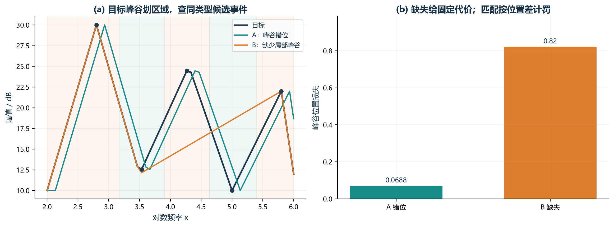

**配图怎么读：**黑点为目标峰谷；浅色区域按相邻目标事件的中点划分。比较位置错位与结构缺失。

**指着图可以这样讲：**“P-02 对每个区域内全部同类峰谷的指数位置代价求和；缺失也给惩罚，最终不除以目标事件数。”

**图中边界与设置：**不比较峰高、谷深；可能忽略没有同类匹配的反类型事件。0.41 为当前设置。

### P-03 60 点无窗口 DTW

~~~tex
\begin{aligned}
\widetilde x_k&=x_1+\frac{k-1}{59}(x_N-x_1),\quad k=1,\dots,60,\\
\widetilde A_k(Z)&=\operatorname{interp}
\left(A_i(Z);x_i\to \widetilde x_k\right),\\
D_{ij}&=|\widetilde A_i(\widehat Z)-\widetilde A_j(Z^\star)|
+\min(D_{i-1,j-1},D_{i-1,j},D_{i,j-1}),\\
L_{\rm P03}&=D_{60,60}.
\end{aligned}
~~~

**本式新符号：**\(\widetilde x_k\) 是在整个 log 频率范围内均匀放置的第 \(k\) 个新频率点，共 60 点；\(\operatorname{interp}\) 是线性插值，根据原始相邻点估计新位置的幅值；\(\widetilde A_k\) 是插值后的 dB 幅值；\(D_{ij}\) 是 DTW 累计代价。

**特殊计算方法：线性插值。**若新位置 \(\widetilde x\) 位于原始 \(x_a,x_b\) 之间，就按距离做加权平均：

~~~tex
\widetilde A=A_a+\frac{\widetilde x-x_a}{x_b-x_a}(A_b-A_a).
~~~

**计算步骤：**在 log 频率上建立 60 个等间距点 → 目标和候选都线性插值到这些点 → 用 dB 幅值绝对差作为局部代价 → 按 DTW 的三种前驱递推 → 返回 \(D_{60,60}\)。

**整体意义：**它允许局部频率轴拉伸或压缩以后，比较两条幅值曲线的整体形状。

**容易误解的地方：**它没有 \(|i-j|\) 窗口，输出是累计绝对 dB 差，也不除以路径长度；它只使用幅值，不直接比较相位。不要与 II-03 混用。

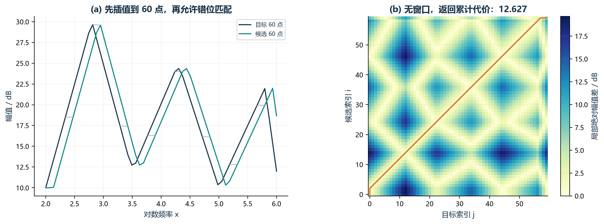

**配图怎么读：**沿用论文 DTW 的对齐连线与矩阵路径画法；距离只使用 dB 幅值。

**指着图可以这样讲：**“目标和候选都在 log 频率上插值成 60 点，逐格计算幅值差，再找累计代价最小的路径。”

**图中边界与设置：**无窗口，不比较相位，也不除路径长度；60 点影响计算成本和细节保留，需敏感性验证。

### P-04 低频连续达标段数（LFP）

~~~tex
e_j=\frac1{|B_j|}\sum_{i\in B_j}
[A_i(\widehat Z)-A_i(Z^\star)]^2,\quad
c=\sum_{j=1}^{m_P}\prod_{k=1}^{j}\mathbf1\{e_k<1.6\},
\qquad L_{\rm P04}=1-\frac{c}{m_P}.
~~~

**本式新符号：**\(B_j\) 是由目标峰谷中点切出的第 \(j\) 个频段；\(|B_j|\) 是这一段包含的频点数；\(e_j\) 是这一段的 dB 幅值 MSE；乘积 \(\prod_{k=1}^{j}\) 表示从第 1 段到第 \(j\) 段的所有达标指示值相乘；\(c\) 是从低频开始连续达标的段数。

**特殊计算方法：前缀连乘。**每个指示函数只有 0 或 1。只要前面某一段不达标出现 0，后续所有前缀乘积都会变成 0，因此后面的零散好段不能补回来。

**计算步骤：**下面的伪代码与前缀连乘等价：

~~~text
c = 0
仍保持连续 = true
for 频段 j 从低频到高频:
    计算本段 MSE e[j]
    如果 e[j] < 1.6 且“仍保持连续”:
        c = c + 1
    否则:
        仍保持连续 = false
返回 1 - c / 总段数
~~~

**整体意义：**它奖励“从低频开始一段接一段地拟合好”，而不是只看全频平均或后面零散的好频段。

**容易误解的地方：**1.6 的单位是 dB\(^2\)，且判断是严格小于；结果强烈依赖目标峰谷如何分段和这个固定阈值。

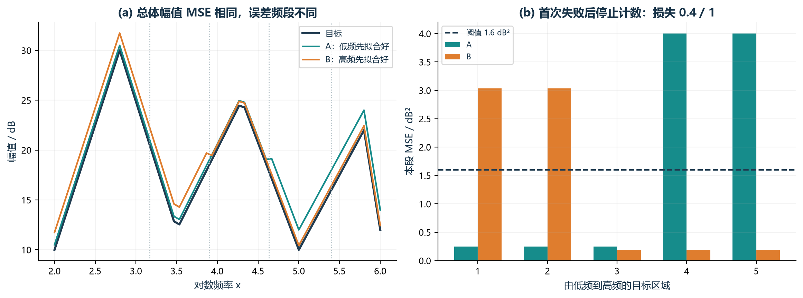

**配图怎么读：**两个候选总体幅值 MSE 相同；A 从低频连续达标，B 低频先失败，高频好段不能补回。

**指着图可以这样讲：**“按实际目标峰谷分段，只累计从低频开始连续低于误差阈值的段数，再除以总段数转成损失。”

**图中边界与设置：**没有规定必须达标几段，但 1.6 dB² 仍是经验阈值，需要验证；分段也影响结果。

### P-05 最大局部幅值误差（LMEP）

~~~tex
L_{\rm P05}=\max_{1\le i\le N}
|A_i(\widehat Z)-A_i(Z^\star)|.
~~~

**本式新符号：**没有新增复杂符号；\(\max_{1\le i\le N}\) 表示在全部频点中只取最大的 dB 幅值绝对误差。

**计算步骤：**逐点算候选与目标的 dB 幅值绝对差 → 找出最大值 → 作为最终损失。

**整体意义：**它专门盯住最差频点，防止“平均看起来很好，但某个局部偏差特别大”。

**容易误解的地方：**只看一个最大值，所以对单点异常、高噪声尖峰和测量毛刺很敏感。实验中高噪声条件下某个组合有效，是独立验证得到的条件性结论，不能反过来说这个公式天然抗噪。

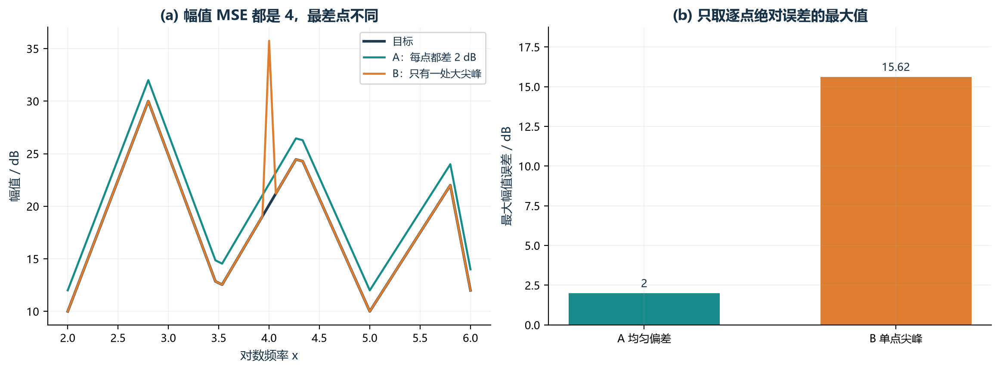

**配图怎么读：**复用 M-01 的等 MSE 示例，最大误差分别为 2 和约 15.62 dB，能看出单点严重失配。

**指着图可以这样讲：**“不把所有点平均，只看最差那个频点有多大幅值偏差。”

**图中边界与设置：**单点噪声或毛刺也能决定指标，因此不能说这个公式本身抗噪。

## 定义与数据来源

M/I/II 公式对照 `experiments/case2_dual_pdf18/objectives.py`，P 系列对照 `experiments/case2_paper5_combinations/objectives.py`。配图脚本为 `scripts/build_all_metric_figures.py` 和 `scripts/build_ii01_explanation_figures.py`。事件层例子直接列出事件位置，未声称由某个具体电路参数生成。原来的实验代码与历史实验记录保留，便于复核已有结果。
