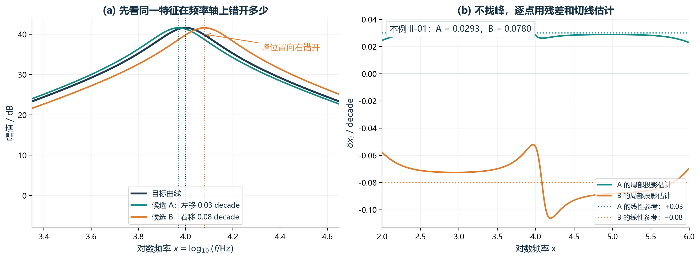
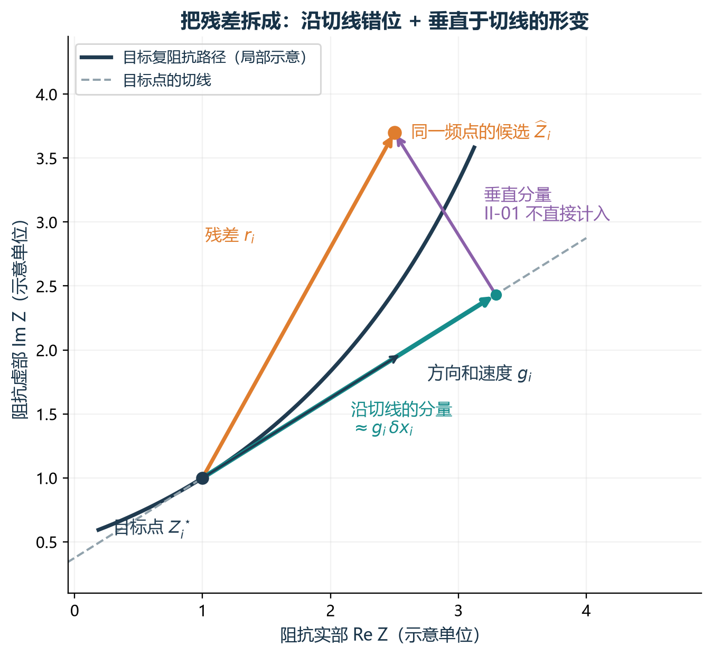
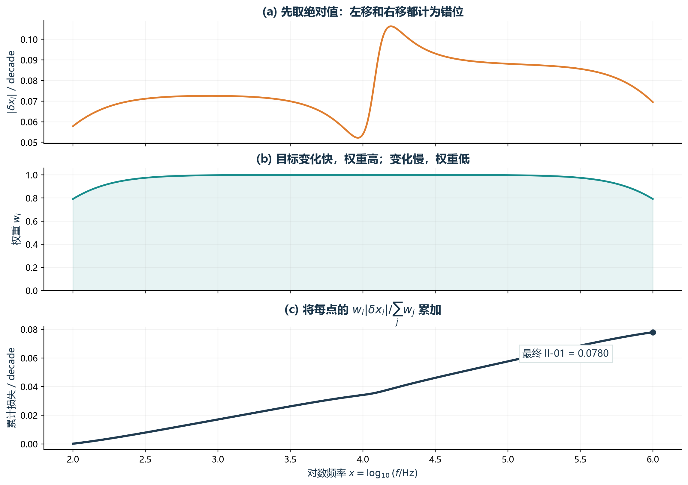
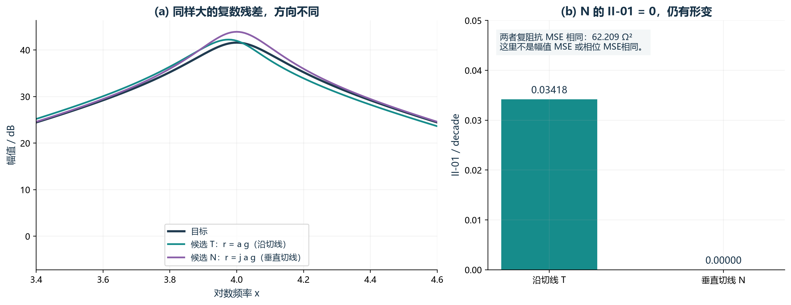

# II-01 局部特征频移误差：用图说明公式在算什么

这个指标想回答的是：候选与目标在同一频点的差异，有多少可以用“沿频率轴局部错开了一点”来解释？先看曲线，再看残差投影，最后看各点怎样合成一个数。

## 论文的五个指标是怎么配图的

参考本项目英文论文第 II 节、图 1 至图 7（PDF 第 2 至第 5 页）。论文用简化的目标曲线与候选曲线，突出指标关心的一个差别，并把计算对象直接标在图上。

| 论文指标 | 对应图片 | 画了什么 | 让读者理解什么 |
| --- | --- | --- | --- |
| SS：趋势相似性 | 图 1、图 2 | 目标与两条候选的相同趋势区间；相邻斜率到趋势编码的色彩图 | 距离接近和趋势接近是两个不同判断；趋势编码怎么产生 |
| PTC：峰谷位置一致性 | 图 3 | 目标峰谷的负责区域、候选同类峰谷、频率距离及累计惩罚 | 哪个峰谷与哪个目标匹配，缺失与错位怎样产生代价 |
| DTW：动态时间规整 | 图 4、图 5 | 同频点连线与可错位连线的对比；距离矩阵与最小累计路径 | 形状相似而位置略错时怎样重新对齐，代价如何累计 |
| LFP：低频优先 | 图 6 | 两个候选、频段划分、从低频开始连续达标的范围 | 总体误差相近时，低频连续拟合好到哪里 |
| LMEP：最大误差偏好 | 图 7 | 两个候选并标出各自最大的局部误差 | 平均误差相同也可能有不同的最差局部误差 |

下面沿用这种“曲线对比 → 标出计算对象 → 展示评分”的方法，绘制 II-01 的原创说明图。所有曲线和数值都是受控合成例子，便于解释数学定义；它们不属于 Case II 优化实验结果。

## 图 1：同一个特征左右错开，指标怎样变化

**图怎么读：**深蓝是目标，青色 A 向左移动 0.03 decade，橙色 B 向右移动 0.08 decade。三个峰的形状相同，位置不同。左图只用幅值帮助看清错位；计算 II-01 时使用完整的复阻抗，不是只用这条幅值曲线。

右图画出每个频点估计的局部频移。现有代码算得 A 的 II-01 为 0.0293，B 为 0.0780 decade。本例中，错位较大的 B 得分也较大。估计曲线不是水平直线，尤其在峰附近会偏离设定移动量，因为这里使用局部一阶近似，且有数值稳定项。

**指着图可以这样讲：**“这三条曲线的形状一样，但出现这个特征的频率不一样。II-01 想把这种局部频率错位单独量出来。它不用先找峰，而是在每个频点看候选残差有多少顺着目标曲线的变化方向。”

**符号方向：**若将候选曲线向右移动 \(h>0\)，它可写成 \(\widehat Z(x)=Z^\star(x-h)\)，因而

~~~tex
\widehat Z(x)-Z^\star(x)\approx -h\,\frac{dZ^\star}{dx}(x),
\qquad \delta x\approx-h.
~~~

所以右移对应负的 \(\delta x\)，左移对应正的 \(\delta x\)。最终损失取绝对值，两边错位都会受罚。0.08 decade 对应峰频率乘以 \(10^{0.08}\approx1.2023\)，即本例从 10 kHz 移到约 12.02 kHz；最终平均损失 0.0780 不能直接当成每个峰都移动了同样的百分比。

## 图 2：残差怎样投影成局部频移

**图怎么读：**横轴是实部，纵轴是虚部。深蓝点是目标在 \(x_i\) 的阻抗；橙点是候选在同一个 \(x_i\) 的阻抗。橙色箭头 \(r_i\) 是两点之差。灰虚线是目标曲线在这里的切线；青色分量沿切线，紫色分量垂直于切线。

**指着图可以这样讲：**“候选点虽然偏离了目标点，但偏离可以分成两部分。顺着切线的这部分，可以近似理解为沿频率往前或往后走了一点；垂直于切线的部分则更像形变。II-01 主要计算前一部分，再用目标曲线每个 decade 走多远，把阻抗距离换成频率距离。”

下面把这个说法对应到公式。\(x_i=\log_{10}f_i\)，\(g_i\) 是目标阻抗对对数频率的导数，\(r_i\) 是复阻抗残差：

~~~tex
g_i=\frac{dZ^\star}{dx}(x_i),\qquad
r_i=\widehat Z_i-Z_i^\star,\qquad
Z^\star(x_i+d)\approx Z_i^\star+g_i d.
~~~

若认为误差可以由一个小频移 \(d\) 解释，就希望 \(r_i\approx g_i d\)。让无法解释的残差尽量小，可以写成下面的一维最小二乘问题；加上稳定项后，其解正好是当前使用的 \(\delta x_i\)：

~~~tex
\begin{aligned}
J_i(d)&=|r_i-g_i d|^2+\varepsilon_v^2d^2,
\qquad d\in\mathbb R,\\
J_i'(d)&=-2\Re(r_i\overline{g_i})
+2(|g_i|^2+\varepsilon_v^2)d,\\
\delta x_i&=\arg\min_{d\in\mathbb R}J_i(d)
=\frac{\Re(r_i\overline{g_i})}{|g_i|^2+\varepsilon_v^2}.
\end{aligned}
~~~

这里 \(\overline{g_i}\) 是复共轭。若 \(r_i=r_R+\mathrm j r_I\)，\(g_i=g_R+\mathrm j g_I\)，则

~~~tex
\Re(r_i\overline{g_i})=r_Rg_R+r_Ig_I,
\qquad |g_i|^2=g_R^2+g_I^2.
~~~

因此分子就是二维向量的点积，量出残差沿目标切线的分量；分母把它换成对数频率距离。\(\varepsilon_v>0\) 会把估计向零收缩，避免目标导数很小时误差被放大。图中的青色箭头示意普通几何投影；带稳定项的 \(g_i\delta x_i\) 会略短一些。

## 图 3：逐点结果怎样变成最终指标

**图怎么读：**上图是候选 B 在每个频点的 \(|\delta x_i|\)；中图是权重 \(w_i\)；下图是从低频开始将各点贡献累加的过程，最右端就是最终 II-01。

~~~tex
\begin{aligned}
\varepsilon_v&=0.05\,\operatorname{median}_{|g_i|>0}|g_i|,\\
w_i&=\frac{|g_i|^2}{|g_i|^2+\varepsilon_v^2},\\
c_i&=\frac{w_i|\delta x_i|}{\sum_{j=1}^{N}w_j},
\qquad C_k=\sum_{i=1}^{k}c_i,\\
L_{\rm II01}&=C_N
=\frac{\sum_{i=1}^{N}w_i|\delta x_i|}{\sum_{i=1}^{N}w_i}.
\end{aligned}
~~~

**指着图可以这样讲：**“先取绝对值，避免左右错位互相抵消；再用权重降低平坦区域的影响。目标变化越慢，越难从残差推断到底错了多少频率，所以权重越低。最后把每个点的加权贡献相加，得到一个以 decade 为单位的平均局部频移误差。”

\(c_i\) 和 \(C_k\) 是为了画图而新增的记号，分别表示单点贡献和前 \(k\) 点的累计贡献，不是额外优化目标。本例最终累计值为 0.0779653，和现有 II-01 函数输出一致。当前代码先用 `np.gradient(..., edge_order=2)` 在 log 频率坐标上求导；\(\varepsilon_v\) 和 \(w_i\) 都由目标计算，所有候选共用。代码也对全平坦目标和零权重和设置了数值保护。

这里的累计图只是把加权平均拆开来展示。它没有按低频优先提前停止，不能与论文 LFP 的“连续达标段数”混淆。

## 图 4：为什么 II-01 小，仍不能说明拟合完全正确

沿用论文“目标 + 两个候选”的画法，构造两种大小相同、方向不同的残差，设 \(a=0.035\) decade：

~~~tex
\begin{aligned}
\widehat Z_{T,i}&=Z_i^\star+a g_i,
\qquad r_{T,i}=a g_i,\\
\widehat Z_{N,i}&=Z_i^\star+\mathrm j a g_i,
\qquad r_{N,i}=\mathrm j a g_i,\\
|r_{T,i}|^2&=|r_{N,i}|^2=a^2|g_i|^2,\\
\Re(r_{T,i}\overline{g_i})&=a|g_i|^2,
\qquad \Re(r_{N,i}\overline{g_i})=0.
\end{aligned}
~~~

复数乘以 \(\mathrm j\) 相当于在实部、虚部平面旋转 90°。因此 T 沿切线，N 垂直于切线；每个频点的复数残差大小完全相同，两者复阻抗 MSE 都是约 62.209 Ω²。但 II-01 给 T 约 0.03418，给 N 数值上接近 0。

**指着图可以这样讲：**“这个例子说明 II-01 能分辨误差方向。紫色候选的残差不沿切线，因此几乎没有频移分量，可是曲线仍然偏离目标。II-01 为零只说明没有测到沿切线的局部频移，不能说明没有其他误差。”

这两条候选是用于解释的线性化构造，未声称它们由合法的电路参数产生。这里相等的是 \(N^{-1}\sum_i|r_i|^2\)，不是我们最终考核的 dB 幅值 MSE、相位 MSE 或 WSMSE 相等。此图说明测量范围与局限，不证明某个候选更值得保留，也不证明加入 II-01 能改善优化结果。

## 汇报时连起来可以这样说

“II-01 是想估计局部频率错位。第一张图里，目标和候选形状相同，但是特征出现的频率左右错开。第二张图说明具体算法：在同一个频点求复阻抗残差，再看残差有多少沿着目标曲线的切线；把这部分换算成 log 频率距离，就是局部频移估计。第三张图把每个频点的估计取绝对值，并对平坦位置降低权重，最后取加权平均。第四张图说明它的边界：垂直切线的形变可能不被计入，所以这项要结合幅值和相位 MSE 来看。它是一阶局部解释，频移太大、结构变化明显或目标导数含噪声时，不能当成精确特征位置。”

数据与复现：合成目标是一个并联 RLC，\(R=120\ \Omega\)、\(L=1\ \mathrm{mH}\)、\(C\approx0.2533\ \mu\mathrm F\)，无噪声；100 Hz 至 1 MHz 共 501 个对数均匀点。评分直接调用 `experiments/case2_dual_pdf18/objectives.py`，作图脚本为 `scripts/build_ii01_explanation_figures.py`。示意图学习论文的解释方法，图形、例子和 II-01 推导为本次新制作。
