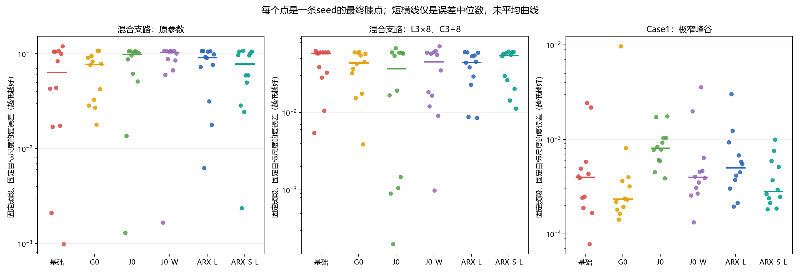
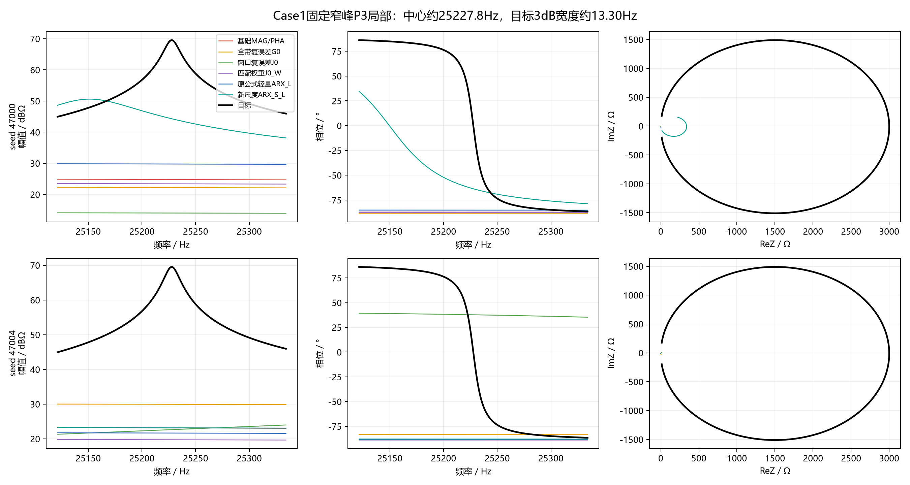
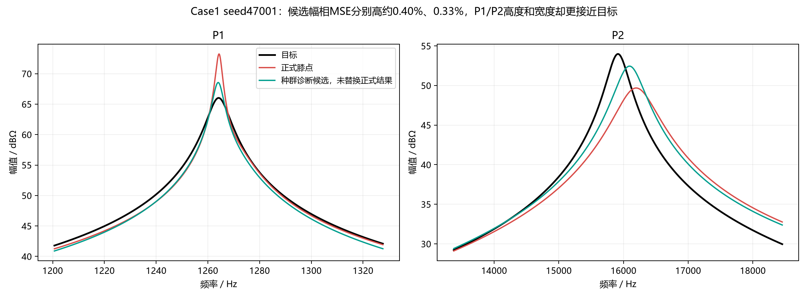
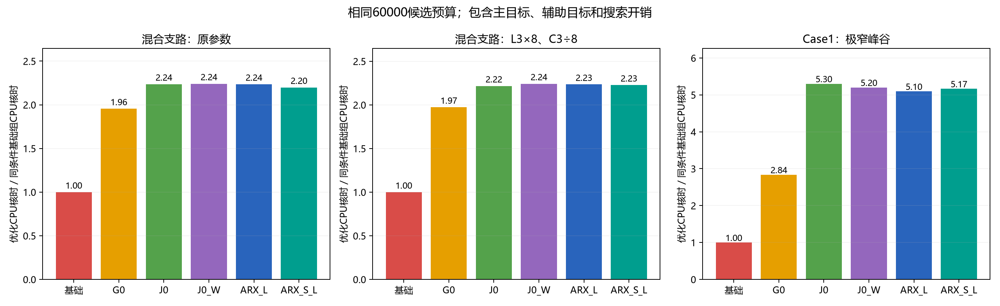

# ARX轻量化与目标轨迹尺度改造：配对实验报告

## 摘要

本批216个优化任务及216项独立复核均已完成，全部通过冻结验收门槛。433,116,024字节结果包已回收到本地，并通过SHA256、ZIP CRC、源代码与输入哈希、逐任务结果及保存阶段校验。

本轮得到两个需要区分的结论：**保持原定义的ARX实现加速有效；目标轨迹长度尺度改造具有Case1局部改善线索，但尚未形成优于基础MAG/PHA或普通复误差对照的稳定证据。**较窄混合网络中的原ARX结构收益也未在本批新seed中稳定重复。

正式优化累计18.79 CPU核时，从正式批次启动至审计结束约36.25分钟，2026年10月16日00:42完成（北京时间，不含前置预检及后续归档时间）。本批为既有目标上的开发实验，不属于独立推广验证。

## 1. 研究问题与实验设计

ARX比较频率标记的复阻抗轨迹累计有向面积。本轮分别检验计算实现和评分尺度：前者应降低成本而保持原分数定义，后者可能改变不同频段的搜索取舍。

三个条件分别为混合网络原参数、同网络L3×8且C3÷8、Case1。六组方法各使用12个新seed（47000–47011），共216任务。每任务200个体、300代、60000次候选评价，每20代保存全种群，共15阶段。相同seed采用相同初始化、边界、算子及预算。

|方法|作用|
|---|---|
|MAG/PHA|幅值、相位双主目标基础组|
|G0|增加全频段普通复阻抗平方误差|
|J0|增加原窗口普通复阻抗平方误差|
|J0_W|对J0施加与新尺度ARX相同的显式窗口权重|
|ARX_L|原ARX公式的轻量计算实现|
|ARX_S_L|轻量实现加目标轨迹长度平方尺度|

各辅助组均只有一个附加目标。所有正式结果均采用冻结MAG/PHA二维膝点及原回退，未按WSMSE最小值重选。诊断候选不替换正式结果。

## 2. 轻量化内容及数值可靠性

ARX_L保留原频段、频率参数、目标幅值尺度、累计面积定义及原目标分母。主要工程改动为：批量编译电路响应、解析导数与Gauss前缀积分；仅计算所需RX投影；复用固定目标面板和同一候选的面板构造；Case1采用等价电路直接求值。

训练仍保留8/16/32/64阶积分、候选与目标模态锚点、原加密上限、绝对1e-4及相对1e-3收敛门槛。未采用粗网格插值、尖峰截断或降低验收标准。这些改动降低重复计算和实现常数，不意味着连续积分的渐近复杂度已经消除。

固定312条历史、正式终点、诊断和随机候选全部通过数值预检。同机、同候选、同精度要求下，预热后交替计时得到辅助求值中位加速：

|条件|ARX_L相对原Python实现的辅助求值加速|
|---|---:|
|混合网络原参数|4.46倍|
|混合网络LC条件|4.36倍|
|Case1|20.48倍|

此处是辅助求值加速，不能直接解释为完整优化加速。正式旧公式组使用已通过一致性预检的ARX_L，没有再重复运行完整的旧Python优化。跨批次完整任务耗时受seed、搜索路径和硬件环境影响，不能作严格的同条件加速估计。

216个正式终点另在本地以原Python模型、主目标回退实现及Python面积积分重放。主目标最大绝对差分别为2.14e-14和1.39e-16，辅助分数最大相对差为2.41e-13，均通过原门槛。3240个保存种群的形状、有限性、边界及膝点均已核对。

一个额外设置的1e-11曲线逐点探针在5条Case1曲线上未通过，最大相对差4.24e-11；原冻结节点门槛为1e-8。49个相关点以70位独立分支解复核，两侧曲线均通过原门槛。额外探针的失败原样保留，没有修改原验收状态。详见[问题记录](ISSUES.md)。

## 3. 评分尺度改造的含义

窗口内采用z=Z/S及归一化log10频率t，累计面积为：

\[
a(t)=\frac12\int_0^t\operatorname{Im}\{\overline{z(u)-z(0)}z'(u)\}\,du.
\]

原ARX_L使用旧目标面积分母d_old。新版本先计算目标轨迹长度L*，令b=(L*)²，再取：

\[
d_{\mathrm{new},k}=\max\{b_k,\;0.1\sqrt{K^{-1}\sum_jb_j^2},\;10^{-4}\},
\quad
J_{S}=K^{-1}\sum_k\int_0^1\frac{(a_k-a_k^*)^2}{d_{\mathrm{new},k}^2}\,dt.
\]

候选不使用自身长度归一化，所有间隙及末端窗口保留。J0_W使用显式权重omega=(d_old/d_new)²，帮助判断收益是否仅来自窗口取舍变化。此对照不消除面积与点误差之间所有非线性敏感度差异。

该改造本质上改变评分尺度，并未增加新的几何观测量。有向面积不直接等于储能、Q值或谐振数量。本轮未加入此前提出的局部面积组合。

## 4. 正式拟合结果

共同局部误差采用固定目标尺度、均匀log10频率上的复数平方积分，评价频段与上一批保持一致：原参数混合网络45–58kHz，LC条件38.5–45kHz，Case1为100Hz–1MHz。不同方法使用相同评价定义，不以各自辅助分数判定胜负。

“完整结构”沿用原位置、高度和宽度共同门槛。混合条件关注P2/V3，共12seed×2事件=24项；Case1有11项幅值事件，共132项。事件不是独立试验，统计配对单位仍为seed。

|条件|方法|局部复误差中位数|关注幅值结构完整项数|相对基础局部误差更小的seed|联合改善seed|
|---|---|---:|---:|---:|---:|
|混合原参数|基础|0.06380|14/24|—|—|
|混合原参数|ARX_L|0.09139|10/24|5/12|4/12|
|混合原参数|ARX_S_L|0.07795|12/24|6/12|5/12|
|混合LC条件|基础|0.05823|9/24|—|—|
|混合LC条件|ARX_L|0.04458|10/24|8/12|6/12|
|混合LC条件|ARX_S_L|0.05442|6/24|7/12|6/12|
|Case1|基础|0.0003991|36/132|—|—|
|Case1|ARX_L|0.0005010|14/132|4/12|0/12|
|Case1|ARX_S_L|0.0002805|32/132|7/12|2/12|

联合改善要求：双方通过原验收、共同局部误差更小、整体MAG/PHA各不超过基础的1.10倍，且额外幅值事件不增加。该口径不保证额外相位事件不增，后者另行报告。1.00及1.25倍口径和全部对照见逐seed及分组表。

### 4.1 Case1：尺度调整改善原ARX，但没有超过基础方法

ARX_S_L相对ARX_L有9/12个seed的共同局部误差更小，9/12个seed完整幅值结构更多；完整项数由14增加至32。改善主要出现在P1、P2、P6等已有峰的高度与宽度，而不是最困难窄峰已经稳定恢复。

基础组仍为36/132。Case1幅值MSE中位数，基础为13.08，新尺度为19.21；相位MSE中位数分别为0.1338和0.1563。相位结构完整项数为基础46/132、新尺度35/132；额外相位事件为8与15。新尺度的局部复误差中位数较低，并不代表整体幅相或所有结构更好。

ARX_S_L相对基础的配对平均局部误差差值探索性95% bootstrap区间为[-0.0006315,0.0000623]，跨越零。相对ARX_L的区间为[-0.0008850,0.0000936]，也跨越零。不能将9/12这一频数写成已确认的稳定优势。

### 4.2 混合网络：正向线索未稳定重复，尺度改造存在退化

原参数条件下，新尺度较原ARX的分组中位数有所改善，但共同局部误差和完整结构数仍不及基础组。

LC条件下，ARX_L完整恢复P2为1/12、V3为9/12；ARX_S_L分别为1/12与5/12。新尺度没有修复峰P2，反而减少了谷V3的完整恢复次数。两者共同局部误差中位数分别为0.04458与0.05442。

原ARX在该条件下相对基础仍有8/12个seed局部误差较小，但配对平均差区间跨零，关注结构完整项数只由9增至10，未稳定重复上一批12/16的结构恢复表现。批次seed不同，不能将变化简单归因于编译加速；相同候选上的数值一致性已有独立证据。

### 4.3 普通复误差对照未被排除

Case1中，J0_W相对J0也有9/12个seed局部误差更小，完整幅值项数由6/132增至25/132。这说明窗口尺度确实会改变搜索结果，不能将ARX_S_L的全部改善归于联合面积。

ARX_S_L相对J0_W的局部误差更小频数，在原参数、LC条件及Case1分别为8/12、4/12、6/12；相应配对均值区间均跨零。Case1相对G0只有3/12个seed局部误差更小。当前没有可靠证据证明面积描述优于普通复误差及匹配权重对照。

所有非基础方法相对基础，以及本文直接比较的探索性95%均值区间均包含零；未作确认性多重检验，也不将“未检出差异”解释为方法等效。

## 5. 持续困难的结构及选解诊断

Case1的P3约位于25,227.8Hz，目标3dB宽度约13.30Hz。基础组仅1/12完整恢复，ARX_L与ARX_S_L均为0/12。该结构在原模型及加密检查中可以被计算到，不能继续将本批主要失败解释为辅助网格漏看尖峰。

P3目标±3宽度区域在基础组幅值误差中的贡献比例中位数约0.88%。这说明尖锐局部缺陷可以只占整体分数的小部分；仍需结合搜索与最终前沿，不能直接断言是MSE单独造成。

混合网络仍反复出现：局部Re/Im轨迹被压缩、频率位置偏移、相位过程过窄或过浅。固定代表seed的三维、平面及幅相图均保留，未平均曲线。

对Case1基础组最终种群，在整体MAG/PHA各不高于正式解1.10倍的候选中，按共同局部复误差最小选择一个诊断候选。12个seed中，4个存在更多完整幅值事件且额外幅值事件不增的候选；其中3个不在MAG/PHA二维前沿，1个在前沿但未被膝点选中。这个诊断规则为事后分析，不替换正式结果，也不能说明候选在所有结构上更好。

seed47001的诊断候选幅相MSE分别仅高约0.40%、0.33%，却被正式解双目标支配。P1高度偏差由+7.22降至+2.53dB、宽度比由0.303增至0.549；P2高度偏差由-4.30改善至-1.53dB、宽度比由1.866降至1.355。两处均存在连续量改善，不只是阈值计数变化。与此同时P4、P6和V1等局部量仍可能变差；第三个新增完整事件V5接近3dB门槛，不能把0→3计数全部当作同等强度的证据。

## 6. 端口模态诊断及窗口贡献

144个混合网络终点的端口模态分解通过重构及节点核验。按频率匹配高频振荡模态，新尺度相对基础的模态频率、复留数、衰减、可见程度更接近目标的频数，在LC条件分别为8、8、6、5个seed（分母均12）；原ARX分别为9、8、8、4。没有形成全部物理描述量同步改善的证据。模态匹配可能存在歧义，峰谷也不与极点简单一一对应。

正式终点中，Case1最大单窗口贡献比例的中位数由ARX_L的73.2%降至ARX_S_L的28.1%，但个别新尺度终点仍有单窗口占比接近100%。混合LC条件相应比例反而由60.4%升至72.6%。这些比较同时受权重和优化终点改变影响，不能作为归一化单因素因果证据；固定旧候选上的纯评分重分配另见预检归档。

局部改善、残差分配更均衡与整体收益是不同判断。本批不支持删除高贡献窗口、截断大残差或据此宣称物理机制已经证实。

## 7. 实际优化成本

|条件|基础组CPU核时（12seed）|ARX_L核时|ARX_S_L核时|ARX_L/基础|ARX_S_L/基础|
|---|---:|---:|---:|---:|---:|
|混合原参数|0.648|1.449|1.425|2.24|2.20|
|混合LC条件|0.659|1.474|1.469|2.23|2.23|
|Case1|0.132|0.674|0.684|5.10|5.17|

这些比值包含主目标、辅助目标及搜索开销，属于相同候选预算比较。本轮没有相同墙钟或相同CPU预算优化，不能据此判断附加指标是否比把时间用于基础搜索更划算。

32个单线程工作进程的正式优化CPU利用率采样平均约95.2%，启动阶段接近100%；队列尾部任务数减少时利用率下降。没有制造无效负载。

## 8. 研究判断

1. **反复困难的结构：**Case1极窄峰的高度、位置、宽度与局部转向，以及混合网络中的谷峰组合和联合轨迹展开过程。尺度改造主要补回部分已有结构，最困难P3未解决。
2. **使问题变难的条件：**局部结构在全局误差中的占比小、参数及模态联动、固定搜索预算和二维前沿/膝点偏好；各因素尚未完全隔离。LC操作不能只解释成峰宽变化。
3. **针对性指标能否改善：**轻量实现的数值与成本证据明确；新尺度在Case1相对旧ARX有开发线索，但未形成相对基础及普通复误差对照的稳定联合收益。
4. **推广与代价：**仅三个既有开发条件、每组12seed，尚无新拓扑、实测、噪声或相同时间预算验证。仍需约2.2至5.2倍基础优化CPU成本。

建议保留ARX_L作为后续开发的计算实现；不将ARX_S_L直接定为最终辅助指标，也不立即扩大seed或电路规模。后续若继续局部面积设计，应优先针对P3联合轨迹缺失及混合谷峰不同步恢复的固定反例，先检验指标在局部连续结构取舍上的判别力，并保留普通复误差、匹配权重及搜索/前沿诊断。

本批未启动新的局部面积优化、扩展电路或网站发布。正确模型内零误差参数仍存在；本报告不声称MSE理论上不能拟合这些电路。

## 9. 数据与复核入口

- [完整分组与配对表](ALL_TABLES.md)
- [进一步判断](FINDINGS.md)
- [工程问题与影响](ISSUES.md)
- [冻结实验方案](../../experiments/arx_light_20261015/PROTOCOL.md)
- [本地数值重放](LOCAL_NUMERICAL_RECHECK.json)、[分析核验](LOCAL_ANALYSIS_CHECKS.json)
- [逐seed数据](analysis/REVIEWED_SEEDS.csv)、[事件连续量](analysis/REVIEWED_EVENTS.csv)、[窗口贡献](analysis/AUXILIARY_WINDOW_CONTRIBUTIONS.csv)

完整原始结果、3240个保存种群、独立审计、冻结代码及二进制保存在retrieved目录；本地分析脚本、数据和图均保留。结果包SHA256为00b9b5526d2cb384bf65bdc5045183dcb3e59906849ad9c398ccc7e4f97d884c。
