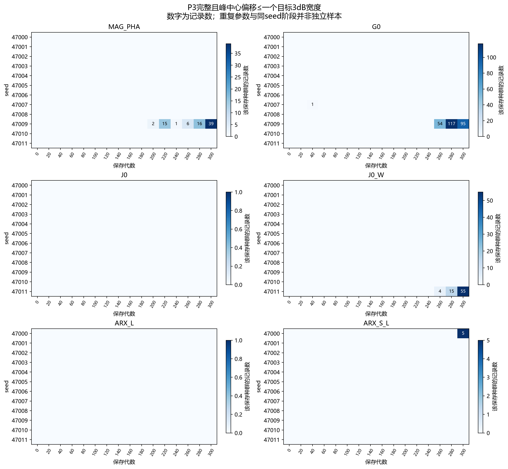
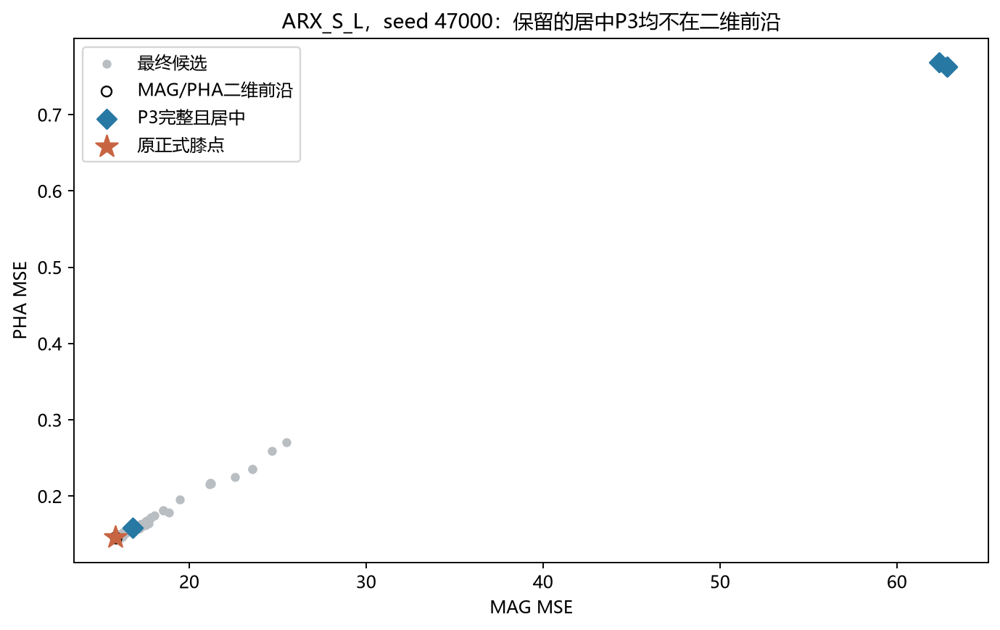
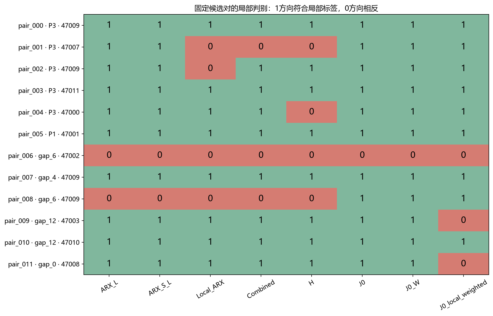
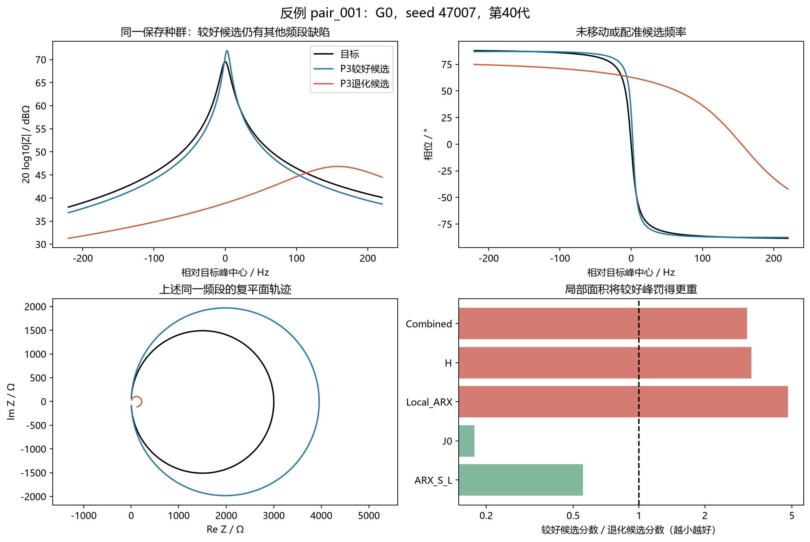
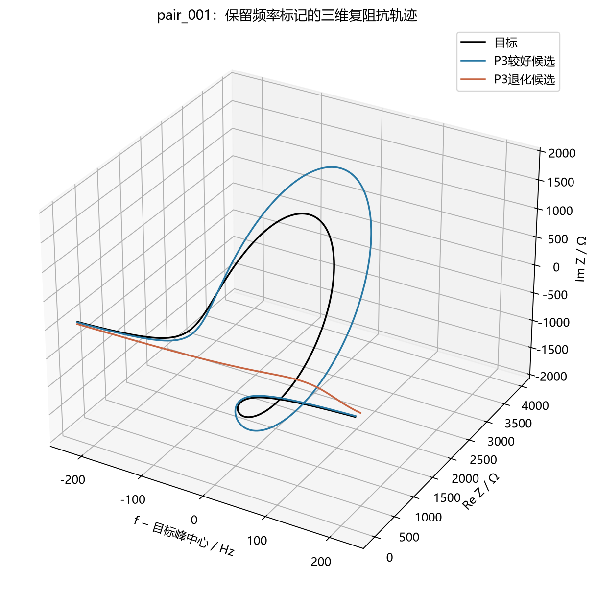
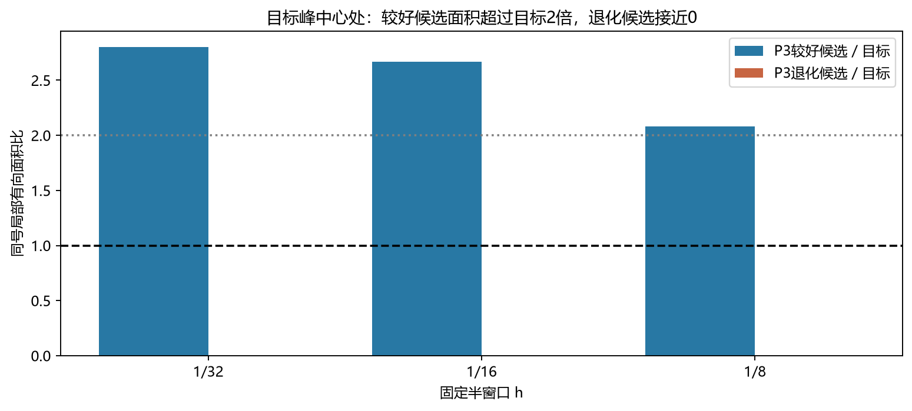
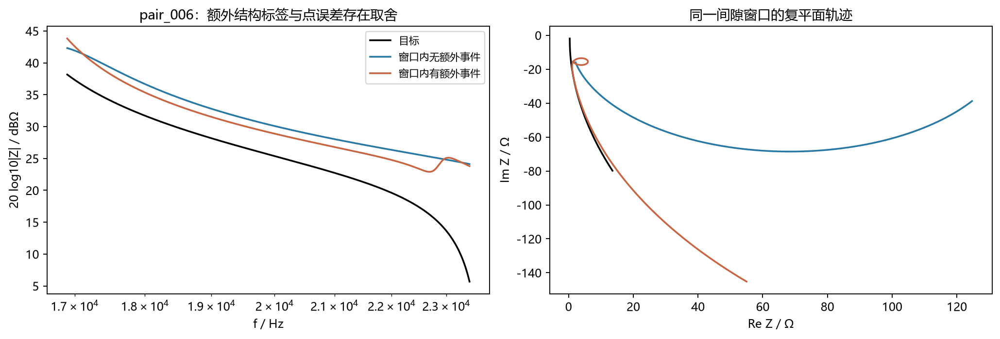

# Case1保存种群追溯与连续局部ARX判别实验

## 摘要

本轮完成既有Case1结果的保存种群追溯、固定候选对筛选及连续局部面积评分检查，未增加优化预算。结论如下：

1. **困难同时涉及搜索过程和目标取舍，不能仅归因于最终膝点。**72次运行中，只有5次在保存阶段确认出现“P3完整且峰中心偏移不超过一个目标宽度”的候选；4次保留至最终种群。G0、J0_W和ARX_S_L的相关最终候选均不在MAG/PHA二维前沿。
2. **连续局部面积没有通过预先定义的开发筛选。**12个固定候选对、9个seed、三类缺陷中，原ARX局部方向符合标签10/12，连续局部ARX为8/12，二者组合为9/12；普通窗口复误差J0为11/12。新局部指标没有显示超越普通复误差的判别证据。
3. **发现了可解释、可复算的面积敏感度反例。**一个P3峰高仅偏+2.40dB、宽度为目标0.65倍的候选，得到的局部面积损失却是明显退化候选的4.80倍。局部有向面积对转弯强度和频率压缩敏感，平方差可能将面积过冲罚得比目标结构近乎缺失更重。

24项候选—窗口数值检查全部通过；本地原Python模型复算与服务器结果的最大相对差为1.35×10⁻¹³以内。因此，本轮主要反例属于**指标与所声明结构要求不一致**，不能用数值积分失败解释。依据原定进入条件，本轮止于诊断，**未启动局部ARX或组合的新优化**。

## 1. 范围、数据及判定口径

数据来自[ARX轻量化配对实验](../arx_light_20261015/REPORT.md)的Case1：六方法、12个seed（47000–47011）、每种群200个候选。读取最终14,400个候选记录、全部15个保存阶段及初始化，共230,400个记录位置，按精确参数字节去重后为165,294个候选。重复记录、同seed阶段及不同方法的配对初始化均不是独立样本。

六方法为MAG_PHA、G0、J0、J0_W、ARX_L及ARX_S_L。G0为全频段普通复误差，J0为原窗口普通复误差，J0_W加入匹配窗口权重；ARX_L保持原面积定义，ARX_S_L采用目标轨迹长度平方尺度。正式解仍为原MAG/PHA二维膝点及回退，诊断候选不替换正式解。

P3为约25,227.78Hz的窄峰，目标3dB宽度约13.30Hz、对数宽度0.000228928decade。保留旧事件检测和完整结构要求：显著度1dB、匹配半径0.25decade、位置偏移≤0.02decade、高度偏差≤3dB、宽度比在[0.5,2]内。

原位置门槛约等于P3目标宽度的87.36倍，足以容许峰仍明显偏离目标局部过程。因此另报“**完整且居中**”：在旧完整条件外，峰中心偏移≤一个目标对数3dB宽度。该描述没有替换旧验收或改变优化；“居中”也不表示整条曲线准确。

### 1.1 全量追溯如何避免漏判窄峰

Case1由六个并联RLC支路串联，满足|Z|≤Σ|Zⱼ|。在旧P3位置允许区间内，单支路最大模值可由支路谐振频率裁剪到该区间求得。若六项最大值之和仍低于目标峰高减3dB，则可确定该候选不可能完整恢复P3。计算保留1e-8相对保守余量，近边界不使用该证书。

该证书只判定“P3不完整”，**不意味着无峰，也不提供其他峰谷的分类或连续量**。其余候选采用全频带峰谷匹配、候选与目标模态锚点及1/2/4/8级加密；全部保存的正式膝点强制完整扫描。补充稳定性要求为相邻级别匹配/完整分类一致、位置差≤1e-5decade、高度差≤0.02dB、宽度相对差≤1%，并检查额外事件数。

|检查项目|结果|
|---|---:|
|去重候选|165,294|
|完整全频带事件评价|3,525|
|仅用解析上界确定P3不完整|161,769|
|完整评价且同时具有阴性证书|1,038，无证书冲突|
|P3状态数值稳定或有解析证书|165,265|
|达到加密上限后仍不确定|29，保留为不确定|
|旧P3完整的唯一候选|495|
|完整且居中的唯一候选|333|
|正式终点P3判断重放|72/72与原审计一致|

最终14,400个记录均无P3不确定项。29项位于历史候选，未计作成功或失败。本地另抽查512个证书候选，实际响应均不超过解析上界；抽查用于实现核验，证书成立依据仍为上述解析不等式。

## 2. 搜索、保留和最终选解分别发生了什么

下表“含P3”均沿用旧完整门槛；“居中”为补充描述。记录数不等于独立候选或成功seed数。

|方法|最终旧完整记录|其中居中记录|最终含P3的运行数|二维前沿含P3的运行数|正式膝点P3完整|保存阶段曾有居中P3|
|---|---:|---:|---:|---:|---:|---:|
|MAG_PHA|41|39|1/12|1/12|1/12|1/12|
|G0|95|95|1/12|0/12|0/12|2/12|
|J0|0|0|0/12|0/12|0/12|0/12|
|J0_W|55|55|1/12|0/12|0/12|1/12|
|ARX_L|1|0|1/12|0/12|0/12|0/12|
|ARX_S_L|6|5|1/12|0/12|0/12|1/12|

“完整且居中”只在5/72次运行、4个不同seed的保存阶段出现；初始化没有这类候选，最终仍有4/72次运行、3个不同seed保留。具体情况为：

- **MAG_PHA，47009：**最终41个旧完整记录、39个居中记录，2个旧完整记录在二维前沿，正式膝点恢复P3。
- **G0，47007：**第40代保存种群存在居中P3，最终种群没有。这支持“保存阶段出现后又丢失”，但缺少逐代亲子记录，不能指定是哪一次选择或变异造成。
- **G0，47009：**最终95个居中P3记录，全部不在二维前沿。其中2个候选的MAG/PHA均不超过正式解1.10倍，仍未进入二维前沿。
- **J0_W，47011：**最终55个居中记录均不在二维前沿，且不满足上述双主目标1.10倍范围，存在明显整体取舍。
- **ARX_S_L，47000：**最终6个旧完整记录，其中5个居中；6个均不在二维前沿，其中3个在双主目标1.10倍范围内。

ARX_L的唯一最终旧完整候选，中心偏移约6.87个目标宽度，不属于居中恢复。不得将其旧完整计数解释为目标窗口内轨迹已经对齐。

因此，不能将失败概括成“其实已经搜到，只是膝点没有选好”。大多数运行在保存种群中没有确认居中P3；少数曾出现后消失；另一些虽保留，但已被二维目标支配。**改变二维前沿上的膝点规则不能直接选中被支配的候选。**这些候选又可能牺牲其他峰谷，不能认定它们全局更好。每20代保存一次也无法证明其余运行从未生成过相关子代。

## 3. 固定候选对及连续局部面积

在任何新局部评分计算之前，冻结12个不同参数对，覆盖9个seed与三类缺陷：5对P3缺失/变形、1对P1高度宽度改善、6对间隙额外结构。优先同一最终种群，必要时追溯历史保存种群。MAG与PHA的对称相对差均≤5%，不使用新指标得分筛选。

“较好/退化”仅指声明窗口与结构标签，不是整条曲线优劣。额外结构对的目标完整项数相同，但无额外事件的一侧可能存在更大的点误差。候选参数、来源、事件连续量及其他退化均保存在[冻结候选库](SCORING_BANK.json)。

本轮是既有目标上的开发。初步最终种群计数在候选对规则形成前已知；评分前冻结候选，不等于整个研究是独立确认性预注册。

窗口内使用z=Z/S与归一化对数频率t。记原累计有向面积为A(t)，局部面积为：

\[
a_{\mathrm{loc}}(t,h)=A(t+h)-A(t-h)
-\frac12\operatorname{Im}\{\overline{z(t-h)-z(0)}[z(t+h)-z(t-h)]\}.
\]

这等价于局部轨迹与端点弦围成的有向面积，消除局部起点之前的累计量。保持相同频率中心，不移动候选；h固定为1/32、1/16、1/8。分母为目标同区间轨迹长度平方，并采用目标窗口集合的均方尺度下限（tau=0.1，epsilon=1e-4）；不以候选自身归一化。Local_ARX为三种h下标准化面积平方差的平均，Combined=0.5ARX_S_L+0.5Local_ARX。

对照包括原ARX_L、尺度ARX_S_L、J0、匹配旧窗口权重J0_W、匹配局部中心权重J0_local_weighted及既有Hermitian增量指标H。固定单窗口内，ARX_L与ARX_S_L仅差正常数，J0与J0_W同理；相同排名不是两份独立证据。原窗口来自幅值事件，因此本轮仍未摆脱幅值引导的窗口定义。

### 3.1 评分的数值可靠性

24个候选—窗口全部检查16/32/64阶积分、候选模态面板、真参数近零及旧定义一致性；局部面积另与128/256细分独立多边形法比较，全部通过原数值门槛。原Python模型本地重放24项，最大相对差1.3425×10⁻¹³。额外的全窗口汇总24项也全部收敛，见[全窗口检查](GLOBAL_SCORE_CHECKS.json)。

## 4. 固定候选对判别结果

|指标|局部方向符合标签|相反|额外结构对符合标签|通过开发筛选|
|---|---:|---:|---:|---|
|ARX_L|10/12|2/12|4/6|否|
|ARX_S_L|10/12|2/12|4/6|否|
|Local_ARX|8/12|4/12|4/6|否|
|Combined|9/12|3/12|4/6|否|
|H|8/12|4/12|4/6|否|
|J0|11/12|1/12|5/6|是，仅判别门槛|
|J0_W|11/12|1/12|5/6|是，仅判别门槛|
|J0_local_weighted|9/12|3/12|3/6|否|

预先定义的进入条件为至少12对、6seed、三类缺陷；总方向符合率≥75%，且额外结构方向符合率≥80%，全部数值检查通过。数量条件满足，**Local_ARX和Combined均未通过**。组合虽为9/12，额外结构仍只有4/6。

这里的“方向符合”按多个积分级别及独立多边形的数值分离判断，12对没有方向不确定项。它是开发样本判别频数，不是总体准确率或显著性检验；不同方法、同seed与结构家族存在相关性。

J0在该库中局部判别较好，也不能据此宣布其优化更好：上一轮Case1正式结果的完整幅值项数，J0为6/132，基础为36/132。固定候选之间能够打分，与优化器能找到并保留这些候选是不同问题。将J0汇总至全部原窗口后，只有5/12对的分数次序与局部标签同向；这不是全局正确率，而是再次说明其他窗口的取舍不能忽略。本轮全窗口分数另表报告，不用局部标签声称全局优势，也不以全窗口排名重新改变进入条件。

## 5. 反例：局部面积为何惩罚较好的窄峰

pair_001来自G0、seed47007、第40代。两候选的整体MAG/PHA分别为(59.576,0.76464)与(59.857,0.76690)：**P3较好候选的两项主目标也都略小**，此对并不支持“MSE偏好坏峰”。

|P3连续量|局部较好候选|退化候选|
|---|---:|---:|
|峰中心偏移/目标对数宽度|0.190|11.84|
|峰高偏差/dB|+2.399|−22.690|
|宽度比|0.650|10.792|
|J0局部得分|0.04074|0.23067|
|ARX_S_L局部得分|0.002369|0.004275|
|Local_ARX得分|0.03135|0.006534|
|Combined得分|0.01686|0.005405|

同一目标峰中心，较好候选在三个固定h下的局部有向面积为目标的2.80、2.67、2.08倍，退化候选接近0。对于同号标量，若目标面积为a*，候选面积超过2a*，平方差可大于面积为0时的误差。**恢复了主要结构但局部展开过强的候选，因而可能比近乎缺失目标局部过程的候选受罚更重。**

该现象不仅出现在一个中心点。对两个P3局部面积失败对pair_001、pair_002进行事后损失分解，较好候选受到更高惩罚的正贡献中，**99.5%以上**来自“同号局部面积超过目标两倍”的中心区间。这里分母为正惩罚差的积分，不是总损失或所有频点比例，不能解释成99.5%的总体失败均由同一原因造成。详见[分解数据](AREA_RESIDUAL_DECOMPOSITION.json)。

局部面积在光滑曲线和h趋小时满足：

\[
a_{\mathrm{loc}}(t,h)=\frac23h^3\operatorname{Im}\{\overline{z'(t)}z''(t)\}+O(h^5).
\]

在近似自相似的局部轨迹z=Aq((t−t₀)/s)中，主导量按A²/s³变化。因此局部频率压缩可显著放大面积响应。此处是小h渐近说明，不能在实际较大h下直接当精确公式；实际反例以完整积分及8192段直接多边形核验。匹配局部权重的普通复误差在两个P3失败对上方向正确，说明此反例不能只归咎于显式频率权重。

这个解释限定于**端口复轨迹的几何响应**。面积不是储能、Q或谐振数；本轮没有证明面积过冲对应某个内部物理量异常，也没有完成一般电路因果验证。

### 5.1 额外事件标签也存在取舍

pair_006的所有对照均偏好窗口内有额外事件的一侧，但其J0确实更低：0.06447，相比无额外事件侧0.18851。该对揭示“减少额外事件”和“降低局部复残差”的冲突，不能把所有评分相反统一解释成指标完全看不见结构。

pair_008来自第20代，整体MAG误差约500，属于较早期候选，不代表最终高质量解。本轮完整保留这些反例，没有删除不利或标签取舍样本提高通过率。

## 6. 研究判断及下一步边界

|持续追踪的问题|本轮判断|
|---|---|
|哪类结构反复难恢复？|Case1极窄P3的高度、中心、宽度和复轨迹展开过程；额外起伏与整体误差之间还存在取舍。|
|什么条件使其更难？|保存种群很少出现居中结构；出现后可能丢失或被二维目标支配。局部面积又可能过度惩罚较尖、较强的展开。各因素不能合并归为MSE理论缺陷。|
|针对性指标能否改善？|本轮检验的是候选判别，未证明优化改善。连续局部面积及组合未达进入条件，不支持直接追加优化。|
|能否推广，代价是什么？|仅Case1开发候选；没有新电路、实测、噪声或相同时间预算验证。数值可靠不意味着轻量或有搜索收益。|

**当前决策：暂停这版平方局部面积与固定0.5组合的优化扩展；保留原轻量实现和全部反例。**不通过增加seed、改最终选解或放宽结构阈值来补救本次筛选失败。

后续开发应先补一个明确的必要条件：对同一局部过程的高度、宽度、位置分别作受控扰动，检验评分是否把允许程度内的形变罚得比明显缺失更重；同时检查额外起伏与普通复误差的取舍。只有候选指标能在预先声明的结构优先级下区分这些反例，且提供普通复误差未提供的信息，才值得进入小规模配对优化。

若继续利用三维形态，需先明确几何量对应的是频率标记的**位置、行进方向、展开强度还是结构存在性**，避免将数种要求压成单个高阶面积残差后再解释物理。本轮没有据此定义或试验第三版指标，也没有证明新的物理机制。具体下一轮方案仍应在这些证据上另行冻结。

本轮为已授权方案中的诊断与开发筛选，未启动新优化、扩大电路或上传网站。原正确模型存在零误差参数；报告不主张MSE理论上无解。

## 7. 复核与数据入口

- [逐项研究判断](FINDINGS.md)、[问题与影响](ISSUES.md)、[全部汇总表](ALL_TABLES.md)。
- [扫描方案](../../experiments/arx_structure_diagnosis_20261016/PROTOCOL.md)、[候选对及进入条件](../../experiments/arx_structure_diagnosis_20261016/PAIR_PROTOCOL.md)。
- [扫描核对](SCAN_CHECKS.json)、[指标数值及方向核对](METRIC_CHECKS.json)、[本地独立复算](LOCAL_INDEPENDENT_CHECKS.json)。
- [候选位置索引](INVENTORY.json)、[候选对来源核对](PAIR_SOURCE_CHECKS.json)、[逐运行追溯](RUN_SUMMARY.csv)、[逐候选对评分](PAIR_METRIC_DIRECTIONS.csv)、[全窗口背景分数](GLOBAL_PAIR_SCORE_CONTEXT.csv)。
- [来源及文件SHA256](PROVENANCE.json)、[最终复核状态](REVIEW_STATUS.json)。

三个回收包均已通过SHA256、大小及ZIP CRC检查；逐候选参数和评分、全量扫描批文件、冻结候选库及源代码保留。本地报告完成后关闭本次SSH会话，不对服务器执行关机操作，也未设置监控任务。
