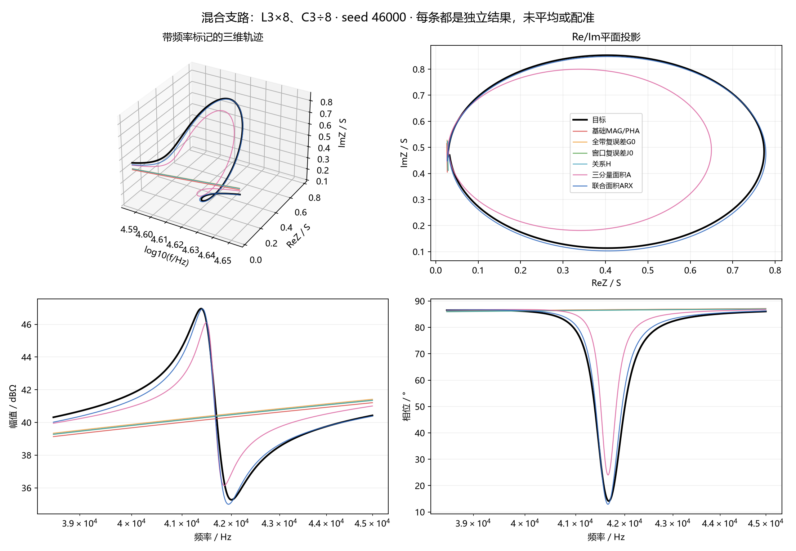
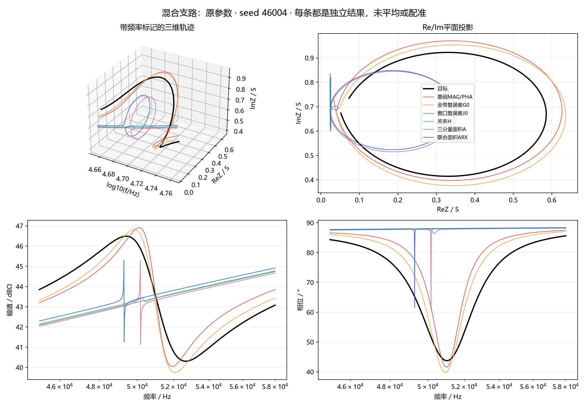
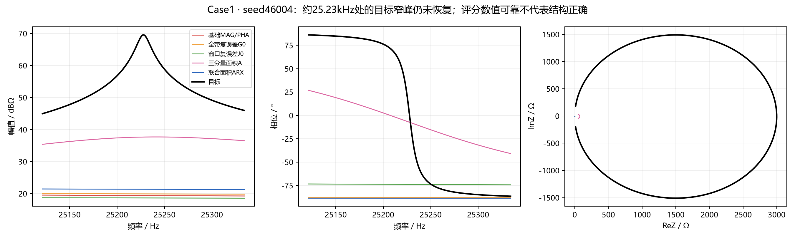
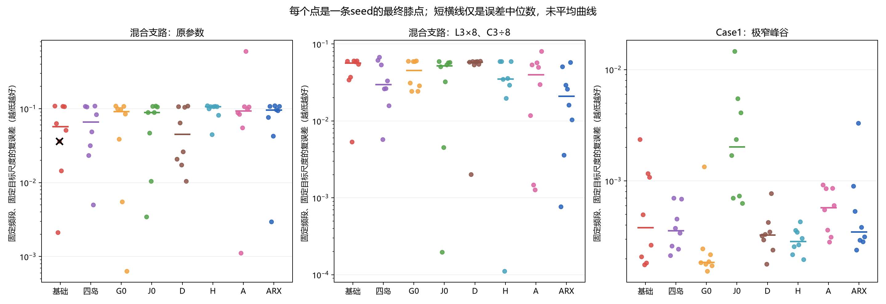
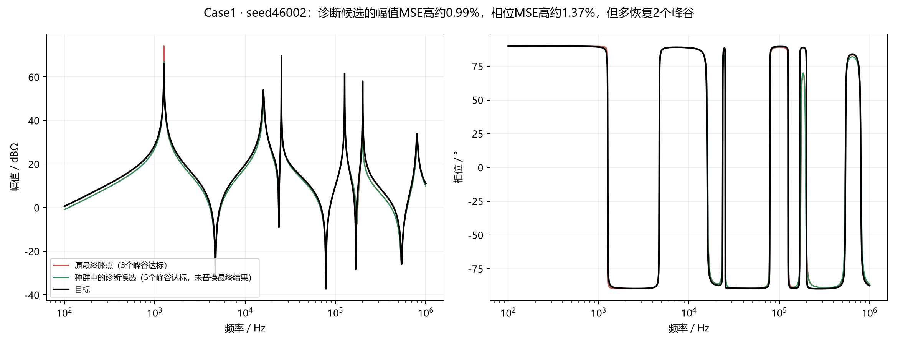

# 联合面积指标实验：哪些地方有帮助，哪些地方仍然不行

这轮实验、独立复核、数据回收和本地校验已经完成。**联合面积ARX在一个较窄的混合支路条件上有值得保留的改善线索，但它没有在另外两个条件上表现出通用优势。**另一个更接近研究主线的发现是：Case1中确实存在幅相MSE很接近、峰谷恢复程度却不同的候选；其中一些结构较好的候选甚至被双目标前沿排除。

这里的“有帮助”指本批固定算法、预算和选解规则下的结果，不表示已经找到普遍优于MSE的指标。

## 1. 先把几个名词说清楚

阻抗可以写成两个数：**实部ReZ**和**虚部ImZ**。实部反映端口的阻性作用，虚部反映容性、感性作用。频率变化时，这两个数一起变化，于是在平面上画出一条路线；再把频率放进第三个坐标，就得到三维轨迹。

**MAG/PHA**是我们保留的幅值、相位两个基础目标。幅值在dB坐标下算误差，相位以弧度算误差。优化器负责找参数，目标负责给候选打分，膝点规则负责从最终候选中选一个结果。这三件事不能混为一谈。

**ARX**比较的是Re/Im路线走到各个频率时累积的有向面积。它关心两者一起怎样展开、转弯，而不只关心每个点离目标多远。它保留整个累计过程，不是只看最后的总面积。

面积不是电磁能量，也不能直接当作Q值或谐振数。它是一种联合几何特征；是否能帮助恢复谐振相关的端口响应，要靠对照实验判断。面积的数学定义本身也不是新的，方法的价值不能只靠把坐标换成Re/Im来证明。

## 2. 这次怎样比较

实验用了三个已有开发条件：混合支路原参数、混合支路L3乘8且C3除8、Case1。后一个混合支路条件有较窄的谷峰组合；Case1有多处极窄峰谷。LC同时改变还会影响阻抗水平、耦合和模态，不能把两个条件的差别只归到峰宽。

每个条件比较八组方法，每组8个新seed，共**192个任务**。同一个seed的各方法从相同的200个候选出发，每次都评价60000个候选。最终全部使用同一套MAG/PHA二维膝点规则，保留每20代的完整种群。

|方法|负责检查什么|
|---|---|
|基础MAG/PHA|共同参照|
|四小种群|仅改变搜索分配是否也有帮助|
|G0：全频带复误差|普通Re/Im点值误差是否足够|
|J0：窗口复误差|局部窗口和尺度的重新分配是否已经有效|
|D：复增量|联合变化的大小是否有帮助|
|H：相邻复增量关系|前后两段变化的关系是否有帮助|
|A：三个面积分量|频率-Re、频率-Im、Re-Im三个过程一起比较|
|ARX：联合面积|只保留Re-Im面积过程是否更有帮助|

后六组均只有一个辅助目标，主目标不变。四小种群总预算也只有60000次，不是每队各60000次。它只是搜索对照，不预设它更强。

本轮没有重复PTC参考组，也没有独立新电路或实测验证，因此不能说已经超过FEMEIF或完成推广。

## 3. 先确认分数是否算得可靠

这一步已经完成。387,233,613字节的完整结果包通过SHA256和ZIP CRC校验；192个任务的预算、保存阶段、初始化配对、源代码、输入和结果文件哈希均已核对。

112个数值预检、24个短程优化全部通过。正式结果中，**144个辅助目标任务全部通过评分复核**。包括Case1那些容易漏看窄峰的候选，新积分器的结果与独立折线积分一致。这里修复的是积分计算，旧目标尺度和归一化分母仍按冻结方案保留；“积分可靠”不等于“权重设计一定合理”。

全部192个独立复核中，191个通过全部门槛，1个基础组样本的结构判定不稳定。详情放在第9节，原失败记录没有改成通过。

**通过复核只是说明结果可以被可靠检查，不是说曲线已经拟合正确。**

## 4. 较窄的混合支路：ARX有正向线索

这一条件固定检查38.5—45kHz的谷峰组合。表里的“局部复误差”使用同一频带、同一目标尺度，越小越好。不同条件的误差尺度不同，不能横向比较数值大小。

|方法|局部复误差中位数|关注峰谷达标次数 / 16|局部误差优于基础的seed / 8|同时满足代价限制的seed / 8|
|---|---:|---:|---:|---:|
|基础MAG/PHA|0.05688|4|—|—|
|四小种群|0.02984|8|4|2|
|G0|0.04539|6|6|5|
|J0|0.05220|5|6|5|
|D|0.05854|2|4|3|
|H|0.03525|4|6|5|
|A|0.03994|9|6|6|
|ARX|**0.02104**|**12**|**6**|**6**|

每条seed检查两个目标峰谷，所以总共16次检查；它们不是16条独立实验。“同时满足代价限制”是预先约定的口径：局部误差下降、MAG和PHA各不超过对应基础组的1.10倍、额外幅值结构不增加，且两条结果均通过复核。

ARX的相位结构达标次数也从基础组的29/48提高到41/48，额外相位结构从5个降到0个。它不是只改善自己的辅助分数，独立的曲线检查也显示了改善。

下面是实验前固定展示的seed46000。黑线是目标，蓝线是ARX。可以看到：基础组及普通复误差组的局部路线较平，ARX恢复了明显的展开和转向，幅值峰谷及相位过程也更接近目标。

图中的S是固定的目标阻抗尺度，同一张图的所有曲线都除以同一个数，方便比较；没有对候选各自放缩。三维图的频率轴使用log10(f)，幅值和相位图则标出实际Hz。

但还有两条限制。第一，8个seed中有2个的局部误差没有优于基础组。第二，ARX与G0、J0、H、A的直接配对差的探索性区间仍跨过零，**目前还不能排除普通复误差或局部权重解释了一部分收益，也不能确认ARX稳定优于这些对照。**与基础组比较的正向线索更清楚，与其他辅助方法的差别还需要独立数据检验。

## 5. 原参数混合支路：优势没有重复出现

在45—58kHz的检查频段，基础组局部误差中位数为0.05714，ARX为0.09572。ARX只在3/8个seed上优于基础；关注峰谷达标次数两组都是10/16。

这一基础组有1个原复核未通过样本，严格联合收益按剩余7对有效结果统计，ARX为3/7。连续误差仍把全部8条列出，不隐藏那个样本。

下图的seed46004更直接：基础组已经恢复了较完整的局部过程，ARX却形成了一个很窄的替代结构，整体展开没有恢复好。

所以，“对较窄条件有用”不能直接扩展成“对这种电路都有效”。上一轮D在原参数条件的正向表现，这轮新seed也没有稳定重现：局部误差只在4/8条上改善。这提醒我们，之前少量开发样本的结果不能当作已经确定的规律。

## 6. Case1：分数可靠了，结构仍然很难恢复

Case1每条seed检查11个幅值峰谷，8条共88次。最终膝点的达标次数如下：

|方法|幅值峰谷达标次数 / 88|相位结构达标次数 / 88|
|---|---:|---:|
|基础MAG/PHA|17|28|
|四小种群|16|16|
|G0|25|32|
|J0|2|9|
|D|19|21|
|H|21|25|
|A|13|17|
|ARX|11|18|

ARX没有改善Case1的整体结构恢复。普通全带复误差G0的峰谷达标次数较多，但其幅值、相位MSE中位数也高于基础组，并出现更多额外结构，不能只凭25/88判它胜出。

约25.23kHz的目标峰只有约13.30Hz宽。下面的放大图说明，即使评分计算已经可靠，所选结果仍可能没有恢复这个峰。

还检查了辅助目标由哪些窗口贡献。Case1部分ARX结果的分数被一个间隙或频带末端窗口主导，例如seed46000的gap_2占约99.3%，seed46002的end_gap占约99.2%。这不是新的漏采样证据，而是可靠算出来的分数分配。它提示当前尺度和窗口聚合可能不平衡，但这些窗口也可能包含真实的额外缺陷；不能直接删掉它们来让指标表现更好。

下面把全部8条seed的局部误差画出来。每个点是一条结果，短横线只是分数中位数；黑叉是原复核未通过样本。可以直接看到，单张好看的曲线不能代表所有seed，同一种方法也可能有很大差异。

## 7. 一个更贴近研究主线的新发现：MSE很接近，结构可以不同

我们检查了192个最终种群、共38400个候选。在两个混合支路基础组的最终种群中，没有找到局部复误差减半的隐藏候选。因此，对这两个条件，不能把主要失败简单归为“膝点没选到”。

Case1不同：8个基础组种群中，有4个含有幅相误差各不超过最终膝点1.10倍、但全带复误差低一半以上的候选。进一步做结构检查，**有5个seed存在幅相分数相近、更多峰谷达标且额外幅值结构未增加的候选**。

例如seed46002：

|结果|幅值MSE相对原膝点|相位MSE相对原膝点|峰谷达标数 / 11|
|---|---:|---:|---:|
|原最终膝点|1.0000|1.0000|3|
|种群中的诊断候选|1.0099|1.0137|5|

也就是幅值MSE只高约0.99%，相位MSE高约1.37%，却多恢复了2个峰谷。这个候选被原膝点同时压过两个MSE目标，所以它不在MAG/PHA双目标前沿上。**这不是换一个膝点公式就一定能解决的情况。**

这也不完全是阈值造成的计数变化：约1.264kHz的峰高偏差从+8.19dB降到+0.91dB，宽度比从0.328变到0.758；约126.4kHz的峰高偏差从−6.79dB降到−0.63dB，宽度比从2.205变到1.085。但约799.4kHz的峰反而变差，另一个峰是在3dB门槛附近转为合格。因此它体现的是结构取舍，不应称作所有结构都更好。

五个结构较好的诊断候选中，四个不在双目标前沿，只有一个在前沿内但未被膝点选中。因此，本批证据同时涉及“评分与结构关注点不同”和“选解规则不同”，不能只归到其中一个环节。

这些候选只用于诊断，**没有替换正式结果**。也不能由此说MSE理论上无法拟合：真参数仍能使幅相误差同时为零。能说的是，在本轮有限预算产生的候选中，略小的整体MSE并不保证更多局部结构达标。

## 8. 物理解释和计算代价

我们还用独立节点方程对128条混合支路结果做了端口模态分解。可以把“模态”理解为电路中一种能参与端口响应的变化方式；位置、衰减和在端口的显现程度要共同看，不能只看某个LC元件的理论频率。

在较窄条件下，ARX相对基础组使所追踪模态的频率更接近目标的有6/8条、端口显现程度更接近的有6/8条、复留数更接近的有5/8条。这与曲线改善方向一致，但A在这些模态量上的改善次数反而更多。因此，不能说ARX已经被证明是在“更准确地调整某一个物理参数”。端口曲线是多个模态和背景共同作用的结果，面积特征与物理机制的联系仍然是解释线索。

代价也不能省略。以下为本实现的优化CPU耗时，相对同条件基础组的总核时比：

|条件|ARX|A|D|H|
|---|---:|---:|---:|---:|
|原参数混合支路|6.1倍|6.1倍|33.0倍|33.1倍|
|较窄混合支路|6.0倍|6.0倍|33.9倍|33.8倍|
|Case1|89.8倍|92.2倍|486.6倍|485.8倍|

全部正式优化共约290.75CPU核时。优化阶段CPU利用率采样均值约99.1%，服务器没有大量闲置。但相同60000次候选预算不等于相同时间预算；尤其Case1，指标花了很多时间，却没有带来相应的结构收益。这些倍数描述当前代码，不是算法无法加速的理论下限。

核时可以理解为“一个CPU核工作一小时”；32个核同时工作一小时约为32核时，所以290.75核时并不是服务器连续运行了290.75小时。

## 9. 那一个未通过样本，以及执行问题

唯一未通过的是原参数混合支路、基础MAG/PHA、seed46003。它的MSE收敛、训练分数一致性、独立电路响应检查均通过，问题出在约388.47Hz的一个相位结构的位置判定。

原位置门槛为0.02个log10频率单位，约对应4.7%的频率差。1、2、4、8级检查给出的偏差在0.0199—0.02002附近来回变化，于是合格与不合格交替。补充16、32级后判定稳定，但我们保留原“未通过”，没有改门槛或把191改成192。

其他执行问题是运行环境尚未安装完时的一次启动退出、本地状态刷新进程中断、回收传输较慢，以及一次本地绘图文件编码读取错误。服务器正式优化没有因此重启，最终预算和数据完整性不受影响。具体处理、保留文件和结论影响见 [问题记录](ISSUES.md)。

## 10. 回到四个问题，下一步可以怎样收紧

**哪类结构反复难恢复？** 局部联合轨迹被压平、用过窄过程替代目标过程，以及Case1的极窄峰谷，仍会出现。它们已经有具体候选、频段和图，而不只是抽象描述。

**什么条件使它更难？** 模态位置、衰减、端口显现程度和背景共同变化；Case1还有分数在窗口之间失衡、近似MSE候选结构不同、前沿排除结构较好候选等问题。峰宽本身不足以解释全部差别。

**针对性指标能改善吗？** ARX在较窄混合支路有局部和幅相联合的正向线索；原参数和Case1没有通用改善。普通复误差、窗口权重和搜索对照也有部分收益，ARX的独特贡献还没有被独立确认。

**能推广吗，代价是什么？** 还不能。这三个目标都参与过开发，每条件只有8seed；ARX的时间代价明显，实测和噪声尚未验证。

下一步不需要再把所有电路和指标重跑一遍，应该分成两条明确路线：

1. **保留较窄混合支路的ARX线索。**冻结现在的方法，在没有用于设计的新参数组上，重点比较ARX与G0/J0；保留窗口外缺陷检查和时间成本。如果优势不能重复，就不把它包装成联合几何机制已经成立。
2. **Case1单独处理评分与结构不一致。**先使用本批已保存的近似MSE候选，核查哪些结构变化没有得到评分奖励、哪些候选被前沿排除，以及窗口尺度为何主导分数。后续若改尺度或聚合方式，要做固定对照，不能直接删除不利窗口。

本轮到这里完成，没有启动这些后续实验，也没有上传网站或设置新的监控任务。逐seed、种群、阶段、连续事件量和模态数据均已保留，便于继续判断。

## 数据入口

- [全部seed的独立误差与结构数据](analysis/REVIEWED_SEEDS.csv)
- [配对差与代价限制统计](analysis/REVIEWED_GROUPS.csv)
- [最终种群中的局部机会](analysis/POPULATION_OPPORTUNITY.csv)
- [每20代的所选曲线过程](analysis/SELECTED_STAGE_TRAJECTORY.csv)
- [公式、复算方法和文件说明](METHODS_AND_FILES.md)
- [进一步的判断与限制](FINDINGS.md)
