# 复阻抗联合轨迹指标实验：通俗报告

我们要回答的是：在保留幅值和相位两个基础目标的情况下，增加描述“复阻抗曲线怎样随频率行走”的指标，能否帮助优化器修好局部结构？

本批已回收1840/1840个优化任务；1840个任务有可读取的独立复核，其中1627个通过全部数值及结构稳定门槛。
如果没有全部通过，下面的结果是带复核标记的开发观察，不能当作已经验证的改进。每个任务200个体、300代、60000次候选评价；每个条件每组8个seed，初始化逐组核对一致。

## 1. 三种新指标分别在看什么

把频率想成播放进度，Re Z和Im Z想成画面里点的两个坐标。D看这一小段往哪里走、走了多少；H同时看前后两段如何接在一起，转向和变化量是否相符；A看从窗口起点走到当前位置时，三个投影积累的有向面积怎样变化。A比较的是一整段随频率展开的过程，面积不能当作储能或Q。

它们仍可能看漏东西。例如H、A对整体平移存在盲区，H对整体旋转也有盲区。因此基础MAG/PHA继续约束阻抗的实际水平，各组均未对候选曲线做自由对齐。

十组为基础MAG/PHA、D、H、A、D+H、D+A、H+A、D+H+A、PTC参考、统一窗口有序路径C参考。组合等权合成一个辅助目标，各组最后均从MAG/PHA二维前沿选膝点。膝点不是两个MSE都最小的唯一解；退化回退原因完整保存。

## 2. 怎么比较才公平

每个条件使用同一批seed、同一初始化、边界、算法和候选评价数。最终比较同seed的结果，负的差值代表减少误差或缺陷。八个seed仍偏少，置信区间只是开发阶段描述，不代表完成了多重检验或独立推广验证。

理论数据经过模型辅助自适应积分，独立检查另用加密网格与候选结构锚点；实测Case2只有原201点，没有补造目标点，模型、测量噪声和稀疏采样的影响需单列。辅助指标窗口都来自目标并覆盖全频带，这种局部等权也会改变优化强调的区域，不能把收益完全归于几何公式。

## 3. 每个电路的结果

### control_rlc/lc_reciprocal_0p25

(R1 // L1 // C1)

[查看常规电路图](../../archive/LOCAL_ONLY.md#ref-229e05a3a25a)

|元件|目标值/适配名义值|单位|
|---|---:|---|
|R1|3000|ohm|
|L1|0.0003978874|H|
|C1|6.366198e-07|F|

|组别|复核通过|幅值MSE dB²|相位MSE rad²|未完整恢复幅值事件|未完整恢复相位过程|额外幅值/相位事件|平均秒数|
|---|---:|---:|---:|---:|---:|---:|---:|
|MAG_PHA|8/8|0.0344048|1.1886e-11|0|0|0/0|77.7|
|D|8/8|0.0109264|1.03276e-10|0|0|0/0|80.2|
|H|8/8|0.000500681|9.04148e-09|0|0|0/0|79.9|
|A|7/8|0.0492202|2.73465e-09|0|0|0/0|80.4|
|D_H|8/8|0.00417375|2.54092e-09|0|0|0/0|78.8|
|D_A|7/8|0.0124681|3.6987e-09|0|0|0/0|80.2|
|H_A|7/8|2.30112|2.91548e-08|0.125|0|0/0|81.5|
|D_H_A|8/8|0.00103828|8.11187e-10|0|0|0/0|81.7|
|PTC_ref|8/8|0.0306763|1.76277e-08|0|0|0/0|232.2|
|C_ref|8/8|0.20004|3.39454e-11|0|0|0/0|88.9|

表中的缺陷数量是逐seed计数后取平均；曲线展示不取平均。Case2的相位结构计数不适用，表中0不意味着连续相位过程完整恢复。

### control_rlc/base

(R1 // L1 // C1)

[查看常规电路图](../../archive/LOCAL_ONLY.md#ref-2d2a3d39b6b8)

|元件|目标值/适配名义值|单位|
|---|---:|---|
|R1|3000|ohm|
|L1|0.001591549|H|
|C1|1.591549e-07|F|

|组别|复核通过|幅值MSE dB²|相位MSE rad²|未完整恢复幅值事件|未完整恢复相位过程|额外幅值/相位事件|平均秒数|
|---|---:|---:|---:|---:|---:|---:|---:|
|MAG_PHA|8/8|0.00102231|8.26223e-09|0|0|0/0|76.0|
|D|8/8|0.0027383|1.17296e-11|0|0|0/0|80.0|
|H|8/8|0.000214298|9.16333e-10|0|0|0/0|79.9|
|A|8/8|9.87071e-05|9.89684e-11|0|0|0/0|79.7|
|D_H|8/8|0.00487253|5.51482e-07|0|0|0/0|80.2|
|D_A|7/8|0.249943|1.70111e-12|0|0|0/0|80.7|
|H_A|8/8|0.0246586|1.34874e-12|0|0|0/0|79.6|
|D_H_A|7/8|0.110214|2.25593e-11|0|0|0/0|80.9|
|PTC_ref|8/8|0.00603439|1.1107e-07|0|0|0/0|233.4|
|C_ref|8/8|5.29078e-06|1.86689e-11|0|0|0/0|88.0|

表中的缺陷数量是逐seed计数后取平均；曲线展示不取平均。Case2的相位结构计数不适用，表中0不意味着连续相位过程完整恢复。

### control_rlc/lc_reciprocal_8p0

(R1 // L1 // C1)

[查看常规电路图](../../archive/LOCAL_ONLY.md#ref-de169b35f3b6)

|元件|目标值/适配名义值|单位|
|---|---:|---|
|R1|3000|ohm|
|L1|0.0127324|H|
|C1|1.989437e-08|F|

|组别|复核通过|幅值MSE dB²|相位MSE rad²|未完整恢复幅值事件|未完整恢复相位过程|额外幅值/相位事件|平均秒数|
|---|---:|---:|---:|---:|---:|---:|---:|
|MAG_PHA|8/8|10.7768|5.16891e-12|0.125|0|0/0|57.4|
|D|8/8|4.72726e-05|2.17086e-12|0|0|0/0|61.4|
|H|8/8|5.50503e-06|1.93337e-12|0|0|0/0|60.7|
|A|8/8|0.00349772|1.06403e-12|0|0|0/0|61.7|
|D_H|8/8|2.51258e-08|4.48545e-17|0|0|0/0|62.0|
|D_A|8/8|8.41776e-05|4.6878e-15|0|0|0/0|62.2|
|H_A|8/8|5.50071e-08|4.27643e-14|0|0|0/0|62.4|
|D_H_A|8/8|8.23015e-08|1.43142e-11|0|0|0/0|63.0|
|PTC_ref|8/8|1.33339e-05|5.46157e-12|0|0|0/0|213.6|
|C_ref|8/8|0.350217|2.81761e-12|0|0|0/0|69.8|

表中的缺陷数量是逐seed计数后取平均；曲线展示不取平均。Case2的相位结构计数不适用，表中0不意味着连续相位过程完整恢复。

### user_nested/lc_reciprocal_0p25

(R1 + (L1 // (R2 + ((R3 + C1) // L2))))

[查看常规电路图](../../archive/LOCAL_ONLY.md#ref-6fd03f8ab7a6)

|元件|目标值/适配名义值|单位|
|---|---:|---|
|R1|2|ohm|
|L1|0.001591549|H|
|R2|3|ohm|
|R3|7|ohm|
|C1|6.366198e-07|F|
|L2|0.0001808579|H|

|组别|复核通过|幅值MSE dB²|相位MSE rad²|未完整恢复幅值事件|未完整恢复相位过程|额外幅值/相位事件|平均秒数|
|---|---:|---:|---:|---:|---:|---:|---:|
|MAG_PHA|8/8|0.000378949|2.72212e-09|0|0|0/0|109.4|
|D|8/8|0.000714742|6.35278e-10|0|0|0/0|113.8|
|H|8/8|0.000496234|3.24145e-09|0|0|0/0|111.9|
|A|8/8|0.000616558|2.46424e-09|0|0|0/0|111.3|
|D_H|8/8|4.98112e-06|4.06161e-10|0|0|0/0|114.5|
|D_A|8/8|7.9502e-05|8.86034e-11|0|0|0/0|115.7|
|H_A|8/8|0.00252687|3.27875e-10|0|0|0/0|115.3|
|D_H_A|8/8|8.05277e-05|6.15218e-10|0|0|0/0|114.4|
|PTC_ref|8/8|0.00233629|1.4322e-08|0|0|0/0|1399.1|
|C_ref|8/8|2.32939e-06|4.85734e-09|0|0|0/0|122.6|

表中的缺陷数量是逐seed计数后取平均；曲线展示不取平均。Case2的相位结构计数不适用，表中0不意味着连续相位过程完整恢复。

### user_nested/base

(R1 + (L1 // (R2 + ((R3 + C1) // L2))))

[查看常规电路图](../../archive/LOCAL_ONLY.md#ref-aeb5994c09d2)

|元件|目标值/适配名义值|单位|
|---|---:|---|
|R1|2|ohm|
|L1|0.001591549|H|
|R2|3|ohm|
|R3|7|ohm|
|C1|1.591549e-07|F|
|L2|0.0007234316|H|

|组别|复核通过|幅值MSE dB²|相位MSE rad²|未完整恢复幅值事件|未完整恢复相位过程|额外幅值/相位事件|平均秒数|
|---|---:|---:|---:|---:|---:|---:|---:|
|MAG_PHA|8/8|0.0204979|0.000122086|0|0.25|0/0|124.9|
|D|8/8|0.0166577|0.0004889|0|0.5|0/0|128.5|
|H|8/8|0.20416|0.000320367|0|0.75|0/0|130.3|
|A|8/8|0.00989685|7.63159e-05|0|0|0/0|131.0|
|D_H|8/8|0.00600805|0.000489413|0|0.25|0/0|131.8|
|D_A|8/8|0.0510842|0.000276249|0|0.5|0/0|131.6|
|H_A|8/8|0.0237017|0.000566279|0|0.25|0/0|132.0|
|D_H_A|8/8|0.0224996|0.000736607|0|0.5|0/0|131.9|
|PTC_ref|8/8|0.0837203|0.00102757|0|1|0/0|1681.3|
|C_ref|8/8|0.0179204|0.000468386|0|0.375|0/0|138.9|

表中的缺陷数量是逐seed计数后取平均；曲线展示不取平均。Case2的相位结构计数不适用，表中0不意味着连续相位过程完整恢复。

### user_nested/lc_reciprocal_8p0

(R1 + (L1 // (R2 + ((R3 + C1) // L2))))

[查看常规电路图](../../archive/LOCAL_ONLY.md#ref-3648f0290419)

|元件|目标值/适配名义值|单位|
|---|---:|---|
|R1|2|ohm|
|L1|0.001591549|H|
|R2|3|ohm|
|R3|7|ohm|
|C1|1.989437e-08|F|
|L2|0.005787452|H|

|组别|复核通过|幅值MSE dB²|相位MSE rad²|未完整恢复幅值事件|未完整恢复相位过程|额外幅值/相位事件|平均秒数|
|---|---:|---:|---:|---:|---:|---:|---:|
|MAG_PHA|8/8|0.00403237|1.31798e-05|0|0|0/0|134.9|
|D|8/8|0.00167071|1.38262e-05|0|0|0/0|138.8|
|H|8/8|0.00211632|1.91002e-05|0|0|0/0|138.8|
|A|4/8|0.0130562|3.67106e-05|0|0|0/0|139.1|
|D_H|8/8|0.000735894|1.38234e-05|0|0|0/0|139.9|
|D_A|7/8|0.00148744|3.69355e-05|0|0.25|0/0|139.4|
|H_A|8/8|0.000776821|2.63403e-05|0|0.125|0/0|140.6|
|D_H_A|8/8|0.0189992|1.43509e-05|0|0.125|0/0|139.9|
|PTC_ref|8/8|0.0221183|1.71367e-05|0|0|0/0|1192.6|
|C_ref|8/8|0.00192722|2.48519e-05|0|0.125|0/0|148.4|

表中的缺陷数量是逐seed计数后取平均；曲线展示不取平均。Case2的相位结构计数不适用，表中0不意味着连续相位过程完整恢复。

### rlc_ladder/lc_reciprocal_0p25

(Rs + (C1 // (R1 + L1 + (C2 // (R2 + L2)))))

[查看常规电路图](../../archive/LOCAL_ONLY.md#ref-6c6228d2e97f)

|元件|目标值/适配名义值|单位|
|---|---:|---|
|Rs|5|ohm|
|C1|1.591549e-07|F|
|R1|2|ohm|
|L1|0.001591549|H|
|C2|2.893726e-07|F|
|R2|3|ohm|
|L2|0.0001808579|H|

|组别|复核通过|幅值MSE dB²|相位MSE rad²|未完整恢复幅值事件|未完整恢复相位过程|额外幅值/相位事件|平均秒数|
|---|---:|---:|---:|---:|---:|---:|---:|
|MAG_PHA|8/8|0.0187368|0.000181891|0|1.12|0.25/0.25|143.1|
|D|8/8|0.0219848|0.00018286|0|0.375|0.25/0.25|145.3|
|H|8/8|0.0393906|0.000128582|0|0.75|0.25/0|145.9|
|A|8/8|0.0229123|0.00025658|0|1.62|0/0.5|146.5|
|D_H|8/8|0.0942822|0.000304827|0|1.25|0.5/0.875|146.3|
|D_A|8/8|0.0267704|0.00017232|0|1|0.25/0|146.1|
|H_A|8/8|0.0513043|0.000100525|0|1|0.5/0|145.5|
|D_H_A|8/8|0.0236941|0.000210229|0|0.75|0.5/0.375|147.1|
|PTC_ref|8/8|0.493675|0.000104249|0|0.75|0/0|2430.8|
|C_ref|8/8|0.0120729|9.54822e-05|0|0.5|0.5/0|155.2|

表中的缺陷数量是逐seed计数后取平均；曲线展示不取平均。Case2的相位结构计数不适用，表中0不意味着连续相位过程完整恢复。

### rlc_ladder/base

(Rs + (C1 // (R1 + L1 + (C2 // (R2 + L2)))))

[查看常规电路图](../../archive/LOCAL_ONLY.md#ref-2d9664e064a1)

|元件|目标值/适配名义值|单位|
|---|---:|---|
|Rs|5|ohm|
|C1|1.591549e-07|F|
|R1|2|ohm|
|L1|0.001591549|H|
|C2|7.234316e-08|F|
|R2|3|ohm|
|L2|0.0007234316|H|

|组别|复核通过|幅值MSE dB²|相位MSE rad²|未完整恢复幅值事件|未完整恢复相位过程|额外幅值/相位事件|平均秒数|
|---|---:|---:|---:|---:|---:|---:|---:|
|MAG_PHA|8/8|0.269046|0.00336671|0.75|1.62|0/0|157.2|
|D|8/8|10.3148|0.00366485|1.12|1.75|0.25/0.375|163.0|
|H|8/8|0.434587|0.0051506|1.5|2.12|0.25/0.375|160.3|
|A|8/8|0.382259|0.00172209|0.25|1|0/0|161.4|
|D_H|8/8|0.335314|0.00199525|0.25|0.875|0/0|164.3|
|D_A|8/8|0.827359|0.00397288|1.25|1.62|0/0|167.6|
|H_A|8/8|0.635195|0.00386292|1.12|1.38|0/0|165.7|
|D_H_A|8/8|0.476243|0.00482734|1.5|1.88|0/0|166.3|
|PTC_ref|8/8|18.4341|0.000886778|1|0.5|0/0|2528.7|
|C_ref|8/8|0.652971|0.00353506|1|1.38|0.25/0.375|180.0|

表中的缺陷数量是逐seed计数后取平均；曲线展示不取平均。Case2的相位结构计数不适用，表中0不意味着连续相位过程完整恢复。

### rlc_ladder/lc_reciprocal_8p0

(Rs + (C1 // (R1 + L1 + (C2 // (R2 + L2)))))

[查看常规电路图](../../archive/LOCAL_ONLY.md#ref-e26212fa25cd)

|元件|目标值/适配名义值|单位|
|---|---:|---|
|Rs|5|ohm|
|C1|1.591549e-07|F|
|R1|2|ohm|
|L1|0.001591549|H|
|C2|9.042894e-09|F|
|R2|3|ohm|
|L2|0.005787452|H|

|组别|复核通过|幅值MSE dB²|相位MSE rad²|未完整恢复幅值事件|未完整恢复相位过程|额外幅值/相位事件|平均秒数|
|---|---:|---:|---:|---:|---:|---:|---:|
|MAG_PHA|8/8|0.76051|0.00878943|2|3|0/0|157.5|
|D|0/8|1.05309|0.00847445|2|3|0/0|161.0|
|H|0/8|0.665926|0.00862234|2|3|0/0|161.5|
|A|8/8|0.640329|0.00841713|2|3|0/0|162.1|
|D_H|0/8|0.61926|0.00765885|1.75|3|0.25/0.375|163.8|
|D_A|0/8|0.661983|0.0086769|2|3|0/0|164.9|
|H_A|0/8|1.0309|0.00730361|1.75|2.62|0/0|166.5|
|D_H_A|0/8|0.968929|0.00792667|2|2.75|0/0|166.0|
|PTC_ref|8/8|0.578252|0.00304193|1|1.62|0/0|2461.5|
|C_ref|8/8|1.21777|0.0076935|1.88|3|0/0|180.6|

表中的缺陷数量是逐seed计数后取平均；曲线展示不取平均。Case2的相位结构计数不适用，表中0不意味着连续相位过程完整恢复。

### loaded_tank/lc_reciprocal_0p25

(Rs + ((R1 + L1) // (C1 + (R2 // L2 // C2))))

[查看常规电路图](../../archive/LOCAL_ONLY.md#ref-7e3a27eff928)

|元件|目标值/适配名义值|单位|
|---|---:|---|
|Rs|5|ohm|
|R1|2|ohm|
|L1|0.001591549|H|
|C1|1.591549e-07|F|
|R2|1500|ohm|
|L2|0.0001808579|H|
|C2|2.893726e-07|F|

|组别|复核通过|幅值MSE dB²|相位MSE rad²|未完整恢复幅值事件|未完整恢复相位过程|额外幅值/相位事件|平均秒数|
|---|---:|---:|---:|---:|---:|---:|---:|
|MAG_PHA|8/8|1.10578|0.00100543|0.125|0.25|0/0|158.9|
|D|7/8|0.895685|0.00123328|0|0.375|0/0|165.9|
|H|3/8|0.61284|0.000488873|0|0.5|0/0|166.1|
|A|2/8|5.5867|0.00251597|1|0.875|0/0|168.3|
|D_H|0/8|63.3195|0.00240159|0.625|1|0/0|168.3|
|D_A|6/8|0.536819|0.000526476|0|0.5|0/0|169.1|
|H_A|2/8|3.7179|0.00161999|0.5|0.875|0/0|170.8|
|D_H_A|2/8|2.58525|0.00079028|0.125|0.375|0/0|171.9|
|PTC_ref|8/8|1.32535|0.00144019|0.25|0.875|0/0|2593.6|
|C_ref|8/8|1.98177|0.00114575|0|0.75|0/0|188.6|

表中的缺陷数量是逐seed计数后取平均；曲线展示不取平均。Case2的相位结构计数不适用，表中0不意味着连续相位过程完整恢复。

### loaded_tank/base

(Rs + ((R1 + L1) // (C1 + (R2 // L2 // C2))))

[查看常规电路图](../../archive/LOCAL_ONLY.md#ref-9cce580dd1e1)

|元件|目标值/适配名义值|单位|
|---|---:|---|
|Rs|5|ohm|
|R1|2|ohm|
|L1|0.001591549|H|
|C1|1.591549e-07|F|
|R2|1500|ohm|
|L2|0.0007234316|H|
|C2|7.234316e-08|F|

|组别|复核通过|幅值MSE dB²|相位MSE rad²|未完整恢复幅值事件|未完整恢复相位过程|额外幅值/相位事件|平均秒数|
|---|---:|---:|---:|---:|---:|---:|---:|
|MAG_PHA|8/8|9.43138|0.000103679|0.375|0|0/0|157.4|
|D|8/8|0.424408|8.2514e-05|0|0|0/0|163.0|
|H|8/8|0.15858|5.48892e-05|0|0|0/0|164.0|
|A|4/8|25.8815|0.000265257|0.75|0.125|0/0|164.1|
|D_H|8/8|0.259102|5.29896e-05|0|0|0/0|164.5|
|D_A|8/8|0.723768|0.00157179|0.125|0.375|0/0|166.4|
|H_A|4/8|4.21227|9.12892e-05|0.375|0.125|0/0|164.8|
|D_H_A|7/8|0.79671|0.00016292|0|0.125|0/0|166.9|
|PTC_ref|8/8|12.8963|0.00033608|0.625|0.125|0/0|2472.5|
|C_ref|8/8|3.68368|4.25436e-05|0.375|0|0/0|184.1|

表中的缺陷数量是逐seed计数后取平均；曲线展示不取平均。Case2的相位结构计数不适用，表中0不意味着连续相位过程完整恢复。

### loaded_tank/lc_reciprocal_8p0

(Rs + ((R1 + L1) // (C1 + (R2 // L2 // C2))))

[查看常规电路图](../../archive/LOCAL_ONLY.md#ref-b3211f8472f6)

|元件|目标值/适配名义值|单位|
|---|---:|---|
|Rs|5|ohm|
|R1|2|ohm|
|L1|0.001591549|H|
|C1|1.591549e-07|F|
|R2|1500|ohm|
|L2|0.005787452|H|
|C2|9.042894e-09|F|

|组别|复核通过|幅值MSE dB²|相位MSE rad²|未完整恢复幅值事件|未完整恢复相位过程|额外幅值/相位事件|平均秒数|
|---|---:|---:|---:|---:|---:|---:|---:|
|MAG_PHA|8/8|0.618204|0.00456785|0.25|0.5|0/0|140.2|
|D|8/8|2.90876|6.16604e-05|0.375|0|0/0|144.5|
|H|8/8|0.55011|0.000362846|0.125|0|0/0|146.3|
|A|8/8|0.179034|8.04665e-05|0|0|0/0|145.6|
|D_H|8/8|0.939279|0.00421931|0.25|0.375|0/0|144.9|
|D_A|8/8|0.450694|0.000576131|0|0.25|0/0|147.1|
|H_A|8/8|1.59475|0.00433916|0.5|0.5|0/0|148.0|
|D_H_A|8/8|0.198459|0.000129156|0|0|0/0|147.1|
|PTC_ref|8/8|0.625797|0.000416311|0|0|0/0|2258.8|
|C_ref|8/8|0.0500745|3.61751e-05|0|0|0/0|163.8|

表中的缺陷数量是逐seed计数后取平均；曲线展示不取平均。Case2的相位结构计数不适用，表中0不意味着连续相位过程完整恢复。

### dual_nested/lc_reciprocal_0p25

(Rs + ((R1 + (L1 // (R2 + C1))) // (R3 + (C2 // (R4 + L2)))))

[查看常规电路图](../../archive/LOCAL_ONLY.md#ref-3a8ee0353761)

|元件|目标值/适配名义值|单位|
|---|---:|---|
|Rs|5|ohm|
|R1|2|ohm|
|L1|0.001591549|H|
|R2|3|ohm|
|C1|1.591549e-07|F|
|R3|7|ohm|
|C2|2.893726e-07|F|
|R4|4|ohm|
|L2|0.0001808579|H|

|组别|复核通过|幅值MSE dB²|相位MSE rad²|未完整恢复幅值事件|未完整恢复相位过程|额外幅值/相位事件|平均秒数|
|---|---:|---:|---:|---:|---:|---:|---:|
|MAG_PHA|8/8|0.0882021|0.000148772|0|0.375|0/0|158.9|
|D|8/8|0.0209643|0.000144118|0|0.5|0/0|161.1|
|H|8/8|0.0975583|0.000514205|0|0.375|0/0|159.4|
|A|8/8|0.0546648|0.000219885|0|0.125|0/0|162.3|
|D_H|8/8|0.0387512|0.000232041|0|0.5|0/0|159.0|
|D_A|8/8|0.357553|0.000312849|0|0.25|0/0|163.7|
|H_A|8/8|0.0918587|0.000167444|0|0.375|0/0|161.5|
|D_H_A|8/8|0.034488|0.000130315|0|0|0/0|162.2|
|PTC_ref|8/8|0.239356|0.00046428|0|0.75|0/0|3457.5|
|C_ref|8/8|0.0359809|0.000269418|0|0.625|0/0|168.7|

表中的缺陷数量是逐seed计数后取平均；曲线展示不取平均。Case2的相位结构计数不适用，表中0不意味着连续相位过程完整恢复。

### dual_nested/base

(Rs + ((R1 + (L1 // (R2 + C1))) // (R3 + (C2 // (R4 + L2)))))

[查看常规电路图](../../archive/LOCAL_ONLY.md#ref-ecad895130c9)

|元件|目标值/适配名义值|单位|
|---|---:|---|
|Rs|5|ohm|
|R1|2|ohm|
|L1|0.001591549|H|
|R2|3|ohm|
|C1|1.591549e-07|F|
|R3|7|ohm|
|C2|7.234316e-08|F|
|R4|4|ohm|
|L2|0.0007234316|H|

|组别|复核通过|幅值MSE dB²|相位MSE rad²|未完整恢复幅值事件|未完整恢复相位过程|额外幅值/相位事件|平均秒数|
|---|---:|---:|---:|---:|---:|---:|---:|
|MAG_PHA|8/8|4.33522|0.000150691|0.125|0.25|0/0|183.2|
|D|8/8|0.0619519|0.000118789|0|0.125|0/0|187.8|
|H|8/8|0.830421|0.000412443|0|0.875|0/0|183.0|
|A|8/8|0.201527|4.47076e-05|0|0|0/0|186.8|
|D_H|8/8|0.0644645|0.000378426|0|1|0/0|185.2|
|D_A|8/8|0.0226288|0.000144811|0|0.375|0/0|187.9|
|H_A|8/8|0.00652578|8.42334e-05|0|0.125|0/0|187.1|
|D_H_A|8/8|0.372964|0.00023401|0|0.5|0/0|187.7|
|PTC_ref|8/8|0.143724|0.000533384|0|0.625|0/0.125|4306.8|
|C_ref|8/8|0.0210366|0.000111643|0|0.625|0/0|194.0|

表中的缺陷数量是逐seed计数后取平均；曲线展示不取平均。Case2的相位结构计数不适用，表中0不意味着连续相位过程完整恢复。

### dual_nested/lc_reciprocal_8p0

(Rs + ((R1 + (L1 // (R2 + C1))) // (R3 + (C2 // (R4 + L2)))))

[查看常规电路图](../../archive/LOCAL_ONLY.md#ref-b8f8e4c7a2bf)

|元件|目标值/适配名义值|单位|
|---|---:|---|
|Rs|5|ohm|
|R1|2|ohm|
|L1|0.001591549|H|
|R2|3|ohm|
|C1|1.591549e-07|F|
|R3|7|ohm|
|C2|9.042894e-09|F|
|R4|4|ohm|
|L2|0.005787452|H|

|组别|复核通过|幅值MSE dB²|相位MSE rad²|未完整恢复幅值事件|未完整恢复相位过程|额外幅值/相位事件|平均秒数|
|---|---:|---:|---:|---:|---:|---:|---:|
|MAG_PHA|8/8|0.00448452|6.53185e-05|0|0.25|0/0|193.7|
|D|8/8|0.0306651|9.95174e-05|0|0.25|0/0|198.0|
|H|8/8|0.00615492|0.000112692|0|0.375|0/0|200.0|
|A|7/8|0.0192572|1.16386e-05|0|0|0/0|195.4|
|D_H|8/8|0.0130482|7.57179e-05|0|0.25|0/0|194.2|
|D_A|8/8|0.0224178|7.6999e-06|0|0|0/0|194.1|
|H_A|7/8|0.0473309|1.42023e-05|0|0|0/0|194.6|
|D_H_A|7/8|0.224558|5.58398e-05|0|0.25|0/0|197.7|
|PTC_ref|8/8|0.440113|0.000163135|0|0.5|0/0|3616.8|
|C_ref|8/8|0.0759226|9.32886e-05|0|0.125|0/0|204.3|

表中的缺陷数量是逐seed计数后取平均；曲线展示不取平均。Case2的相位结构计数不适用，表中0不意味着连续相位过程完整恢复。

### three_level/lc_reciprocal_0p25

(Rs + (C1 // (R1 + L1 + (C2 // (R2 + L2 + (R3 // L3 // C3))))))

[查看常规电路图](../../archive/LOCAL_ONLY.md#ref-de120ed03172)

|元件|目标值/适配名义值|单位|
|---|---:|---|
|Rs|5|ohm|
|C1|1.591549e-07|F|
|R1|2|ohm|
|L1|0.001591549|H|
|C2|7.234316e-08|F|
|R2|3|ohm|
|L2|0.0007234316|H|
|R3|2000|ohm|
|L3|9.947184e-05|H|
|C3|1.591549e-07|F|

|组别|复核通过|幅值MSE dB²|相位MSE rad²|未完整恢复幅值事件|未完整恢复相位过程|额外幅值/相位事件|平均秒数|
|---|---:|---:|---:|---:|---:|---:|---:|
|MAG_PHA|8/8|0.354658|0.00395359|0.875|3.12|0/0.125|206.2|
|D|8/8|0.491959|0.00451677|1|3.5|0.5/0.875|233.7|
|H|3/8|0.324952|0.00357782|1|3.25|0/0.25|225.2|
|A|6/8|0.288187|0.00309245|0.5|2.88|1/0.625|236.7|
|D_H|1/8|0.911811|0.0041544|0.875|3.25|0/0.125|232.3|
|D_A|6/8|1.78073|0.0033484|1.12|3|0.5/0.625|235.6|
|H_A|6/8|0.296856|0.00307727|0.75|2.62|0/1|235.5|
|D_H_A|7/8|0.339262|0.00382967|0.875|2.88|0/0.375|242.8|
|PTC_ref|8/8|10.3615|0.00164522|1|3.12|0.25/0.375|3765.0|
|C_ref|8/8|0.409196|0.00202278|0.375|2.5|0/0.125|249.5|

表中的缺陷数量是逐seed计数后取平均；曲线展示不取平均。Case2的相位结构计数不适用，表中0不意味着连续相位过程完整恢复。

### three_level/base

(Rs + (C1 // (R1 + L1 + (C2 // (R2 + L2 + (R3 // L3 // C3))))))

[查看常规电路图](../../archive/LOCAL_ONLY.md#ref-ad233c3e7723)

|元件|目标值/适配名义值|单位|
|---|---:|---|
|Rs|5|ohm|
|C1|1.591549e-07|F|
|R1|2|ohm|
|L1|0.001591549|H|
|C2|7.234316e-08|F|
|R2|3|ohm|
|L2|0.0007234316|H|
|R3|2000|ohm|
|L3|0.0003978874|H|
|C3|3.978874e-08|F|

|组别|复核通过|幅值MSE dB²|相位MSE rad²|未完整恢复幅值事件|未完整恢复相位过程|额外幅值/相位事件|平均秒数|
|---|---:|---:|---:|---:|---:|---:|---:|
|MAG_PHA|8/8|1.92056|0.00600447|0.875|2.75|0.25/0.25|207.4|
|D|8/8|2.07671|0.0046994|0.75|2.25|0.25/0.25|233.2|
|H|2/8|22.2466|0.00629815|1.25|1.88|0/0.125|233.9|
|A|7/8|3.37123|0.00479322|1|2.38|0.5/0.375|233.3|
|D_H|3/8|7.18666|0.00444894|1|2|0/0.625|231.7|
|D_A|7/8|57.6187|0.00531993|1.12|1.88|0.5/0.625|237.3|
|H_A|4/8|1.12658|0.00564834|1|2.62|0/0.375|236.1|
|D_H_A|6/8|0.256361|0.00265916|0.5|1.62|0.25/0.25|254.8|
|PTC_ref|8/8|1.87763|0.000859204|0.125|1.75|0/0.375|3767.9|
|C_ref|8/8|0.60063|0.00159112|0.25|1.62|0.5/0.625|259.3|

表中的缺陷数量是逐seed计数后取平均；曲线展示不取平均。Case2的相位结构计数不适用，表中0不意味着连续相位过程完整恢复。

### three_level/lc_reciprocal_8p0

(Rs + (C1 // (R1 + L1 + (C2 // (R2 + L2 + (R3 // L3 // C3))))))

[查看常规电路图](../../archive/LOCAL_ONLY.md#ref-c75622d1139a)

|元件|目标值/适配名义值|单位|
|---|---:|---|
|Rs|5|ohm|
|C1|1.591549e-07|F|
|R1|2|ohm|
|L1|0.001591549|H|
|C2|7.234316e-08|F|
|R2|3|ohm|
|L2|0.0007234316|H|
|R3|2000|ohm|
|L3|0.003183099|H|
|C3|4.973592e-09|F|

|组别|复核通过|幅值MSE dB²|相位MSE rad²|未完整恢复幅值事件|未完整恢复相位过程|额外幅值/相位事件|平均秒数|
|---|---:|---:|---:|---:|---:|---:|---:|
|MAG_PHA|8/8|2.1527|0.00648086|0.5|0.75|0.25/0.625|201.4|
|D|8/8|1.33545|0.000916584|0.375|0.625|0/0|227.6|
|H|7/8|28.0099|0.000245857|0.375|0|0.25/0.25|232.8|
|A|8/8|0.184673|0.000438652|0|0.375|0.25/0.25|227.5|
|D_H|8/8|0.0781731|0.000294724|0|0.375|0.25/0.5|226.3|
|D_A|8/8|0.830173|0.00108488|0.125|0.5|0.5/0.5|229.5|
|H_A|8/8|0.758356|0.000782134|0.125|0.125|0.5/0.75|228.6|
|D_H_A|7/8|1.66875|0.000810682|0.25|0.25|0.25/0.25|243.9|
|PTC_ref|8/8|2.04844|0.00271241|0.25|0.5|0/0.25|3745.6|
|C_ref|8/8|0.158278|0.000692146|0|0.125|0/0.25|250.5|

表中的缺陷数量是逐seed计数后取平均；曲线展示不取平均。Case2的相位结构计数不适用，表中0不意味着连续相位过程完整恢复。

### mixed_resonators/lc_reciprocal_0p25

(Rs + ((R1 + L1 + C1) // (L2 + (R2 // C2 // (R3 + L3 + C3)))))

[查看常规电路图](../../archive/LOCAL_ONLY.md#ref-da348df7e4c7)

|元件|目标值/适配名义值|单位|
|---|---:|---|
|Rs|5|ohm|
|R1|2|ohm|
|L1|0.001591549|H|
|C1|1.591549e-07|F|
|L2|0.0007234316|H|
|R2|1500|ohm|
|C2|7.234316e-08|F|
|R3|7|ohm|
|L3|9.947184e-05|H|
|C3|1.591549e-07|F|

|组别|复核通过|幅值MSE dB²|相位MSE rad²|未完整恢复幅值事件|未完整恢复相位过程|额外幅值/相位事件|平均秒数|
|---|---:|---:|---:|---:|---:|---:|---:|
|MAG_PHA|8/8|9.65574|0.00173342|1|2.38|0/0.125|181.6|
|D|7/8|0.347169|0.00309172|1|3.38|0.375/0.625|183.7|
|H|8/8|3.11064|0.0018846|0.625|3.5|0/0.5|189.0|
|A|7/8|0.804649|0.00315861|0.875|3.5|0/0.25|188.6|
|D_H|8/8|0.279224|0.00268159|0.875|3.38|0/0.25|187.9|
|D_A|5/8|0.390951|0.00366482|1.25|3.88|0/0|188.7|
|H_A|5/8|0.277781|0.00293088|0.875|3.38|0.25/0.375|189.1|
|D_H_A|4/8|2.9614|0.00276633|1.12|3.62|0.25/0.25|188.4|
|PTC_ref|8/8|1.23433|0.00101082|0.25|1.38|0/0|3578.5|
|C_ref|8/8|0.292733|0.00320946|1.12|3.62|0/0.75|205.7|

表中的缺陷数量是逐seed计数后取平均；曲线展示不取平均。Case2的相位结构计数不适用，表中0不意味着连续相位过程完整恢复。

### mixed_resonators/base

(Rs + ((R1 + L1 + C1) // (L2 + (R2 // C2 // (R3 + L3 + C3)))))

[查看常规电路图](../../archive/LOCAL_ONLY.md#ref-d067dab721ee)

|元件|目标值/适配名义值|单位|
|---|---:|---|
|Rs|5|ohm|
|R1|2|ohm|
|L1|0.001591549|H|
|C1|1.591549e-07|F|
|L2|0.0007234316|H|
|R2|1500|ohm|
|C2|7.234316e-08|F|
|R3|7|ohm|
|L3|0.0003978874|H|
|C3|3.978874e-08|F|

|组别|复核通过|幅值MSE dB²|相位MSE rad²|未完整恢复幅值事件|未完整恢复相位过程|额外幅值/相位事件|平均秒数|
|---|---:|---:|---:|---:|---:|---:|---:|
|MAG_PHA|8/8|11.1007|0.00299853|2.5|2.88|0/0.5|188.8|
|D|8/8|0.192424|0.00181649|0.75|2.62|0/0|199.8|
|H|7/8|0.523587|0.00238486|0.875|2.5|0.25/0.25|198.9|
|A|7/8|0.382355|0.00290776|1|3.25|0/0|196.7|
|D_H|8/8|0.337239|0.00230912|1|2.5|0/0.25|216.0|
|D_A|8/8|0.283757|0.00304857|1.25|3.12|0/0|213.5|
|H_A|8/8|0.287421|0.00267704|0.75|3.25|0/0|216.6|
|D_H_A|8/8|0.25073|0.00270904|0.75|3|0/0|222.5|
|PTC_ref|8/8|15.1493|0.00247061|1.25|2.62|0/0|3684.6|
|C_ref|8/8|0.371604|0.00289894|1.25|2.88|0/0|235.7|

表中的缺陷数量是逐seed计数后取平均；曲线展示不取平均。Case2的相位结构计数不适用，表中0不意味着连续相位过程完整恢复。

### mixed_resonators/lc_reciprocal_8p0

(Rs + ((R1 + L1 + C1) // (L2 + (R2 // C2 // (R3 + L3 + C3)))))

[查看常规电路图](../../archive/LOCAL_ONLY.md#ref-9b08328e1e93)

|元件|目标值/适配名义值|单位|
|---|---:|---|
|Rs|5|ohm|
|R1|2|ohm|
|L1|0.001591549|H|
|C1|1.591549e-07|F|
|L2|0.0007234316|H|
|R2|1500|ohm|
|C2|7.234316e-08|F|
|R3|7|ohm|
|L3|0.003183099|H|
|C3|4.973592e-09|F|

|组别|复核通过|幅值MSE dB²|相位MSE rad²|未完整恢复幅值事件|未完整恢复相位过程|额外幅值/相位事件|平均秒数|
|---|---:|---:|---:|---:|---:|---:|---:|
|MAG_PHA|8/8|0.4058|0.00157606|1.38|2.25|0.25/0.875|190.9|
|D|8/8|0.351789|0.00134379|1.25|1.62|0/0.75|222.7|
|H|8/8|0.194491|0.00135896|1.62|2|0/0.5|206.2|
|A|8/8|0.110237|0.000642987|0.375|1|0/0|218.3|
|D_H|8/8|0.136025|0.00124701|1.12|1.88|0/0.75|221.2|
|D_A|8/8|0.162165|0.000853064|0.75|1.12|0/0|220.2|
|H_A|8/8|0.151474|0.00112136|0.875|1.12|0/0|220.5|
|D_H_A|8/8|58.5659|0.00108189|1.5|1.25|0/0|271.8|
|PTC_ref|8/8|1.17399|0.00239407|1.5|1.88|0/0.375|3692.8|
|C_ref|8/8|1.03109|0.00106183|1.38|1.5|0/0.5|245.5|

表中的缺陷数量是逐seed计数后取平均；曲线展示不取平均。Case2的相位结构计数不适用，表中0不意味着连续相位过程完整恢复。

### case1

((R1 // L1 // C1) + (R2 // L2 // C2) + (R3 // L3 // C3) + (R4 // L4 // C4) + (R5 // L5 // C5) + (R6 // L6 // C6))

[查看常规电路图](../../archive/LOCAL_ONLY.md#ref-b50897d650ef)

|元件|目标值/适配名义值|单位|
|---|---:|---|
|R1|2000|ohm|
|L1|0.001585|H|
|C1|1e-05|F|
|R2|3000|ohm|
|L2|1e-05|H|
|C2|3.98e-06|F|
|R3|500|ohm|
|L3|0.0001|H|
|C3|1e-06|F|
|R4|1200|ohm|
|L4|2.512e-06|H|
|C4|6.31e-07|F|
|R5|800|ohm|
|L5|1.259e-06|H|
|C5|5.01e-07|F|
|R6|50|ohm|
|L6|2.51e-07|H|
|C6|1.58e-07|F|

|组别|复核通过|幅值MSE dB²|相位MSE rad²|未完整恢复幅值事件|未完整恢复相位过程|额外幅值/相位事件|平均秒数|
|---|---:|---:|---:|---:|---:|---:|---:|
|MAG_PHA|8/8|13.8718|0.130157|7.88|6.62|0.5/1.12|39.9|
|D|0/8|21.3091|0.180805|9.25|8.75|0.25/0.875|161.2|
|H|0/8|37.4082|0.185646|10.1|9.12|0.375/0.75|138.9|
|A|1/8|38.6631|0.280384|10.1|9.62|0.5/1|163.5|
|D_H|0/8|18.9658|0.204617|9.12|8|0/1.62|171.8|
|D_A|0/8|74.801|0.245834|10.1|8.5|0.5/0.625|168.4|
|H_A|1/8|26.9635|0.244248|9.88|8.75|0/1.62|159.9|
|D_H_A|0/8|27.0734|0.216702|9.88|9.25|0.25/0.75|182.6|
|PTC_ref|8/8|19.5746|0.176999|9.12|7.62|0/0.75|16961.4|
|C_ref|7/8|43.6065|0.257751|10.8|10.4|0.125/1.38|278.2|

表中的缺陷数量是逐seed计数后取平均；曲线展示不取平均。Case2的相位结构计数不适用，表中0不意味着连续相位过程完整恢复。

### case2

((C1 // (L1 + R1) // R2) + (C2 // (L2 + R3) // R4) + (C3 // (L3 + R5) // R6) + C4 + R7 + L4)

[查看常规电路图](../../archive/LOCAL_ONLY.md#ref-168261700fee)

以下参数仅为程序适配器的名义值，不是真实测得的电路参数。

|元件|目标值/适配名义值|单位|
|---|---:|---|
|C1|3.162278e-10|F|
|L1|3.162278e-07|H|
|R1|17.78279|ohm|
|R2|17.78279|ohm|
|C2|3.162278e-10|F|
|L2|3.162278e-07|H|
|R3|17.78279|ohm|
|R4|17.78279|ohm|
|C3|3.162278e-10|F|
|L3|3.162278e-07|H|
|R5|17.78279|ohm|
|R6|17.78279|ohm|
|C4|3.162278e-10|F|
|R7|17.78279|ohm|
|L4|3.162278e-07|H|

|组别|复核通过|幅值MSE dB²|相位MSE rad²|未完整恢复幅值事件|未完整恢复相位过程|额外幅值/相位事件|平均秒数|
|---|---:|---:|---:|---:|---:|---:|---:|
|MAG_PHA|8/8|32.2627|0.0692228|8.5|0|0/0|6.9|
|D|8/8|6.49439|0.0635982|7.25|0|0/0|10.5|
|H|8/8|5.49787|0.0619729|7|0|0/0|10.9|
|A|8/8|10.6908|0.0767632|8.25|0|0/0|11.1|
|D_H|8/8|4.73164|0.0669862|8.38|0|0/0|10.7|
|D_A|8/8|13.7619|0.0607919|8.12|0|0/0|11.2|
|H_A|8/8|6.56179|0.0688836|7.5|0|0/0|11.2|
|D_H_A|8/8|6.99903|0.076351|8.5|0|0/0|11.6|
|PTC_ref|8/8|5.80069|0.0573215|7.62|0|0/0|14.8|
|C_ref|8/8|4.77857|0.0682792|6.5|0|0/0|10.7|

表中的缺陷数量是逐seed计数后取平均；曲线展示不取平均。Case2的相位结构计数不适用，表中0不意味着连续相位过程完整恢复。

## 4. 固定随机seed的典型曲线

以下展示固定随机选出的3个seed，不以好坏挑seed。三维图保留频率轴，Re/Im投影辅助看形态；数值判断以逐频率复核为准。

### case1

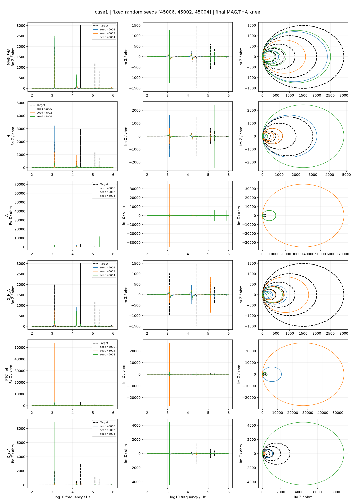

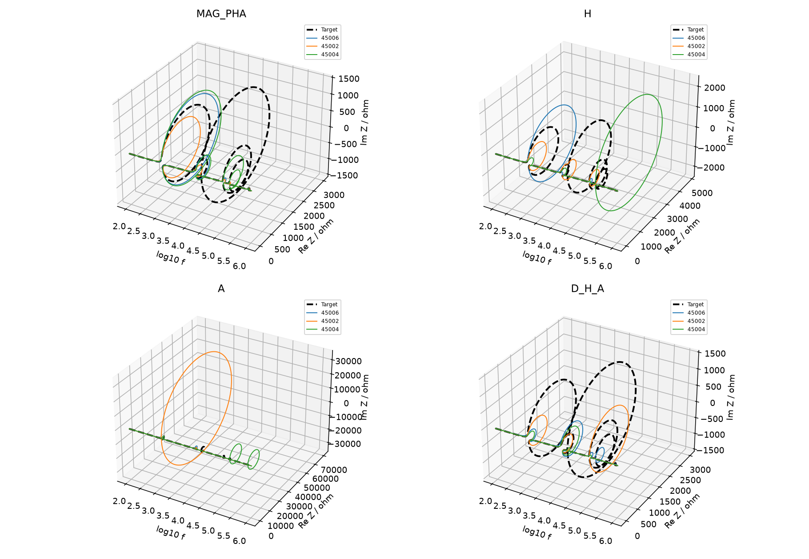

### user_nested/base

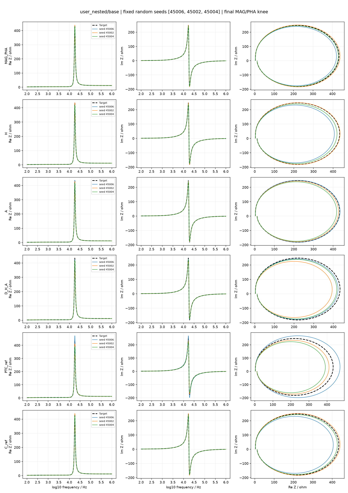

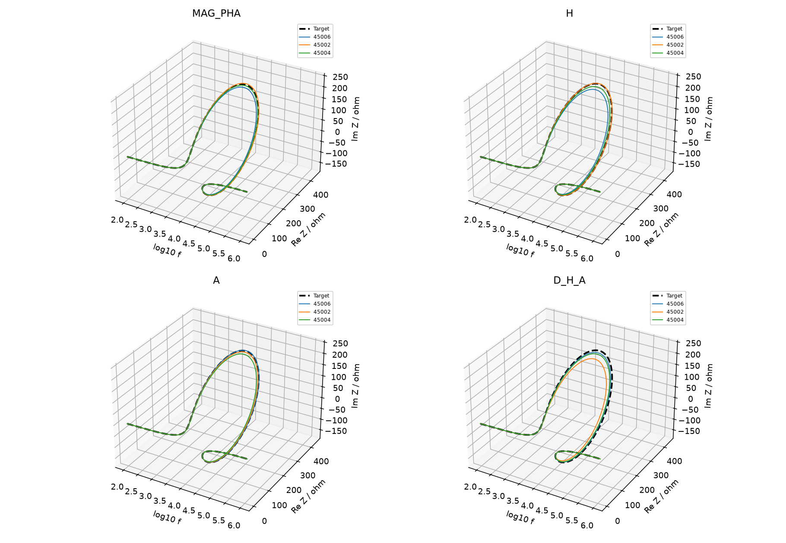

### rlc_ladder/lc_reciprocal_8p0

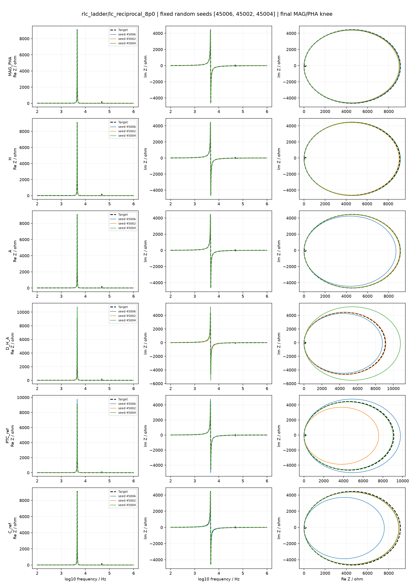

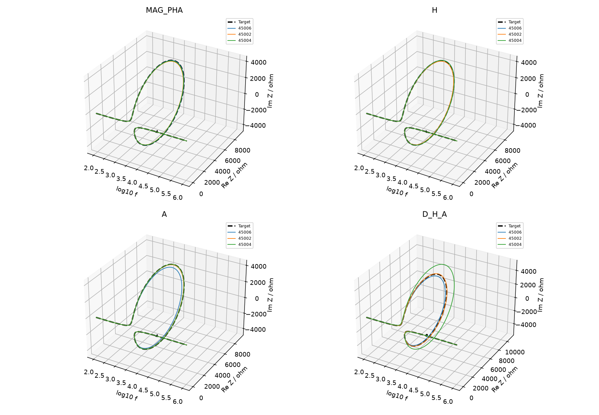

### mixed_resonators/lc_reciprocal_0p25

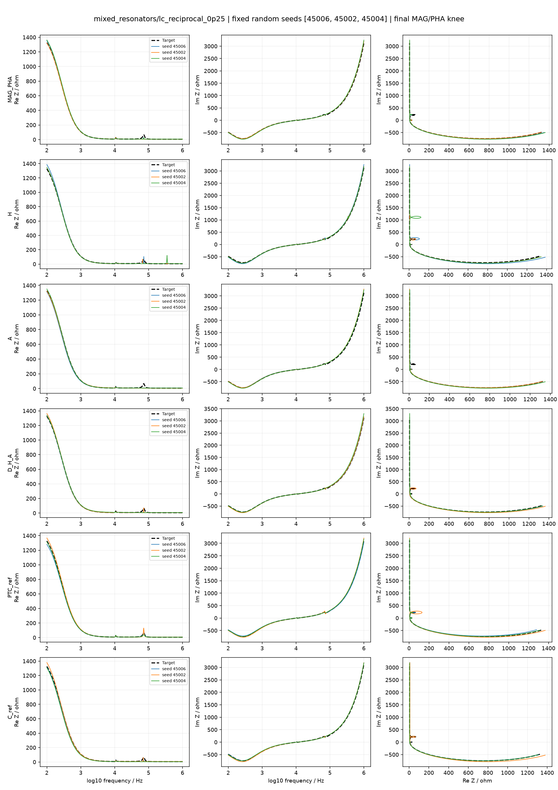

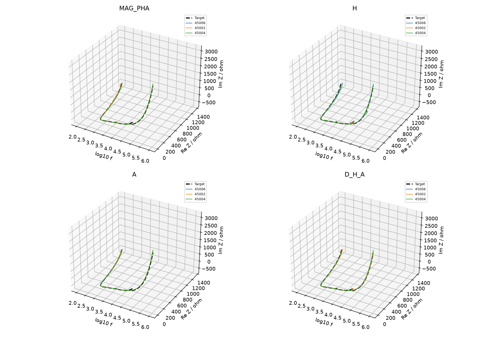

### three_level/base

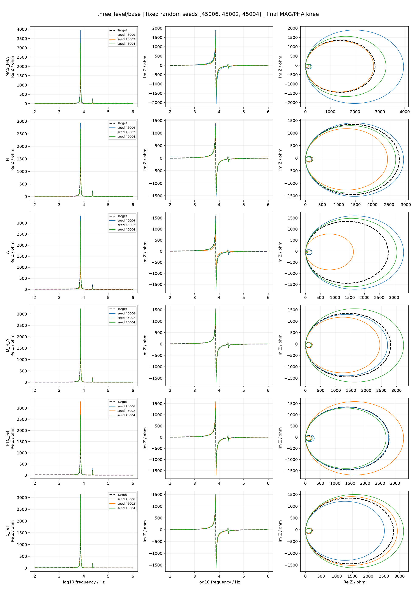

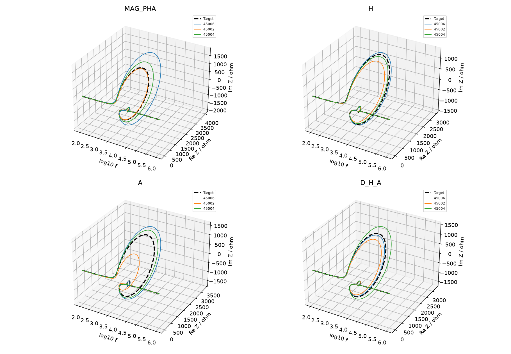

### case2

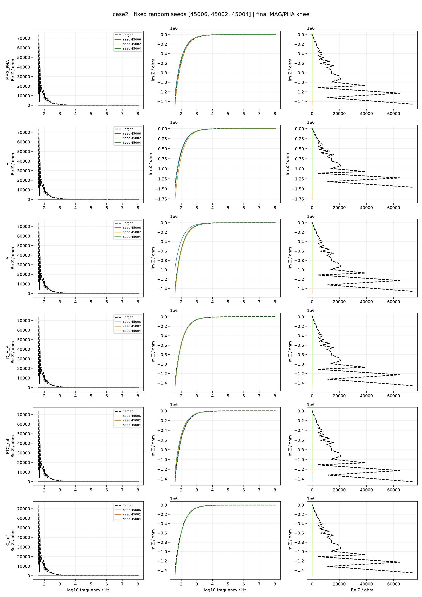

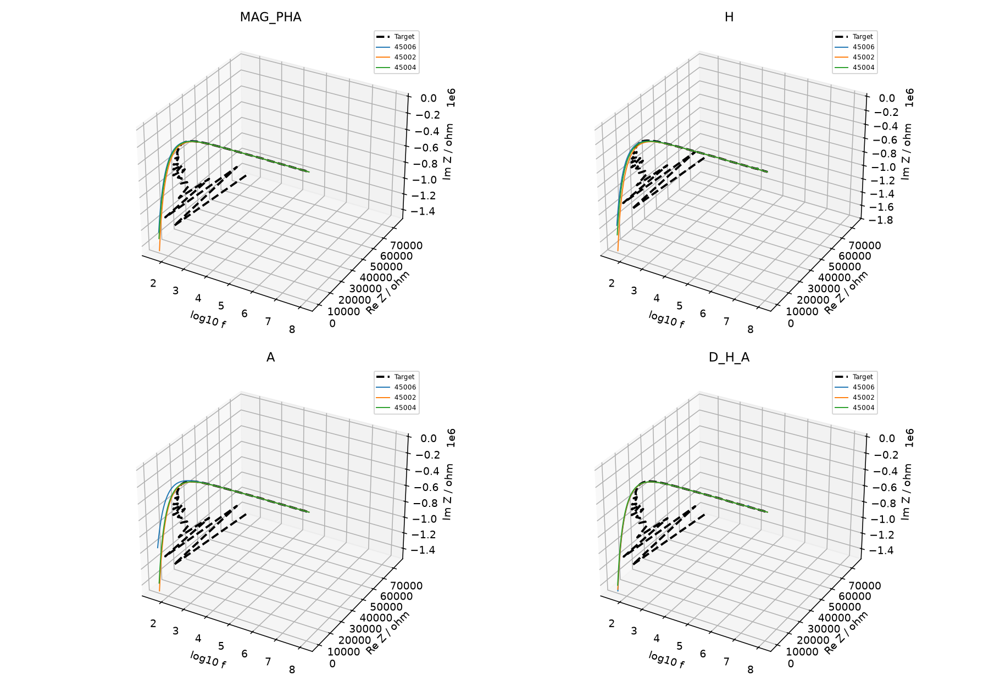

## 5. 回到四个研究问题

1. 哪类结构反复难恢复？先看各电路基础组的峰谷高度、位置、宽度及相位过程失败计数，并核对轨迹图。不能用辅助目标本身下降替代结构恢复。
2. 哪个条件使它更难？比较同电路三档LC条件；这会同时改变尺度、阻尼和参数联动，没有单独隔离峰宽。
3. 针对性指标能否改善？按同seed比较基础误差和结构缺陷，连同额外结构、复核通过率与成本一起看。
4. 能否推广、代价是什么？本批覆盖全部既有电路，但这些目标都参与过开发；还需要全新电路、噪声和实测验证。相同候选数不等于相同CPU时间。

[完整配对差值及95%自助区间](PAIRED.csv)；[逐seed数据](PER_SEED.csv)；[正式可复算方案](../../archive/LOCAL_ONLY.md#ref-d13f89bd8996)；[问题与故障记录](ISSUES.md)
