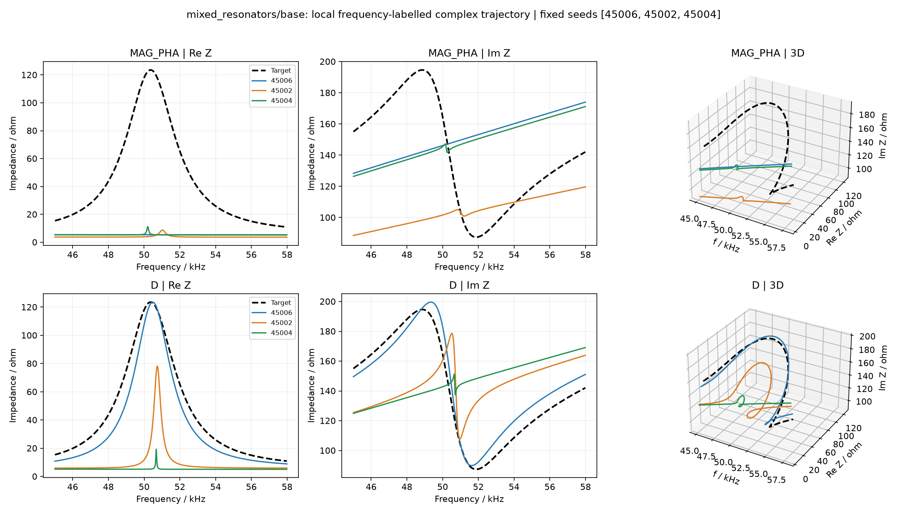
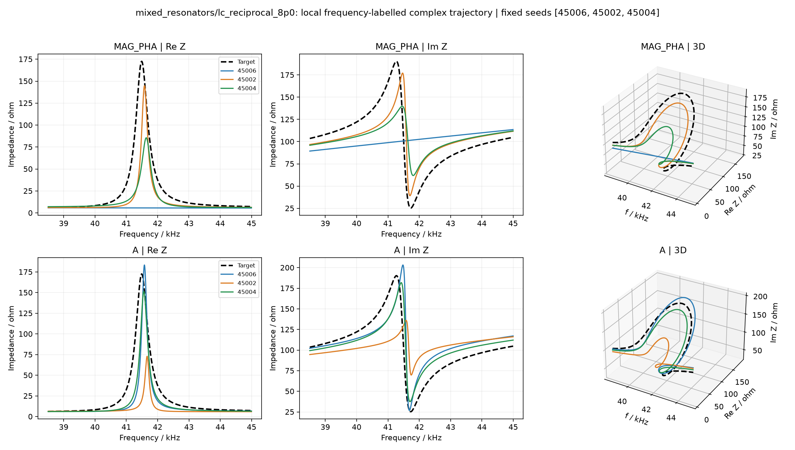
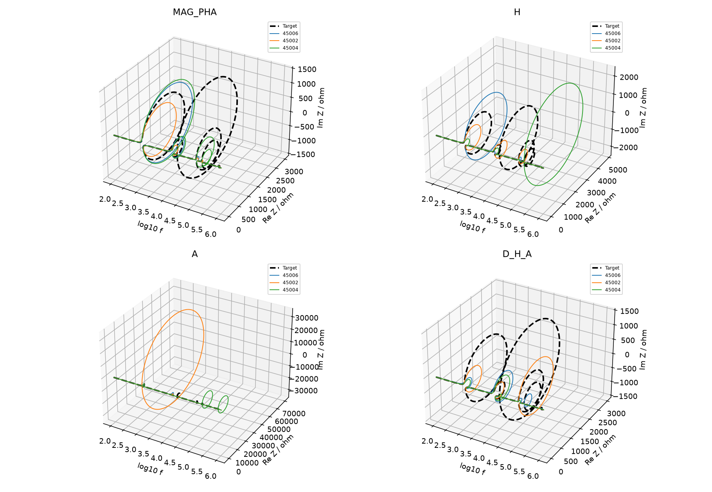

# 复阻抗联合轨迹实验：从“曲线怎样弯”看拟合困难

**本轮找到了局部改进的线索，也发现了一个必须先处理的数值问题。**

D在混合谐振电路的基础条件下，帮助更多seed恢复了被压扁的局部形态；A在同一电路的另一档LC条件下，同时减少了峰谷缺陷和局部相位过程缺陷。组合指标没有稳定胜过单项。

但Case1的新指标组有54/56个结果未通过复核，主要问题是辅助指标的固定测点没有看清某些非常尖的候选结构。因此，我们还不能说“这一组指标已经普遍有效”，也不能把所有失败都归因于MSE。

## 1. 这次在研究什么

电路对不同频率的交流信号，会呈现不同的阻抗。每个频率对应一个复数：

\[
Z(f)=R(f)+jX(f).
\]

R是阻抗的实部，X是虚部。把频率当成播放进度，把R和X当成平面里一个点的两个坐标：频率逐渐增加时，这个点就会画出一条轨迹。

加上频率轴，我们得到三维曲线\((f,R,X)\)。本轮想让优化器同时注意：**点在哪里，以及前后这些点怎样连起来、怎样转弯。**

这与只分别检查幅值峰谷、相位变化有区别。不过，它没有提供新测量信息：完整的幅值和相位也能表示同一条复阻抗曲线。我们改变的是组织误差、引导搜索的方式。

|指标|通俗理解|本轮实际比较的内容|
|---|---|---|
|D：复增量|这一小段往哪里走、走了多少？|同一频率位置附近，Re和Im的联合变化量|
|H：前后段关系|走过这个地方时，前后两段怎样接起来？|前后复增量的内积和有向转弯关系，兼顾变化量|
|A：累积有向面积|从这一段起点走到当前位置，轨迹如何逐步展开？|频率–Re、频率–Im、Re–Im三个投影的累积面积过程|

**面积不是储能，转弯也不自动等于Q或一个独立谐振模态。**这些指标描述端口响应的联合形态。复杂网络里，内部谐振、阻尼和支路联动可能共同形成这种形态，当前还没有把它们一一分开。

计算时，频率使用对数坐标，在每个固定窗口内转成进度；阻抗使用目标给定的尺度。窗口覆盖全频带，候选曲线不能自行平移、旋转或缩放来“对齐”。这是有明确尺度约定的轨迹特征，不是原始\((f,R,X)\)坐标的欧氏距离。

H和A存在整体平移等盲区，H还有整体旋转盲区，所以MAG/PHA两个基础目标始终保留。组合组把相应特征等权平均成一个辅助目标，没有增加到四个、五个目标。本轮使用平方残差版本，和最初草案的绝对残差版本并不完全相同。

## 2. 实验有多大，怎样选结果

- 7类自设计电路，各3档LC条件，另加Case1、Case2，共23个条件。
- 每个条件比较10组：MAG/PHA、D、H、A、D+H、D+A、H+A、D+H+A、PTC参考、C路径参考。
- 每组8个seed，200个候选、300代，每20代保存完整种群；共1840个任务，每任务60000次候选评价。
- 同一条件、同一seed的各组使用相同初始化、范围、算法和候选数。

seed可以理解为“换一个随机起步方式，再做一次”。每个seed最终都使用**冻结的MAG/PHA二维膝点规则**选解；没有合适膝点时使用预先规定的回退。不再按WSMSE最小重选。

膝点是两种误差的折中，不保证两个误差都最小。本轮1635个结果找到凸膝点，205个使用其他回退情形。最终选解还会受到每组前沿的形状和归一化范围影响。

表格是“每个seed先选一个最终解，再平均数值”。**图中画独立曲线，不平均曲线。**本轮固定随机展示45006、45002、45004三个seed；它们并不是按效果挑出来的。

全部电路图、元件参数和23条件的完整表格，放在[电路与结果附录](CIRCUITS_AND_TABLES.md)。其中Case2是201个原始测点，表中适配器名义参数不是真实测得的元件参数。

## 3. 先确认数字靠不靠谱

1840个优化任务和1840个独立复核全部执行完成，执行失败为0。1627个通过本轮全部复核门槛，213个没有通过。

“通过复核”表示计算及结构判定在规定检查下足够稳定，**不表示曲线已经拟合正确**；“未通过”也不表示程序没跑完。

|检查问题|结果数|含义|
|---|---:|---|
|辅助分数在独立复算时不一致|212|训练时给出的辅助分数不能可靠代表更细检查下的曲线|
|逐级加密后仍不收敛|59|这59个同时属于上面的212个，不能重复相加|
|结构判定加密后仍不稳定|1|峰谷/相位过程的判定还随检查网格变化|

所有结果的基础MAG/PHA分数一致性检查均通过。节点电路独立解也均通过，其中81个最终解需要70位精度复核；原双精度偏差仍保留。

理论电路的基础MSE和新辅助指标用了不同的数值评价路径。**目标曲线和基础MSE能看清，不代表辅助指标也能看清所有候选曲线。**

Case1的A组seed45002是明显例子：训练辅助分数约39.52；8级加密复算约217.7万；加入候选尖锐结构锚点复算约5.88×10¹²。后两者也不能当作已收敛的精确真值，但足以说明训练分数不可信。我们没有放宽门槛让它“通过”。

它说明：**目标附近预先布置的测点，可能看不到候选在其他位置形成的更窄尖峰。**下一步应先解决评价可靠性，而不是用这类结果宣布新指标成功或失败的普遍规律。

## 4. 基础MSE反复难修的形态是什么

看起来最有研究价值的，已经不只是“少了一个幅值峰”。在三维轨迹上，常见的是：

1. **局部弯折被压扁或省掉。**Re本应明显凸起，Im本应先增强、再回落，但拟合只留下很平的一小段。
2. **弯折出现了，大小、位置和展开范围不对。**可能看见一个相似回环，却发生在错误频率，或太大、太小、太窄。
3. **大的形态拟合好了，小的形态仍错误。**全频带图中很醒目的大回环可能掩盖其他局部缺陷。

下面是基础组的若干结果。“未完整恢复”按原有固定标准检查位置、高度、宽度，或局部相位变化位置、斜率和宽度。计数是逐seed后平均，所以会出现小数。

|条件|未完整恢复幅值结构 / 目标数|未完整恢复相位过程 / 目标数|
|---|---:|---:|
|Case1|7.875 / 11|6.625 / 11|
|梯形网络，LC因子8|2.000 / 3|3.000 / 6|
|三级网络，基础条件|0.875 / 3|2.750 / 6|
|混合谐振网络，基础条件|2.500 / 5|2.875 / 6|
|混合谐振网络，LC因子8|1.375 / 5|2.250 / 6|
|Case2原始测点|8.500 / 10|连续相位过程不能可靠评价|

这不是“MSE理论上做不到”的证明。理论电路的正确参数仍然能给零误差；这里描述的是规定算法、初始化、范围、300代预算及膝点选解下的困难。

也没有发现“电路越复杂，就一定越难”。用户提出的嵌套电路多数条件下基础组已较好恢复；混合支路、梯形网络中的部分局部结构则更反复。LC操作保持指定L、C的乘积，却会同时改变端口尺度、阻尼关系和联动，不能只解释为改变峰宽。

## 5. 两个最值得继续验证的例子

### 例一：D让被压扁的形态更常重新出现

混合谐振电路基础条件，在约49.41 kHz有一个峰，约52.68 kHz有一个谷。对应的Re凸起、Im回折构成一段明显的联合轨迹。

基础组中，这两个幅值结构各只有2/8个seed完整恢复；D组都提高到5/8。它仍没有让所有seed恢复正确。

|量|基础MAG/PHA|加D|
|---|---:|---:|
|幅值MSE / dB²|11.1007|0.1924|
|相位MSE / rad²|0.002999|0.001816|
|未完整恢复幅值结构|2.500|0.750|
|未完整恢复相位过程|2.875|2.625|
|额外幅值结构|0|0|
|复核通过|8/8|8/8|

逐seed的幅值结构差值平均为−1.75，95%自助区间为[−3.25, −0.25]；5个改善、1个变差、2个相同。相位过程缺陷的改善区间跨零，因此不能说D同时稳定修好了全部相位过程。

图中蓝色seed恢复得较好，橙色和绿色仍有不同程度的不足。D比较的是前后点的联合变化，所以它可能让优化器更注意这段“怎样走”；这是一种与数据相符的机制解释，尚未通过独立消融实验排除窗口权重、搜索路径等因素。

这里Im在该局部窗口仍为正，**不是端口电抗过零**。不能把这段弯折直接称为端口纯阻性状态，也不能凭一个回环就认定一个独立模态。

### 例二：A在另一档LC条件下，兼顾了两类结构

同一混合电路把指定L3乘8、C3除8后，关键局部形态移到约41–42 kHz。峰的目标3dB宽度约714 Hz，谷约1105 Hz；不能因为L3C3不变就认为端口峰的位置和宽度不变。

|量|基础MAG/PHA|加A|
|---|---:|---:|
|幅值MSE / dB²|0.4058|0.1102|
|相位MSE / rad²|0.001576|0.000643|
|未完整恢复幅值结构|1.375|0.375|
|未完整恢复相位过程|2.250|1.000|
|额外幅值结构|0.250|0|
|额外相位过程|0.875|0|
|复核通过|8/8|8/8|

幅值结构差值平均−1.00，95%区间[−1.625, −0.25]；相位过程差值平均−1.25，区间[−2.125, −0.50]。幅值MSE虽然均值更低，其差值区间仍跨零，要保留这个区别。

目标峰的完整恢复次数从2/8提高到5/8，谷从3/8提高到8/8。

A比较的是整个展开过程，不是只比较最后一个面积数值。这个例子支持继续研究“局部展开被压扁”的缺陷；但图中的橙色seed仍有明显误差，不能把平均改善写成每个seed都改善。

### 两个例子也不能替其他条件作结论

D、D+H、H+A、D+H+A在混合网络基础条件都有幅值结构改善线索；A、H+A在LC因子8条件有两类结构改善线索。但在LC因子0.25条件，H等组可能改善幅值同时增加相位过程缺陷；三项一起用没有稳定超过单项。

这些是全部结果出来后识别的开发线索。每条件只有8个seed，比较项目很多，自助区间没有完成多重检验或独立验证。不能把“某些区间不跨零”当成通用规律已经证明。

## 6. Case1、Case2分别告诉我们什么

**Case1：当前新指标实现还不能可靠用于极尖锐结构。**基础组仍有明显缺陷，但D/H/A及组合54/56个结果未通过复核，不能用这些组的均值声称可靠改进。A、H+A各只有1个通过，远不足以支持结论。需要先处理候选曲线自身的数值检查。

图中的巨大或错误位置回环不是“效果好”，即使训练辅助分数看起来较低也不能接受。各面板纵轴范围不同，全局图只能提示形态，不能直接凭视觉面积给方法排序。

**Case2：D、H有测点层面的正向线索，但实测难点没有全部解决。**

|量|基础MAG/PHA|加D|加H|C路径参考|
|---|---:|---:|---:|---:|
|幅值MSE / dB²|32.2627|6.4944|5.4979|4.7786|
|相位MSE / rad²|0.06922|0.06360|0.06197|0.06828|
|未完整恢复测点峰谷|8.50|7.25|7.00|6.50|
|复核通过|8/8|8/8|8/8|8/8|

基础幅值均值受seed45005的173.07 dB²明显拉高，不能忽略。D的测点峰谷缺陷有7个seed改善、1个相同；H有6个改善、2个变差。它们的相位MSE差值区间都跨零。C参考在这个测点结构计数上更好，因此不能说新指标已经胜过参考方法。

Case2的连续相位结构计数为“不适用”，不是0个缺陷。低频Re测点存在明显起伏，而现有模型拟合出的曲线较平滑；需要区分测量波动、模型遗漏和真实响应。不能把所有测点峰谷都当成必须恢复的真实谐振，也不能补造密集目标点进行证明。

## 7. 是找到了更好解，还是最后挑得不同

我们查看了保存的最终完整种群，没有重选最终答案。

混合网络基础条件中，D有5/8个seed的种群含有同时优于基础组最终解的MAG/PHA候选；混合网络LC因子8中，A为6/8。最终所选解的同时改善次数也分别为5/8、6/8。说明这两个例子不只是统计均值下降，确实出现了更好的基础误差候选。

但这还不能完全分离搜索与选解。Case2的H组有3/8个seed，其所选解被基础组种群中的某个候选同时优于两个MSE。相同膝点规则遇到不同前沿，仍会选到不同折中位置。

另外，候选评价数相同，不代表模型查询数和CPU时间相同；额外评价信息也可能贡献收益。窗口等权本身改变了关注区域，还没有做“保持相同窗口权重、只去掉几何关系”的对照。

[最终种群对照图](analysis/figures/case2_population.png)和[逐seed种群机会表](analysis/POPULATION_PAIR.csv)保留了这部分证据。每20代的阶段选解也复看了四个代表条件，共360条观察；基础组有些局部误差停滞，新组有些继续下降，但折中点的两种误差并非必然逐代下降。这不是所有seed都更快收敛的证明。

## 8. 成本与下一步的方向

全部正式任务合计约227.2 CPU核时。基础组约7.21核时，D/H/A及组合各约7.80–8.25核时，C参考约8.88核时，PTC参考约155.30核时。

核时是把每个进程的CPU时间相加，**不是实际等了227小时**。32个单线程进程运行期间，分配CPU大多接近满载；本轮最耗时的是高密度事件检测的PTC参考实现，占正式任务核时约68%。它不是论文程序的逐位复现，这个成本不能直接代表论文PTC的理论成本。

围绕一直追踪的四个问题，目前的判断是：

|问题|本轮回答|
|---|---|
|哪类结构反复难恢复？|频率标注的局部弯折被压扁、局部展开大小或位置失真，以及大形态正确但小形态遗漏|
|什么条件使它更难？|很尖的候选结构会令辅助计算失真；电路联动、局部权重和前沿选解也有影响。没有隔离出单一因果条件|
|针对性指标能改善吗？|D与A有明确的局部开发线索；组合有条件收益，尚无通用赢家|
|能推广吗，代价是什么？|还没有独立推广验证；要计入更多模型查询、额外CPU及评价可靠性的成本|

**2026年10月13日文献阅读后的调整：下一项工作先分析已有候选，解释混合支路的小弯折为什么被压扁、展开为什么失真，同时检查辅助评分能否可靠识别它们。**这比继续扩大指标组合更有判断价值。原实验结果保持不变。

近邻工作已经包含复平面几何、有理复函数拟合、导数约束与路径面积特征。D因此定位为增量强对照；A保留候选资格，但须证明比局部加权和增量多识别了什么。H与三项组合暂不作为主要开发路线。极点、留数等先用于解释理论电路，不立刻变成优化目标。相关依据与阅读顺序见[文献阅读指南](../../docs/阻抗拟合近邻文献_阅读指南_20261013.md)。

|顺序|要交付什么|达到什么条件才继续|
|---|---|---|
|先检查已有结果|混合原始LC、混合L3×8/C3÷8、Case1的逐seed缺陷解释卡；评分失败和成本清单|局部动态解释有依据，候选评分可可靠计算；反例仍保留|
|再做固定候选评分对照|同窗口复数点误差J0、D和一个可靠形态候选的排序与盲区|形态候选确实提供额外辨别能力，而非只增加局部权重|
|通过后才优化|建议三理论条件、六组、每组12配对seed，共216任务；含PTC及更强基础搜索对照|独立结构评价改善，整体误差和成本可接受|
|方案稳定后推广|未参与开发的目标/电路及有来源的实测数据|先冻结规则，再查看新数据结果|

前两项可在本地做。优化仍按MAG/PHA二维膝点选解，并比较相同候选预算与计算成本；Case2先检查数据一致性和模型范围，再决定是否加入。若J0、D或更强基础搜索已能解释收益，就应相应调整研究主张。具体做法、解析例子和停止条件见[下一步研究决策](../../docs/阻抗拟合_文献后的下一步决策_20261013.md)。

本次只完成文献阅读与规划，没有启动新实验、修改原冻结预算或上传网站。

## 9. 文件、复算和关机记录

- [完整电路图、参数、23条件表格](CIRCUITS_AND_TABLES.md)
- [四问题的详细证据与局限](FINDINGS.md)
- [故障、复核失败及关机记录](ISSUES.md)
- [完整逐seed数据](PER_SEED.csv)、[全量与双方通过的配对表](analysis/PAIRED_VALIDITY.csv)
- [逐事件连续误差与恢复次数](analysis/EVENT_MEANS.csv)、[局部误差贡献](analysis/LOCAL_CONTRIBUTIONS.csv)
- [正式冻结方案](../../archive/LOCAL_ONLY.md#ref-d13f89bd8996)

全部原始数据、15阶段种群、失败标记、源代码和输入哈希已回收。SHA256、ZIP CRC及1840任务的逐文件检查通过。

**服务器关机已确认。**2026年10月13日07:14:40，在全部结果回收校验后发出一次官方关机命令；随后用户查看AutoDL控制台并确认西北B区066机（48244ca5f1-6e84d8fb）显示“已关机”，确认记录于07:31保存。平台状态证据来自用户的控制台核查，SSH断开仅作连接证据。未重复发出关机命令，也未操作其他实例。报告分析在本地完成，本轮工作已完成。

