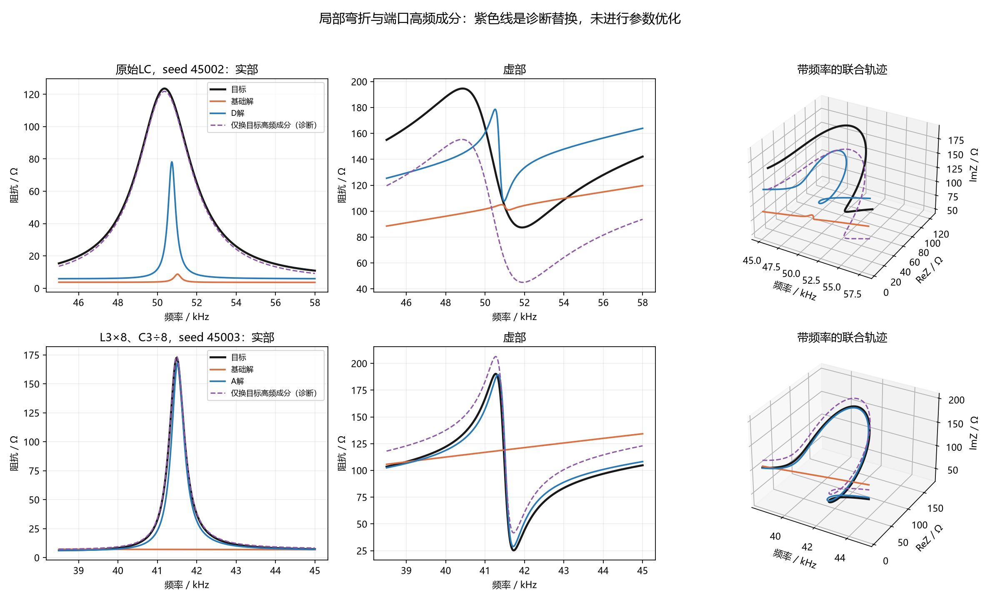
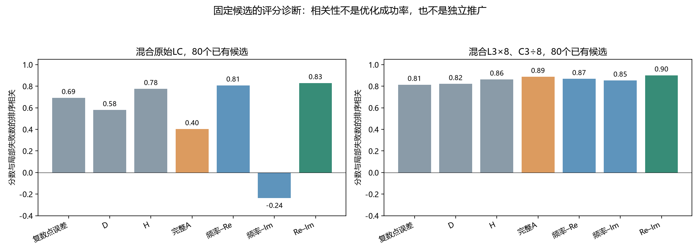
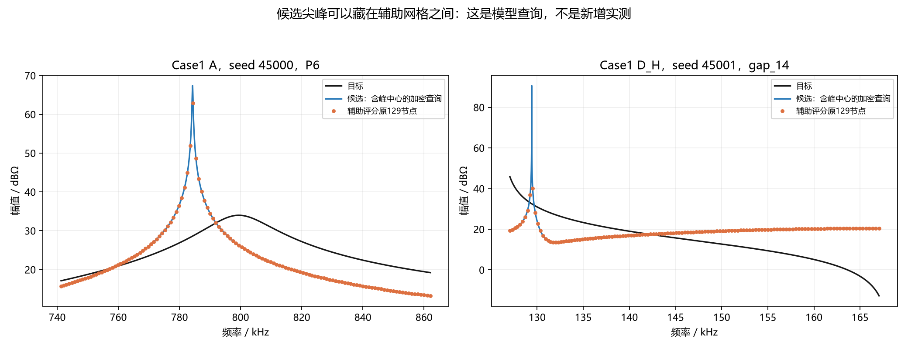

# 局部弯折为什么难恢复：已有实验结果的本地追查

日期：2026年10月13日。面向零基础读者。只读取已有结果、重新计算曲线与诊断分数，没有运行新的参数优化，没有连接服务器，没有上传网站。

**这次找到了更具体的原因：有些解把目标附近的响应成分移走了；有些成分还在附近，却变得过弱、过窄，与其他响应一起把局部弯折压平。另有一类失败来自辅助评分本身的网格与归一化。它们需要分开处理，不能统称为“MSE不行”。**

还有一条新线索：完整A包含的三种面积过程并不总在检查同一处缺陷。单独的Re/Im联合面积在这批已有候选中更能辨别局部峰谷恢复情况。不过，这只是评分诊断，还没有做“单独优化这一项”的新实验。

## 1. 这次具体检查了什么

|检查|范围|目的|
|---|---|---|
|端口动态分解|两个混合支路条件，各8seed的基础解与D/A解，共32候选，另有2目标|把局部弯折和响应成分联系起来|
|成分替换诊断|每个候选检查频率、衰减、参与强度的8种替换组合|判断单项修正还是联合修正更能解释误差|
|固定候选评分|两条件各10方法×8seed，共160候选|比较复数点误差、D、H、A及A的三个分量|
|保存种群检查|上述基础与D/A的32个最终种群，共6400个保存个体|检查是否只需换一个最终选解就能消除缺陷|
|Case1网格诊断|新七组的56个最终候选；8个D样本及分层选取的4样本补充深度计算，有1样本重叠|检查评分漂移和遗漏候选尖峰|

32个候选全部保留，没有只选改善样本。后两条件的160个评分候选包含所有方法，不是160次新优化。Case2的实测数据不能提供真实端口动态参数，所以这次没有把它用作物理机制的真值证明。

本次核对了216份被使用的最终种群与复核曲线的原哈希，以及冻结代码、输入数据的哈希。原始膝点、预算、分数和通过/失败标签均未改动。

## 2. 先用人话解释“一个响应成分”

在外部施加不同频率的交流电，电路的阻抗会随频率变化。多个动态过程与背景叠在一起，形成我们看到的整条曲线。

描述某个端口响应成分，至少需要同时考虑三件事：

|量|通俗理解|本报告用什么表示|
|---|---|---|
|位置|它主要在哪个频率附近起作用|振荡极点的虚部，对应一个频率|
|衰减|变化过程是尖锐还是展开得较宽|极点的负实部；不能直接等同于端口峰宽|
|参与强度与方向|这个成分在外部有多明显，怎样与其他成分叠加|复留数；既有大小，也有相位关系|

这些是整个网络在端口能表现出的动态，不是一元件对应一成分。极点在复频率平面里，和Re/Im阻抗轨迹的坐标不是同一个平面。

“零点”也不是电抗过零。极点附近若有零点，端口上的作用可能被部分抵消。因此，内部存在一个动态过程，不代表外部一定看到明显峰谷。

## 3. 混合支路：失真至少有两种形态

### 3.1 成分跑到了目标局部频段以外

原始LC条件的目标高频端口成分约在 **50.36kHz**；L3×8、C3÷8条件约在 **41.48kHz**。这不是幅值峰顶位置：峰顶还受到背景和其他成分影响。

原始LC基础组有2/8个解，把匹配的高频成分移到约538–546kHz。另一条件基础组有4/8个解，相关成分离开了38.5–45kHz检查带，其中有的到了约388–476kHz，有的降到了约19.82kHz。

这些频率有些仍在完整训练频带内，不能说是全部“躲到测量范围外”。准确说法是：**目标局部频段所需的成分缺席了，整条曲线却仍能靠其他成分形成较接近的背景。**

D/A组这16个对应解的高频成分都回到了所检查的局部频段内。但“位置回来了”还不等于全部结构恢复。

### 3.2 位置差不多，作用却太弱、太窄

以原始LC的基础解seed45002为例：

|量|相对目标的情况|
|---|---|
|高频成分位置|偏高约672Hz，仍在目标附近|
|衰减|目标的约13.0%|
|复留数大小|目标的约0.56%|
|留数大小÷衰减的比值|目标的约4.3%|

最后一行只是衡量局部作用强弱的粗略诊断，不是新的能量或Q定义，也不等于实际峰高。

这个成分既窄，又很弱，叠加后的Re凸起和Im转折几乎被压平。D解仍不是目标参数，但相应比值提高到约61.2%，局部弯折明显恢复。这一对样本的幅值峰谷完整检查由0/2变成2/2。

在这个基础解中，最近极点–零点距离约为该极点衰减尺度的0.049倍；D解约为0.508倍。这与基础解端口成分被较强抵消相一致。它支持“弱可见成分”解释，**不证明某一个元件就是唯一原因**。

黑线是目标，橙线是基础解，蓝线是D/A解。上排基础解的实部几乎没有应有凸起；下排基础解几乎没有应有转折。紫线将在下一节解释。图中目标Im仍为正，不能把这些弯折直接解释成“恢复了电抗过零”。

### 3.3 全部8seed的配对情况

|诊断量更接近目标/误差更小的seed数|原始LC：D对基础|L3×8、C3÷8：A对基础|
|---|---|---|
|成分位置|7/8|7/8|
|衰减比值|5/8|6/8|
|复留数|6/8|7/8|
|留数/衰减诊断比值|4/8|7/8|
|局部复数曲线误差|7/8|7/8|

比值用与目标的对数距离判断接近程度。并非所有动态量都随结构恢复而单调变好，也不是D/A普遍成功。因此应研究“在哪些条件下有效”，而不是寻找一个保证通用的解释。

## 4. 为什么只修峰宽或位置还不够

我做了一项诊断：把候选的高频成分拆出来，分别替换它的位置、衰减、复留数，以及它们的组合，观察局部曲线误差。

**这不是重新优化电路。**替换后的复响应未必能由当前RLC拓扑实现，也未必保持无源；它用于分解误差来源，不能作为新的拟合结果。

还是看原始LC基础解seed45002：

|诊断替换|局部复数误差变化|
|---|---|
|只换位置|下降约0.18%|
|只换衰减|反而增加约0.62%|
|只换复留数|变成原误差的约5.47倍|
|同时换衰减和复留数|下降约67.2%|
|位置、衰减、复留数一起换|下降约70.5%|

只增加参与强度、同时保留过尖的形态，会形成新的尖峰，所以误差反而更大。**这说明位置、衰减和参与强度要配合，不能把LC操作仅解释成峰宽变化。**

全部基础解中，把这个高频成分整体换成目标成分，原始LC条件有6/8个样本的局部误差下降超过一半；另一条件是8/8。下降幅度的中位数分别约96.3%、99.95%。

也有明确反例：原始LC的seed45001和45005，替换该高频成分只改善约17.2%和8.2%，主要剩余误差与其他成分或背景有关。不能把所有局部失真都归给同一个高频成分。

## 5. MSE是不是根本没有看见这段缺陷

这个问题需要改写。**本轮不是所有缺陷都被MSE忽略。**

在基础组里，目标P2、V3的两个不重叠3dB核心频段：

|条件|占主目标总频率权重|占幅值误差的平均份额|占相位误差的平均份额|
|---|---|---|---|
|原始LC|约3.03%|约31.7%|约81.3%|
|L3×8、C3÷8|约0.47%|约38.0%|约68.6%|

这些份额是各seed的误差占比再平均，不是把曲线取平均。频率权重小，的确会影响整体评分；但局部残差已经贡献了大量相位误差，说明主目标不是对它完全无感。

当前更合理的判断是：**分数看见了误差，但搜索仍可能停在多参数联动的折中区域；整体分数接近的候选，也可能呈现不同的局部形态。**局部权重、非线性搜索和选解仍需对照才能分离。

不能把“频段很短”直接推成“MSE没有引导”，也不能从辅助指标改善倒推出“MSE理论无解”。

## 6. 完整A的问题：三个分量不总在关注同一件事

A分别检查：频率–Re过程、频率–Im过程、Re–Im联合过程，然后将归一化后的误差平均。

这次把它们拆开，在每条件80个已有候选上比较评分与P2/V3失败数的排序关系。数值越接近1，表示这一分数越倾向于把局部失败更多的候选排得更差。

|分数|原始LC|L3×8、C3÷8|
|---|---|---|
|同窗口复数点误差J0|0.693|0.814|
|D|0.580|0.821|
|H|0.776|0.864|
|完整A|0.403|0.888|
|频率–Re分量|0.808|0.868|
|频率–Im分量|−0.238|0.854|
|Re–Im分量|0.830|0.902|

**不能把这些数读成优化成功率。**候选来自参与开发的同一批目标，方法和seed有关联；也不能由排序相关判断哪种算法搜索更好。

原始LC条件中，完整A明显弱于Re–Im分量。基础seed45000、45006的完整A约98.1%来自末端宽频段，P2/V3两窗口仅占约1.7%。这说明当前窗口与归一化后的组合，有时把主要注意力放到了别处。

这未必是“末端误差没有意义”：它可能确实在检查移到高频的额外变化。结论应是**完整A与当前关注的局部缺陷不总一致**，而不是为了提高局部成绩就直接删掉末端窗口。

所有160个候选的D/H/A总分，以及A三个分量，在16、32级计算间按原特征门槛通过；总分另与原候选锚点复核值核对通过。这里的排序差异不只是Case1那种明显网格失稳。

### 6.1 幅相误差接近时，联合形态能多区分一点吗

将同条件候选两两比较，只保留幅值、相位MSE各自相差不超过10%，而局部失败数不同的候选对：

|分数把局部失败更多者排得更差的次数|原始LC：54对|另一条件：11对|
|---|---|---|
|J0|30/54|6/11|
|D|18/54|7/11|
|H|49/54|10/11|
|完整A|27/54|9/11|
|Re–Im分量|52/54|11/11|

放宽到25%后，Re–Im分量分别为165/183、58/60，完整表保留。**这些候选对大量重叠，不是54或11次独立试验，更不能宣称96%或100%的新优化成功率。**相似MSE筛选也属于本次探索分析，不是独立检验。

这为带频率标记的Re–Im有向面积过程提供了具体开发线索；H表现也接近，必须保留为强对照。另一方面，另一条件的J0与连续局部复数误差排序更接近，说明“结构阈值”和“连续曲线误差”不能互相代替。

J0与几何方案使用同窗口、同Ω尺度和同节点，但没有完全复制增量/面积的目标归一化分母；因此这次尚未完全排除权重因素。

### 6.2 这个联合分量可以怎样解释物理意义

固定端口有效值电流时，ReZ决定有功功率，ImZ决定无功功率。联合轨迹描述这两种端口响应随频率怎样一起变化。上面的动态分解显示：局部凸起与转折可以来自同一个端口高频成分的参与、衰减及其与背景的叠加。

因此，联合面积过程可以尝试检查这种展开是否被压平、错位或改变方向。**它不是把频率积分直接解释成储能，也不是Q、谐振数量或元件值。**相同二维圆也可能有不同频率过程，串联RLC也可能没有二维环形面积；原来的解析反例仍须保留。

目前支持的是“与局部端口动态失真相关的形态诊断”，还没有证明该分量改善搜索的因果机制，更没有证明论文创新成立。

## 7. Case1：这里先要修的是评分可靠性

56个新指标候选中，有14个至少在一个窗口，直接计算候选支路中心幅值比原129节点的窗口最大值高超过3dB；7个超过10dB，最大约50.55dB。

这些是已知理论模型的查询。支路中心不必是叠加曲线的精确峰顶；若其值已经比原网格最大值高很多，就足以证明原网格漏看了该候选的高值结构。

例如A、seed45000：

- P6窗口的目标尺度约50.02Ω，候选中心响应约2341.51Ω，约为该尺度的46.8倍。
- 该支路约784.28kHz，Q约3067；其近似3dB宽度约为原网格间隔的0.276倍。
- 原评分约958.6；8、16、32级均匀计算约132711、174922、188413；32级候选锚点计算约193259。

32级均匀值与锚点值仍差约2.51%，不能把“加密到32级”当作所有样本都已可靠。此处原网格不只影响峰高，也影响面积过程的积分。

另一个D_H、seed45001样本，在gap_14窗口原网格最大值约101.5Ω，支路中心却约34187Ω，相差50.55dB。这是非常具体的候选结构漏检。

但峰中心漏看并不能解释全部54个未通过案例。8个D补充样本里，原分数/32级锚点分数既有约1.47，也有约0.19；粗网格可能高估，也可能低估。已有通过样本A45006、H_A45000补充加密后则稳定。**评分失稳有候选分辨率、积分误差和尺度敏感性等不同表现，不能只归成“所有辅助指标都低估尖峰”。**

正确处理是保留原失败，改进新版本的候选查询和积分检查，再判断指标效果。不能用这次可靠重算给旧优化补发“通过”。

## 8. 是否只是膝点选错了

我检查了32个保存的最终种群。在每个种群中，允许候选的MAG、PHA各比最终膝点恶化不超过10%，再看能否大幅降低局部复数误差。

16个基础组种群里，没有一个能在这个限制内将局部误差降至膝点的一半以下。若完全不限制幅相代价，有的种群确有明显更好的局部曲线。

这说明：**简单换个最终选解，未必能修好大部分缺陷；部分局部改善需要接受其他误差代价，部分好候选尚未进入种群。**10%只是本次诊断容忍范围，不是改了最终规则，也不是证明膝点永远没有影响。

我们还没跑更强的基础搜索，所以现在仍不能把搜索器和主目标的影响完全分开。

## 9. 现在可以做出的判断，以及下一项工作

|问题|这次更具体的回答|
|---|---|
|哪类结构困难？|局部端口成分缺席、弱化或变尖，使Re凸起和Im转折难以同时恢复；另有辅助网格遗漏候选尖峰|
|什么条件使它更难？|位置、衰减、留数联动，极点–零点的端口抵消，其他成分/背景，以及窗口与尺度的实际权重；相位残差并非都被忽略|
|指标为什么可能有用？|它可能更直接地区分幅相总分接近但联合形态不同的候选；Re–Im分量与H都有线索，完整A平均可能削弱这项辨别能力|
|能否推广、代价是什么？|尚无独立推广；可靠候选查询明显增加计算量。单独Re–Im分量还没优化，不能预报其收益|

**下一项建议收敛为“频率标记的局部Re–Im有向面积过程及其可靠评价”这一个候选方向。**先以它检查端口成分的局部参与与联合展开，保留位置、绝对水平与完整频带缺陷检查；不直接堆新组合。

先在本地完成两件事：

1. 用这次Case1反例检查新分量的候选网格与积分可靠性，同时核对窗口和归一化，不能仅把旧完整A删两项就默认计算可靠。
2. 固定候选集，继续比较联合分量、H、D、J0及匹配权重的对照；检查连续误差、位置/宽度和额外结构，避免只优化“通过阈值”的数量。

通过后再安排配对优化与更强基础搜索对照。服务器不可用时，这两项都可在本地开展。当前没有启动后续优化，也没有据此修改原1840任务的结论。

## 10. 数据与复算

主要数据见[文件与方法说明](METHODS_AND_FILES.md)。其中保留逐seed端口成分、全部替换组合、评分分量、相近MSE候选对汇总、56个Case1候选检查及种群机会。

[原实验报告](../complex_joint_20261012/REPORT.md)仍记录原1840任务；[文献后的规划](../../docs/阻抗拟合_文献后的下一步决策_20261013.md)提供此前的路线。本次只补充原因分析，不把新诊断当成新优化结果。
