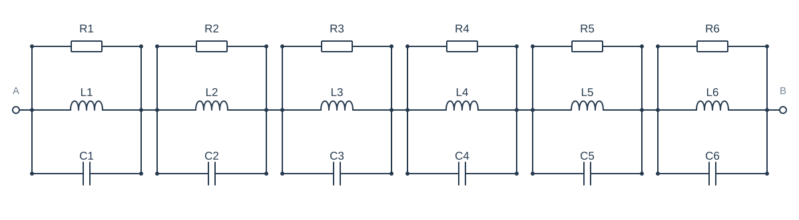
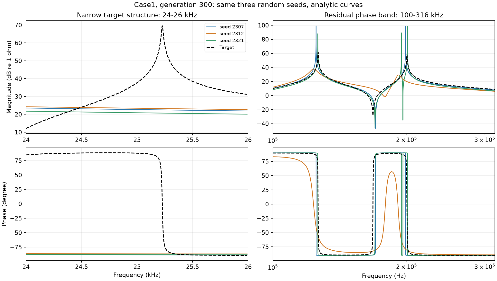
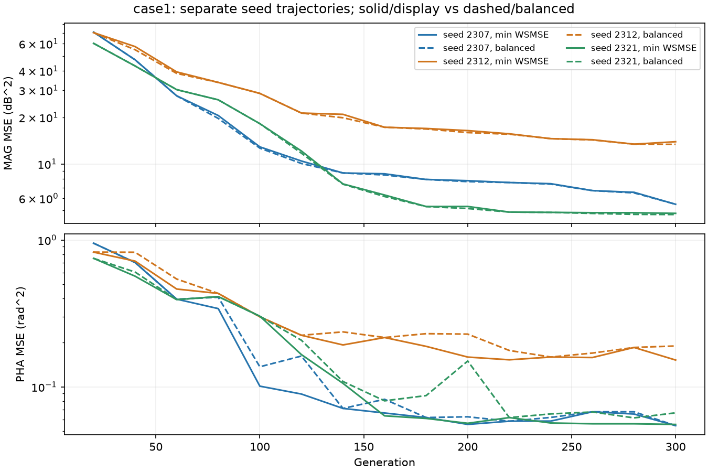
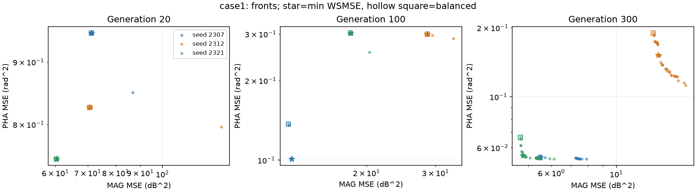
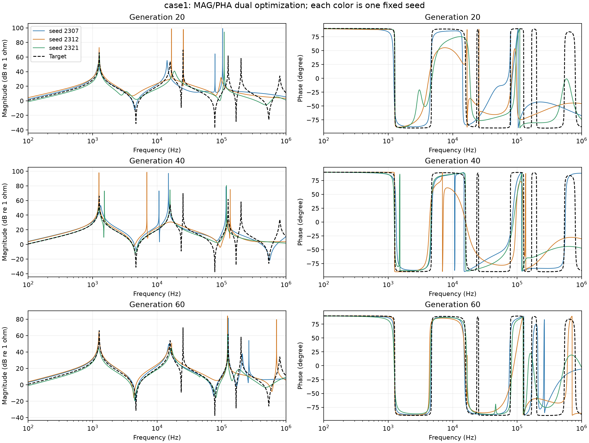
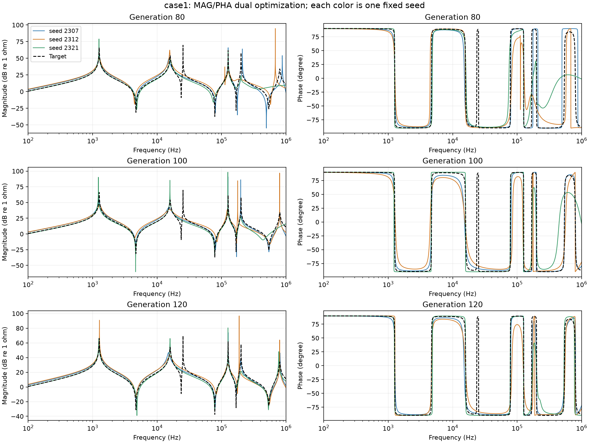
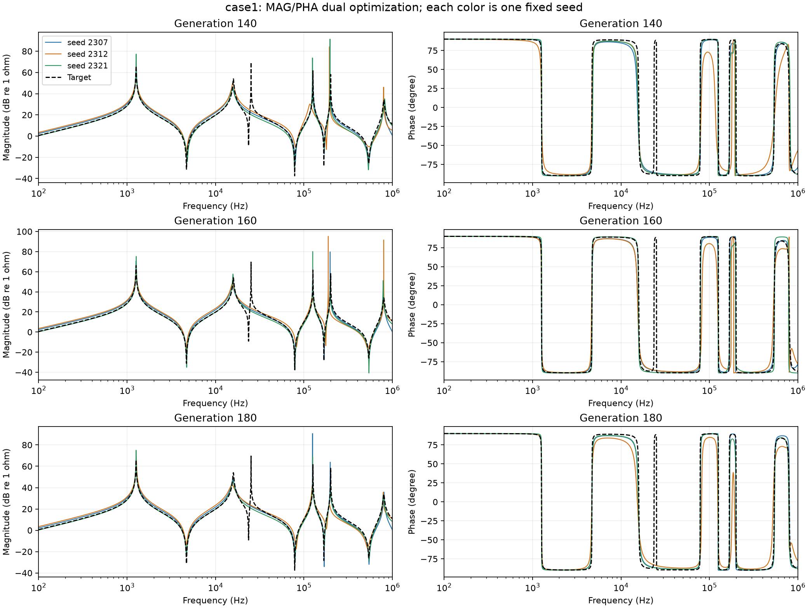
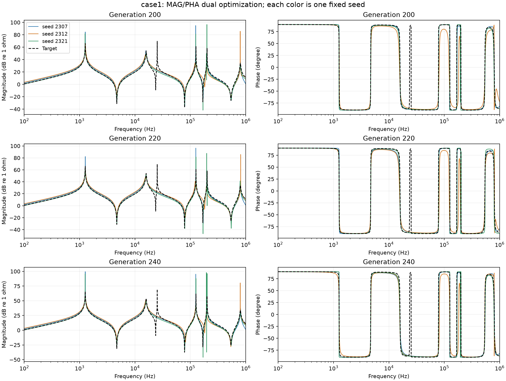
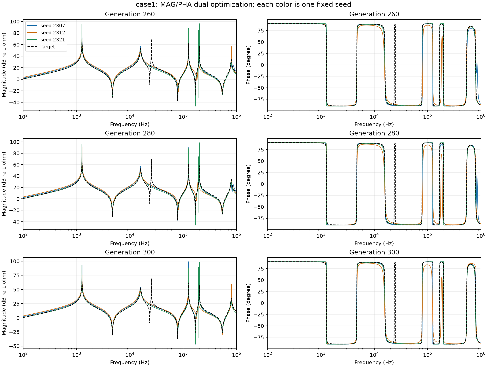

# case1：每20代查看3个固定seed

随机seed：[2307, 2312, 2321]；颜色全程固定；每个seed各取本阶段前沿的最小WSMSE代表解。没有平均任何曲线。

| 元件/单位 | 目标真值 | seed 2307·300代 | seed 2312·300代 | seed 2321·300代 |
| --- | --- | --- | --- | --- |
| R1/Ω | 2000 | 82322.1 | 78.0592 | 47256.9 |
| L1/H | 0.001585 | 1.06748e-06 | 3.21985e-06 | 0.00154139 |
| C1/F | 1e-05 | 5.99188e-07 | 5.15949e-07 | 1.03584e-05 |
| R2/Ω | 3000 | 47244.9 | 17.4224 | 25109.9 |
| L2/H | 1e-05 | 0.00187248 | 1.08839e-07 | 2.11088e-06 |
| C2/F | 3.98e-06 | 8.45882e-06 | 3.48438e-07 | 7.52757e-07 |
| R3/Ω | 500 | 90476.6 | 5828.13 | 324.55 |
| L3/H | 0.0001 | 2.56842e-06 | 0.0021691 | 0.000105568 |
| C3/F | 1e-06 | 6.30168e-07 | 7.29516e-06 | 9.63606e-07 |
| R4/Ω | 1200 | 43.7496 | 28.6527 | 34.211 |
| L4/H | 2.512e-06 | 1.30591e-07 | 4.9716e-07 | 1.91426e-07 |
| C4/F | 6.31e-07 | 3.01677e-07 | 1.38945e-06 | 2.12676e-07 |
| R5/Ω | 800 | 13.9714 | 245.877 | 29016.3 |
| L5/H | 1.259e-06 | 1.0821e-07 | 0.00014852 | 2.1807e-07 |
| C5/F | 5.01e-07 | 3.56267e-07 | 7.0871e-07 | 3.06497e-06 |
| R6/Ω | 50 | 527.705 | 903.37 | 84717.4 |
| L6/H | 2.51e-07 | 0.000130963 | 1.02807e-07 | 7.16127e-07 |
| C6/F | 1.58e-07 | 7.81828e-07 | 3.77833e-07 | 8.75055e-07 |

## 末代两个局部结构

左列把约25.23kHz的目标窄峰和相位转变放大；右列对应100–316kHz的主要相位残差频带。图中的极窄拟合尖峰来自解析电路响应，原训练点折线可能看不到。

## 每个seed的阶段诊断

| seed | 代 | 幅值RMSE/dB | 相位RMSE/° | 幅值漏失/新增 | 相位事件漏失/新增 | 网格稳定 |
| --- | --- | --- | --- | --- | --- | --- |
| 2307 | 20 | 8.6111 | 56.007 | 5/3 | 3/1 | True |
| 2312 | 20 | 8.7759 | 53.43 | 4/0 | 4/7 | True |
| 2321 | 20 | 8.1229 | 51.585 | 4/2 | 5/3 | True |
| 2307 | 100 | 4.0101 | 20.899 | 2/0 | 2/0 | True |
| 2312 | 100 | 5.8738 | 34.724 | 2/0 | 2/1 | True |
| 2321 | 100 | 4.7575 | 32.356 | 3/0 | 2/0 | True |
| 2307 | 200 | 3.2577 | 17.802 | 2/0 | 2/0 | True |
| 2312 | 200 | 4.5425 | 26.36 | 2/0 | 2/2 | True |
| 2321 | 200 | 2.8718 | 17.326 | 2/2 | 2/2 | True |
| 2307 | 300 | 2.9863 | 18.31 | 2/0 | 2/0 | True |
| 2312 | 300 | 4.3219 | 25.025 | 2/0 | 2/2 | True |
| 2321 | 300 | 2.8819 | 17.457 | 2/2 | 2/2 | True |

Case1在解析加密网格上诊断；Case2仅在原实测点上诊断，点间峰谷不能确认。峰谷阈值1dB、相位事件阈值5°，同类型在0.25 decade内匹配；这些是诊断阈值，不是新优化目标。RMSE按log f积分，和优化使用的频点等权MSE有所不同。

## 所有20代阶段的曲线

### 20–60代

### 80–120代

### 140–180代

### 200–240代

### 260–300代

[所有阶段元件参数](parameters.csv)；[逐seed局部结构诊断](diagnostics.csv)；[逐频带数据](bands.csv)

[返回主报告](REPORT.md)
