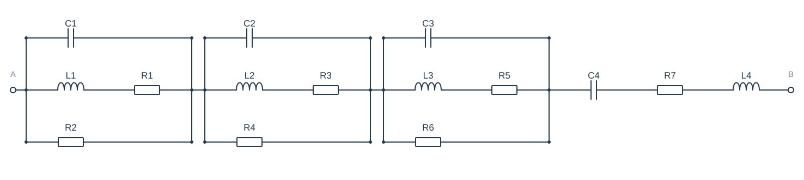
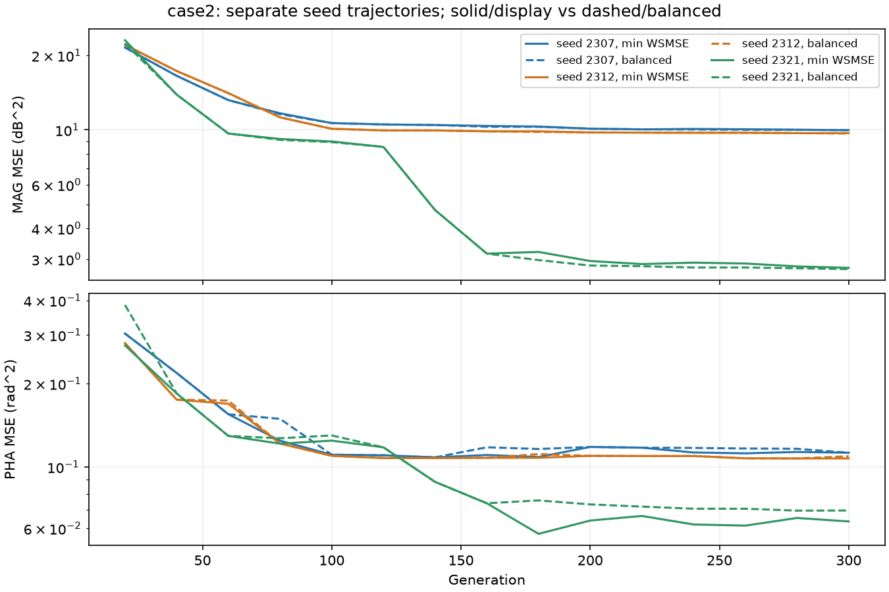
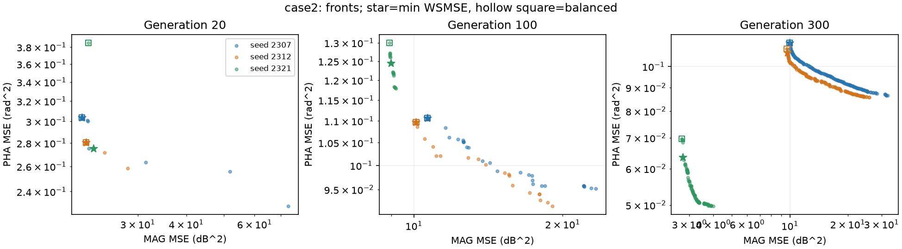
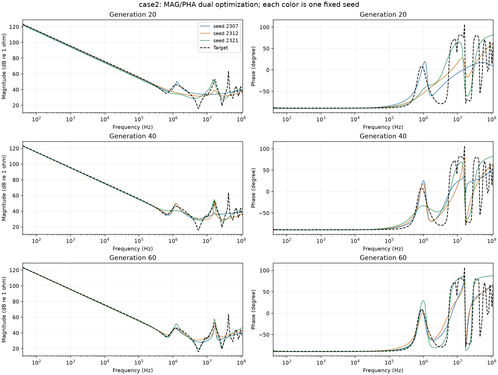
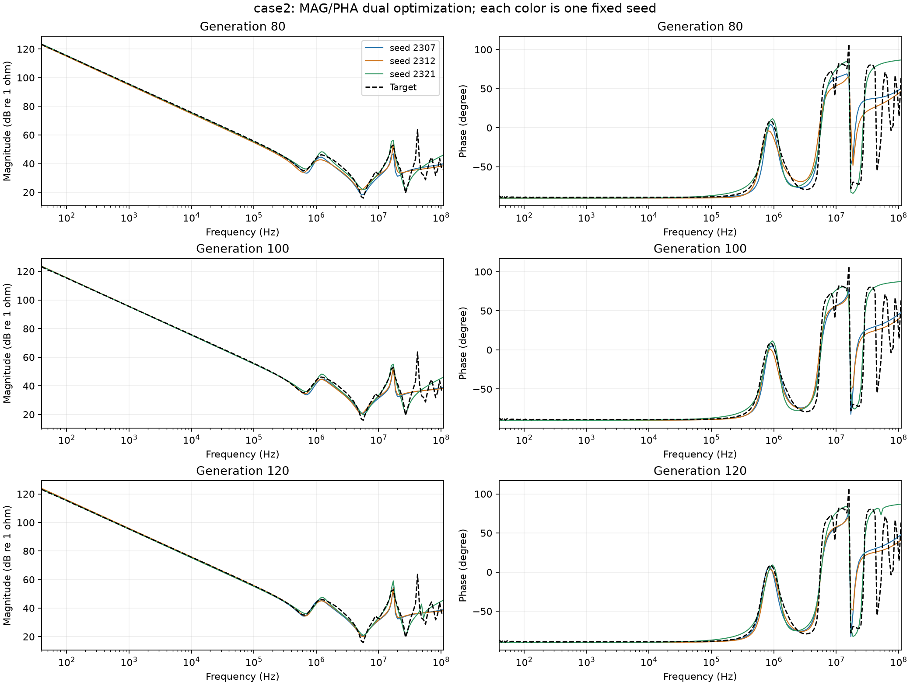
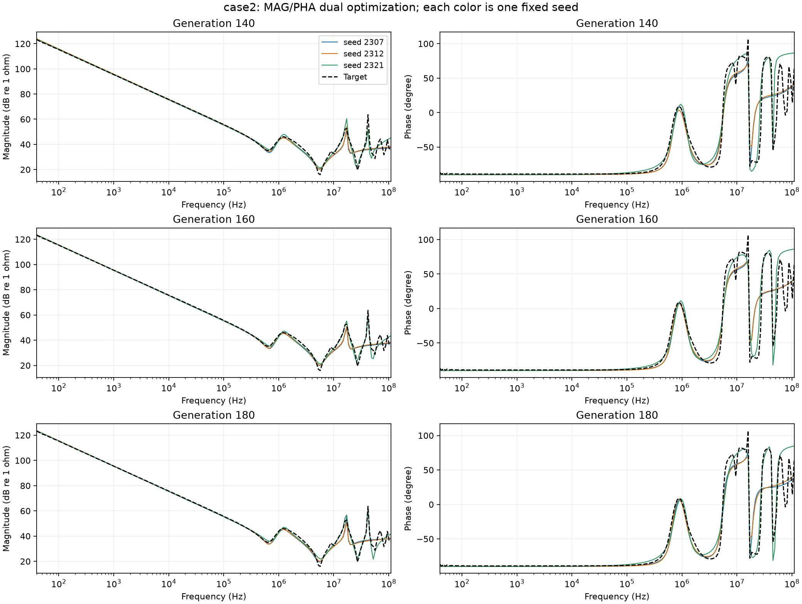
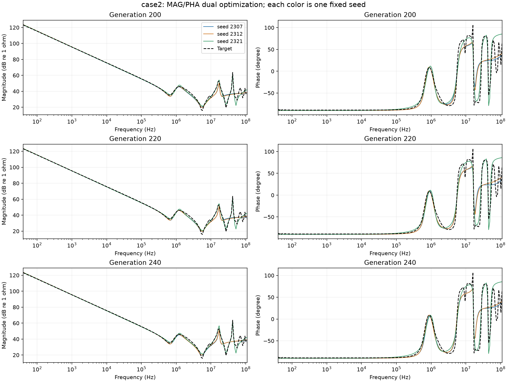
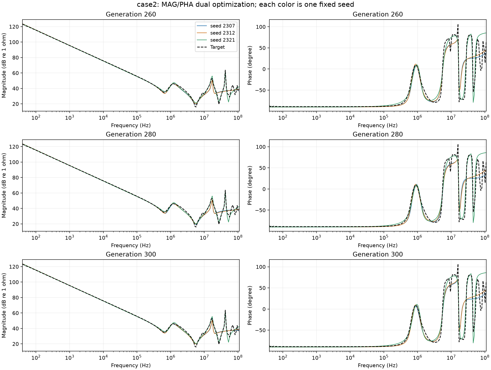

# case2：每20代查看3个固定seed

随机seed：[2307, 2312, 2321]；颜色全程固定；每个seed各取本阶段前沿的最小WSMSE代表解。没有平均任何曲线。

| 元件/单位 | 目标真值 | seed 2307·300代 | seed 2312·300代 | seed 2321·300代 |
| --- | --- | --- | --- | --- |
| R1/Ω | 无真值 | 0.0118689 | 0.0151893 | 0.0114321 |
| R2/Ω | 无真值 | 653.672 | 62.7113 | 2720.89 |
| R3/Ω | 无真值 | 0.0169687 | 0.0362767 | 0.0103131 |
| R4/Ω | 无真值 | 64.648 | 845.056 | 713.827 |
| R5/Ω | 无真值 | 10.2182 | 10.8376 | 19.7593 |
| R6/Ω | 无真值 | 221.682 | 238.75 | 492.776 |
| R7/Ω | 无真值 | 0.342983 | 0.0153056 | 8.91811 |
| L1/H | 无真值 | 1.4146e-07 | 6.70419e-07 | 7.17717e-08 |
| L2/H | 无真值 | 6.62862e-07 | 1.56729e-07 | 4.77455e-07 |
| L3/H | 无真值 | 1.40107e-05 | 1.36218e-05 | 1.14424e-05 |
| L4/H | 无真值 | 1.0033e-07 | 1.07418e-07 | 2.209e-07 |
| C1/F | 无真值 | 6.17846e-10 | 5.62657e-12 | 1.97793e-10 |
| C2/F | 无真值 | 9.97918e-12 | 5.68286e-10 | 1.87853e-10 |
| C3/F | 无真值 | 1.45341e-09 | 1.43827e-09 | 1.51477e-09 |
| C4/F | 无真值 | 2.63548e-09 | 2.62505e-09 | 2.67775e-09 |

## 每个seed的阶段诊断

| seed | 代 | 幅值RMSE/dB | 相位RMSE/° | 幅值漏失/新增 | 相位事件漏失/新增 | 网格稳定 |
| --- | --- | --- | --- | --- | --- | --- |
| 2307 | 20 | 4.6483 | 31.511 | 9/0 | 12/1 | True |
| 2312 | 20 | 4.708 | 30.408 | 9/0 | 12/0 | True |
| 2321 | 20 | 4.7961 | 30.057 | 9/0 | 12/0 | True |
| 2307 | 100 | 3.2642 | 19.094 | 7/0 | 10/0 | True |
| 2312 | 100 | 3.1801 | 18.992 | 7/0 | 10/0 | True |
| 2321 | 100 | 2.9551 | 20.213 | 7/0 | 10/0 | True |
| 2307 | 200 | 3.1824 | 19.697 | 7/0 | 10/0 | True |
| 2312 | 200 | 3.1257 | 18.988 | 7/0 | 10/0 | True |
| 2321 | 200 | 1.6876 | 14.49 | 5/0 | 8/0 | True |
| 2307 | 300 | 3.1601 | 19.23 | 7/0 | 10/0 | True |
| 2312 | 300 | 3.1139 | 18.795 | 7/0 | 10/0 | True |
| 2321 | 300 | 1.6279 | 14.434 | 5/0 | 8/0 | True |

Case1在解析加密网格上诊断；Case2仅在原实测点上诊断，点间峰谷不能确认。峰谷阈值1dB、相位事件阈值5°，同类型在0.25 decade内匹配；这些是诊断阈值，不是新优化目标。RMSE按log f积分，和优化使用的频点等权MSE有所不同。

## 所有20代阶段的曲线

### 20–60代

### 80–120代

### 140–180代

### 200–240代

### 260–300代

[所有阶段元件参数](parameters.csv)；[逐seed局部结构诊断](diagnostics.csv)；[逐频带数据](bands.csv)

[返回主报告](REPORT.md)
