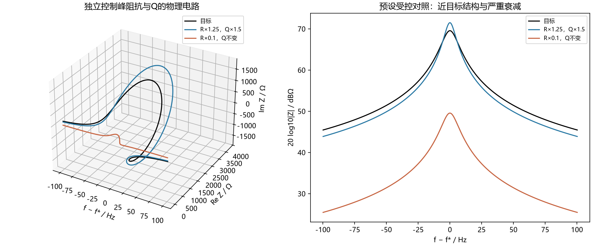
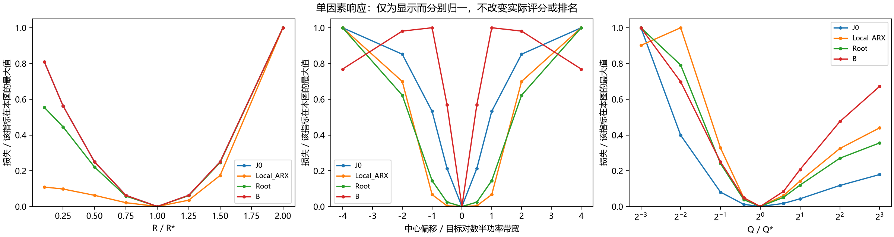
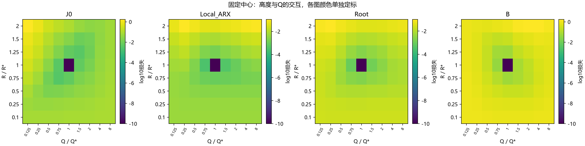
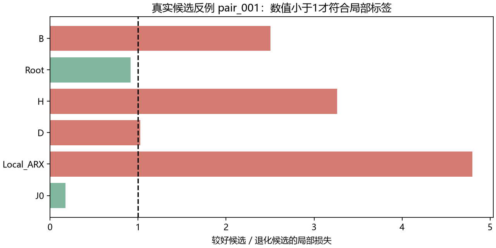
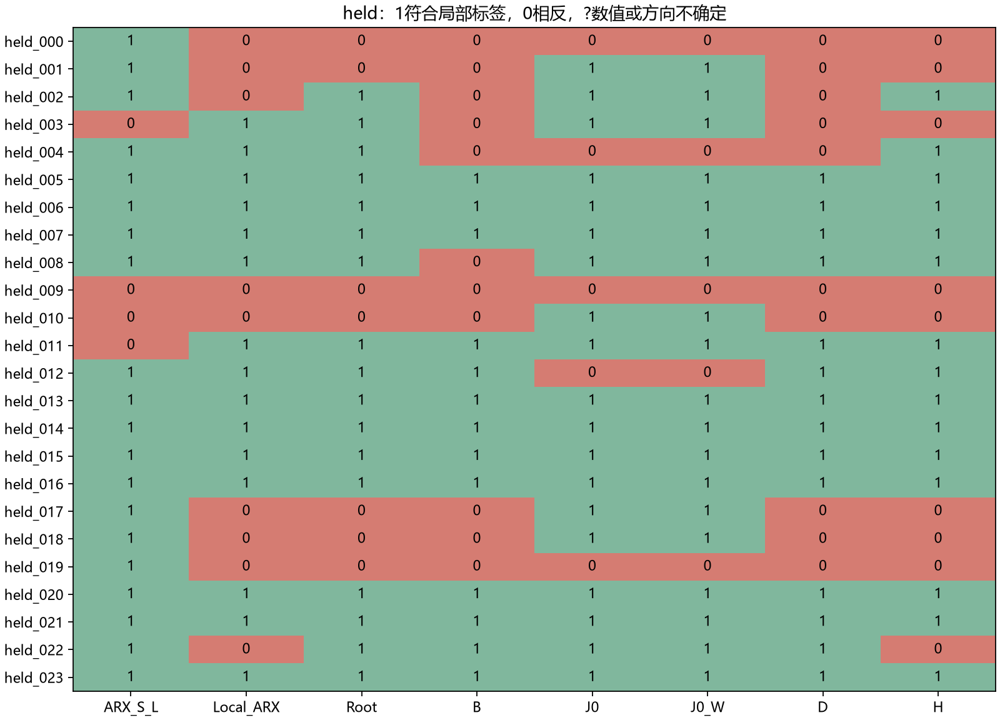
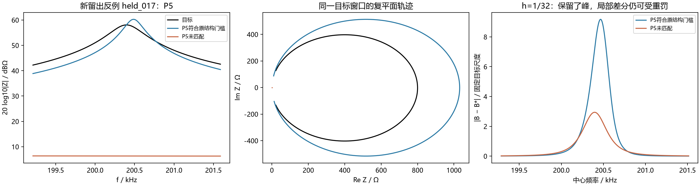
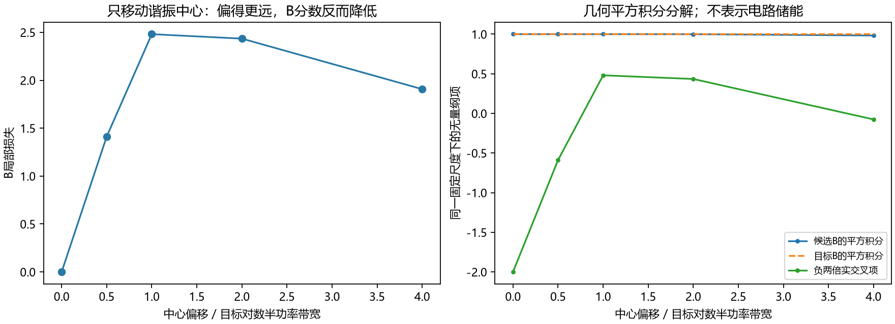

# 复阻抗轨迹指标后续实验：面积特征压缩与复向量弦偏离

## 摘要

本轮按[实验方案](../../docs/复轨迹指标下一轮实验方案_20261016.md)完成受控物理电路、既有反例及固定候选留出检查。共684个受控设置、12组开发候选对和24组留出候选对，形成756项评分任务、2124项候选—窗口记录，全部通过数值检查。两个新候选均未通过预定方向门槛，因而**未启动条件性配对优化**。

面积特征压缩版Root修复了两个已知P3排序反例，但在24组留出候选中只有17组方向符合局部标签；原累计面积ARX为20组，普通窗口复误差J0为19组。复向量弦偏离B为13组，并仍误判一个已知P3反例。**修复少数已知反例，没有转化为足够稳定的候选判别。**

另发现B对谐振频率错位的响应并不单调：在固定峰阻抗和Q的受控电路中，中心偏移从1个目标带宽增加到4个带宽，B损失由2.481降为1.907，约下降23.1%。事后分解显示，下降量约97.0%来自实交叉项的变化，有限窗口内候选平方积分变化约占3.0%。这限定了将二阶向量差分解释为“错位程度”的合理范围。

本轮是评分和机制开发实验，没有得到新的优化收益、独立推广或最终辅助指标结论。

## 1. 实际执行范围

|内容|数量或口径|
|---|---|
|单并联RLC参数网格|648个设置：8档R、9档中心偏移、9档Q|
|额外串联叠加的并联RLC支路|36个设置|
|开发反例|上轮冻结12对，24条候选|
|候选留出|24对，48条候选；三个条件各8对，覆盖12个seed编号|
|评分任务|684+24+48＝756|
|候选—窗口记录|684×3+24+48＝2124|
|条件性新优化|0；未使用48000–48007进行正式优化|

留出条件为Case1、混合网络原参数、混合网络LC条件。每条件使用8个不同seed；三个缺陷家族各8对：严格未匹配的目标结构、已匹配但严重失真的结构、间隙额外结构。双方MAG/PHA对称相对差均≤5%，参数与上轮12对不重叠，同一条件内seed不重复。

选样优先最终种群，再按300、280、…、80代追溯，最终在第80代检查后构成24对。覆盖三个条件216次既有运行的12个保存阶段，共2592个运行阶段文件、518400个候选记录位置；这些记录并不独立，也不等于新的搜索评价预算。少数旧候选的其它事件原先未知，本轮补齐完整检测后再选样。

候选库在新指标评分前保存参数、来源、结构量及SHA256；本地逐对核对来源文件、参数、原主目标、5%条件和结构标签全部通过。主候选库沿用**原严格未匹配定义**。过程中讨论过将严重低峰纳入缺失类的补充草案，但没有用于主候选库、评分或门槛。

三个条件都曾参与研究开发。因此，这24对是“未按新指标分数选取的候选留出”，**不是独立目标、新拓扑或实测验证集**。

## 2. 两个候选的定义

### 2.1 Root：压缩局部面积特征

沿用上一轮局部有向面积a(t,h)和仅来自目标的局部长度平方分母d*(t,h)。对r=a/d*施加：

\[
\psi_\delta(r)=\operatorname{sgn}(r)
\left(\sqrt{|r|+\delta}-\sqrt\delta\right),\qquad\delta=0.01.
\]

比较候选与目标变换后特征的平方差，再在固定频率中心、三个h及全部窗口上取平均。计算使用等价稳定式r/(√(|r|+δ)+√δ)。

这是对每个面积特征作变换，**不是对最终总分开平方**。它保留符号并降低较大面积差的放大程度，但仍是面积族的机制对照，不代表新的内部物理量。

δ=0.001和0.1仅按原方案作敏感性检查，未依据结果替换主设置。

### 2.2 B：同频率的复向量弦偏离

保持z=Z/S*及目标固定的归一化对数频率t，定义：

\[
B_h(t)=z(t)-\frac{z(t-h)+z(t+h)}2.
\]

候选和目标在同一t比较，采用目标RMS弦偏离及跨窗口下限作为分母。h固定为1/32、1/16、1/8。所有原窗口、间隙和末端保留，不移动、旋转或以候选自身大小归一化。

B是关于复向量的线性有限差分量，避免面积乘积，但不是曲率不变量，也不保留所有绝对位置与仿射成分。小h下B≈−h²z''/2，因此仍可能放大频率压缩和局部快速变化。其数学形式与成熟差分/导数拟合有联系，不能把B本身视为已成立的创新。

## 3. 受控物理电路结果

采用R、L、C三支路并联：

\[
Z(\omega)=\left[R^{-1}+j(\omega C-(\omega L)^{-1})\right]^{-1},
\quad L=\frac{R}{\omega_0Q},\quad C=\frac{Q}{\omega_0R}.
\]

目标R*=3000Ω、f₀*=25kHz、Q*=2000。通过重算L、C独立控制R、f₀、Q，而非把某个元件变化只归因于峰宽。受控窗口取目标中心左右各8个目标对数半功率带宽，并保留全频带检查；半功率带宽不与旧3.000dB事件宽度混称。

684个设置均以另一种R/(1+jQ(f/f₀−f₀/f))表达式核对响应，最大相对差7.99×10⁻¹²。目标弧长另与解析圆弧公式核对一致。目标真参数只用于生成和解释，指标没有把真R、Q或真极点当作候选损失输入。

预设对照为R/R*=1.25、Q/Q*=1.5、中心不变，与R/R*=0.1、Q不变、中心不变比较。各指标均偏好前者；**这个预设单支路对照没有复现旧Case1局部面积的反向排序**。不能据此声称“峰稍尖就必然被面积错罚”。

在已冻结网格的一项事后切片中，固定中心，对R/R*∈[0.75,1.25]、Q/Q*∈[0.5,2]的15个组合，与同一R/R*=0.1参照比较：Local_ARX出现1次反向，Root、B、J0均未出现。该反向为R/R*=1.25、Q/Q*=0.5，即较宽结构，且在宽度边界附近。这是探索性切片，不是15次独立验证，也未用于修改门槛。

因此，面积问题同时受高度、频率展开、背景、窗口和目标尺度影响。单个窄峰反例中的局部面积过冲解释仍成立，但不能直接扩展为所有电路中的单一Q机制。

## 4. 已知开发反例：Root局部修复有效，B仍有过罚

以下为“符合声明结构要求的一侧/另一侧”的局部损失比，小于1表示方向符合局部标签：

|开发对|J0|Local_ARX|Root|B|
|---|---:|---:|---:|---:|
|pair_001|0.177|4.798|0.917|2.506|
|pair_002|0.645|1.169|0.732|0.898|

Root确实修复了两个已知P3反例，支持降低面积非线性放大可以改变这些样本的取舍。但pair_001的改善幅度有限，且已知样本参与过指标设计，不能作为独立成功证据。B在pair_001仍将结构较好一侧罚得更重，说明取消乘积后仍不能自动消除局部形变过罚。

开发12对中，Root方向符合10对、B符合9对；两者在额外结构子集均为4/6，未达到至少5/6的门槛。

## 5. 三条件24对留出检查

|指标|开发12对符合|留出24对符合|未匹配类/8|已有失真类/8|额外结构类/8|
|---|---:|---:|---:|---:|---:|
|J0、J0_W|11|19|6|5|8|
|ARX_L、ARX_S_L|10|20|7|5|8|
|Local_ARX|8|15|2|6|7|
|Root（主设置）|10|17|3|6|8|
|B|9|13|1|4|8|
|D|9|14|2|4|8|
|H|8|15|3|5|7|

单窗口内，J0与J0_W仅差正常数，ARX_L与ARX_S_L也仅差正常数；相同排名不是独立重复证据。这里评价的是指定窗口，不能由这些频数断言整条曲线、搜索过程或优化结果更优。

分条件结果如下，各条件均为8对：

|条件|原ARX|Local_ARX|Root|B|J0|
|---|---:|---:|---:|---:|---:|
|混合原参数|7|5|6|3|6|
|混合LC条件|5|6|6|5|6|
|Case1|8|4|5|5|7|

Root比Local_ARX多符合2对，但比原ARX少3对：相对原ARX修正2对，同时退化5对。它在留出额外结构类达到8/8，在未匹配类只有3/8，未形成足够稳定的结构判别。

### 5.1 新反例：保留峰仍可能被差分特征重罚

held_017来自Case1、G0、seed47007、第100代。P5符合旧完整门槛的一侧，高度偏差+2.205dB、宽度比0.559、中心偏移0.000196decade；另一侧P5未匹配。

J0和原ARX偏好前者，损失比分别为0.244和0.452；Local_ARX、Root和B分别为7.655、1.266和3.838，均偏好另一侧。

该正侧较窄，仍有明显形变；“符合完整门槛”不等于波形准确。某些其它候选还接近3dB或宽度边界，标签也可能与点误差存在取舍。因此不能把所有反向都称为毫无歧义的全曲线退化。但这些反向足以说明新指标没有稳定满足本轮预先声明的结构要求，不能事后删除它们获得通过。

### 5.2 δ敏感性没有挽救结论

δ=0.001时，Root开发10/12、留出18/24，但开发额外结构仍4/6，留出未匹配类4/8；δ=0.1时，开发9/12、留出16/24，并再次误判一个已知P3反例。没有一个敏感性设置满足全部条件；本轮也未将其中最好设置改为主结果。

## 6. B为何会“偏得更远，分数反而更低”

保持R和Q不变，仅平移受控电路的谐振中心。B的局部损失如下：

|中心偏移/目标对数半功率带宽|B损失|
|---:|---:|
|0|近零|
|0.5|1.413|
|1|2.481|
|2|2.434|
|4|1.907|

这些是预先生成的同一网格中的结果。事后按恒等式分解：

\[
\int|B-B^*|^2
=\int|B|^2+\int|B^*|^2
-2\operatorname{Re}\int B\overline{B^*}.
\]

同一固定分母与测度下，偏移1到4时，候选平方积分由约1.000变为0.983，目标项保持约1；实交叉项由−0.240变为+0.038。约97.0%的损失下降来自交叉项，约3.0%来自有限窗口内候选项变化。这里的平方积分是数学量，**不是电路储能**。

因此，非单调性不能主要解释成结构移出窗口后未被看到；二阶差分特征之间的相关关系本身就会改变分数。该例限定了B作为错位引导量的能力，但未证明所有向量指标均有同样问题，也未测量它实际造成多少优化局部极值。

## 7. 数值与来源复核

|核验|结果|
|---|---|
|756项评分、2124项窗口检查|全部通过|
|独立多边形Root/B核对|全部窗口通过128/256细分检查|
|目标尺度32/1对64/2|四个目标全部通过；受控目标另过解析弧长检查|
|72条实际候选本地原Python评分重放|全部通过，最大相对差2.49×10⁻¹³|
|24条开发候选的旧指标复现|与上轮同级评分一致，最大相对差2.98×10⁻¹⁴以内|
|72条服务器原生曲线与原Python/节点解|全部通过；均无需高精度回退|
|684个受控设置的独立电路式核对|全部通过|
|原冻结源代码与输入42项、两个原生库|哈希未变|
|主结果包与完整几何补充包|大小、SHA256、ZIP CRC全部通过|

本轮反向排序不由已观察到的数值不收敛解释。数值可靠仍不代表标签无争议、指标有效或搜索一定改善。

## 8. 执行决策、成本和研究判断

进入优化要求开发至少9/12且额外结构至少5/6，两个已知P3反例方向正确；留出至少18/24、各家族至少6/8、额外结构至少7/8，并通过数值、附加作用及成本检查。

Root在开发额外结构、留出总数和未匹配类失败；B还在已知P3及已有失真类失败。**两者均未进入成本准入计时和配对优化。**没有用额外seed、改膝点、调δ或放宽结构门槛来挽救本次结果。

评分阶段756任务使用32进程，墙钟约22.97秒，不含选样、尺度预检、工程准备和回收。一次选样阶段的配额CPU采样为99.94%，内存约7.76GB/64.42GB；这不是全程平均。联合计算多项输出的时间不能代表Root或B单独优化的成本，本轮也没有端到端加速比或CPU核时的完整连续计量。

|持续追踪的问题|本轮新增判断|
|---|---|
|哪类结构困难？|已有窄峰的高度、宽度、位置，以及未匹配过程和额外起伏；局部高阶特征仍会偏离声明的结构优先级。|
|什么条件使其更难？|幅度与频率展开耦合、固定观察尺度，以及差分特征交叉相关的非单调性。当前证据针对评分，不直接证明优化器因果。|
|指标能否改善？|Root能修复两个已知评分反例，但留出不足；B没有满足开发要求。均无新优化收益证据。|
|能否推广，代价是什么？|仍是三个既有开发目标，未做新拓扑、实测、噪声或相同时间预算验证；单项指标成本准入未执行。|

建议保留Root作面积敏感度的机制对照，不把它或B定为最终辅助指标。后续应先明确“局部过程是否存在”与“过程形态有多准确”的优先关系，再检验所用几何量的错位响应与形变响应；继续调δ、h或扩大这两项的优化规模，当前依据不足。本轮未启动第三种指标，也未宣称MSE理论上无法拟合正确模型。

## 9. 数据入口

- [研究判断](FINDINGS.md)、[全部汇总表](ALL_TABLES.md)、[问题与影响](ISSUES.md)。
- [冻结候选留出库](HOLDOUT_BANK.json)、[逐对评分方向](PAIR_DIRECTIONS.csv)、[684个受控设置](CONTROLLED_SCORES.csv)。
- [本地独立复核](LOCAL_CHECKS.json)、[目标尺度核验](TARGET_SCALE_AUDIT.json)、[B错位分解](B_TRANSLATION_DECOMPOSITION.json)。
- [回收校验](ALL_RECOVERY_CHECKS.json)、[来源及哈希](PROVENANCE.json)、[最终状态](REVIEW_STATUS.json)。

主结果包6,342,583字节；完整几何补充包676,896,503字节，379148个归档条目离线保留于ZIP中，无需全部展开。所有原始失败、旧选样记录和未执行草案保留。本轮未发布网站、创建定时监控或执行服务器关机；计算与归档进程已结束，SSH会话已关闭。
