# 带方向相位指标的预筛结果

2026-10-06。本地重建1,200个已保存最终种群，共评价245,000个初始/最终个体；新增优化0次。

## 检验什么

主候选Dφ沿用前轮带方向相位割线定义。主幅值和相位MSE分别接近（比值≤1.10）的候选中，比较它和II-02能否优先识别最差频段角度误差较小的曲线。局部质量判据为8个等log频段中的最大相位RMSE；它不含相位导数，仍是预先选定的一种局部质量标准，不是所有形状质量的真值。

## 排序结果

| Case / 阶段 | 种子数 | 配对数 | II-02正确率 | Dφ正确率 | 原相位MSE正确率 | Dφ−II-02（95%描述区间） |
| --- | --- | --- | --- | --- | --- | --- |
| case1 / initial | 100 | 1,517 | 47.9% | 53.3% | 72.4% | 5.4% [2.0%, 8.6%] |
| case1 / final | 100 | 7,844 | 46.0% | 35.8% | 70.8% | -10.3% [-14.7%, -5.9%] |
| case2 / initial | 100 | 1,236 | 89.5% | 61.6% | 60.3% | -27.9% [-31.4%, -24.4%] |
| case2 / final | 96 | 4,474 | 44.6% | 89.3% | 79.1% | 44.7% [38.8%, 50.4%] |

配对个体不重复使用，统计与bootstrap以种子为单位；每种子至少5对。初始/最终四个区间只作描述，不能直接写成四项校正后的显著性结果。

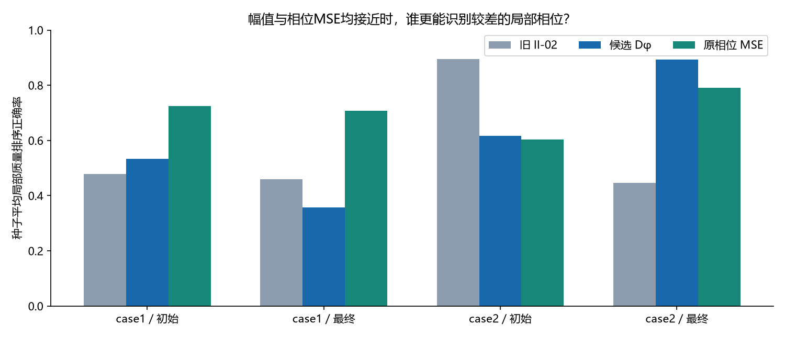

## 真实失败片段

| Case | II-02下降但相位MSE上升的种子 | 基线相位均值 rad² | 原组合相位均值 rad² | 同号误差均值变化 | 错号误差均值变化 |
| --- | --- | --- | --- | --- | --- |
| case1 | 33/100 | 0.133708 | 0.146038 | 0.011098 | 0.00123145 |
| case2 | 46/100 | 0.0880997 | 0.0792649 | -0.00033224 | -0.00850263 |

这些来自旧实验固定WSMSE选中解，不是新优化结果。辅助项下降与相位变差同时出现是诊断证据，不证明进化失败的因果路径。

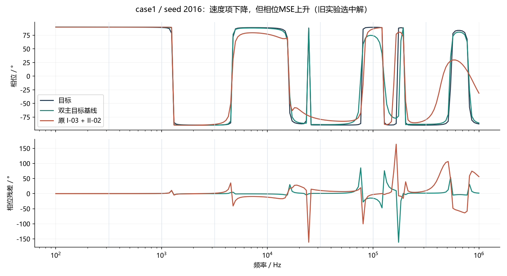

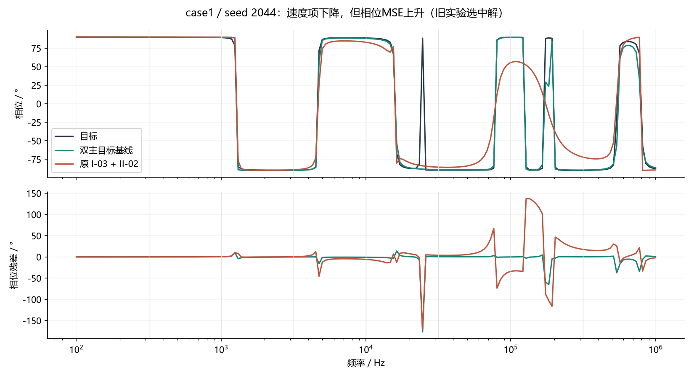

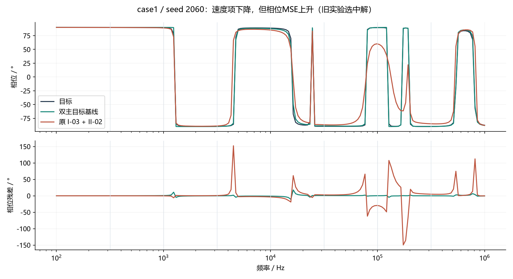

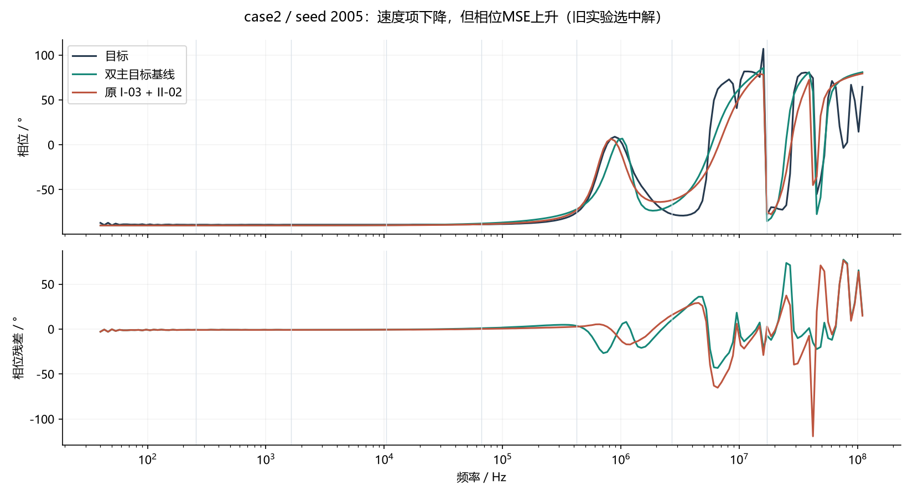

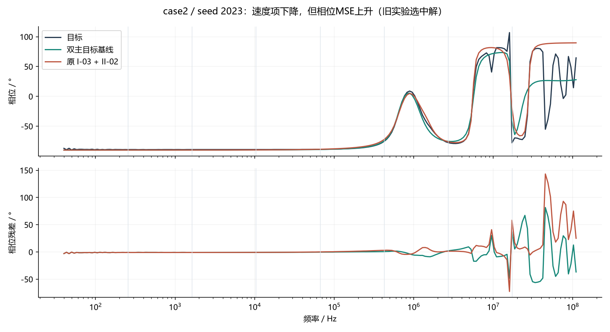

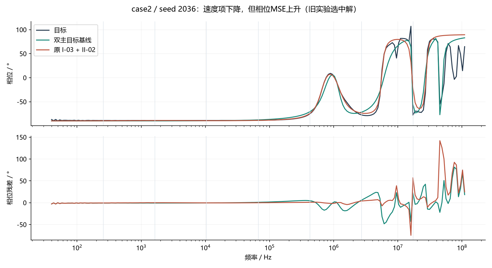

## 主误差接近的曲线对照

图按局部质量差异确定性挑选，不按哪个指标胜出挑选。

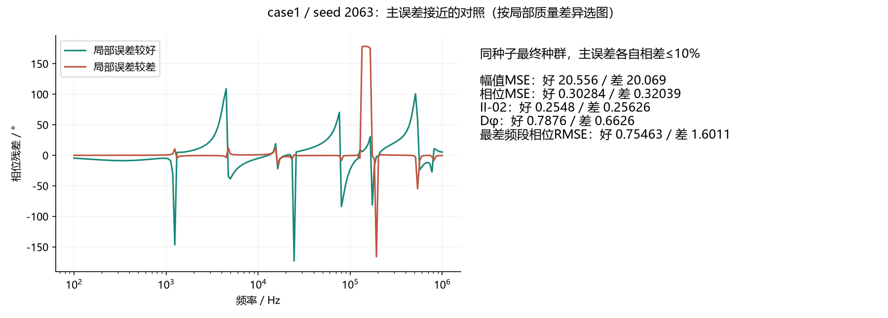

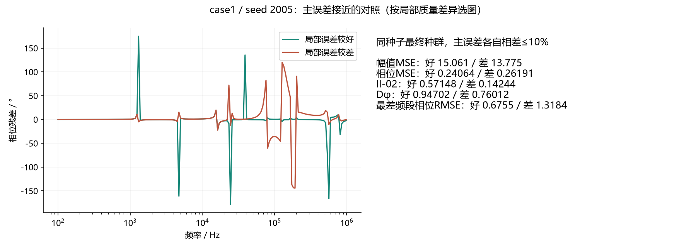

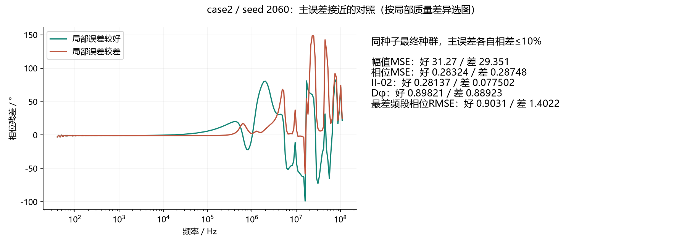

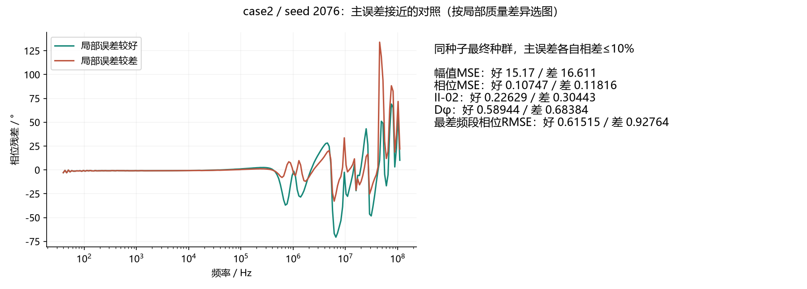

## 是否进入新优化

预筛门槛：**未通过**。
- Case1最终阶段相对速度项的排序率增量未达到5个百分点。
- case2 / initial 的差值区间下界低于-5个百分点，存在排序退步。

通过仅表示值得用新种子检验，不等于获得优化收益；未通过也不证明所有带方向指标无效。本轮不更改候选定义或阈值以追求通过。

Dφ对恒定相位偏移不敏感，由原相位MSE锚定。正数整体阻抗缩放不改变相位，Dφ保持零响应。这些是定义性质，不要求每个辅助项包办所有误差。
保留Case2原相位主值和原采样点，未展开分支、未删点、未平滑。割线可能对噪声和采样分辨率敏感。局部质量分窗、主误差10%容差与20%局部差异都是本轮预设筛选条件，结论不能外推到其他条件。

旧种群主误差重算核对210,000个个体；所有候选评价均为有限非负值。原始包SHA256、代码、协议和输入版本见data/PROVENANCE.json。

数据：data/seed_ranking.csv（种子统计）、data/pairs.csv（全部配对）、data/real_failure_seeds.csv（真实失败及频段）、pools/（完整评分、参数和配对索引）。

## 追加检查与读数说明

Dφ−II-02一栏为正确率差值，单位为百分点。同号/错号贡献分别按每条曲线自身与目标的符号关系划分，其均值变化不是两组共同同号/错号频点的固定掩码分解。

看过主结果后的分窗/容差检查见[SENSITIVITY.md](SENSITIVITY.md)，不调整主门槛。服务器检查见SERVER_CHECK.json。
