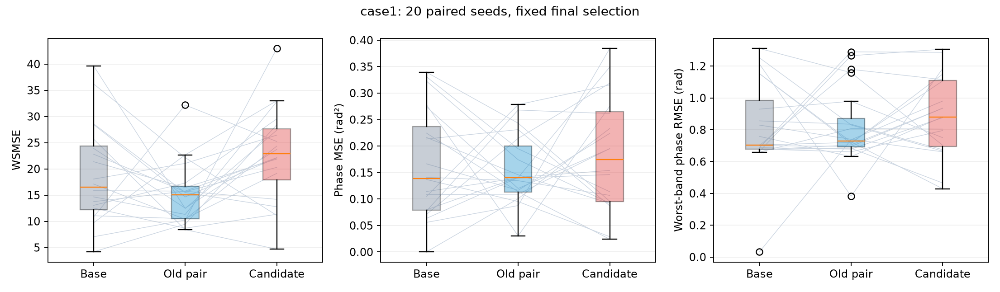
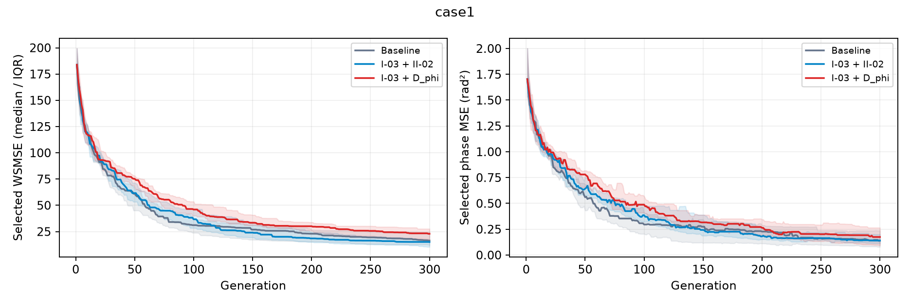
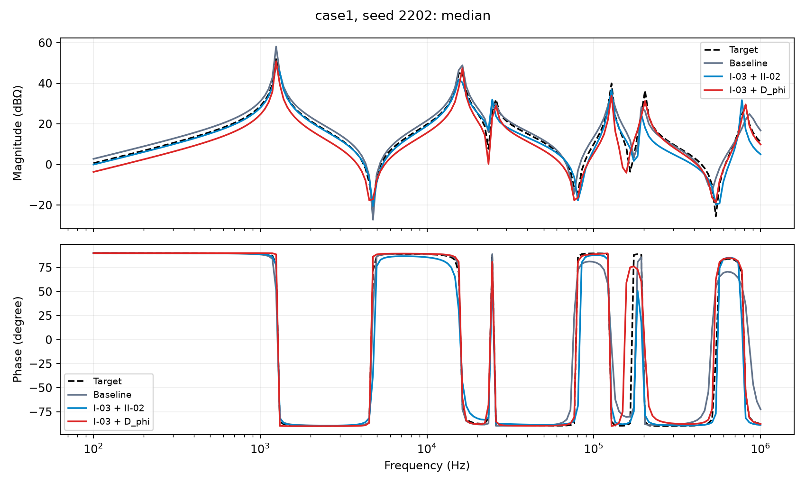
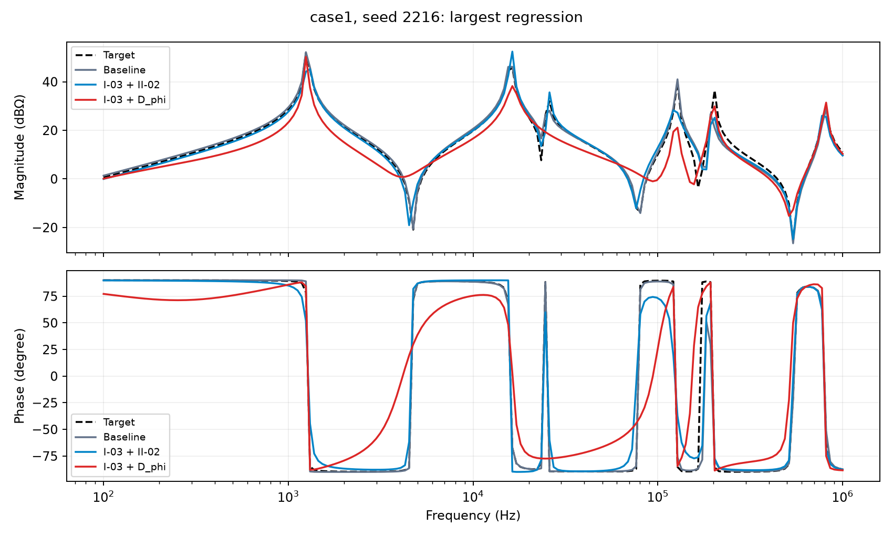
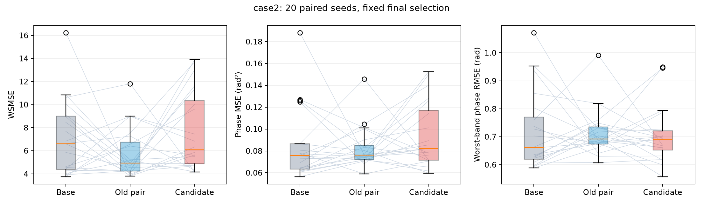
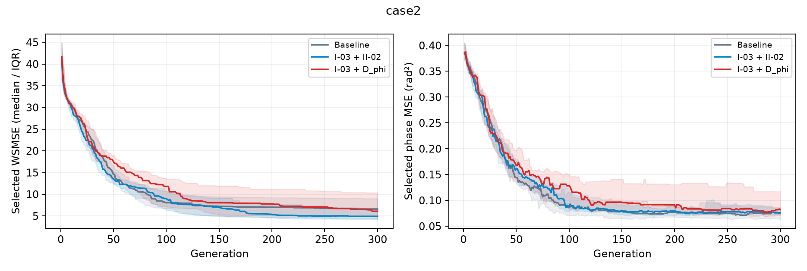
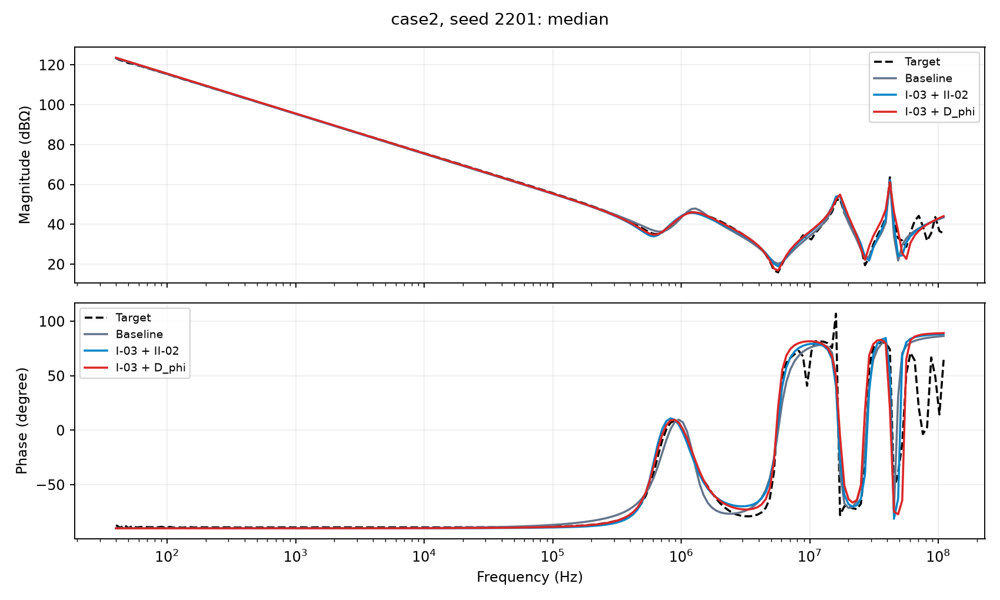
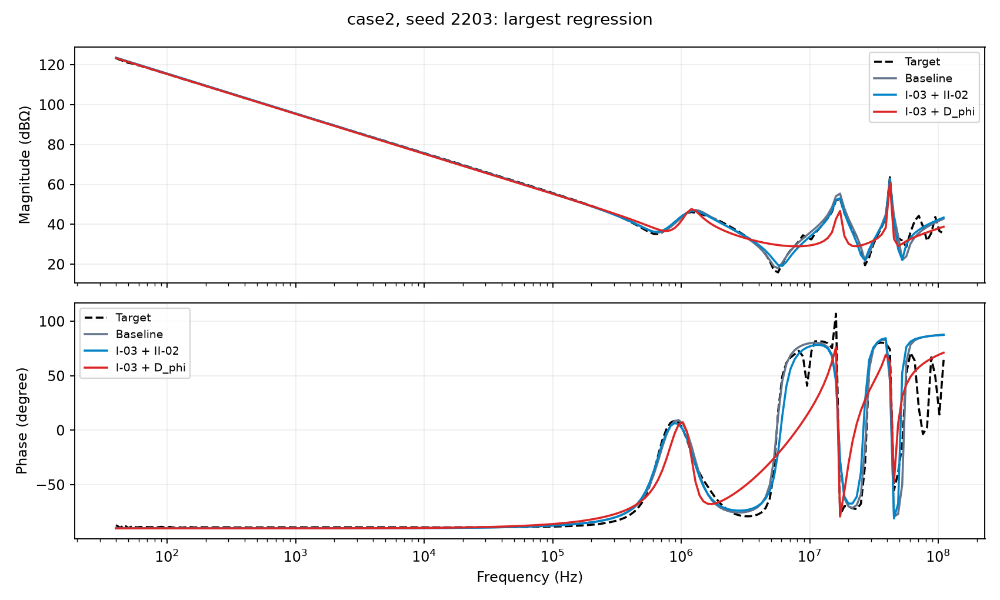

# 相位斜率指标：服务器优化验证结果（2026-10-07）

**结论：这轮结果不支持用 D_phi 替换 II-02。** 在固定预算和固定选解规则下，候选的综合拟合误差在两个 Case 上都更高；相位误差没有可靠改善。

| 候选相对原 I-03＋II-02 | Case1 | Case2 |
|---|---:|---:|
| 平均综合误差变化 | +49.7% | +32.9% |
| 平均幅值 MSE 变化 | +59.9% | +39.2% |
| 平均相位 MSE 变化 | +19.9% | +13.9% |

综合误差的配对均值差区间在两个 Case 均高于零，Case2 区间下界接近零，证据较弱。相位 MSE 的区间均跨零，不能把均值增加直接说成已经证实相位退步。局部最差频带误差也未显示可靠收益。

一个直接的指标设计警示：Case2 候选组的 D_phi 均值下降了 9.2%，但综合误差增加了 32.9%。这说明降低带方向相位导数误差，仍不能保证按现有规则选出的解更接近目标。它支持把该指标暂留为诊断项，不支持直接作为 II-02 的替代目标。

本轮只有两个电路、每组 20 个种子，结论限于本预算与本选解方法；不能外推为该方向在所有电路上无效。关于损失原因的解释仍属假设，未做独立因果实验。

以下是服务器生成的详细统计与曲线。上面的解读是在计算完成后添加的，没有修改预登记方案、公式、种子或原始统计。

两个 Case、三组对照、每组 20 个配对新种子，120 次运行全部完成。每次 300 代，总计 630 万次评价。最终按固定 WSMSE 选解，辅助值不参与最终选择。

本次是在预筛未通过之后，按用户明确要求继续的独立优化验证。不能用优化结果追改预筛门槛。负的配对差表示候选改善；统计单位是种子。

## case1

| 组别 | 幅值 MSE（dB²） | 相位 MSE（rad²） | WSMSE | 最差频带相位 RMSE（rad） |
|---|---:|---:|---:|---:|
| Baseline | 14.5557 | 0.165902 | 18.7232 | 0.815885 |
| I-03 + II-02 | 11.2801 | 0.153953 | 15.1474 | 0.820712 |
| I-03 + D_phi | 18.0352 | 0.184631 | 22.6731 | 0.885282 |

### 候选相对原 I-03＋II-02（同为四目标）

| 量 | 配对均值差 | 95% bootstrap 区间 | 均值相对变化 | 改善种子数 |
|---|---:|---|---:|---:|
| WSMSE | +7.52571 | [+3.17562, +11.995] | +49.7% | 5/20 |
| 幅值 MSE | +6.75507 | [+3.39145, +10.1357] | +59.9% | 5/20 |
| 相位 MSE | +0.0306783 | [-0.0222991, +0.0849729] | +19.9% | 9/20 |
| 最差频带相位 RMSE | +0.0645696 | [-0.0589113, +0.191294] | +7.9% | 10/20 |

原组 II-02 下降但相位 MSE 比基线上升：8/20；候选组 D_phi 下降但相位 MSE 比基线上升：2/20。

## case2

| 组别 | 幅值 MSE（dB²） | 相位 MSE（rad²） | WSMSE | 最差频带相位 RMSE（rad） |
|---|---:|---:|---:|---:|
| Baseline | 5.58966 | 0.0849303 | 7.06575 | 0.719106 |
| I-03 + II-02 | 4.33083 | 0.0826593 | 5.76744 | 0.712864 |
| I-03 + D_phi | 6.02654 | 0.0941709 | 7.66323 | 0.704094 |

### 候选相对原 I-03＋II-02（同为四目标）

| 量 | 配对均值差 | 95% bootstrap 区间 | 均值相对变化 | 改善种子数 |
|---|---:|---|---:|---:|
| WSMSE | +1.89579 | [+0.0670106, +3.76766] | +32.9% | 7/20 |
| 幅值 MSE | +1.69572 | [+0.118447, +3.30777] | +39.2% | 6/20 |
| 相位 MSE | +0.0115116 | [-0.00410677, +0.027366] | +13.9% | 7/20 |
| 最差频带相位 RMSE | -0.00876983 | [-0.0632563, +0.0456731] | -1.2% | 10/20 |

原组 II-02 下降但相位 MSE 比基线上升：7/20；候选组 D_phi 下降但相位 MSE 比基线上升：4/20。

## 如何解读

主要证据是候选与原组合的配对主误差，指标自身降低并不等于拟合改善。区间跨零时，20 个种子不足以分清方向；区间不跨零也只支持本电路、本预算下的探索结果。多个诊断量未作多重比较校正，不据此作普适胜出声明。

Case1 目标相位导数能量最强的 5 个区间占 54.0%；Case2 占 78.2%。Case2 最大相邻相位差 184.90 度，所有原始测量点均保留。候选对该局部跳变的重视程度是既知限制。

这轮直接检验指标用于进化时的收益，尚未验证对 16 种自设计拓扑的推广，也未新增实测电路。下一步选择应依据两项主误差及局部频带误差的联合结果，不凭 D_phi 单项变小做替换。

核验：120 个完整记录，21,000 个末代个体全部独立重算；初始种群配对、种子复现、参数边界、选解、每代评价次数及冻结代码哈希均通过。

[逐种子数据](selected_metrics.csv) · [组均值](group_means.csv) · [完整统计](SUMMARY.json) · [核验](VALIDATION.json)
