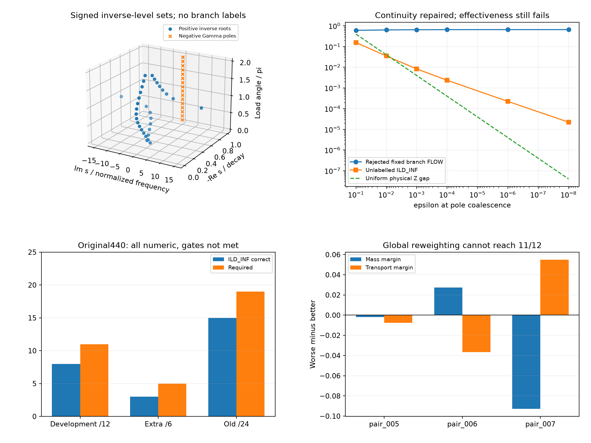

> 2026-11-08 精选归档：以下为原日期研究记录；“active／下一步／完成”等是当时状态。现行结论见[研究现状](../../docs/研究现状_20261108.md)。此目录是核心阅读与复核材料，原运行包未全量附带；JSON中的历史路径/证书不是本次重跑证明。

# 无标签复逆像除子：连续性改善，原440仍失败

2026-10-31。**当前ILD_INF不合格，尚无新有效指标。**原40全部通过，原440全部数值有效，但开发8/12、extra3/6、旧15/24（5/6/4），没有达到原门槛。本轮未组合、未进入后续可靠性或成本认证、未新增60000优化。科学进程经共享flock及foreign进程检查错峰，29663/29664和29718/29719均已终态，锁释放已核对。

## 表示实际保留什么

对完整观测Gamma=(Z−1)/(Z+1)，在同一16个复值w上计算nu_w=zeros(Gamma−w)−poles(Gamma)，带重数但不带任意分支标签。每个w对应同一个函数的反应性负载，根的位置同时反映全部过程的相互作用。有限有符号除子的正/负原子在复s平面以有界伪双曲地面代价配对，F(nu)记为该负载的位移总量M；F(nu_c−nu_t)为R。

只要w不等于Gamma∞，一个完整nu_w加Gamma∞即可由根乘积唯一重建该有理函数。Gamma0因此不是必要背景项。可重建不保证损失能修复局部结构，更不保证生产精度或成本。数学重建及适用边界见[MATH](../../experiments/inverse_level_divisor_20261031/MATH.md)。没有独立拟合ReZ/ImZ或使用真实目标参数。

主量ILD_INF=[mean(|delta M|+.5R)+min(1,|delta Gamma∞|/2)]/[2+mean M_t]。M不是幅值包络或物理储能，而是同一个复负载下的零pole活动。全部负载必须逐角对应，不能任意配准候选复值。实际40/440的目标始终由原观测P/Q构建。

## 两个版本及失败保留

最初双端点ILD在原47×8中有26/28/30/32四例压幅更优。分解表明这四例内部除子代价均惩罚压幅，Gamma0锚点却奖励压幅。依据最小重建信息，另行冻结仅必要Gamma∞背景的同家族ILD_INF，未改地面代价、负载角或1/.5权重；不是另一项独立创新。新原47是对SHA冻结根特征的重评分，0次新前向/求根，不能说原失败版本通过。

controls_inf.py在保存全部弱/临界状态后，selected控制使用的feature变量被三角点循环覆盖成mpc而TypeError。原代码/failed STATUS保留；controls_inf_v2.py仅修复局部变量并换独立输出，同精度/公式/样本重跑，未改科学门槛。

## 机制与数值检查

|检查|结果|限制|
|---|---|---|
|新原47×8|376状态80/120位，无错误增益更优/移位反向|同一冻结特征的新评分|
|已知弱背景|24状态72物理函数，80/120位，无选定错误压幅/放大更优|不是全lambda/全部多过程保证|
|极点合并|同一6个eps趋近，评分由.1577降至2.2327e−5；严格重pole恒等通过|修复固定分支FLOW的.660865869正跳跃，不是全域稳定证明|
|常量/公共因子|3正常量、公共因子消去通过|零pole相消按无标签测度处理|
|高Q/弱消失|Lorentz宽度1至1e−12的固定高峰距离不消失；A趋0的弱过程距离趋0|受限族，不是全部高Q组合验收|
|小阶指派|29360次MP原始—对偶认证，2748项保存评分复算|所有已保存float引导结果与MP最优一致|
|原型直接物理|23919个pole/逆像节点，70位独立方程复核|公共因子奇点另作代数检查|
|一般次数入口|6控制，160/240位含三重pole与三次公共双因子|不是所有逆像重根的严格区间证明|
|实际40|40数值、12恒等、28移位全通过；全部六方法|最大恒等仍远低于1e−4|

一般入口逐次验证全部根乘积重建全部系数及节点残差，不按索引硬比精度层。全部M/R/复角指派使用MP原始—对偶Hungarian；两个成功层无序根/M/六方法分数及353个内部指派成本scaled差<=1e−20。目标及候选的全部pole/16逆像另作直接观测/物理Z检查，原4个RHP物理Gamma节点也保留。

实际40另有80精度记录×六方法的独立回放，以及80位新算13464个物理节点、1960份主/M/复角MP原始—对偶证书复核通过。原440中428新算、12同模型本版本恒等SHA复用；先完整重算r03核对全部无序特征/评分/内部成本再复用，没有拿旧指标评分替代。

## 原440及联合作用

|方法|开发/12|extra/6|旧/24|旧三目标|
|---|---:|---:|---:|---|
|ILD_INF主量|8|3|15|5、6、4|
|MASS每负载位移总量|7|4|15|4、5、6|
|NO_MASS|7|4|11|4、4、3|
|ANGLE_FREE去复值对应|8|3|14|4、6、4|
|JOINT_PROJ相同四投影联合指派|10|4|15|4、6、5|
|MARG拆开相同投影指派|10|4|16|4、6、6|
|原要求|>=11|>=5|>=19|每目标>=6|

MASS与主量有8对方向不同，不能称主量严格等于总量；质量项分子占比中位27.567%，运输项确实参与。去复负载对应与主量35/36方向相同，只有held_016由主量判对而其判错。相同投影的JOINT_PROJ相对MARG没有新增正确对，反而held_010只有MARG判对；联合投影距离增加中位约6.13%，没有转化为需要的排序收益。MARG是复s逆像的Busemann投影控制，不是直接的幅相指标。

原P3开发对能区分，但extra仍3/6，LC8旧对仅4/8。主量旧24比D_OP多4对正确，不等于有限60000预算已修复这些结构；本轮没有进行此项优化。分子质量与运输还可在不同过程/不同局部结构间相互抵消，完整可重建信息被当前全球代价压缩后仍不足以引导原目标。

## 不能只调一个全局权重补救

原开发pair_005在质量和运输两项上都反向。对同样两项的任意非负混合m+beta*r，pair_006正确要求beta<.75188028，pair_007正确要求beta>1.68843353。二者不相容，因此至少两开发对不能正确，**即使把所有成对容差放宽到0，也最多10/12，达不到11/12**。纯质量和纯运输端点也覆盖。

这是160位读取三个固定原始对的解析不等式，不搜索新权重、不选新候选。[原始证明](weight_obstruction/SUMMARY.json)。结论仅覆盖同一M/R的全局非负线性重权，不证明所有复反函数或局部/非线性代价不可行。

## 独立回放中的精度问题

原440的complex128坐标回放在p04/setting_0230的M误差约6.33e−11，超过预先2e−12审计线，已保留[失败记录](../../archive/CORE_LOCAL_ONLY_20261108.md#local-14)。MP原始科学分数不变。独立回放v2在相近坐标/投影处先80位差分，再转无量纲float64代价，仍用SciPy独立指派；52条精度记录需要此步骤，没有放宽审计线。

全部440最终独立复核：428新算×两层856记录、5136方法评分、856套全部353内部成本向量通过，最大scaled分数差2.52e−13、成本差6.62e−12；12复用SHA/模型及36×6方向和原门槛也全部独立核对。该记录提示直接截断完整根坐标不能满足本轮严格审计线，不等于已经完成生产实现精度或1.25成本认证。

## 未完成与下一步

当前定义被原440及联合必要性结果否定，不进入20/167、F8/4-8/隔离、一般高Q/扰动可靠性、完整1.25成本8×31+330、60000原种子/初始化/算子/MAG-PHA二维膝点或未用条件。对目标ARX的全域正实性不作假设；跨虚轴的地面几何连续性尚无一般保证。L1仍仅少量模态对照，JOINT_POWER详细讨论后置。

下一候选需要解释如何保留多过程局部差异及跨频/复值联系，避免用整体质量补偿或源对应的弱化掩盖局部缺陷；必须重新冻结和实测，不能把这里的理论完整性、前置控制或某个消融晋升当作准入通过。
