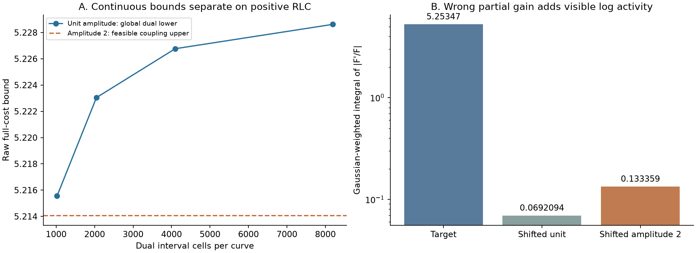

> 2026-11-08 精选归档：以下为原日期研究记录；“active／下一步／完成”等是当时状态。现行结论见[研究现状](../../docs/研究现状_20261108.md)。此目录是核心阅读与复核材料，原运行包未全量附带；JSON中的历史路径/证书不是本次重跑证明。

# 完整复log切向运输：正RLC连续部分幅值反例确认

记录时间：2026-11-01 18:47:48。研究目标active，未找到满足全部要求的新指标。

本轮从已冻结六个开发探针的第二个信号partial72 index7出发，确认连续定义错误偏好把错位RLC支路的幅值翻倍。不是新增held-out成功，也没有改旧公式/gain/source/observer/阈值。首个Lorentz信号的N512上下界仍重叠，保留该例未决；这里的另一个正电路反例已足以拒绝同一完整指标。

- 单位幅值完整主量raw下界：5.228620035805091，score下界0.839450794196544。
- 两倍部分幅值的可行完整主量raw上界：5.214059176603480，score上界0.839074593340679。
- 错误幅值的score改善下界：0.000376200855865094，超过原1e-8 gain线，也超过参考方法差100倍。

## 具体比较什么

target F=1+9/(1+i1000sinh(ln10 x))；候选F=1+9g/(1+i1000sinh(ln10(x−log10(.936))))，比较g1和g2。每个都是正R串联正parallel RLC：归一角频率omega=10^x，D1、支路R=9g、L=2R/(Q omega0)、C=Q/(2R omega0)，所有元件正。整体F未作幅值归一；这不是whole global gain，而是错误位置的partial gain。

rho=|F'/F|对whole positive gain不变的性质仍成立；本轮没有推翻它。失败在于partial gain同时改变完整log切向场的质量和mark，更多错误结构活动仍能给未覆盖target提供运输供应。主代价是同一个完整q/source/Gaussian cone运输与复log均值锚的max；不是只比较活动总量。

## 全域dual下界，没有把局部optimizer当最大值

换元t=asinh(Q sinh(ln10(x−center)))后rho dx=A/sqrt((1+A)^2+sinh(t)^2)dt。target势取v；candidate每个cell取v_min−B_upper，B_upper包住该cell向全部target频率的运输benefit supremum。使用source及完整4维复mark的解析导数球半径、可见度/密度区间端点包络；target观察外benefit≤2exp(−72)一并覆盖，candidate观察外取势−v并扣Gaussian尾。

1024/2048/4096/8192固定cell下界分别约5.215557/5.223046/5.226766/5.228620。target正贡献和candidate带符号贡献以mass下/上包络按符号组合，不靠GK估计其可行性。计算中的浮点余量事先固定，最终8192两侧全部midpoint/endpoint再逐点用80/120位正元件网络核对：32768次midpoint及32772次endpoint检查；所有可见度、质量和几何半径包络都保持外包。它不是通用区间计算库证书，但全域sup的数学包络与全部数值余量检查分别保存。

## gain2原初上界及完整score

固定N128/256/512顺序；N128已能分开，按协议停止扩大。原子LP流用真实rho cell质量归一化乘积扩成连续耦合，按真实边缘比再缩小1e-9，余密度删除。实际t质量GL64/128/256和另一GK15/GK21核对，流容量及所有质量向量另回放。二维cost在可见性相等线y=x及y=2center−x分片，GL8/16/32的上界数值为5.214059176602432/5.214059176603479/5.214059176603480，达到原三阶双级容差。这里的积分是数值参考，不冒称任意精度区间积分包络。

原Gaussian实际正网络复log均值锚另以GK15/GK21计算，远小于上述transport界，因此max主量的上下界同样分离。positive RLC/primary kernel/独立t坐标在MP80/120下六个模型精度状态桥接，并以mp.diff核对实际物理导数。所有源/flow/box数组及SHA保存。

## 为什么继续堆瞬时mark不够

条件性增量公式：若仍有target质量可用，新增candidate活动与v_target>=v_candidate的部分配对时，配对相对删除target的代价变化c−v_target=v_candidate(d−1)<=0。更多有限维复方向标记不能改变d<=1这个条件。它不是所有实际parameter变化的普遍反例；本轮正RLC上下界才证明实际partial gain的问题。单过程代理到正确幅值时已用尽target强度，完整场却可能尚有大量目标活动空缺，这解释了代理通过和完整定义失败的差异。

不做d上限/权重扫描，不再把瞬时正场质量加维度或归一化当新机制。下一步转向完整可观察过程的成组表示审计，先查弱出生、接近/分离和等高临界点换序；不能直接把内部RLC元件当观测过程，也不能把新的分组名称当联合创新。旧MCD/KR的有符号内部抵消、ILD的M/R分组失败和权重不相容同样保留，避免重复走全局除子标量压缩。

原854文件阶段封存逐一核对未变；本轮全部本地，不占服务器，不作当前外部服务器状态推断。没有新增实际40/440分数、可靠性准入或优化评价。全部原完整Laurent/public640、20/167、实际40/440及各组门槛、4/8密度/隔离、完整1.25、60000 seed/初值/边界/算子、MAG/PHA二维膝点和未用条件不变。

