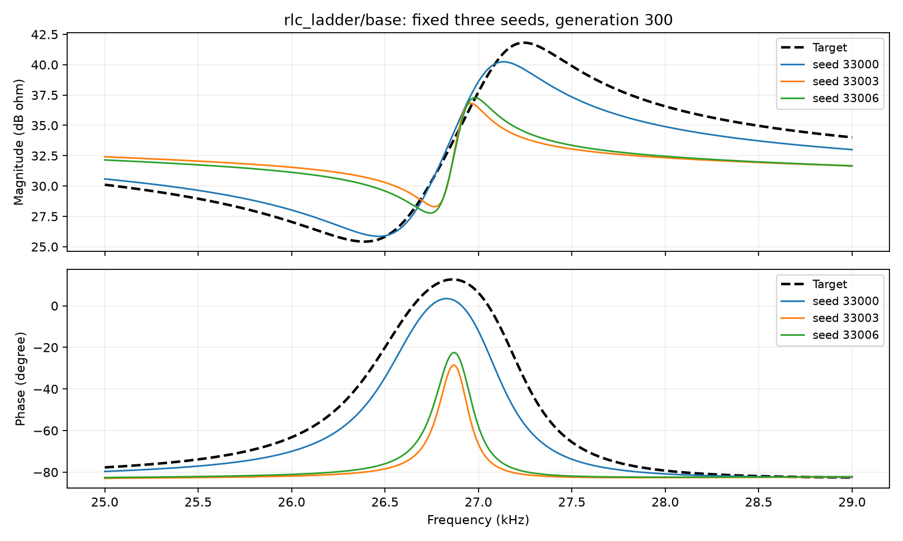
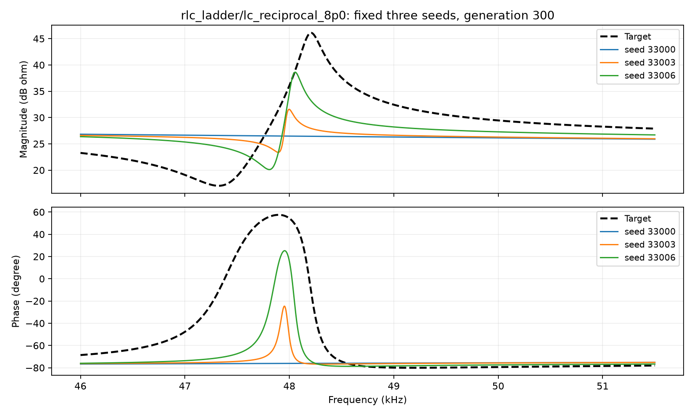
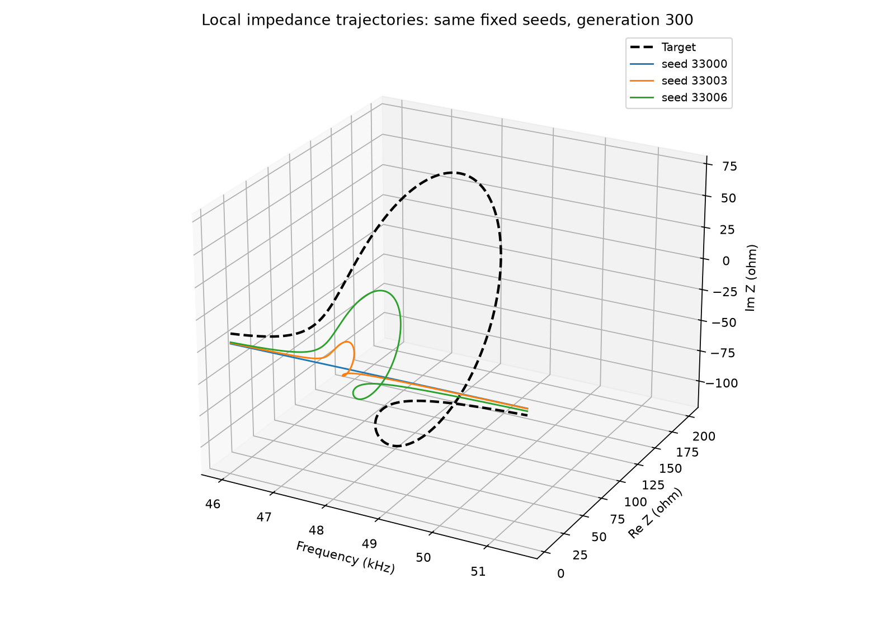
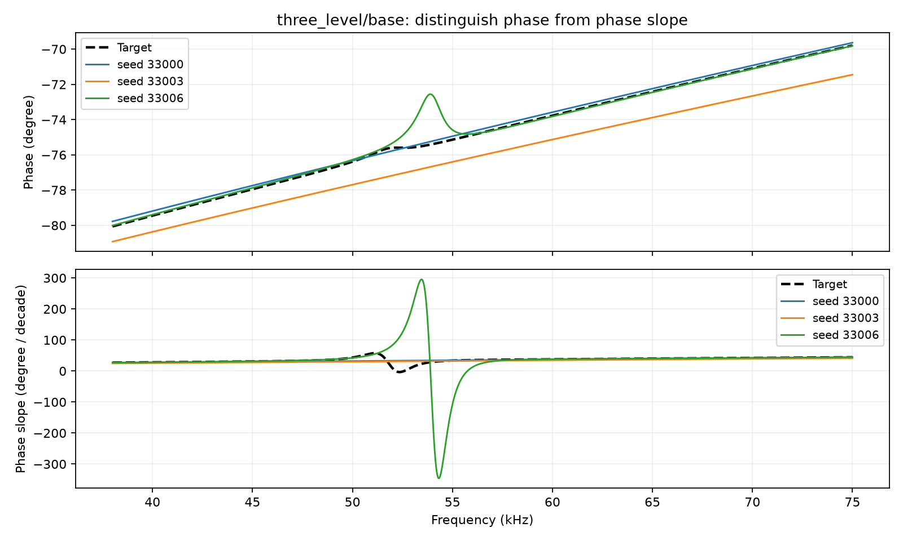

# 复杂电路实验：哪些曲线细节容易恢复不好？

2026年10月10日启动，10月11日完成优化、核验、回收和分析。

**这次已经找到比较明确的困难实例：一个峰已经出现，但高度总是不够；以及挨得很近的一个谷和一个峰，连同对应的相位变化，一起被削弱或漏掉。** 后一种现象也能直接在三维阻抗曲线上看出来，适合作为下一步设计指标时优先研究的对象。

这句话的范围是：使用本轮算法、参数范围和300代计算预算时，经常恢复不好。所有目标都由正确的理论电路生成，真参数也在搜索范围内，所以这些电路都存在幅值和相位误差同时为零的解。我们仍在研究“怎样更可靠地找到好解”，还没有证明MSE在理论上做不到。

这份说明先讲最有代表性的发现。所有电路图、参数和完整统计保存在[完整结果与电路说明](FINDINGS.md)，运行问题集中记录在[问题与处理](ISSUES.md)。本轮结果仅保存在本地。

## 1. 我们到底让程序做了什么？

可以把阻抗曲线理解成电路面对不同频率时的反应。幅值描述交流电压与电流的幅度之比，相位描述它们的超前或滞后关系。幅值图上突出的高点叫峰，低点叫谷；相位图上也会有上升、下降或局部起伏。

这次给程序两个要求：幅值的平均平方误差MAG尽量小，相位的平均平方误差PHA尽量小。幅值先换成dB再算误差，相位用弧度。它们都是把各处偏差平方后汇总成一个整体分数，因此分数本身不会告诉我们“究竟哪一个峰矮了、哪一段转弯没了”。

我们另外检查这些细节，但**没有把细节检查加入优化目标**。这样才能看到原来的两个目标在固定预算下会留下什么问题。

|设置|本轮内容|
|---|---|
|电路|7类，包括简单并联RLC对照和6类嵌套、混合支路电路|
|每类目标|3种参数条件，共21条目标曲线|
|重复次数|每条目标8个seed；seed是控制随机起点的编号|
|每次搜索|200个候选，300代，共60,000次参数候选评价|
|全部任务|168/168完成，总计10,080,000次候选评价|
|中间记录|每20代保存一次，共15个阶段，保存整个保留种群|
|拟合参数|所有元件参数都允许改变，已超出单元件扰动的情形|
|采样核验|理论电路可计算加密频点；另外使用更密的网格检查分数和结构|

双目标通常没有唯一“最好”的解，因为幅值更好、相位稍差的两条曲线可能各有优点。本报告按事先固定的MAG＋25.12×PHA从前沿挑一条代表，也检查另一种平衡选法，以及末代保留的全部200个候选。25.12负责选代表，优化过程中仍使用MAG/PHA两个独立目标。

“结构合格”也是一个有容差的检查：本轮对可定义3 dB宽度的目标峰谷，要求位置差在约4.7%的频率比范围内、高度差不超过3 dB、宽度在目标的一半至两倍之间。相位另查位置、变化速度和变化宽度。所以“合格”表示通过这组检查，并不表示每一点完全重合；完整定义与数值记录在详细报告里。

图中固定展示seed 33000、33003、33006，没有把几条曲线取平均，也没有按照本次图片是否好看重新挑seed。表格平均的是误差分数和计数。

## 2. 先认识主要例子里的电路

主要例子是“两级RLC梯形网络”。它不是两个简单模块各算各的：内部支路通过串并联相互影响，调整一个元件可能改变不止一处曲线。

|元件|基准条件|倍率8条件|
|---|---:|---:|
|Rs|5 Ω|5 Ω|
|R1|2 Ω|2 Ω|
|R2|3 Ω|3 Ω|
|L1|1.59155 mH|1.59155 mH|
|C1|159.155 nF|159.155 nF|
|L2|0.723432 mH|5.78745 mH|
|C2|72.3432 nF|9.04289 nF|

倍率8条件把L2乘8、C2除8。乘积L2C2保持不变，整个嵌套网络的实际峰位、峰高、宽度和相邻结构仍会变化。下文用曲线测出的实际变化解释结果。

## 3. 第一类困难：峰的位置大致对了，高度仍然不够

基准梯形网络有两个峰。约8.10 kHz处的主峰，8次拟合全部通过结构检查；约27.24 kHz处的第二个峰，8次拟合中都能找到，却只有1次同时通过位置、高度和宽度检查。

**其余7次主要错在峰高：比目标低约3.04～5.47 dB。** 它们的位置都在容差内，宽度也没有超过预先规定的两倍范围。宽度仍有偏差，只是没有触发这条较宽松的判定标准。

怎么看这张图：黑色虚线是目标，上图是幅值，下图是相位。彩色线有相似的谷峰轮廓，却没有完整达到目标峰高；对应的相位回转也被压缩。这里的困难已经比“整体分数不好”具体得多。

为什么不能只用“局部误差被平均淹没”解释？这个第二峰的核心频段，平均占幅值总平方误差约24.9%，贡献并不小。更合理的暂时判断是：**在多个参数联动、同时照顾幅相的搜索中，程序经常停在一个轮廓相近、局部形状仍不对的解附近。** 是搜索难、幅相取舍还是目标引导不足，仍需要下一步对照来区分。

## 4. 第二类困难：相邻的谷和峰被一起削弱，甚至绕过去

倍率8条件的目标在约47.32 kHz出现一个谷，在约48.21 kHz紧接着出现一个峰。峰的3 dB宽度约179.5 Hz，谷的宽度约682.3 Hz。宽度是在曲线上测量的，不是L、C操作的倍率。

峰的3 dB宽度，可以理解为从峰顶向下3 dB处，左右两个交点之间的频率距离。谷的定义相应反过来。宽度和相邻峰谷间距是两件事。

在8次拟合中，这个峰有4次漏失，另4次找到了匹配的峰，但只有1次位置、高度和宽度都合格。相邻的谷也有4次漏失、仅1次完整合格。按冻结的事件匹配规则，“漏失”表示没有找到对应事件，不能机械理解为该频段完全没有起伏。

黑色目标线先下探，再快速上升。彩色线中，有的几乎把这段压成平滑背景，有的保留了较弱的起伏。下方的相位图说明同一频段也有问题：目标明显的回转，在拟合中消失或缩小了。

将同样三条曲线放回你关心的三维坐标：横轴是频率，另外两轴是阻抗实部Re Z和虚部Im Z，后两者单位都是Ω。

目标在这段频率中向外伸出，再折回；部分拟合轨迹从附近平滑经过，另外一些只做了较小的伸出。**这个困难可以描述为：局部轨迹的伸出、折回和幅相联合变化没有完整恢复。** 这为围绕三维曲线设计指标提供了具体对象。

三维图用于看形状，透视和轴尺度会影响视觉印象，不能从图上的线距直接比较数值误差。

## 5. 是最后挑错了曲线，还是搜索确实没有找到？

我们不只看挑出来的一条代表，还检查了每次搜索末代保留的200条曲线。

|梯形网络条件|代表曲线幅值结构全部合格|另一种平衡选法合格|末代种群中至少有一条幅值全合格|
|---|---:|---:|---:|
|基准|1/8|1/8|2/8|
|倍率0.25|8/8|8/8|8/8|
|倍率8|1/8|1/8|1/8|

倍率8条件下，7个seed的被检查末代种群里都没有找到幅值结构全合格的曲线。因此，这个例子不能只靠“换一个选代表的规则”解释。

不过，被检查的是保留下来的种群，不是搜索历史中每一个曾产生又被淘汰的候选；更不是整个参数空间。“末代没有找到”仍只描述当前算法和预算下的结果。

另一些电路确实存在选解因素。例如最初提出的嵌套电路，基准条件的相位结构代表有2次不合格，但8次搜索的末代种群都存在相位合格解。这类例子应优先研究选解与幅相取舍，不应和梯形网络的失败合并归因。

## 6. 中途的分数下降了，细节是否也跟着恢复？

下面从已保存的15个阶段中摘出4个。MAG和PHA是8条代表曲线的分数均值；峰的计数来自各seed分别检查，没有平均曲线。

|梯形网络条件|代数|MAG / dB²|PHA / rad²|第二峰漏失次数|第二峰完整合格次数|
|---|---:|---:|---:|---:|---:|
|基准|20|0.9535|0.009762|8/8|0/8|
|基准|100|0.4453|0.005186|1/8|1/8|
|基准|200|0.3534|0.004204|0/8|2/8|
|基准|300|0.3255|0.004154|0/8|1/8|
|倍率8|20|1.0651|0.011808|6/8|0/8|
|倍率8|100|0.6247|0.007447|5/8|1/8|
|倍率8|200|0.5859|0.007288|4/8|1/8|
|倍率8|300|0.5655|0.007148|4/8|1/8|

基准条件中，第二峰逐渐出现，但最终多数峰高仍不够；倍率8条件中，到300代仍有一半漏失。**整体分数继续改善，某个局部结构却可能改善很慢，或没有继续改善。** 这是本轮比较直接的观察。

合格次数不是必须单调增加：每个阶段挑出的代表可能变化，而且跨过一个容差边界就会改变计数。基准条件200代2次合格、300代1次，不能据此断言所有曲线都变差了，也不能断言所有阶段的优化已经停滞。

## 7. 两条需要保留的反例，防止把规律说过头

### 窄峰本身不一定难

简单并联RLC对照在一个条件下，峰的3 dB宽度只有约83.1 Hz，8次全部恢复合格。相比之下，梯形网络倍率8条件的第二峰约179.5 Hz，恢复却很差。

这说明只用“宽度是多少Hz”无法解释困难。两个峰的中心频率不同：对照约10 kHz，梯形网络约48.2 kHz；后者相对中心频率更窄。参数数量、相邻峰谷、局部幅相变化也不同。我们还看到部分较宽的混合支路结构恢复不好，所以不能把所有困难归为窄峰。

### 改L、C之后，目标结构本身也可能变了

梯形网络倍率0.25条件的幅值结构8次全部合格，但目标在当前突出程度标准下只剩一个幅值峰。它不能被解释成“同一个第二峰变宽，因此8次都恢复了”。这三个条件可以提供线索，却没有单独隔离出宽度的因果作用。

## 8. 相位检查还有一个容易误读的地方

自动检查用的是“相位随频率变化的速度”。这类似于看道路的坡度：很小的起伏，只要局部坡度变化够明显，也可能被计为一个事件。

例如三级网络基准条件约51 kHz处，目标只有很小的相位局部起伏。检查中对应事件6次漏失、8次都未完整合格，但这不等于8次都丢失了一整段大角度相位转变。

上图看实际相位角，下图看变化速度。黑色目标在上图的起伏很小，下图却能定位一个速度峰；部分拟合把起伏抹平，另一条拟合反而制造了更大的起伏。上下两图需要一起看。

因此，“相位事件不合格比例”不能直接当成缺陷严重程度。**指标设计需要判断细节的实际影响，防止为了补一个很小的起伏，把整条曲线推得更偏。** 在实测数据里，这一点还要结合噪声和仪器分辨率。这轮没有新增实测数据，不能给它作验证结论。

## 9. 现在四个研究问题分别回答到了哪里？

|研究问题|本轮得到的答案|还缺什么|
|---|---|---|
|哪类结构反复难恢复？|已有具体实例：次峰高度不足，相邻谷峰和对应局部轨迹被削弱或漏失；多个seed重复出现|更多条件、预算和算法下的稳定性，避免把一次探索当普遍规律|
|哪个条件使它更难？|同一拓扑在不同L、C条件下恢复情况明显不同；实际位置、宽度和邻近结构均已测量|能够区分相对宽度、峰高、相邻结构和参数耦合的受控对照|
|针对性指标能否改善？|已经能指出要改善的具体三维轨迹缺陷|本轮没有优化任何辅助指标，效果尚无实验答案|
|能否推广，成本是什么？|7类电路提供了困难和成功的对照；原始计算成本已记录|指标的跨电路验证、更多seed、实测数据及新增计算成本|

对原来的研究目标来说，现在已经走到“能明确指出一个值得针对的结构，并给出重复失败的证据”。下一步应先聚焦约47～48 kHz这种相邻谷峰及局部三维回转，避免同时设计很多无法区分作用的指标。

候选指标可以关注**同一频段内三维轨迹的局部伸出、折回及转向是否保留**，同时考虑尺度和频率对应。只把所有三维欧姆距离再加总一遍，是否能提供足够不同的引导，还需要证明；几何指标也可能过度重视高阻抗区域或小起伏。

正式检验时，仍保留MAG/PHA基础目标，用同样seed、初始化和搜索预算比较加入辅助指标前后，并记录实际频率查询数和耗时。评价要使用共同的结构标准、原有幅相误差和具体曲线，不能仅凭新指标自己下降就宣布成功。本轮没有自动启动这一步。

## 10. 结果可信到什么程度？运行问题有没有影响？

全部168个任务的保存阶段、预算、初始化配对、参数范围、输入与代码哈希已检查。代表解另外复算分数和结构。中途出现的主要问题及影响是：

|问题|处理|对结论的影响|
|---|---|---|
|CPU配额32核，优化只开8进程，使用率约25%|保留正在运行的seed；后处理改为24进程，并与重新串行计算交叉核对|运行调度偏保守，延长耗时；没有减少优化预算或改变seed|
|首批1条、末批5条候选的结构判断对检查网格敏感|保留原记录；局部加密复核，最高检查至128、256级，没有放宽阈值|末批主表采用加密诊断；首批原种群统计仍保守排除1条非代表候选，代表统计不受影响|
|报告读取中文编码报错|显式使用UTF-8后重新生成|只影响报告生成，不影响实验数值|
|最终下载发生一次SSH中断|自动重连、重试，再检查包与解压文件哈希|最终回收完整，没有用不完整文件形成结论|

这里“复核通过”指分数计算和诊断在检查精度下可靠，**不表示拟合曲线的结构一定合格**。一个峰高明显不对的解，依然可以通过计算正确性的核验。

全部优化原始数据已经回收。末批用约98.8 MB核心包保留所有seed及所有保存阶段，省略的是可由参数与代码重建的绘图导出和重复图片；约1.17 GB全量包仍在服务器保留。详细来源、故障轨迹和保存策略见下面记录。

本轮是8个seed、300代的理论电路探索。不同电路的元件数不同，也没有比较多种优化算法。因此可以说“找到了在当前设置下反复恢复困难的结构”，尚不能把失败唯一归因于MSE、只归因于宽度，或推断实际电路中的普遍效果。

## 资料入口

- [完整电路图、基准参数、21个条件的统计与成本](FINDINGS.md)
- [实验设置、各阶段整体误差及全频段图](REPORT.md)
- [运行故障、修复方式与结论影响](ISSUES.md)
- [汇总数值依据EVIDENCE.json](EVIDENCE.json)
- [168个任务的完整性核验INTEGRITY.json](INTEGRITY.json)
- [末批逐seed、逐阶段和逐事件数据目录](../../archive/LOCAL_ONLY.md#ref-461a8a7ace98)
- [已有的三维曲线指标候选思路，尚未作有效性实验](../../docs/三维阻抗曲线_辅助指标候选与设计思路.md)
