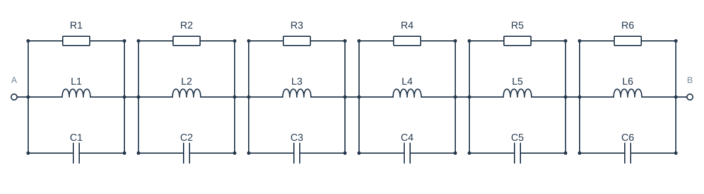
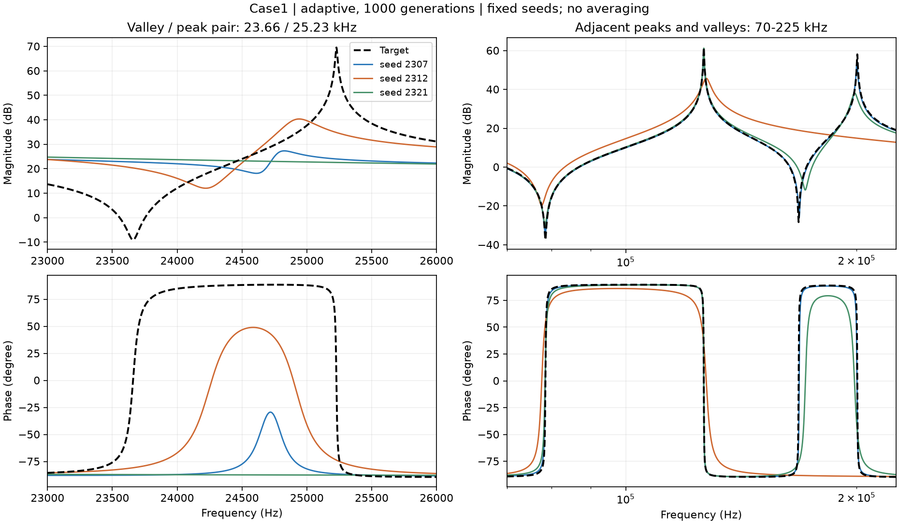
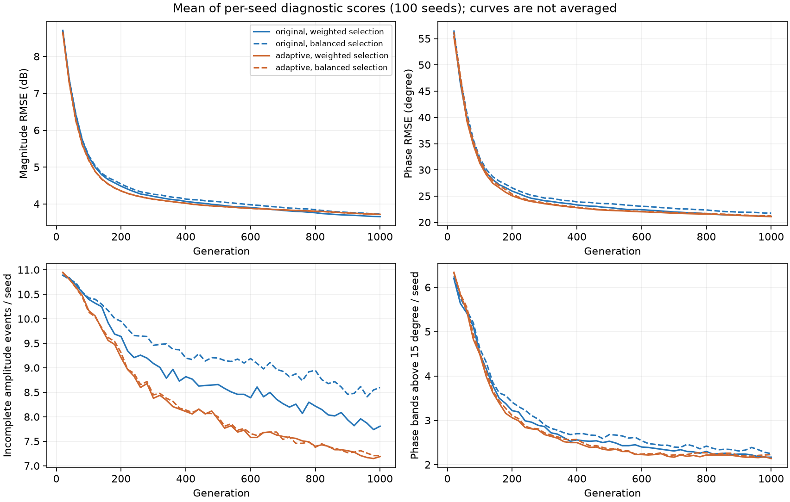

# 第一步结果：MAG/PHA反复没做好的结构，具体长什么样？

2026年10月8日启动，10月9日整理。本文只保存本地，没有上传网站。

**这次已经把问题缩小了：最值得优先研究的是“一个很窄的峰、它旁边的谷，以及这一段的相位变化”。** 在Case1中，把训练时的曲线细节检查得更充分、把搜索从300代延长到1000代后，这个组合仍经常没有恢复。另一个值得保留的候选，是相邻峰谷被拟合得偏低、偏浅、偏宽。

这意味着我们可以带着具体对象进入第二步，研究“哪些条件让它更难”。目前还不能说“MSE在理论上无法拟合这些结构”，也还没有验证新的辅助指标。

## 1. 先用不需要专业背景的话解释这次在做什么

一条阻抗曲线，可以理解为：用不同频率检查电路，记录电路在每个频率下的反应。

- **幅值曲线**告诉我们反应有多大。这里用dB表示，目的是把跨度很大的数值压缩到方便比较的尺度。
- **相位曲线**告诉我们电压、电流的周期变化在时间上如何相对错开。图上用度表示。
- 曲线向上突起的地方叫**峰**，向下凹进去的地方叫**谷**。除了有没有，还要看它的位置、高度或深度、宽度。

优化程序不断尝试一组组电路参数，希望生成的曲线接近目标。MAG和PHA分别给幅值、相位的平均平方误差打分；分数越小，整体越接近。

我们现在关心的是：**整体分数越来越好时，是否仍有某些局部细节一直做不好？** 如果有，先把它具体找出来，再考虑增加什么要求。

本次的“100个seed”，就是让程序从100套不同的随机起点各尝试一次。每套起点都同时用于两组对照，所以不是拿两批随意挑选的结果比较。

## 2. 用什么电路检查？

本轮只用Case1，因为它的目标由已知电路计算得到。我们知道正确参数，也知道当前模型能生成正确曲线，适合先排除“电路模型本身做不到”的干扰。

电路有六个小单元，六个单元串联；每个单元内部，电阻R、电感L、电容C并联。

生成目标曲线的参数如下。μH是微亨，μF是微法，分别是电感、电容的单位。

| 单元 | 电阻R / Ω | 电感L / μH | 电容C / μF |
| --- | ---: | ---: | ---: |
| 1 | 2000 | 1585 | 10 |
| 2 | 3000 | 10 | 3.98 |
| 3 | 500 | 100 | 1 |
| 4 | 1200 | 2.512 | 0.631 |
| 5 | 800 | 1.259 | 0.501 |
| 6 | 50 | 0.251 | 0.158 |

后面把曲线上的峰按频率从低到高叫P1—P6，谷叫V1—V5。**曲线编号与电路单元编号不同**，例如25.23 kHz的P3对应最尖的那个峰，不是“第3个单元”的简称。

## 3. 做了哪些对照？

| 对照结果 | 训练时怎样看曲线 | 搜索进行多久 |
| --- | --- | --- |
| 原始采样，300代 | 沿用原来的180个频点 | 较短预算 |
| 自适应采样，300代 | 对目标和每条候选曲线补查细节 | 较短预算 |
| 原始采样，1000代 | 沿用原来的180个频点 | 延长预算 |
| 自适应采样，1000代 | 对目标和每条候选曲线补查细节 | 延长预算 |

两组各100次运行，每次200个候选，均运行到1000代；300代是同一次运行的中间结果。每20代记录代表曲线，300代和1000代还保留全部候选参数及最终候选名单。

训练始终只用MAG/PHA两个目标，没有加入峰谷、宽度等辅助指标。新增频点采用明确的频率权重，避免“某处检查点变多”就自动获得更多总权重。不过，原来的有限点平均与自适应积分仍是两种数值评价方式，不能说数学上完全相同。

“双目标最好的一条”没有天然唯一答案：有的候选幅值更好，有的相位更好。本报告延续原先的固定选解办法，并另用一种均衡办法复核；同时检查候选名单中是否已经存在更好的局部结构。具体规则放在[核验说明](AUDIT.md)。

## 4. 怎样算“恢复了一个峰谷”？

这次分两层检查，避免把“附近有一个峰”当作成功。

**第一层：有没有对应的峰或谷？** 只匹配相同类型，并限制位置距离。这一层统计“缺失”。

**第二层：对应结构的形状是否也基本正确？** 预先约定三个筛查要求：频率位置相差约4.7%以内，高度或深度相差3 dB以内，局部宽度在目标的一半到两倍之间。三项都满足，才叫“较完整恢复”。

宽度是在峰顶下降3 dB、谷底上升3 dB处量出的范围，比较时采用对数频率横轴上的跨度。它与之前使用的“半突出度宽度”不同，这次更直接检查尖峰的核心，不能把两种宽度数值混在一起。

这些门槛只是本轮统一检查的尺子，不是所有应用都必须使用的标准。“较完整恢复”也不等于误差为零。原始位置、高度、宽度残差均保留，后续可以查看连续变化。

## 5. 最值得研究的结构：窄峰谷组合一起缺失或变形

目标在约23.66 kHz有一个谷V2，紧接着在25.23 kHz有一个峰P3。这段幅值曲线有明显的凹陷和突起，相位也有相应的局部转变。

其中P3非常尖：峰顶约3000 Ω，峰顶下降3 dB所对应的宽度只有约13.3 Hz。把整个100 Hz—1 MHz频段画在一张图上，它看起来像一根细针。

下面每条彩线都是真实的一次优化结果，来自事先固定的三个seed；没有把曲线取平均。上排看峰谷，下排看对应的相位变化。左列重点看23.66—25.23 kHz这一组合，右列看另一个相邻峰谷区域。

全体100次尝试的结果如下。每个数字都表示“100次尝试中的多少次”。

| 条件 | P3缺失 | P3较完整恢复 | V2缺失 | V2较完整恢复 |
| --- | ---: | ---: | ---: | ---: |
| 原始采样，300代 | 58 | 2 | 58 | 2 |
| 自适应采样，300代 | 59 | 3 | 59 | 2 |
| 原始采样，1000代 | 50 | 4 | 50 | 13 |
| 自适应采样，1000代 | 56 | 3 | 56 | 5 |

**自适应采样、1000代这一组，56次尝试中P3和V2一起缺失；两者的缺失状态在100个seed中完全一致。** 这说明该区域应当作为一个组合来研究，不能只盯着峰顶那个点。

“没有缺失”也往往不够。在这组结果中，P3匹配到对应峰的44次尝试里，37次宽度超过目标两倍，38次峰高低了超过3 dB；这些情况可以重叠。常见形状是：本来又高又尖的峰，被拟合成比较低、比较宽的起伏。

P3和V2同时达到较完整恢复要求的代表解只有1/100。相位方面，10—31.62 kHz频带有90/100次尝试的局部均方根误差超过15°。这个频带还包含其他变化，不能把全部相位误差都归因于P3，但它确认了这一区域反复存在问题。

**目前支持的判断是：在Case1、当前算法和1000代预算下，这个局部峰谷组合及相关相位变化难以可靠恢复。** 它没有被“补查细节”或“多运行一段时间”普遍解决。

## 6. 另一个候选：有峰谷，但偏低、偏浅、偏宽

约78.59—200.40 kHz一带，目标还有几个相邻的窄峰谷。部分结果能找到对应的起伏，但形状仍明显不对。

以下只列自适应采样、1000代的代表解，仍是100次尝试的统计。

| 结构 | 较完整恢复 | 常见的高度或深度问题 | 常见的宽度问题 |
| --- | ---: | --- | --- |
| P4：126.41 kHz峰 | 21 | 57次峰顶低了超过3 dB | 40次超过目标两倍 |
| P5：200.40 kHz峰 | 8 | 70次峰顶低了超过3 dB | 65次超过目标两倍 |
| V3：78.59 kHz谷 | 11 | 88次谷底高了超过3 dB，也就是不够深 | 68次超过目标两倍 |
| V4：168.03 kHz谷 | 6 | 73次谷底高了超过3 dB | 71次超过目标两倍 |

各列可能来自同一个seed，不能相加；高度和宽度的计数只针对匹配到的结构，缺失另行记录。

100—316.23 kHz频带还有87/100次尝试的相位误差超过15°。因此，“只要有峰谷就算好”的检查会漏掉很多问题。

这一类也值得保留，但**还不能说宽度本身就是原因**。高度、宽度、峰谷之间的距离和相位会一起随电路参数变化，第二步需要有控制地改变条件，才能区分它们。

## 7. 会不会其实有好曲线，只是我们没有选中？

我们检查了300代、1000代保留的全部双目标候选名单。这些候选通常各有优势：不能同时在幅值和相位两项上被另一条候选超过，专业上称为“非支配前沿”。

自适应采样、1000代时：

| 检查对象 | 代表解达到要求的seed数 | 候选名单中存在达到要求的解的seed数 |
| --- | ---: | ---: |
| P3单个峰较完整恢复 | 3 | 7 |
| P3和V2在同一条曲线上都较完整恢复 | 1 | 3 |
| P5单个峰较完整恢复 | 8 | 13 |
| V4单个谷较完整恢复 | 6 | 9 |

**选解方式确实能解释少数失败，但解释不了大多数失败。** 例如P3仍有93/100个seed，在1000代保留的候选名单中找不到达到要求的解。这里只检查保留的名单，不宣称搜索历史上从来没有出现过更好的个体。

有一个很有启发性的例子：seed 2302的代表解中，P3比目标低7.82 dB、宽度约为目标的2.42倍。同一名单中的另一个候选，把峰高差缩小到0.85 dB、宽度缩小到约1.08倍。可它们的整体幅值误差仅从5.201变到5.207 dB，整体相位误差仅从33.898变到33.841°。

也就是说，**局部峰形有明显差别，整体两项成绩却非常接近。** 这给“是否需要专门关心局部结构”提供了具体线索。但只有少数seed已经有这样的候选，单纯改选解规则还不足以解决整个问题。

进一步检查同一条候选是否同时恢复所有11个幅值峰谷、所有8个相位频带：自适应1000代组没有一个seed的保留名单包含满足全部要求的单条曲线。不能把不同候选各自做好的部分拼成一个成功结果。

## 8. 采样和延长预算，到底帮了多少？

所有结果都用共同的加密检查方式比较，避免一组只在180点上算、另一组在更多点上算。下面的误差是每次尝试的均方根误差，再对100次尝试取平均；没有平均阻抗曲线。

| 条件 | 整体幅值误差 / dB | 整体相位误差 / ° | 每条曲线平均未较完整恢复的幅值事件数（共11个） |
| --- | ---: | ---: | ---: |
| 原始采样，300代 | 4.208 | 24.125 | 9.09 |
| 自适应采样，300代 | 4.132 | 23.564 | 8.38 |
| 原始采样，1000代 | 3.661 | 21.158 | 7.81 |
| 自适应采样，1000代 | 3.721 | 21.108 | 7.19 |

**多运行到1000代确实有帮助，不能说程序已经完全不再进步。** 两组的整体幅值、相位误差都继续下降，达到结构要求的事件也更多。但P3/V2等困难仍反复存在。

**自适应采样对部分峰形很有帮助，却没有在这轮中表现为全面更好的拟合。** 例如1.264 kHz的P1，1000代较完整恢复从原始组22/100提高到自适应组77/100；它不适合作为本轮最顽固的重点对象。

在1000代比较两组，自适应组每条曲线平均少0.62个未较完整恢复的幅值事件，配对95%统计区间为减少0.18—1.04个；宽度超出要求的事件平均少0.91个，区间为减少0.42—1.39个。可是整体幅值、相位误差的差异区间都跨过零，尚不能确认整体优势。

还必须同时报告不利结果：自适应组平均缺失事件从原始组1.28个变为1.56个，增加0.28个，配对区间为增加0.02—0.52个。**较多保留下来的峰谷形状改善，与某些峰谷仍缺失、甚至缺失更多，可以同时发生。** 只报一个总分会掩盖这种差别。

统计区间用于描述这批配对seed的变动，未做多重比较校正，也不能推广成所有电路的规律。

图中蓝色是原始采样，橙色是自适应采样；实线、虚线对应两种固定选解方式。它汇总的是诊断分数，不是把曲线平均。完整的单次曲线见[seed 2307](../../archive/LOCAL_ONLY.md#ref-57b1cbd6231d)、[seed 2312](../../archive/LOCAL_ONLY.md#ref-a39131295d09)、[seed 2321](../../archive/LOCAL_ONLY.md#ref-40795d4cebb8)。

## 9. 换一个选解办法，结论会消失吗？

使用偏向平衡幅值和相位的选解办法，自适应1000代组的P3仍有57/100次缺失、只有3/100次较完整恢复；P5只有6/100次较完整恢复，V4只有6/100次。

所以，重点困难不是由当前一种代表解规则单独造成的。不过，其他峰谷的统计会受选解影响，不能把两种规则的数字混在一起。

另外，把识别峰谷的最低突出程度从1 dB改为0.5 dB或2 dB，1000代两组的主规则平均缺失数不变。这支持缺失现象并非仅由该识别门槛造成。其他位置、高度、宽度门槛的全面敏感性尚未完成，后续仍需检查。

## 10. 这一步得到的困难结构清单

| 对象 | 本轮处理 | 理由 |
| --- | --- | --- |
| 23.66—25.23 kHz的窄谷、尖峰组合及相关相位变化 | **优先进入第二步** | 反复共同缺失；采样补查与延长预算后仍常见；大多数末代候选名单也没有恢复 |
| 相邻峰谷偏低、偏浅、偏宽，尤其P5、V3、V4附近 | **保留为第二候选** | 形状偏差和局部相位残差重复出现；需要区分宽度、邻近结构和参数联动 |
| P1等通过可靠评价明显改善的峰形问题 | **暂不作为最顽固的重点** | 相当一部分能被评价方式和预算改善，不能把原始失败直接叫作MSE缺陷 |

这张清单针对的是**当前理论电路上的困难候选**。它没有证明所有窄峰都难，也没有证明换一个优化器仍然如此。

## 11. 接下来沿着哪条方向走？

下一轮应进入大纲第二步，优先围绕P3/V2这一组合做有控制的目标变化：

1. 尽量保持峰位置、高度一致，分档改变宽度，检查缺失和变形是否随宽度变化。
2. 检查相邻峰谷的距离、对应相位变化是否使困难加重。不能把同一次参数变化带来的所有联动都归因于宽度。
3. 记录局部残差在MAG/PHA总误差中占多少，比较整体成绩接近、局部结构不同的候选。
4. 如果某种条件变化并没有使它更难，就否定或修改“该条件导致困难”的假设。

**这一轮没有启动第二步，也没有提前添加辅助指标。** 我们现在有了具体观察对象，下一步要解释条件；再下一步才检验指标能否改善。

四个问题保持不变：

| 主线问题 | 当前进度 |
| --- | --- |
| 哪类结构反复难以恢复？ | 已在Case1和当前流程下确认上述候选 |
| 哪个条件使它更难？ | 有“窄、相邻、参数联动”的假设，尚需控制实验 |
| 针对性指标能否改善它？ | 尚未检验 |
| 改善能否推广，代价是什么？ | 尚未检验推广；本轮已单独记录计算代价 |

## 12. 结果可信度和计算代价

原始组100个seed在300代的完整种群，都与上一轮逐项一致。两组初始化也逐项对应；没有替换失败seed或按结果挑seed。

本轮共完成4000万次候选参数评价；独立重算了保留的8万个种群个体。所有2万条阶段代表曲线、21,159条候选名单曲线都通过了加密诊断的稳定检查。自适应组保留的4万个个体，还全部通过了两档独立加密积分与训练评分的核验。

自适应评价需要更多计算。原始组每个候选检查180个频率，自适应组平均查询约1709次，约为原始组9.49倍。服务器上单次1000代运行的中位耗时约为原始组16.9秒、自适应组96.2秒；这是本次并行环境下的实测耗时，不是硬件无关的速度结论。

所以这里控制的是相同候选评价次数，**不是相同计算成本**。性能预检和中断的计算试运行没有计入最终比较，记录保留在核验材料中。新指标以后也要报告额外代价。

需要追溯细节时，看[核验、评分定义与边界](AUDIT.md)、[逐结构统计](EVENTS.csv)、[候选名单检查](FRONT_EVENTS.csv)、[配对变化与区间](PAIRED.csv)。阅读本文不需要先看这些技术材料。
