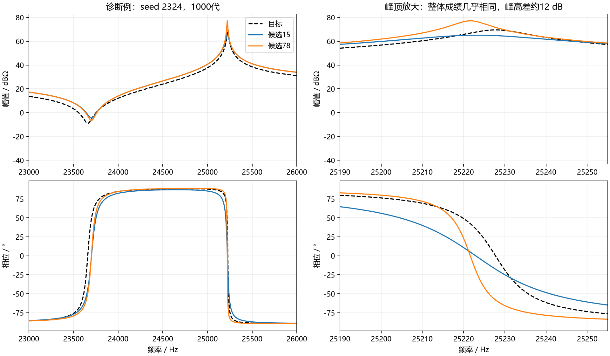
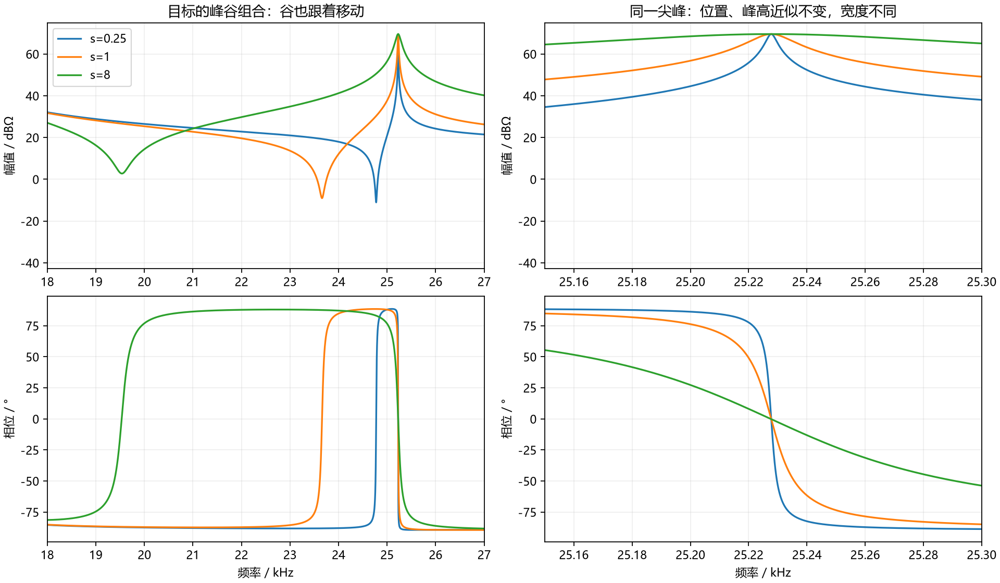
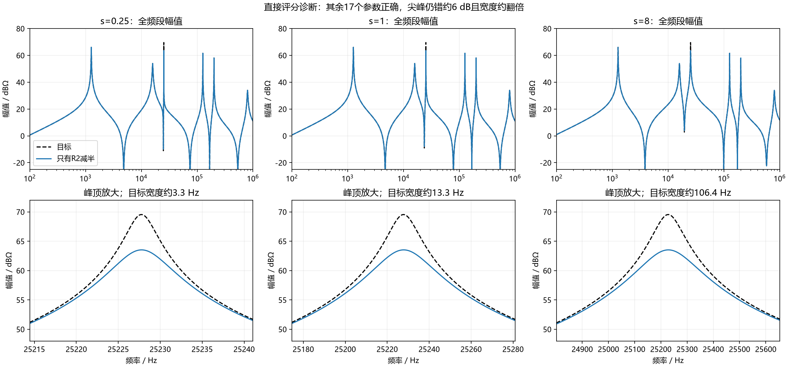
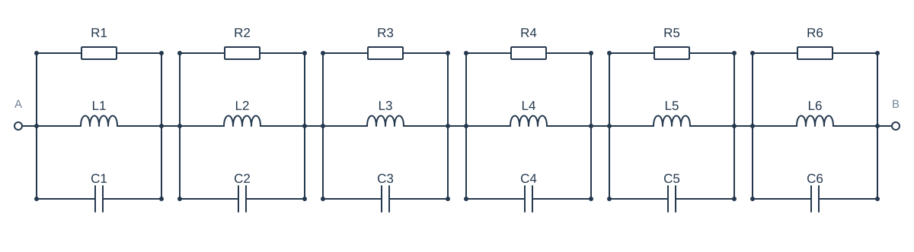
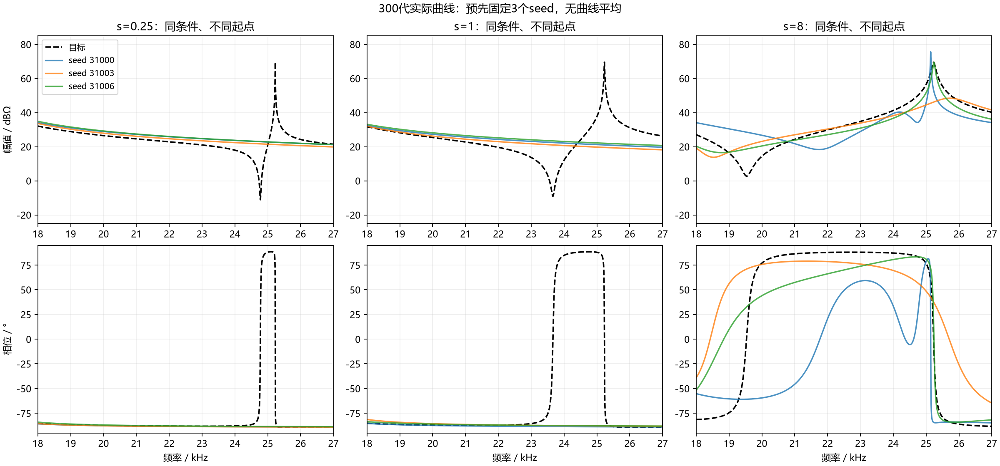

# 第二步探索：哪些条件让局部峰谷更难拟合？

2026年10月9日。本轮在本地完成已有数据分析、六档目标核验和三档各8个seed的300代探索。没有使用服务器，没有更新网站。

## 先说明我们现在走到哪里

第一步像是给曲线做体检：找到了经常恢复不好的部位。第二步要追问：**它在什么条件下更难恢复？** 只有这件事逐渐清楚，下一步设计指标才有具体方向。

这次重点仍是Case1中约25.23 kHz的尖峰，以及它左边相邻的谷。尖峰编号P3，谷编号V2；编号只是方便找位置。

**本轮还不能宣布找到了“峰越窄就越难”的普遍规律。** 新优化每档只有8个seed，运行300代；改变目标支路还会连带改变谷的位置、相位和背景。这是用来找线索的一轮探索。

## 1. 完全不了解这个领域，也可以先这样理解

电路里电阻、电感、电容的数值决定了阻抗曲线。阻抗可以理解为电路对交流电的响应：频率变了，它的大小和相位也会变。幅值曲线告诉我们响应有多大，相位曲线告诉我们响应的时间关系。

我们让程序不断尝试18个元件参数，希望计算出的两条曲线接近目标。MAG是幅值的平均平方误差，PHA是相位的平均平方误差；两项越小越好。幅值先转成dB，相位用弧度计算。报告中把相位的误差大小转成度数，便于理解。

“平均平方误差”像把各处的偏差平方后汇成一张成绩单。它能反映整体拟合，但总分一样，不代表每个局部细节一样。“局部结构”就是我们想另外检查的峰、谷、位置、宽度和相位转变。

一个seed是一次独立的随机起跑。不同seed从不同参数开始搜索。同一个seed在三个目标下用完全一样的初始参数，可以减少比较中的随机起点差异；后续搜索路线仍然可以不同。

每代会保留200个候选参数。程序同时考虑MAG和PHA，候选中可能有“幅值更好、相位略差”的取舍。我们另外检查非支配前沿：其中没有一条能被另一条做到“两项都不差、至少一项更好”。

我们继续只优化MAG/PHA两个目标。为了画图和统计，每个seed按固定规则选一条代表曲线：主规则取MAG+25.12×PHA最小；另用max(MAG,25.12×PHA)最小检查结论。**这里的加权分数只用于选代表解，没有变成这轮的优化目标。** 不把不同seed的曲线平均成一条。

## 2. 先看已有数据：整体分数下降，局部也一定变好吗？

这部分使用第一步已有的100个seed，不重新优化。重点看可靠采样组：它会检查目标和候选曲线的细节，减少尖峰躲在测点之间的问题。

我们提前固定了三个检查范围：尖峰核心（目标3 dB宽度、以峰中心对称划定）、23—26 kHz的峰谷组合窗口、10—31.62 kHz的较大频带。3 dB宽度可以先理解为“峰顶下降3 dB时，两边之间有多宽”。

### 一个很小的峰顶，可以误差很大，却只占总分的一小部分

原目标尖峰核心宽约13.3 Hz。在原频率单元权重下，它只占全频段权重的**0.0057%**。1000代时，这里的局部幅值RMSE平均仍约**38.7 dB**，但其幅值误差贡献比例平均约**0.85%**。

RMSE就是“平方误差的平均值再开根号”，可以用原本的单位读出误差大小。这里的局部RMSE很大，说明真实峰顶附近仍有很大的偏差；这里的总贡献小，是因为这个范围非常窄。它不是程序没看到峰，而是按整个频段平均时，这一小段占的份额很少。

### 但整个峰谷组合，不能说是被整体分数忽略了

23—26 kHz窗口占权重约**1.32%**。1000代时，它平均占每条曲线幅值总误差的**23.4%**、相位总误差的**41.1%**，局部相位RMSE仍约**98.2°**。

这段相位错误已经对总成绩有相当大的影响。因此，“整个局部区域没被MSE重视”不是目前证据支持的解释。**尖峰核心所占份额很小，与峰谷组合仍很难恢复，是两个相关但不同的问题。** 搜索困难、参数之间的联动和候选之间的取舍仍需要考虑。

| 阶段 | 全局MAG均值 / dB² | 全局PHA均值 / rad² | 尖峰核心幅值RMSE均值 / dB | 23—26 kHz局部相位RMSE均值 / ° |
| --- | ---: | ---: | ---: | ---: |
| 20代 | 74.887 | 0.9404 | 47.24 | 113.76 |
| 100代 | 27.815 | 0.3104 | 44.38 | 114.06 |
| 300代 | 17.982 | 0.1803 | 39.44 | 100.47 |
| 1000代 | 14.818 | 0.1479 | 38.73 | 98.19 |

从300代到1000代，整体成绩继续改善，局部平均也有改善，但改善小得多。逐seed看更能说明问题：100个seed的全局幅值MSE都下降，尖峰核心幅值RMSE却只有48个下降、52个上升。全局相位MSE有98个seed下降，23—26 kHz局部相位RMSE只有51个下降。平均有改善，不代表每次运行的局部都在改善。

不能说局部绝对没有进步，也不能用整体分数下降代替局部恢复。这个统计比较两个保存阶段，并按固定代表规则选解，不代表同一条参数曲线连续更新的全过程。

表中是按原频率单元权重独立积分复算的训练口径，和统一对数频率的诊断口径分别保存。百分比先按每条曲线计算，再对100个seed取平均；不是把两列均值直接相除。幅值与相位的比例分别计算，不混用dB²和rad²。原180点训练在尖峰核心没有测点，离散训练口径的这段权重为零；可靠采样口径则有明确的非零权重。

## 3. 整体成绩接近的候选，局部形状会不会差很多？

对每个seed的1000代候选名单，检查两项成绩都很接近的候选对。“接近”分别以较小的MAG、PHA为分母，主门槛为5%，另查2%、10%；接近零时设数值下限，避免比例失真。

为了不把轻微越过合格线说成重大差异，局部必须出现以下至少一项：一个有匹配峰谷、另一个没有；同一匹配事件高度差至少6 dB；或两候选的宽度比至少2倍。准确复制的参数候选不重复计数，统计单位仍是seed。

| 训练采样方式 | 成绩差≤2%的seed | 成绩差≤5%的seed | 成绩差≤10%的seed |
| --- | ---: | ---: | ---: |
| 原180点：存在明显局部差异 | 50/100 | 51/100 | 54/100 |
| 可靠采样：存在明显局部差异 | 9/100 | 9/100 | 10/100 |

可靠采样组5%门槛下，有91个seed能找到成绩接近的候选，但只有9个seed同时满足明显局部差异；其中仅1个seed出现“同一条曲线的峰谷组合合格，另一条不合格”且差异明显。

**说明这种情况确实存在，但在当前保留下来的候选中，证据还不足以说整体成绩普遍无法区分局部结构。** 稀疏采样会明显放大这类问题。没有找到相近成绩、不同结构的候选对，也不证明评分就足够敏感：候选名单有限，未必搜索过所有可能形状。

下面是诊断例：seed 2324，两项成绩最大相对差约0.0065%，P3峰高却相差约12.1 dB，宽度相差约4倍。两条都不是峰谷组合完全恢复的解；这个例子展示的是形状差别，不是宣布其中一条已经正确。示例按“可靠采样组、满足明显差异且两项成绩最接近”挑出，不用它代替100个seed的统计。

## 4. 新实验怎么改变目标？

Case1由六个并联RLC单元串联组成。R是电阻，L是电感，C是电容。我们只改变生成目标时第二单元的L2、C2：L2乘倍率s，C2除以s，R2保持3000 Ω，其余15个目标参数固定。

这样LC乘积不变，单元中心频率不变；单元在中心处的阻抗高度也不变。峰宽随s变化。对真正拟合的整个串联电路，仍要重新计算，而不是只修改表格。

| s | L2 / μH | C2 / μF | 实际P3宽度 / Hz | 实际V2频率 / kHz | 谷峰距离 / Hz |
| --- | ---: | ---: | ---: | ---: | ---: |
| 0.25 | 2.5 | 15.92 | 3.32 | 24.775 | 453.1 |
| 0.5 | 5 | 7.96 | 6.65 | 24.367 | 861.1 |
| 1 | 10 | 3.98 | 13.30 | 23.660 | 1568.1 |
| 2 | 20 | 1.99 | 26.60 | 22.561 | 2666.7 |
| 4 | 40 | 0.995 | 53.19 | 21.106 | 4121.3 |
| 8 | 80 | 0.4975 | 106.38 | 19.538 | 5689.8 |

六个目标的P3峰顶都约为25,227.75 Hz、69.54 dBΩ，但谷的位置、深度、相位和周围幅值明显联动。下面的目标图直观展示了这一点。

**所以本轮比较的是这组支路调整后的目标难度，不能写成“只改变了峰宽”。** 真参数在固定搜索范围中的位置也随s改变；相同起点不代表离三个真值一样远。要分清宽度、邻近结构和搜索条件的作用，仍需要后续针对性对照。

### 补充评分诊断：同样的峰顶失真，分数变化有多大？

在首批优化运行期间，另加了一个直接评分诊断。它是探索性补充，不冒充开跑前设定的主检验。做法很简单：把其他17个参数放在当前目标真值上，只将R2减半，然后直接计算曲线和分数，不让优化器搜索。

这会让P3峰顶降低约6.02 dB（阻抗峰值约减半），3 dB宽度约翻倍；相邻谷的深度也有约1.2 dB的变化，所以不是完全孤立的峰顶修改。它足以说明局部结构明显失真，而且所有参数都在原搜索范围内。

| 目标实际峰宽 / Hz | R2减半后的MAG / dB² | PHA / rad² | P3峰高偏差 / dB | P3宽度比 |
| --- | ---: | ---: | ---: | ---: |
| 3.32 | 0.000682 | 0.00000903 | -6.02 | 2.000 |
| 6.65 | 0.001355 | 0.00001796 | -6.02 | 2.000 |
| 13.30 | 0.002682 | 0.00003555 | -6.02 | 2.000 |
| 26.60 | 0.005282 | 0.00007002 | -6.02 | 2.000 |
| 53.19 | 0.010369 | 0.00013741 | -6.02 | 2.000 |
| 106.38 | 0.020345 | 0.00026944 | -6.02 | 2.000 |

**在这组六档已核验的电路中，同样约6 dB的峰顶错误和两倍宽度错误，峰越窄，两项整体分数的增量越小。** 原目标宽13.3 Hz时，MAG约0.00268 dB²，PHA约0.0000356 rad²；即使宽到106.4 Hz，MAG也只有约0.0203 dB²。

因为其余参数几乎都正确，这些数也是整个曲线的误差：全局幅值RMSE只有约0.052 dB，P3峰顶却错了约6 dB。**“全局平均误差很小”和“某个尖峰细节明显不对”可以同时成立。** 这比只看随机优化失败更直接地说明了平均打分与局部结构要求之间的区别。

可以用一个简化例子理解：假如只有一小段一直错6 dB，其他地方全对，它对MAG的贡献是6²×这段的权重。范围越小，贡献越小。真实曲线并非整段恒定错6 dB，所以表中仍用完整曲线积分，没有用这个简化算式代替实验。

每列下方的放大范围随该目标峰宽改变，横坐标是实际Hz，不应拿不同列的视觉宽度直接比较Hz宽度；真实宽度见表。

表中采用独立密网格积分；4/8档加密相对差≤0.1%（极小值另设绝对下限）。实际自适应训练评分的数值偏差另保存在CSV中。补充还检查了R2加倍、支路宽度变化、中心移动和R2压到下界，共42个候选，不把它们当作42次独立seed实验。

**这支持一个明确的困难条件假设：极窄峰的高度和宽度偏差，对整体幅相均分的影响较弱，可能在多参数搜索的其他误差中被盖过。** 它没有证明优化器在窄目标下必定更难，也没有证明MSE存在无法达到的正确解；真参数仍能得到零误差，并同时优于这些失真曲线。

下一阶段可以优先检验针对窄峰高度/宽度的结构要求，而不是先泛泛加重整段相位评分。但辅助要求是否真能帮助搜索、是否损害其他部位，仍要通过基础MAG/PHA与新增指标的配对实验回答。

基准电路的全部参数如下；六个并联RLC单元首尾串联。只有生成目标时第2单元的L、C按上表改变，拟合时18个参数都未知。

| 单元 | 电阻R / Ω | 电感L / μH | 电容C / μF |
| --- | ---: | ---: | ---: |
| 1 | 2000 | 1585 | 10 |
| 2 | 3000 | 10 | 3.98 |
| 3 | 500 | 100 | 1 |
| 4 | 1200 | 2.512 | 0.631 |
| 5 | 800 | 1.259 | 0.501 |
| 6 | 50 | 0.251 | 0.158 |

搜索范围固定为：R为1—100000 Ω，L为0.1—10000 μH，C为0.001—100 μF。基准真值和六个新目标真值都在范围内。

## 5. 新优化的规模和合格标准

正式运行只选s=0.25、1、8三档：每档8个seed（31000—31007），每个300代，每代200个候选；总计24次运行、144万次候选评价。所有18个拟合参数都允许变化，不给程序其他15个参数的正确答案。

算法、边界、交叉和变异算子沿用第一步。每个目标重算目标响应和采样网格；使用Windows本地纯Python自适应评分。新的s=1也在本地重跑，作为严格配对基线，不把旧服务器结果直接拼进新批次。

每20代保存两种规则的代表和完整候选参数。预先固定展示seed 31000、31003、31006，没有看结果后改挑种子。

“较完整恢复”沿用第一步：先匹配同类事件，再要求位置差≤0.02个对数频率单位（约4.7%）、高度差≤3 dB、3 dB宽度比在0.5—2之间。主要结果要求**P3与V2在同一条代表曲线上都合格**；不能把一条的好峰和另一条的好谷拼成一个成功。

这些是统一筛查门槛，不代表所有工程精度需求。位置门槛并未随尖峰宽度变严；更严格或宽松门槛以及连续误差都另外报告。

## 6. 300代探索得到了什么？

| 目标 | 峰谷同时合格 | P3合格 | V2合格 | P3缺失 | V2缺失 | 末代前沿存在同曲线组合合格的seed |
| --- | ---: | ---: | ---: | ---: | ---: | ---: |
| s=0.25 | 0/8 | 0/8 | 0/8 | 7/8 | 7/8 | 0/8 |
| s=1 | 0/8 | 0/8 | 0/8 | 8/8 | 8/8 | 0/8 |
| s=8 | 0/8 | 1/8 | 0/8 | 0/8 | 2/8 | 0/8 |

本轮主选解下三档都是0/8组合合格，所以主要结果没有分出“哪档更容易完整恢复”。失败率都为100%只描述这24次运行，不代表真实成功率必然为零。

更具体的差别是：窄、原、宽三档P3缺失分别为7/8、8/8、0/8。峰谷出现与峰谷精确恢复需要分开评价；出现了峰，也可能明显偏低、偏高、过宽或过窄。

三档末代非支配候选名单都没有同曲线组合合格的结果。因此，在已保存的末代候选范围内，不能靠更换这两种代表选解规则修复组合；它还涉及候选结构没有搜到或没有保留。这里没有穷尽所有被淘汰的历史候选，不能断言搜索全过程从未出现好结构。

下一次优先安排一个小诊断：仍用MAG/PHA，比较“18个参数全未知”与“其他15个参数固定为真值、只找尖峰单元3个参数”。如果后者容易成功，会支持多参数搜索是重要障碍；它使用真实拟合中没有的先验信息，只能诊断原因，不能当作实用方法。先用同预算、少量固定seed，不自动扩到大规模。

上表使用预先固定的主选解规则。“缺失”是没有匹配到相应峰谷；“不合格”也包括已匹配但高度、位置或宽度不对。两者不要混为一谈。候选名单一栏用于检查选解问题，不是重新挑好看的候选当作主结果。

| 目标 | 全局幅值RMSE均值 / dB | 全局相位RMSE均值 / ° | 10—31.62 kHz相位RMSE均值 / ° |
| --- | ---: | ---: | ---: |
| s=0.25 | 3.600 | 19.402 | 22.344 |
| s=1 | 3.318 | 19.886 | 41.329 |
| s=8 | 4.847 | 27.783 | 46.105 |

上述误差按共同的对数频率权重检查，每个seed先计算RMSE，再对seed取均值。不同目标的背景和相位本来就不一样，因此跨目标的整体误差也不是峰宽作用的纯净测量。

### 换一种选解规则，结果如何？

| 目标 | 均衡规则：峰谷同时合格 | P3合格 | V2合格 |
| --- | ---: | ---: | ---: |
| s=0.25 | 0/8 | 0/8 | 0/8 |
| s=1 | 0/8 | 0/8 | 0/8 |
| s=8 | 0/8 | 1/8 | 0/8 |

### 再检查前沿之外：好结构是否藏在种群中？

补查每次运行末代保留的全部200条曲线，共4800条，包含没有进入非支配前沿的候选。主代表结果保持不变，这项补查只用于诊断。

| 目标 | 末代全部200候选中存在组合合格的seed | 存在P3合格的seed | 存在V2合格的seed |
| --- | ---: | ---: | ---: |
| s=0.25 | 0/8 | 0/8 | 0/8 |
| s=1 | 0/8 | 0/8 | 0/8 |
| s=8 | 0/8 | 2/8 | 0/8 |

三档末代完整种群都没有组合合格的解，V2也都没有合格解；宽目标有2个seed保留了合格P3，但对应谷仍未恢复。因而换末代代表规则不能从这些种群里选出合格组合。

**这把下一次诊断收窄到了搜索条件和峰谷联动。** 不过这里只检查末代保留的曲线，未穷尽所有被淘汰的历史候选；不能断言搜索全过程从未出现过好结构，也不能据此把原因全归到MSE。

### 配对比较与不确定性

| 对照 | 主规则组合成功率差 / 百分点 | 配对bootstrap 95%区间 / 百分点 |
| --- | ---: | ---: |
| s=0.25 − s=1 | 0.0 | [0.0, 0.0] |
| s=8 − s=1 | 0.0 | [0.0, 0.0] |

**8个seed的区间很粗。** 如果所有观察到的配对差都相同，bootstrap区间可能退化成一个点，这不代表真实差异已经被精确证明，更不代表两个条件等效。

| 目标 | 主规则组合成功率的Wilson 95%区间 |
| --- | ---: |
| s=0.25 | [0.0%, 32.4%] |
| s=1 | [0.0%, 32.4%] |
| s=8 | [0.0%, 32.4%] |

这张表是每档成功率的边际区间，不是目标之间的配对差区间。即使8次全失败，也不能据此说这个目标永远恢复不了。

### 合格线是否改变判断？

| 目标 | 更严格门槛的组合合格数 | 原门槛 | 更宽松门槛 |
| --- | ---: | ---: | ---: |
| s=0.25 | 0/8 | 0/8 | 0/8 |
| s=1 | 0/8 | 0/8 | 0/8 |
| s=8 | 0/8 | 0/8 | 0/8 |

更严格门槛为位置0.01、高度2 dB、宽度1/1.5—1.5；更宽松为位置0.03、高度4 dB、宽度1/3—3。所有门槛同时改变，所以这张表只作稳健性筛查，不用于反推最佳标准。具体高度、位置和宽度残差保存在EVENTS.csv；没有匹配的事件保留为空，不当作零误差。

## 7. 看实际曲线，不平均曲线

以下三个seed在优化前已固定。每张图中三个条件各有自己的目标和300代代表，幅值、相位一起显示。图用于理解形状，全体seed的统计用于判断趋势。

逐seed单独放大查看：[seed 31000](figures/pilot_seed_31000.png)；[seed 31003](figures/pilot_seed_31003.png)；[seed 31006](figures/pilot_seed_31006.png)。

## 8. 这轮支持什么，下一步应该怎么走？

补充评分诊断已经找到了一条可用的机制线索：同样的尖峰高度/宽度错误，峰越窄，对整体MAG/PHA的增量越小。这是当前最明确的指标设计依据；它仍需要下一步的优化实验验证。

已有100个seed的分析给出了更具体的方向：**极窄的峰顶在全频段平均分中占的份额很小；但完整峰谷组合的相位错误已经占很大的份额，仍可能长期没有恢复。** 因而后续应同时检查尖峰高度/宽度与峰谷之间的相位结构，不能只给整个局部区域加权后就假定问题解决。

这轮3档×8seed×300代是第二步的首批探索，还不足以确定单一困难条件。不同目标的谷峰距离、相位和真参数位置明显联动，不能根据三档结果直接宣布“窄峰天然比宽峰难”或“MSE优化不了窄峰”。

应先根据各事件的连续残差和候选名单判断更具体的障碍，再安排一个能区分解释的小对照。例如：如果三档候选名单都没有组合合格的解，优先诊断搜索和多参数未知带来的困难；如果名单中已有好结构而固定代表没有选到，优先检查选解取舍。只有出现清楚的宽度趋势时，才值得补中间档或用新seed延长预算确认。

**本轮没有自动扩到六档12seed，也没有追加30seed×1000代或加入辅助指标。** 预先设计的扩展是有必要时才做，不能因为首次探索不明确，就不断扩大直到出现想要的趋势。具体下一次对照应围绕本轮留下的疑问安排。

主线仍是四个问题：哪类结构反复困难；哪个条件加重困难；指标能否改善；改善能否推广、代价如何。第三、四问还没有被这轮回答。

## 9. 结果可靠吗？本地用了多少计算？

- 24次正式运行全部完成，共1,440,000次候选评价；4个本地进程，训练墙钟时间约28.9分钟。
- 训练累计4,037,528,688次频率查询对（每次同时计算候选和目标）；单候选最多4141点、最多17层细分。这包括自适应检查频点，不等于原180个测点；分析耗时另计。
- 42条补充评分诊断均在边界内，独立积分和结构加密检查通过。
- 六档目标真参数均在搜索范围内，MAG/PHA均可接近数值零；独立电路实现与原实现响应一致。
- 开跑前，三档各51个候选（随机、旧结果、边界、真值）通过自适应评分与独立加密积分核验；单条与批量评分一致。
- 4,800个末代候选的P3/V2结构另经密网格加密复核；全部末代候选独立积分复查，失败0个；720条阶段代表、269条末代前沿候选的结构诊断加密稳定，未稳定数均为0。
- 两档独立密网格积分均稳定；评分绝对允许偏差为幅值max(0.01 dB²,0.5%参考值)、相位max((0.5°换成弧度)²,0.5%参考值)。这说明当前数值精度经过核验，不是对所有可能电路的数学误差证明。
- 已有数据的1600条代表、14400条局部统计经过两档密网格复核，没有未稳定项。
- 随机初始化逐条校验；同seed三档初始化完全一致；前沿、固定选解、种群边界和末代训练分数已复算。

本轮能在本地完成，不需要等待服务器。大规模重复实验主要增加等待时间；精度检查和对照设计比换机器更影响结论是否可信。

## 10. 想继续核查时看哪些文件？

- [末代4800候选结构补查](analysis/FULL_POPULATION_STRUCTURE.csv)；[完整种群汇总](FULL_POPULATION_SUMMARY.json)。

- [42条直接评分诊断](SCORING_PROBES.csv)；[补充诊断规则](SCORING_PROBE_PROTOCOL.json)。

- [新实验逐条件汇总](SUMMARY.json)；[逐指标配对差与区间](PAIRED.json)。
- [每20代代表结果](analysis/REPRESENTATIVES.csv)；[峰谷连续残差](analysis/EVENTS.csv)；[末代候选结构](analysis/FRONT.csv)。
- [已有数据：逐seed局部贡献](offline/REGIONAL_ERRORS.csv)；[已有数据：候选对筛查](offline/CANDIDATE_PAIRS.csv)。
- [六档目标参数与联动](TARGET_CONDITIONS.csv)；[首次合格阶段与末代保留](ATTAINMENT.csv)。
- [核验记录](AUDIT.md)；[本地复现说明](REPRODUCE.md)；[实验前固定的规则](PROTOCOL.json)。
- [24次原始参数与完整候选目录](../../experiments/mse_structure_step2_20261009/batch)。
