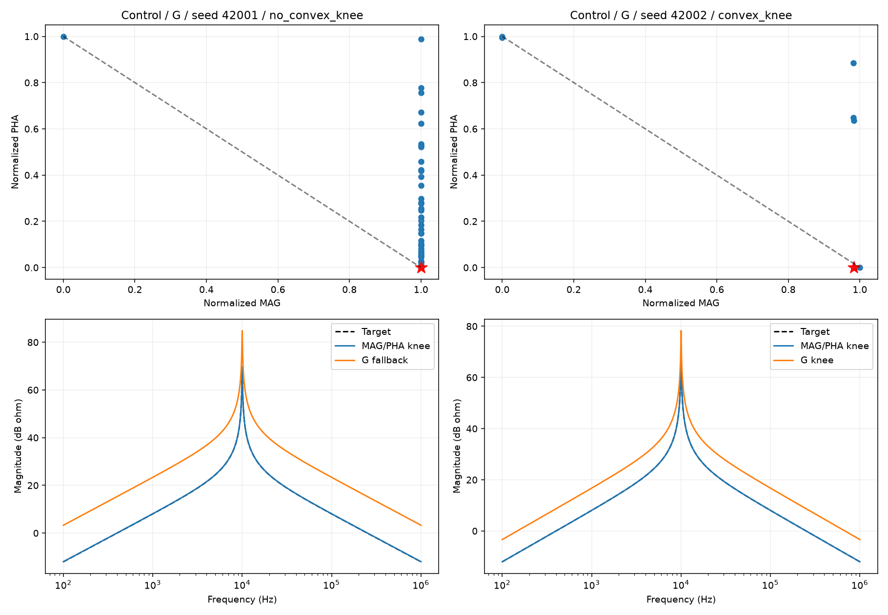

# 第三步重新整理：用膝点选最后的曲线，哪些判断还成立？

2026年10月11日。第三步三轮共252次优化的结果，已经统一重新选解和复核。本版是后续研究使用的版本；旧版报告、图表和派生分析在新版验收后清理。没有上传网站。

**换成膝点后，仍没有找到一个能稳定解决所有电路结构问题的指标。角度进程T、顺序累计C和跨窗连接B各有值得保留的例子，但也各有失败和代价。另一个新发现是：膝点本身也可能选出明显不合理的幅相取舍，需要独立检查曲线。**

## 1. 先说清楚：这次“重新做”改了什么？

想象一次优化最后留下200组电路参数，每组都能画出一条阻抗曲线。我们需要从中挑一组，作为这个seed的最终答案。

MAG检查幅值误差：曲线离频率轴有多远，是否与目标一致。PHA检查相位误差：曲线绕频率轴的方向，是否与目标一致。两项越小越好，但有时一项变好，另一项会变差。

以前用一个加权总分挑最后的曲线。现在先留下“没有被其他候选在两项误差上同时胜过”的候选，再从它们组成的前沿找膝点。可以把膝点理解成折弯处：继续往一个方向改善时，另一项可能开始付出比较大的代价。

这里必须规定具体算法，不能只凭肉眼说“这个像膝点”。本版先把前沿的两项误差分别缩放到0—1，再取向“两项都小”的方向凸出最多的点。所有组用同一条规则，辅助指标组也只看MAG/PHA二维前沿。

**优化搜索没有重跑。** 检查程序确认，三轮一直分别优化MAG、PHA，辅助组另加第三个结构目标；以前的加权分数只在记录和最终选解时使用。完整种群都已保存，因此重新挑代表和检查曲线，就能回答本次问题。重复搜索只会花费更多计算，不会给同一前沿增加新信息。

本次重算了全部3780个保存阶段的代表、50400个末代候选的训练分数，并独立加密检查252条最终曲线。新增优化评价为0，原优化合计1512万次候选评价。seed、初始化、参数范围、预算、指标定义和结构门槛都没改变。

## 2. 前沿没有明显折弯时，怎么办？

252个最终前沿中，200个找到了有正凸出的离散膝点。剩下52个包括：25个只有一个不同的前沿点、12个不足三个不同点、13个没有向理想点凸出的折弯、2个目标跨度数值退化。

只有一个点时直接取它。其余没有明确膝点的情况，按事先固定的规则取归一化后离“两项都小”最近的折中代表。逐seed记录明确标出原因；**这些代表不能被说成已经检测到膝点。** 没有临时换回最小WSMSE，也没有另用辅助分数挑一条更好看的曲线。

每个方法的前沿分别缩放，红星坐标只解释怎么挑选，不能用“红星更靠左下”比较不同方法。方法之间比较的是原单位误差和真正的曲线结构。

## 3. 最新一轮的指标，重新评价后怎样？

最新轮在五个理论电路目标上，各用4个相同seed配对。下表的数是4条最终曲线中，指定峰谷组合通过原位置、高度、宽度门槛的条数。

|方法|Case1|梯形网络|混合支路|三级网络|简单RLC对照|
|---|---:|---:|---:|---:|---:|
|只用MAG/PHA|0/4|0/4|1/4|1/4|4/4|
|C：顺序累计轨迹偏差|0/4|2/4|4/4|3/4|4/4|
|R：峰谷径向极值|1/4|2/4|3/4|3/4|4/4|
|F：沿频率的占据分布|0/4|3/4|1/4|3/4|4/4|
|T：有方向的角度进程|1/4|3/4|3/4|4/4|4/4|
|B：峰谷之间的连接轨迹|0/4|2/4|3/4|4/4|4/4|
|X：多余往返量|0/4|0/4|1/4|2/4|4/4|

“过关”是误差没有超过规定门槛，**不是曲线已经重合**。也不代表其他峰谷和所有相位结构都正确。

### T：梯形网络仍值得继续验证，但不是四次都成功

基础组的重点峰谷0/4过关，加入T后3/4过关。这3个seed同时改善两项全频幅相误差，并通过全频相位事件检查。局部相位RMSE四seed平均从约52.13°降到11.79°，本组没有多出幅值事件。

因此，本轮支持“角度进程可以帮助恢复这个网络的局部转向”，没有支持“四次都恢复”或“所有电路都有效”。在混合支路，T虽然重点过关3/4，但同时满足幅相不退步的只有1/4，还出现2个额外幅值事件。它的效果依赖电路和具体起跑。

### C：混合支路仍有正向证据，梯形网络的稳定性不足

混合支路的重点组合由1/4变成4/4；其中3/4同时做到两项全频误差不退步。局部相位RMSE平均从约13.47°降到6.24°。

不过，4条中只有3条通过全频幅值结构检查，全部都还有相位事件未通过。这说明补好了指定峰谷，并没有补好整条曲线。

在前一轮的另一批seed中，C在梯形网络4/4重点过关且幅相都改善；最新轮是2/4重点过关，其中只有1/4同时满足幅相不退步。两轮seed不同，不能逐seed配对，也不能把前一轮4/4当作稳定保证。

### B：三级网络的局部改善明显，但窗口外出了问题

三级网络中B组4/4重点组合过关，4/4两项全频误差都改善；局部相位RMSE平均从约24.72°降到2.42°。

但每个seed都多出一对目标没有的峰谷，四次合计8个额外事件。它们分别落在约29.8—30.7、197.8—200.8、43.4—44.1、40.6—41.3 kHz，位于这次辅助指标关注区间之外；显著程度约1.3—8.3 dB。全部四条仍有全频相位事件不合格。

所以，B可以帮助关注区间贴近目标，但不能据此推荐它作为通用指标。需要保护其他频段。当前X也只覆盖固定局部区间，不能简单认为“把B和X加起来”就会解决窗口外问题。

### R和F有部分帮助，X尚没有足够证据作为恢复指标

R只检查峰伸得够不够、谷靠轴够不够，没有直接约束出现的位置和完整转向。它在多个电路有改善，却不能独立保证正确轨迹。

F在梯形网络重点过关3/4，其中2/4同时满足幅相不退步；在混合支路只1/4过关。Case1固定seed图还出现远高于目标、极窄的尖峰，说明这个实现也可能通过错误的高度与宽度组合降低分数。

X惩罚多余往返，但一条没有正确峰谷的平滑错误曲线也可能拿到低分。它在Case1和梯形网络重点仍0/4。当前更适合把它视为待改进的副作用检查，不能把它当作已经有效的结构恢复目标。

## 4. Case1到底解决了没有？

**没有稳定解决。** 前两轮各方法都没有恢复指定峰谷组合。最新轮R、T各出现一次通过旧门槛的代表，其余指标仍0/4；所有方法的全频幅值结构合格数都是0/4。

R的seed 43000，谷的位置偏差约为目标谷宽的2.39倍，局部相位RMSE仍约39.12°。固定位置门槛对这么窄的谷比较宽松，因此它能“过旧门槛”，并不代表位置准确。

T的seed 43002局部相位RMSE约7.07°，比同seed基础组改善明显；但峰位置偏差仍约为目标峰宽的0.51倍，峰高低约2.20 dB。它是一个值得分析的局部改善例子，不能当成稳定成功。

这两条代表的二维前沿都只有一个不同的目标点，因此本轮直接取唯一点。**它们的改善并不能归因于“找到了更好的膝点”。**

## 5. 这次特别需要注意：膝点也会选出坏曲线

修订轮的简单RLC对照，G和A各只有2/4重点结构过关。两组在这个单事件电路中定义和搜索结果相同，所以不是四个独立失败。

|G/A代表|幅值MSE / dB²|幅值RMSE / dB|相位RMSE / °|选解情况|
|---|---:|---:|---:|---|
|seed 42001|234.99|15.33|约0.0038|没有可辨识凸膝点，使用冻结的退化折中|
|seed 42002|75.58|8.69|约0.0097|有正凸出的离散膝点|

可以直观看到：相位已经很接近，但幅值明显偏了。

原因线索是，前沿归一化把每项的整个变化范围都放大成同样的0—1。这里前沿PHA范围很小，两次最大PHA对应相位RMSE也只有约0.134°和0.270°；幅值范围却大得多。归一化仍把这些很小的相位差看成完整的一项取舍，因此可能舍弃幅值较好的候选，选中幅值偏差很大的候选。

这不是计算把角度单位弄错，也不是膝点程序偷偷使用WSMSE；全部末代分数已重新计算，两个选解规则分支也已核对。**几何折弯不自动等于研究上可接受的误差折中。** 一个案例属于退化处理，一个确实属于当前定义的膝点，两者要区分。

此图专门选择两个失败seed解释问题，不代表随机典型样本。规则本轮未改；后续若考虑由目标或测量精度固定的尺度、幅相可接受约束，必须先规定再检验，不能悄悄调整到本批结果好看。

## 6. 回到一直追踪的四个问题

1. **哪类结构反复难恢复？** Case1极窄峰谷的高度、位置、宽度与转向仍难同时恢复；嵌套网络中，谷峰组合和局部相位过程也会反复失真。局部补好后还可能多出窗口外结构。
2. **什么条件使它更难？** 极窄结构占整体误差的份额较小，复杂电路存在参数联动；本轮又明确了前沿形状和选解尺度的影响。当前没有把采样、搜索和选解的各项影响完全分离，不能全部归因于MSE。
3. **针对性指标能改善吗？** T在梯形、C在混合支路、B在三级网络有配对正向证据；但成功频率、整体代价和窗口外缺陷不同。没有一个方案通过了所有检查。
4. **能推广吗，代价是什么？** 还未完成推广验证。每条件4seed，所有目标都参与了开发；没有新电路、实测、噪声或组合验证。辅助目标增加搜索评价内的计算；本次只重新分析已有数据，不增加优化预算。

## 7. 这轮之后，方向怎样收紧？

先固定最终选解方法，同时承认膝点和退化代表的适用边界；今后不能在膝点与加权最小之间根据结果切换。

优先复核T在梯形、C在混合支路的正向例子，以及B的窗口外副作用。Case1继续拆分径向、相对峰宽单位的位置、角度进程这些具体缺陷，不把偶尔过宽松门槛当成解决。

这些是后续方向，**本次没有追加seed、调整指标或启动新优化**。完整数字、固定seed图和可复算记录见[完整报告](REPORT.md)；维护故障和两项辅助评分偏差见[问题记录](ISSUES.md)。
