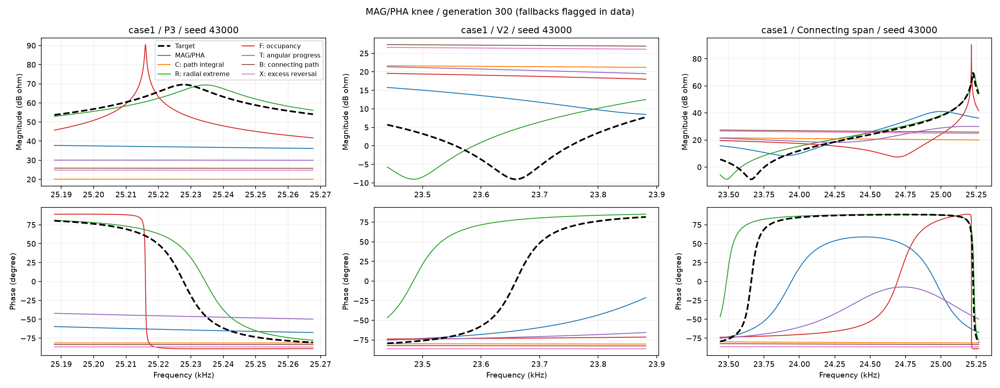
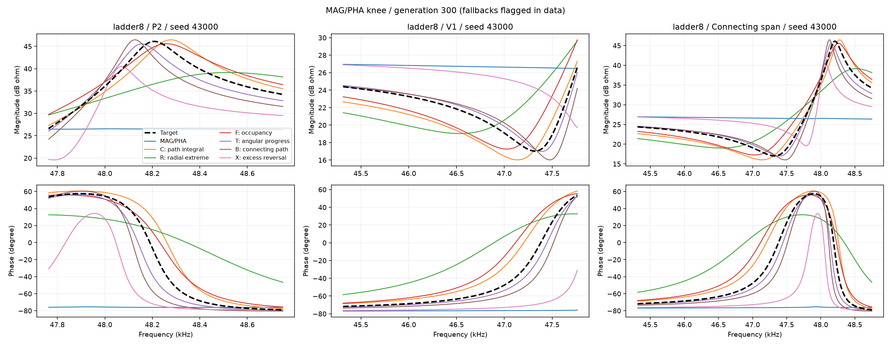
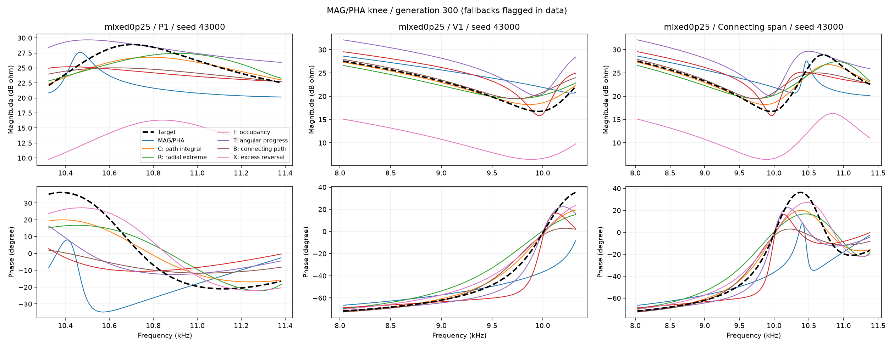
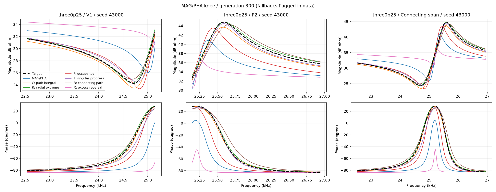
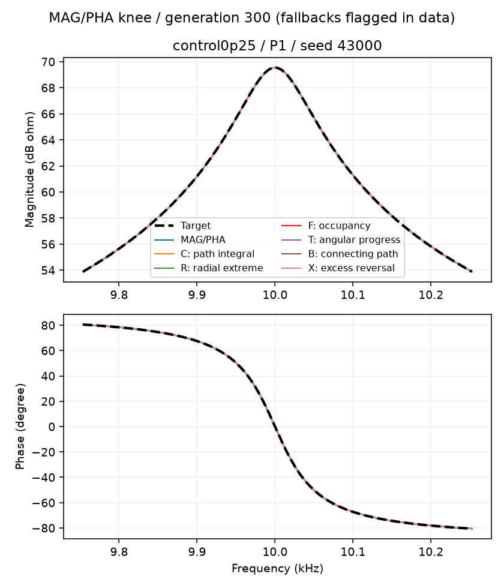
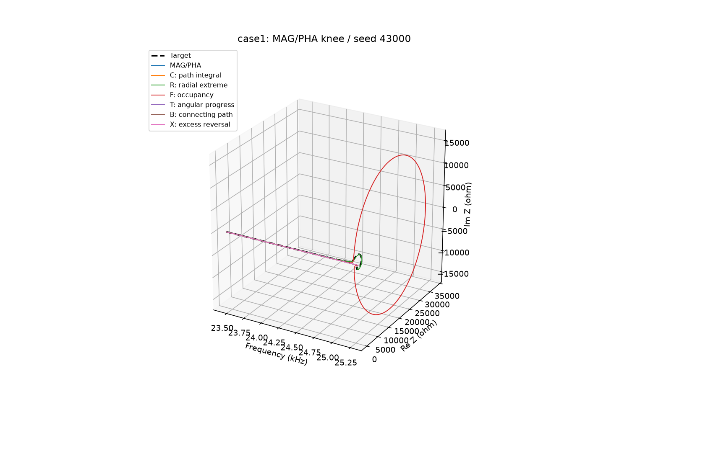
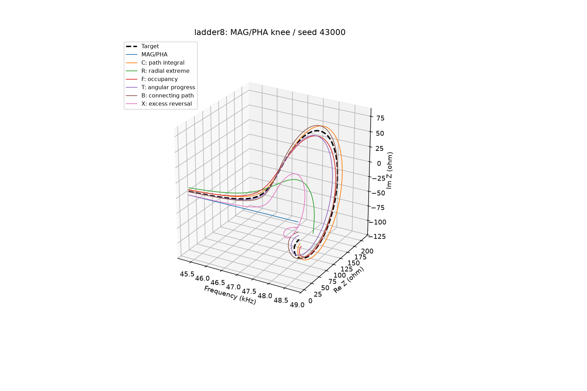
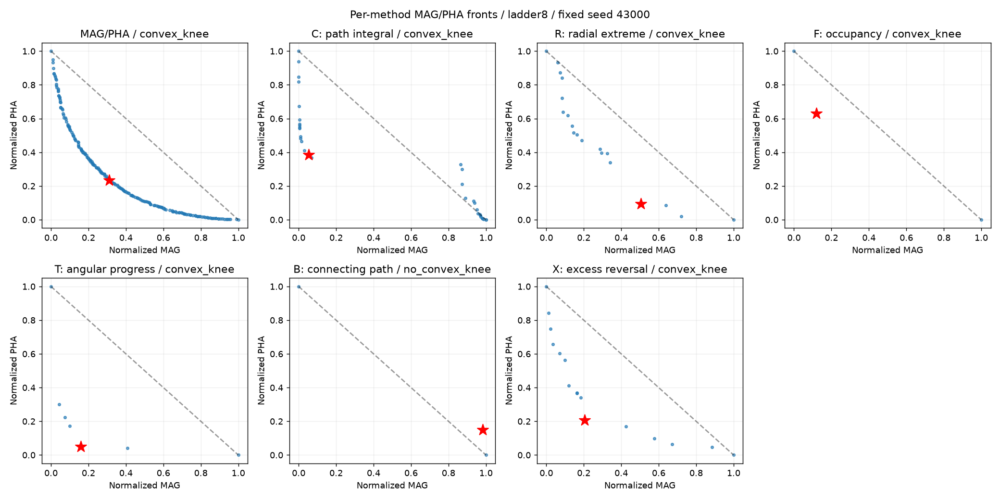

# 第三步：统一按MAG/PHA膝点重新选解的完整结果

2026年10月11日。本版替换第三步三轮旧选解结果；每seed最终只使用第300代MAG/PHA二维前沿膝点，无明确膝点时使用已冻结的退化折中代表。辅助指标不参与最终代表的挑选。

252个任务来自三轮已完成的完整优化种群，每任务60000次评价，合计15120000次；本次没有新增优化评价。全部3780个阶段重选、50400个末代候选训练分数重算，252条最终曲线重新独立加密复核。

## 怎么读下面的表

“重点过关”同时要求指定峰谷的位置、高度、宽度在原门槛内，不等于精确重合。“重点＋幅相不退步”还要求与同seed基础组相比，两项全频MSE都不增加。只改善一个目标时不会计入这个数。表中MSE是先计算每seed代表误差，再等权平均；没有平均曲线。

“额外幅值事件”是目标没有的可检测峰谷总数；“全相位过关”是全频相位事件都在门槛内的seed数。“真膝点”表示找到有正凸出的前沿，不包含退化折中。每方法前沿分别归一化，归一化坐标不可当作跨组质量分数。

指标代号：G原瓶颈，A平均瓶颈，D旧方向/伸展（原修订稿称B，避免与新跨窗B混淆），C顺序累计，R径向极值，F频率占据，T角度进程，B跨窗连接，X额外往返。

## 第一轮：原局部瓶颈指标

seed固定为41000–41003，不同轮不按编号伪配对。

|电路|指标|重点过关|重点＋幅相不退步|MAG / dB²|PHA / rad²|局部相位RMSE / °|全相位过关|额外幅值事件|真膝点|
|---|---|---:|---:|---:|---:|---:|---:|---:|---:|
|case1|基础MAG/PHA|0/4|0/4|11.3773|0.132166|106.202|0/4|0|2/4|
|case1|G：原瓶颈|0/4|0/4|24.2701|0.250305|99.532|0/4|0|1/4|
|control0p25|基础MAG/PHA|4/4|4/4|0.00246564|4.87403e-13|0.000|4/4|0|4/4|
|control0p25|G：原瓶颈|4/4|1/4|8.57945e-05|4.14483e-11|0.003|4/4|0|4/4|
|ladder8|基础MAG/PHA|0/4|0/4|0.65623|0.0085173|54.252|0/4|0|4/4|
|ladder8|G：原瓶颈|3/4|3/4|0.297266|0.00135871|14.479|2/4|0|3/4|
|mixed0p25|基础MAG/PHA|3/4|3/4|0.718272|0.00360874|9.392|0/4|0|4/4|
|mixed0p25|G：原瓶颈|2/4|1/4|1.8074|0.00261565|9.144|0/4|2|4/4|

[逐seed误差](../../archive/LOCAL_ONLY.md#ref-e18493aa750b) · [逐峰谷及目标宽度单位位置偏差](../../archive/LOCAL_ONLY.md#ref-9730babb4691) · [阶段代表](../../archive/LOCAL_ONLY.md#ref-868a1e28c32f) · [数值复核](../../archive/LOCAL_ONLY.md#ref-b0ce5e706061)

## 第二轮：汇总、方向和顺序累计修订

seed固定为42000–42003，不同轮不按编号伪配对。

|电路|指标|重点过关|重点＋幅相不退步|MAG / dB²|PHA / rad²|局部相位RMSE / °|全相位过关|额外幅值事件|真膝点|
|---|---|---:|---:|---:|---:|---:|---:|---:|---:|
|case1|基础MAG/PHA|0/4|0/4|32.0666|0.184532|157.935|0/4|0|2/4|
|case1|D：方向/伸展|0/4|0/4|28.9338|0.291301|85.118|0/4|0|1/4|
|case1|C：顺序累计|0/4|0/4|22.2605|0.257081|111.941|0/4|2|0/4|
|case1|G：原瓶颈|0/4|0/4|52.8918|0.275731|111.697|0/4|2|2/4|
|case1|A：平均瓶颈|0/4|0/4|32.6181|0.321778|81.805|0/4|0|2/4|
|control0p25|基础MAG/PHA|4/4|4/4|0.00066557|2.00226e-08|0.055|4/4|0|4/4|
|control0p25|D：方向/伸展|4/4|2/4|0.215999|1.29395e-07|0.145|4/4|0|4/4|
|control0p25|C：顺序累计|4/4|2/4|0.00785018|3.51915e-10|0.008|4/4|0|4/4|
|control0p25|G：原瓶颈|2/4|2/4|77.6419|9.36823e-09|0.056|4/4|0|3/4|
|control0p25|A：平均瓶颈|2/4|2/4|77.6419|9.36823e-09|0.056|4/4|0|3/4|
|ladder8|基础MAG/PHA|0/4|0/4|0.630043|0.00827966|53.437|0/4|0|4/4|
|ladder8|D：方向/伸展|1/4|0/4|3.81043|0.00388259|29.664|1/4|0|4/4|
|ladder8|C：顺序累计|4/4|4/4|0.215437|0.00136459|19.597|1/4|0|2/4|
|ladder8|G：原瓶颈|1/4|1/4|1.86116|0.00488977|37.145|0/4|0|4/4|
|ladder8|A：平均瓶颈|3/4|1/4|2.17782|0.00192597|18.389|3/4|0|4/4|
|mixed0p25|基础MAG/PHA|2/4|2/4|29.9266|0.00405721|10.956|0/4|0|4/4|
|mixed0p25|D：方向/伸展|1/4|1/4|1.10599|0.00336965|10.236|0/4|0|4/4|
|mixed0p25|C：顺序累计|4/4|2/4|0.253267|0.00201785|6.958|0/4|2|4/4|
|mixed0p25|G：原瓶颈|3/4|1/4|0.270029|0.00299991|9.348|0/4|0|4/4|
|mixed0p25|A：平均瓶颈|4/4|3/4|0.273241|0.00142842|6.651|2/4|0|4/4|

[逐seed误差](revision/REPRESENTATIVES.csv) · [逐峰谷及目标宽度单位位置偏差](revision/EVENTS.csv) · [阶段代表](revision/STAGES.csv) · [数值复核](revision/AUDIT.json)

## 第三轮：五类结构候选初筛

seed固定为43000–43003，不同轮不按编号伪配对。

|电路|指标|重点过关|重点＋幅相不退步|MAG / dB²|PHA / rad²|局部相位RMSE / °|全相位过关|额外幅值事件|真膝点|
|---|---|---:|---:|---:|---:|---:|---:|---:|---:|
|case1|基础MAG/PHA|0/4|0/4|24.8237|0.151556|101.518|0/4|2|2/4|
|case1|T：角度进程|1/4|1/4|24.7952|0.27088|54.565|0/4|2|0/4|
|case1|B：跨窗连接|0/4|0/4|45.6062|0.311792|127.952|0/4|0|2/4|
|case1|X：额外往返|0/4|0/4|21.1942|0.211854|125.530|0/4|0|2/4|
|case1|C：顺序累计|0/4|0/4|30.8511|0.361306|85.134|0/4|2|2/4|
|case1|F：频率占据|0/4|0/4|31.408|0.348199|86.732|0/4|2|1/4|
|case1|R：径向极值|1/4|1/4|21.7015|0.194227|89.632|0/4|0|0/4|
|control0p25|基础MAG/PHA|4/4|4/4|0.00296591|1.78271e-14|0.000|4/4|0|4/4|
|control0p25|T：角度进程|4/4|2/4|0.00132831|5.18228e-13|0.000|4/4|0|4/4|
|control0p25|B：跨窗连接|4/4|0/4|0.236493|2.52717e-10|0.007|4/4|0|4/4|
|control0p25|X：额外往返|4/4|1/4|0.00044015|1.05874e-10|0.005|4/4|0|4/4|
|control0p25|C：顺序累计|4/4|0/4|0.236493|2.52717e-10|0.007|4/4|0|4/4|
|control0p25|F：频率占据|4/4|2/4|0.00103881|3.5757e-07|0.233|4/4|0|3/4|
|control0p25|R：径向极值|4/4|3/4|3.84204e-05|2.65666e-09|0.020|4/4|0|2/4|
|ladder8|基础MAG/PHA|0/4|0/4|3.48379|0.00788322|52.126|0/4|0|4/4|
|ladder8|T：角度进程|3/4|3/4|0.254544|0.00064846|11.790|3/4|0|4/4|
|ladder8|B：跨窗连接|2/4|2/4|1.10544|0.00183941|19.682|2/4|0|3/4|
|ladder8|X：额外往返|0/4|0/4|4.20091|0.00714547|49.058|0/4|0|4/4|
|ladder8|C：顺序累计|2/4|1/4|0.540458|0.0015395|18.227|1/4|0|4/4|
|ladder8|F：频率占据|3/4|2/4|0.718952|0.0009891|16.648|2/4|0|4/4|
|ladder8|R：径向极值|2/4|2/4|0.654343|0.0014384|17.744|2/4|0|4/4|
|mixed0p25|基础MAG/PHA|1/4|1/4|2.20149|0.00510531|13.469|0/4|0|4/4|
|mixed0p25|T：角度进程|3/4|1/4|4.18999|0.0017054|5.533|0/4|2|4/4|
|mixed0p25|B：跨窗连接|3/4|1/4|0.201412|0.00223679|7.107|0/4|0|3/4|
|mixed0p25|X：额外往返|1/4|0/4|35.6804|0.00373065|10.789|0/4|0|4/4|
|mixed0p25|C：顺序累计|4/4|3/4|1.19663|0.00175817|6.243|0/4|0|3/4|
|mixed0p25|F：频率占据|1/4|1/4|0.673204|0.00275886|9.332|0/4|0|4/4|
|mixed0p25|R：径向极值|3/4|2/4|0.259361|0.0026681|9.237|0/4|0|3/4|
|three0p25|基础MAG/PHA|1/4|1/4|45.3557|0.00451744|24.724|0/4|4|4/4|
|three0p25|T：角度进程|4/4|2/4|0.553035|0.000696704|5.758|0/4|2|4/4|
|three0p25|B：跨窗连接|4/4|4/4|0.0886464|0.000441735|2.425|0/4|8|4/4|
|three0p25|X：额外往返|2/4|1/4|0.66498|0.00611718|27.191|0/4|4|3/4|
|three0p25|C：顺序累计|3/4|3/4|0.438144|0.000800141|7.198|0/4|4|2/4|
|three0p25|F：频率占据|3/4|2/4|0.574414|0.000851438|8.680|0/4|2|4/4|
|three0p25|R：径向极值|3/4|2/4|0.535822|0.00106889|10.821|0/4|0|4/4|

[逐seed误差](family/REPRESENTATIVES.csv) · [逐峰谷及目标宽度单位位置偏差](family/EVENTS.csv) · [阶段代表](family/STAGES.csv) · [数值复核](family/AUDIT.json)

## 固定seed曲线

每轮固定使用冻结配置中的第一个seed；不挑冠军、不平均曲线。第三轮各方法同图，虚线为目标。局部放大看峰谷与相位，三维图保留物理Re Z/Im Z。图例中C是原顺序累计，B是新跨窗；可在逐seed记录中查到该曲线是真膝点还是退化代表。

### case1：seed 43000

### ladder8：seed 43000

### mixed0p25：seed 43000

### three0p25：seed 43000

### control0p25：seed 43000

### 膝点怎样被选中

红星是新代表；虚线连接两个归一化极端点。此图按方法分别归一化，只展示选法，不能比较红星坐标判断哪个方法更好。

## 评价条件与边界

全部是模型正确、真参数在搜索范围内的理论开发目标，每条件只有4seed。没有未见电路、实测数据、噪声、更多seed或组合指标检验。结果描述规定预算下的搜索和选解，不证明MSE理论无法拟合。辅助组搜索实际为MAG/PHA加第三目标；最终用其保留种群的MAG/PHA投影前沿选解，可能舍弃辅助目标优异但基础目标被支配的解。

膝点取决于当次保留前沿和极端点，离群极端值、前沿稀疏、不同目标跨度会影响最终折中。它不是唯一正确的定义，也不是全局最优保证。原始前沿和归一化记录全部可复算。

固定位置门槛0.02decade，对极窄峰谷可能太宽松。高度门槛3dB、宽度比0.5–2均沿用；连续位置偏差另以目标3dB宽度单位提供，没有根据本轮成绩改变合格门槛。

[通俗解释](FINDINGS.md) · [问题及影响](ISSUES.md) · [逐seed配对](PAIRED.csv) · [膝点选法与核验约定](../../experiments/mse_structure_step3_knee_20261011/PROTOCOL.md)
