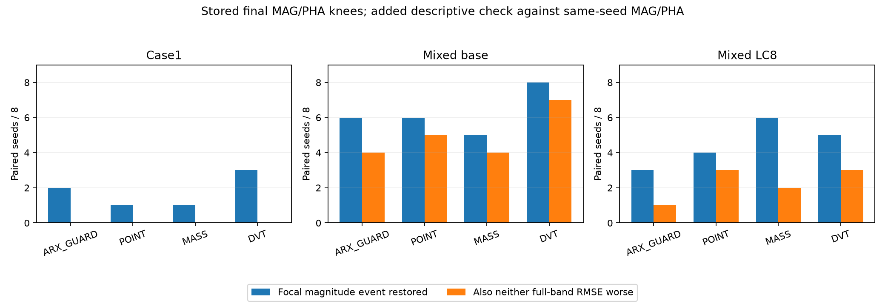

> 2026-11-08 精选归档：以下为原日期研究记录；“active／下一步／完成”等是当时状态。现行结论见[研究现状](../../docs/研究现状_20261108.md)。此目录是核心阅读与复核材料，原运行包未全量附带；JSON中的历史路径/证书不是本次重跑证明。

# 复阻抗辅助指标：既有结果的离线再分析与方向判断

日期：2026-10-22。范围：本地存量数据分析；新增优化、响应求值、服务器操作均为0。

## 1. 结论

**目前较明确的困难是局部结构恢复与全频拟合之间的取舍，以及不同结构描述之间的不一致。现有证据不足以把困难统一归因于MSE、膝点选解或指标缺少物理解释。**

本次重新核对192条正式代表、72个最终种群及14,400个已存储候选分数，得到三项更具体的判断：

1. **Case1应优先处理跨频段代价。**七个旧辅助方法共56条最终代表，没有一条同时做到全频幅值和相位RMSE均不高于同seed基础目标。DVT/MASS/POINT的24个最终种群中，也没有找到“指定尖峰完整且两项训练主目标均不高于基础膝点”的候选。这是本批有限种群的事实，不是全参数空间不可能兼顾的证明。
2. **混合基准中确有较好的局部与整体兼顾，但DVT并未显示独有优势。**DVT和较简单的P1均有7/8条最终代表既恢复指定谷，又在两项全频误差上不劣于基础目标。应继续保留简单点误差作为强对照。
3. **新阻尼差分JK的优势依赖参照。**LC8旧种群中，JK比同五复点状态误差JS更能区分原幅值标签；但相对原局部复点积分POINT，平均排序正确率更低。JK与JS的互补信息存在，组合能否转化成优化收益仍未核实。

最新K_S/S_DUP/R_DUP的72项配对不能纳入上述效果判断：本地只有历史完成及审计状态，没有完整结果包。不能把“72项数值审计通过”写成“72项结构改善”。

## 2. 数据与本次统计的含义

正式代表来自[已回收的DVT配对集](../../archive/CORE_LOCAL_ONLY_20261108.md#local-23)：Case1/P3、混合基准/V3、混合LC8/V3，八方法、八seed。每任务原预算为200个体×300代，保存15阶段，按原MAG/PHA二维膝点及回退选解。

原指定幅值事件恢复标准保持不变：匹配成功，位置偏差不超过0.5个目标对数频率宽度，高度偏差不超过3dB，宽度比在0.5—2内，且分类独立稳定。它描述一个峰或谷，不代表整条复曲线正确。

本次另列“兼顾计数”：指定事件恢复，并且两项全频RMSE都不高于同seed对照。**这是事后描述性统计，既不是新的正式成功门槛，也不意味着任何微小整体代价都应否决方法。**实际可接受代价尚未确定，因此同时保留[逐seed连续差值](PAIRS.csv)，不靠单一计数裁决。

915个输入文件与已有分析清单或回收成员清单哈希一致；192条表记录与原始审计、严格事件复核逐项一致；72个种群的14,400个标签与既有分数表逐项一致。见[输入核验](INPUT_VERIFICATION.json)。没有重新计算电路响应或更改原结果。

## 3. 局部恢复增加后，整体是否也更好

下表每格为“指定峰谷恢复数 / 同时两项全频RMSE不劣于基础目标的恢复数”，分母均为8个配对seed。

|方法|Case1|混合基准|混合LC8|
|---|---:|---:|---:|
|ARX_GUARD|2 / 0|6 / 4|3 / 1|
|POINT_Z_LOCAL|2 / 0|7 / 6|4 / 1|
|D1|1 / 0|8 / 4|4 / 0|
|P1|0 / 0|8 / 7|4 / 3|
|DVT|3 / 0|8 / 7|5 / 3|
|MASS|1 / 0|5 / 4|6 / 2|
|POINT|1 / 0|6 / 5|4 / 3|

基础MAG/PHA的指定事件恢复数为0/8、2/8、4/8。各辅助组保持原输出，不从种群里另挑好曲线。P1、POINT_Z_LOCAL和POINT的窗口、积分定义并不完全相同，不应合并成一个方法。

Case1的56条辅助代表均至少有一项全频误差增加。DVT有5/8两项误差均增加，ARX有6/8。这里不能解释为“基础目标已找到全局最优”；只能说明目前辅助搜索在固定预算下尚未表现出兼顾能力。

混合基准的DVT和P1均达到7/8兼顾，支持继续研究这个条件中的可恢复性，但不足以把收益归因于DVT特有的方向运输项。

LC8按指定事件数，MASS的6/8高于DVT的5/8；加看整体误差后，兼顾数分别为2/8和3/8，P1、POINT也为3/8。这说明只追一个谷的通过数，会改变方法排序。完整比较含ARX、POINT两种参照，见[JOINT_SUMMARY.csv](JOINT_SUMMARY.csv)。

## 4. 是否只是膝点没有选中好结果

对DVT/MASS/POINT三组的最终种群，每条件24个种群，失败分为互斥类别：

|条件|最终代表已恢复|最终种群无完整事件|存在完整事件，但全部被主目标支配|主前沿有完整事件，膝点未选|
|---|---:|---:|---:|---:|
|Case1|5|11|6|2|
|混合基准|19|0|2|3|
|混合LC8|15|1|8|0|

“被主目标支配”表示已有其他候选在两个主目标上均不差、至少一项更好，因而该局部完整候选不在两主目标前沿。

Case1最终19次失败中，仅2次属于主前沿已有局部完整事件但未选，均来自MASS。DVT自己的5次失败为3次最终种群没有、2次存在但被支配。LC8的9次失败中没有“仅需换一个前沿代表即可补谷”的实例。**更换膝点不是本批主要问题的充分解法。**

进一步检查每个种群是否有候选同时满足“指定事件完整＋两项训练主目标均不差于同seed基础膝点”：Case1三组均为0/8；混合基准DVT/MASS/POINT分别为8/8、4/8、6/8；LC8为3/8、2/8、3/8。

这项比较使用存储的训练目标，不冒充14,400个候选的独立高精度主目标复核。未找到仅限最终种群，不能表述为整个优化过程中从未出现，更不能证明真实参数附近不存在可兼顾解。详见[POPULATION_DIAGNOSIS.csv](POPULATION_DIAGNOSIS.csv)。

## 5. 具体缺陷和窗外代价

Case1 DVT八条代表中，未匹配1条；已可评价的条目里，位置超限4条、高度超限3条、宽度超限4条。LC8则为位置1条、高度2条、宽度3条。各项可在同一曲线上同时发生，不能相加当失败总数；未匹配的条目不补为无限宽度等人为数值。

因此不能把Case1统一简化成“宽度没调好”。LC8三条最终失败均包含宽度超限，但还伴随位置或高度问题；宽度只是当前筛查的共同缺陷，并非已证实的唯一原因。见[FAILURE_COMPONENTS.csv](FAILURE_COMPONENTS.csv)。

把已审计主目标积分拆成指定局部窗和窗外，两部分相加仍等于原全频目标。DVT相对基础目标：

|条件|局部幅值误差降低而全频幅值目标增加|局部相位误差降低而全频相位目标增加|
|---|---:|---:|
|Case1|4/8|7/8|
|混合基准|1/8|0/8|
|混合LC8|1/8|0/8|

Case1尤其明确：局部相位改善的同时，窗外损失可以盖过收益。该结果支持优先分析跨频段代价，尚不能区分参数联动、有限预算搜索和辅助目标改变前沿各自的因果贡献。这里的积分与上节用于读图的RMSE统计口径不同，不混用数值大小。逐项分解见[LOCAL_OUTSIDE.csv](LOCAL_OUTSIDE.csv)。

## 6. 新阻尼差分增加了什么信息

JK比较两个阻尼尺度下的复响应差分；JS比较同五个复频率点的绝对复状态；JR比较五个主动实频率点；POINT为原局部实频率复点积分。物理及解析限制保留在[前阶段报告](../../archive/CORE_LOCAL_ONLY_20261108.md#local-24)。

只在同时有完整和不完整幅值标签的旧种群中，计算随机抽取一好一坏候选时，将完整者排在前面的概率，再对种群等权平均。72个种群中35个可比较：Case1为10、混合基准9、LC8为16。剩余全同标签种群不补成0.5，也不算成功。

|条件|JK|JS：同五复点|JR：五实点|POINT：局部积分|
|---|---:|---:|---:|---:|
|Case1|94.42%|91.25%|91.68%|91.97%|
|混合基准|81.08%|71.45%|86.31%|81.25%|
|混合LC8|75.02%|63.79%|71.30%|82.04%|

这不是优化成功率。Case1局部混合标签区分率较高，并不矛盾于正式恢复很少：11个最终种群压根没有完整事件，不能进入这一排序统计。

**对先前LC8“7个种群胜过POINT、6个落后、3个相同”的解读需要收紧。**按胜负次数似乎略有优势，按排序概率的变化幅度，JK平均落后POINT约7.01个百分点。在DVT、MASS、POINT三个来源内均为负，分别约−2.15、−0.43、−24.19个百分点。依次去掉任一seed并连同它的所有来源种群一起去掉，平均差仍为负，范围约−8.64至−0.13个百分点。影响大小受种群来源与个别seed影响，但现有数据不支持JK稳定超越局部POINT。

相对JS，LC8的JK平均提高11.23个百分点，三个来源内方向均为正；去掉任一seed后仍为正。说明差分有补充同五点状态误差的信息，但这不是“比所有复数点误差都强”。

Case1的JK相对JS平均高3.17个百分点，去掉seed62004后变为低1.63个百分点；其优势更依赖个别样本。上述检查是事后敏感性分析，不是独立验证或显著性检验。[分种群结果](RANKING_PER_POPULATION.csv)、[来源与留一seed检查](RANKING_SENSITIVITY.csv)保留全部比较。

## 7. 为什么不能直接把JK和JS的互补性当组合成功

以LC8为例，按种群等权：JK纠正JS错误排序的候选对占14.11%，反向破坏JS原正确排序的占2.88%；两者共同偏好旧幅值不完整候选的占22.10%。

JK纠正JS的候选对，在双分量中通常形成一个分量更好、另一个更差的取舍。优化器可能同时保留两者，**不能把14.11%直接加到组合成功率上**。共同错误也不会因为简单并列两分量而消失。实际仍须看已完成但未回收的K_S与S_DUP/R_DUP配对。

此外，“错误”在这里严格相对于原幅值标签。此前LC8两个固定反例对已经显示：幅值标签不完整的一方，模态位置、对数尺度和复强度反而都更接近目标。该事实不允许删掉原幅值缺陷，也不允许认定新分数所有逆序均无意义；需要并列看完整复轨迹、局部峰谷和可靠模态量。当前数据不足以把它们压成一个普适物理正确性分数。

## 8. 后续工作的明确取舍

### 当前可以决定

- **保留K_S作为待判断方案，暂不追加改造或扩大试验。**其原生实现与调用成本已通过，效果仍待原72项结果；现在叠加新项会使问题更难归因。
- **Case1暂不以“再加一个宽度项”作为首选。**首先需要解释并降低窗外代价；目前没有证据证明某个新宽度公式能解除这种取舍。
- **混合基准保留P1与DVT平行对照。**两者兼顾计数同为7/8，复杂特征必须证明超出简单局部复点误差的价值。
- **LC8收紧为一个具体问题：差分信息能否在不损害整体误差的情况下，改善谷附近完整复过程？**JK只胜过同五点JS还不够，已有局部POINT的表现必须保留。

### 服务器或结果文件重新可用以后

先回收原72项和其种群/补充审计，不重跑优化。仍按原膝点输出，依次检查：

1. 数据、预算、配对初始化、数值与结构核验是否齐全；失败原样保留。
2. K_S相对S_DUP是否增加可解释的结构收益；再对R_DUP及原POINT、ARX检验是否只是取点和局部强调带来的收益。
3. 同时报指定峰谷连续偏差、全频误差、额外结构、最终种群机会与全任务CPU；可靠时补模态描述，不用辅助下降替代实际改善。
4. 若只有局部计数收益而整体代价增加，应归入取舍，不宣布成功；若K_S与点对照相当，应优先保留简单方案；只有出现可复核的增益，才值得冻结改进方案并安排未参与开发的验证。

具体整体误差容忍量尚无依据。本次不为某方案“过线”事后选择百分比，也不把“零增加”的描述统计强行规定成最终应用标准。

## 9. 回到四个研究问题

1. **哪类结构反复难恢复？**Case1极窄峰的位置、高度、宽度联合恢复及其全频代价；LC8谷的宽度与完整复过程一致性。它们不是同一个困难。
2. **什么条件使它更难？**本批可见局部/窗外取舍、多个结构量的排序冲突，以及有限搜索产生的候选分布；各机制的独立因果贡献仍未分离。
3. **针对性指标能改善吗？**旧DVT在混合基准有兼顾收益，简单P1也有；JK在旧LC8候选中补充JS信息，但不足以超越POINT或证明K_S优化有效。
4. **能推广吗，代价是什么？**没有独立推广证据。固定五点调用很轻量，但噪声下目标延拓、有限点盲区、全任务成本和结构收益仍需分别检验。调用快不能替代有效性。

本次分析完成，持续研究目标尚未完成。全部机器可读结果与代码见[分析状态](STATUS.json)、[离线分析脚本](../../archive/CORE_LOCAL_ONLY_20261108.md#local-25)、[问题记录](ISSUES.md)。
