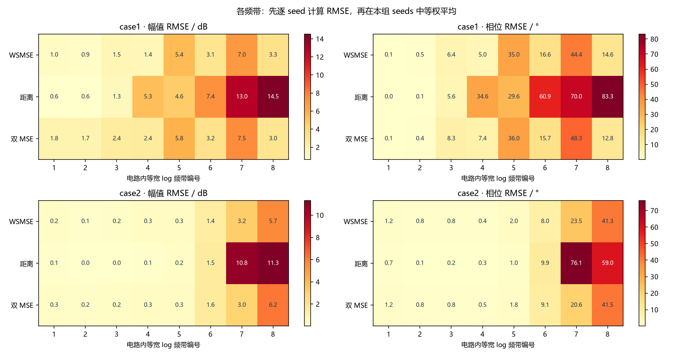
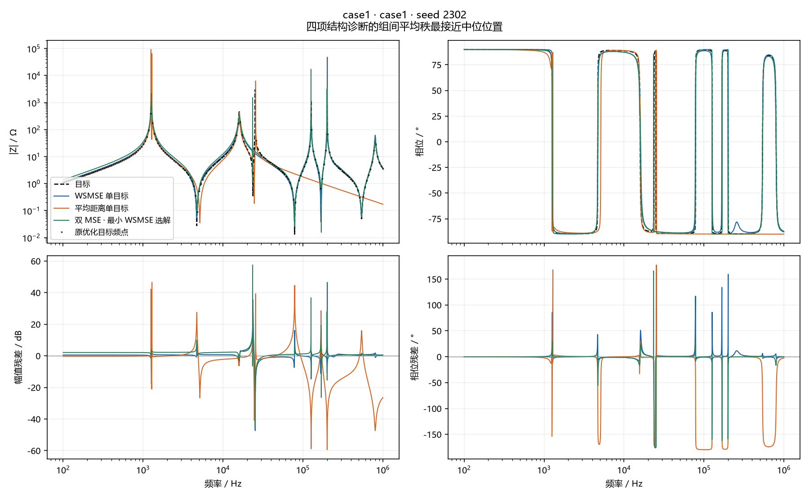
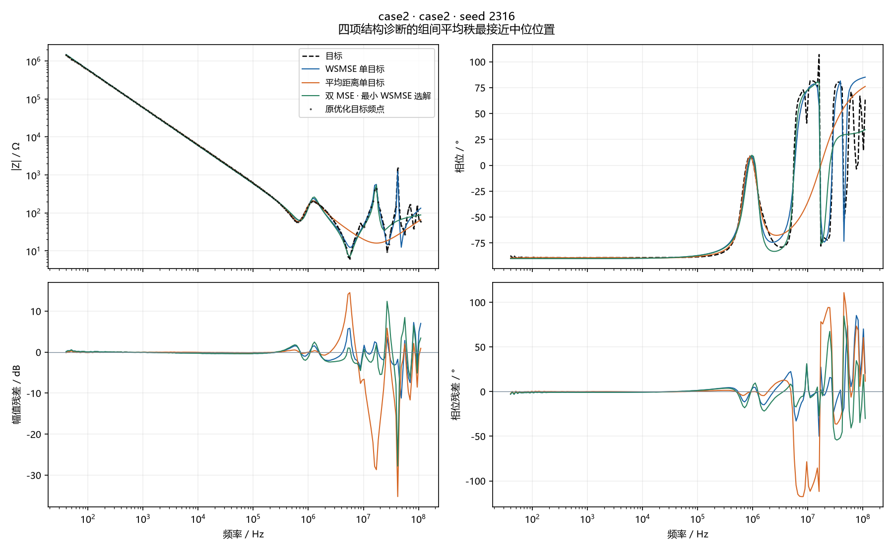
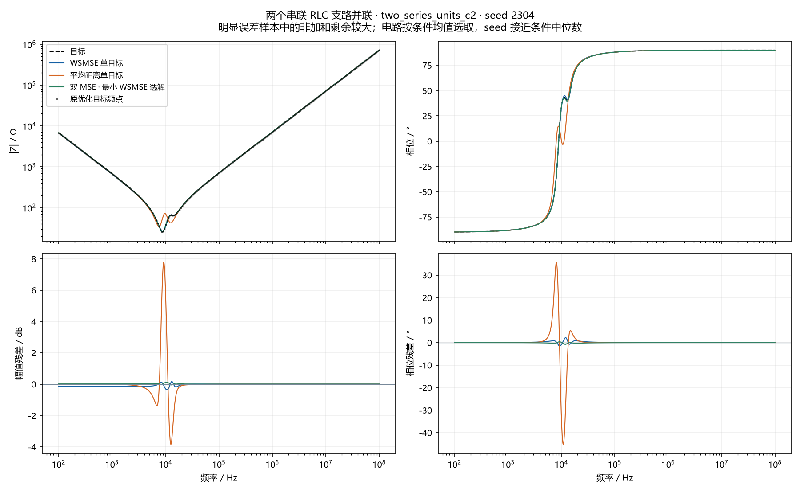
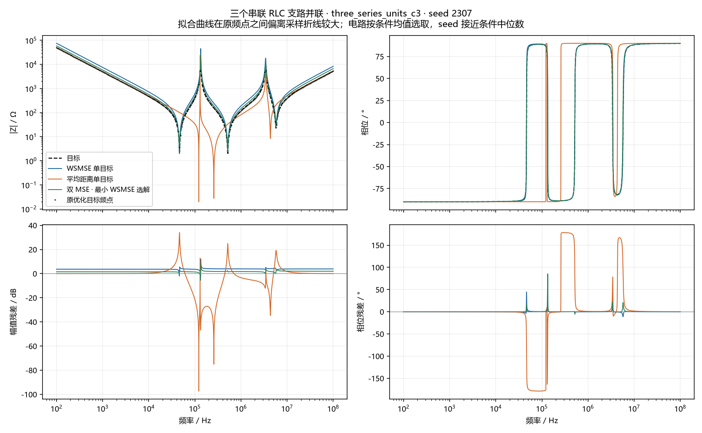
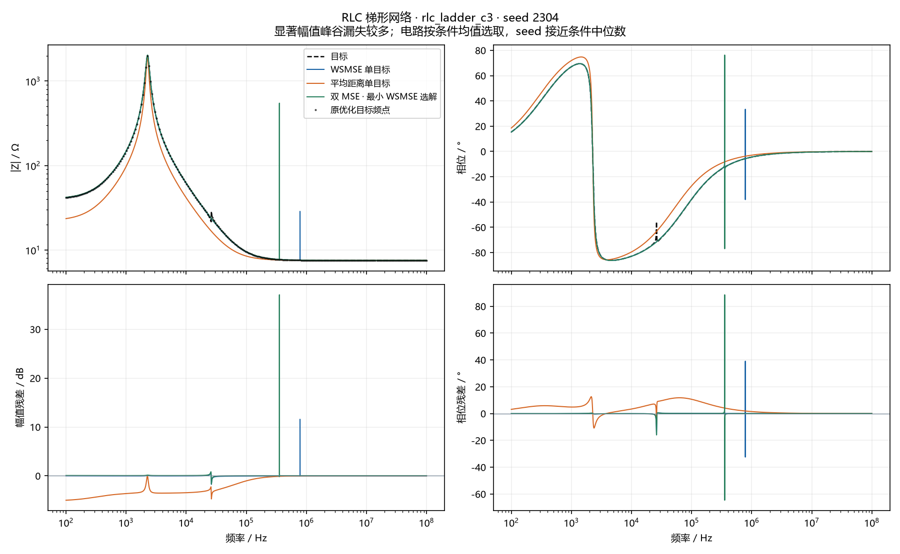
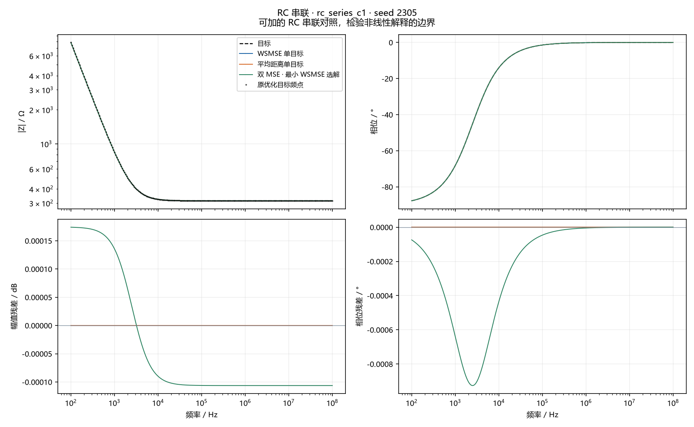

# 优化结束后，阻抗曲线具体错在哪里

**后台逐一分析3,480条主要代表曲线，另分析1,160条双目标均衡选解；没有把全部seed画成图片。** 50个电路、1,160个配对seed，新增双目标1,160次运行全部通过。

三类进化目标分别为WSMSE、MAE_Z=mean|Z−Z*|（原始Ω）和幅值/相位MSE双目标。幅值MSE用dB²，相位MSE用rad²主值差。α在运行前固定：Case1=25.12、Case2=17.38，自设计沿用目标幅值/相位跨度比的平方；双目标中的α只参与末代代表解选择。自设计为无噪声且结构正确的16拓扑×3组参数，边界为真值中心±2 decades。

## 先看三点

1. **最先要修的是结构的采样可靠性。** Case1的解析目标在约25.23 kHz有约3 kΩ的尖峰，比原180点目标连线高40.49 dB。49个有解析真值的电路中，8个目标相对原采样折线的最大幅值差超过3 dB。这说明部分结构在优化前就没有被充分表达；Case2没有测点间真值，不能作同样断言。
2. **残差集中在局部峰谷和相位变化区，不只是整体抬高或压低。** Case1的距离组幅值RMSE为8.007 dB，去掉每seed最佳恒定dB偏移后仍为7.625 dB。Case2距离组的距离残差中，目标幅值最高四分位频点占 97.5%；这也显示原始Ω距离的误差尺度集中。双MSE的峰谷漏失改善区间跨零，没有稳定修复这些结构。
3. **单参数变化不能普遍相加，且也存在可加特例。** 在幅值RMSE>1 dB或相位RMSE>5°的解析目标样本中，三组η中位数分别为 0.9311 / 0.9603 / 0.9202；RC串联的η接近零。η高也可能含参数抵消或等价参数的影响，不能当作曲线质量指标。

> 这些结果用于定位缺陷和提出假设；没有证明某个新辅助指标有效，也不能把有限300代结果解释为各目标的全局最优解。

Case1和48个自设计电路的真实参数都在搜索边界内，且目标与拟合网络相同，因此三类目标都存在零误差解。现在比较的是同预算300代的搜索行为及残余失真，不能据此说它们的全局最优曲线必然不同。Case2是实测目标，另有模型与测量是否一致的问题。

## case1：全部100个seed

| 进化目标/选解 | 幅值MSE / dB² | 相位MSE / rad² | 平均距离 / Ω | WSMSE |
| --- | --- | --- | --- | --- |
| WSMSE 单目标 | 11.24 | 0.1484 | 4.1 | 14.97 |
| 平均距离单目标 | 62.48 | 0.723 | 2.519 | 80.64 |
| 双 MSE · 最小 WSMSE 选解 | 13.97 | 0.1444 | 5.979 | 17.6 |

结构诊断使用log频率权重；Case1使用解析密集曲线，Case2使用全部201个测量点。峰谷为1 dB显著幅值事件 / 5°显著相位事件，类型相同且频差不超过0.25 decades才匹配。下表计数是每seed平均事件数，不是百分比。

| 组 | 幅值RMSE / dB | 相位RMSE / ° | 幅值漏失/新增 | 相位漏失/新增 | \|相位误差\|>15°频带份额 | 最坏频带相位RMSE / ° |
| --- | --- | --- | --- | --- | --- | --- |
| WSMSE 单目标 | 3.848 | 23.4 | 1.72/0.38 | 1.85/1.44 | 9.4% | 52.86 |
| 平均距离单目标 | 8.007 | 48.96 | 3.14/1.56 | 3.41/2.13 | 10.1% | 91.68 |
| 双 MSE · 最小 WSMSE 选解 | 4.208 | 24.13 | 1.56/0.49 | 1.74/1.12 | 8.5% | 53.6 |

匹配峰谷的频移和宽度误差仅对成功匹配的事件统计；先看漏失/新增数量，再看频移，避免把失去特征的解误认成“位置误差小”。

| 组 | 幅值事件平均绝对频移 / decades | 幅值宽度 \|log₂比值\| | 相位事件平均绝对频移 / decades | 相位宽度 \|log₂比值\| |
| --- | --- | --- | --- | --- |
| WSMSE 单目标 | 0.007014 | 1.165 | 0.05059 | 0.3549 |
| 平均距离单目标 | 0.02809 | 1.133 | 0.0425 | 0.6361 |
| 双 MSE · 最小 WSMSE 选解 | 0.008083 | 1.061 | 0.04768 | 0.3604 |

相对WSMSE单目标的配对seed区间：

| 比较组 | 量 | 均值差 | 95%配对bootstrap区间 |
| --- | --- | --- | --- |
| 平均距离单目标 | magnitude_mse_db2 | 51.23 | [45.58, 56.98] |
| 平均距离单目标 | phase_mse_rad2 | 0.5745 | [0.5218, 0.6273] |
| 平均距离单目标 | worst_band_phase_rmse_deg | 38.82 | [34.76, 42.77] |
| 平均距离单目标 | amp_missed | 1.42 | [1.06, 1.76] |
| 平均距离单目标 | phase_missed | 1.56 | [1.22, 1.89] |
| 双 MSE · 最小 WSMSE 选解 | magnitude_mse_db2 | 2.725 | [0.9868, 4.527] |
| 双 MSE · 最小 WSMSE 选解 | phase_mse_rad2 | -0.004024 | [-0.02807, 0.02057] |
| 双 MSE · 最小 WSMSE 选解 | worst_band_phase_rmse_deg | 0.7471 | [-3.122, 4.661] |
| 双 MSE · 最小 WSMSE 选解 | amp_missed | -0.16 | [-0.44, 0.12] |
| 双 MSE · 最小 WSMSE 选解 | phase_missed | -0.11 | [-0.39, 0.17] |

## case2：全部100个seed

| 进化目标/选解 | 幅值MSE / dB² | 相位MSE / rad² | 平均距离 / Ω | WSMSE |
| --- | --- | --- | --- | --- |
| WSMSE 单目标 | 6.241 | 0.09274 | 3594 | 7.853 |
| 平均距离单目标 | 31.79 | 0.3632 | 1475 | 38.11 |
| 双 MSE · 最小 WSMSE 选解 | 6.847 | 0.08896 | 4060 | 8.393 |

结构诊断使用log频率权重；Case1使用解析密集曲线，Case2使用全部201个测量点。峰谷为1 dB显著幅值事件 / 5°显著相位事件，类型相同且频差不超过0.25 decades才匹配。下表计数是每seed平均事件数，不是百分比。

| 组 | 幅值RMSE / dB | 相位RMSE / ° | 幅值漏失/新增 | 相位漏失/新增 | \|相位误差\|>15°频带份额 | 最坏频带相位RMSE / ° |
| --- | --- | --- | --- | --- | --- | --- |
| WSMSE 单目标 | 2.434 | 17.28 | 5.54/0.04 | 8.65/0.13 | 15.6% | 41.26 |
| 平均距离单目标 | 5.647 | 34.59 | 9.22/0 | 12.22/0 | 22.6% | 76.15 |
| 双 MSE · 最小 WSMSE 选解 | 2.544 | 16.95 | 5.77/0 | 8.87/0.16 | 15.6% | 41.56 |

匹配峰谷的频移和宽度误差仅对成功匹配的事件统计；先看漏失/新增数量，再看频移，避免把失去特征的解误认成“位置误差小”。

| 组 | 幅值事件平均绝对频移 / decades | 幅值宽度 \|log₂比值\| | 相位事件平均绝对频移 / decades | 相位宽度 \|log₂比值\| |
| --- | --- | --- | --- | --- |
| WSMSE 单目标 | 0.02044 | 0.4841 | 0.04645 | 0.3479 |
| 平均距离单目标 | 0.05741 | 1.319 | 0.06117 | 0.466 |
| 双 MSE · 最小 WSMSE 选解 | 0.02042 | 0.4778 | 0.03922 | 0.3966 |

相对WSMSE单目标的配对seed区间：

| 比较组 | 量 | 均值差 | 95%配对bootstrap区间 |
| --- | --- | --- | --- |
| 平均距离单目标 | magnitude_mse_db2 | 25.55 | [24.94, 26.17] |
| 平均距离单目标 | phase_mse_rad2 | 0.2705 | [0.2644, 0.2765] |
| 平均距离单目标 | worst_band_phase_rmse_deg | 34.89 | [33.21, 36.53] |
| 平均距离单目标 | amp_missed | 3.68 | [3.46, 3.91] |
| 平均距离单目标 | phase_missed | 3.57 | [3.35, 3.8] |
| 双 MSE · 最小 WSMSE 选解 | magnitude_mse_db2 | 0.6059 | [-0.1334, 1.361] |
| 双 MSE · 最小 WSMSE 选解 | phase_mse_rad2 | -0.00378 | [-0.01131, 0.003704] |
| 双 MSE · 最小 WSMSE 选解 | worst_band_phase_rmse_deg | 0.2957 | [-1.635, 2.302] |
| 双 MSE · 最小 WSMSE 选解 | amp_missed | 0.23 | [-0.03, 0.49] |
| 双 MSE · 最小 WSMSE 选解 | phase_missed | 0.22 | [-0.03, 0.48] |

Case2在16 MHz有107°原测量点，原样保留。当前正值无源网络的Re Z>0，因此相位只能在−90°到90°之间；这个测点至少有17°相位误差，对全201点相位MSE的下界贡献为0.000438 rad²。实际该点平均占三组相位平方误差的比例为 3.2% / 4.9% / 3.1%，不足以解释总体差异。主值相位平方差不能被“平滑后曲线更好看”替代；从测量起伏提取的事件不是已证实的物理谐振。

## 误差集中在哪些频带

| 电路 | 频带 | 频率下界 / Hz | 频率上界 / Hz |
| --- | --- | --- | --- |
| case1 | 1 | 100 | 316.2 |
| case1 | 2 | 316.2 | 1000 |
| case1 | 3 | 1000 | 3162 |
| case1 | 4 | 3162 | 1e+04 |
| case1 | 5 | 1e+04 | 3.162e+04 |
| case1 | 6 | 3.162e+04 | 1e+05 |
| case1 | 7 | 1e+05 | 3.162e+05 |
| case1 | 8 | 3.162e+05 | 1e+06 |
| case2 | 1 | 40 | 255.3 |
| case2 | 2 | 255.3 | 1629 |
| case2 | 3 | 1629 | 1.039e+04 |
| case2 | 4 | 1.039e+04 | 6.633e+04 |
| case2 | 5 | 6.633e+04 | 4.233e+05 |
| case2 | 6 | 4.233e+05 | 2.701e+06 |
| case2 | 7 | 2.701e+06 | 1.724e+07 |
| case2 | 8 | 1.724e+07 | 1.1e+08 |

## 48个自设计电路

下表先逐电路对seeds等权平均，再数方向；近零差异也计数，不等同于实用或统计优势。双MSE与单目标沿用相同目标参数、频点、边界和预算。

| 比较组 | 原幅值MSE更低 /48 | 原相位MSE更低 /48 | 密集幅值RMSE更低 /48 | 密集相位RMSE更低 /48 | 幅值漏失更少 /48 | 相位漏失更少 /48 |
| --- | --- | --- | --- | --- | --- | --- |
| 平均距离单目标 | 20 | 19 | 21 | 21 | 3 | 2 |
| 双 MSE · 最小 WSMSE 选解 | 19 | 15 | 20 | 17 | 2 | 2 |

## 多个元件的偏差能否相加

在原频点上计算：r_all=Z(p_fit)−Z(p*)；r_add=Σ_j[Z(p*仅将第j个元件改为拟合值)−Z(p*)]；r_int=r_all−r_add。η=||r_int||/(||r_all||+||r_add||)，使用log频率权重L2范数；取值0–1，η=0表示该组有限变化可加。它不是交互贡献百分比。

| 组 | 明显误差的解析样本数 | η中位数 | η>0.2样本数 |
| --- | --- | --- | --- |
| WSMSE 单目标 | 158 | 0.9311 | 157 |
| 平均距离单目标 | 239 | 0.9603 | 239 |
| 双 MSE · 最小 WSMSE 选解 | 123 | 0.9202 | 122 |

这些数以seed为诊断单位，不能当成独立电路的普遍比例；近乎完美拟合不会因很小分母而被拿来制造“强非线性”。Case2没有已知真值参数，不计算分解。不同参数组合可能给出相同阻抗，参数差异大也不必然表示曲线差。

## 双目标“最好”的选择敏感性

主要选解是末代非支配解中最小WSMSE。较均衡的另一个固定规则为min max(M_A,αM_φ)。两者是同一前沿上的两个选择，不是额外优化组。

| 电路 | 选解 | 原幅值MSE | 原相位MSE | 曲线幅值RMSE / dB | 曲线相位RMSE / ° | 幅值漏失 | 相位漏失 |
| --- | --- | --- | --- | --- | --- | --- | --- |
| case1 | 双 MSE · 最小 WSMSE 选解 | 13.97 | 0.1444 | 4.208 | 24.13 | 1.56 | 1.74 |
| case1 | 双 MSE · minmax 选解 | 13.65 | 0.1699 | 4.264 | 24.64 | 1.54 | 1.74 |
| case2 | 双 MSE · 最小 WSMSE 选解 | 6.847 | 0.08896 | 2.544 | 16.95 | 5.77 | 8.87 |
| case2 | 双 MSE · minmax 选解 | 6.798 | 0.09436 | 2.533 | 17.46 | 5.76 | 8.87 |

前沿内按平均距离、纯幅值或纯相位另选的误差也全部记录在dual_selection_sensitivity.csv，供检查其他取舍。它们不能替换主要比较中的选解。

## 少量典型曲线

图中黑色虚线为目标，蓝/橙/绿分别为三组。上排使用f–|Z|与f–θ，下排为同频残差。论文电路选接近总体中位位置的seed；合成例子按说明中的诊断条件选取，包含刻意突出的现象，不能代表所有电路。

### case1 · seed 2302

四项结构诊断的组间平均秩最接近中位位置。

[查看结构、参数与本seed数据](../../archive/LOCAL_ONLY.md#ref-4d2a1f20ad2f)

### case2 · seed 2316

四项结构诊断的组间平均秩最接近中位位置。

[查看结构、参数与本seed数据](../../archive/LOCAL_ONLY.md#ref-b4f02f068254)

### two_series_units_c2 · seed 2304

明显误差样本中的非加和剩余较大；电路按条件均值选取，seed 接近条件中位数。

[查看结构、参数与本seed数据](../../archive/LOCAL_ONLY.md#ref-cf1ac98ecbfd)

### three_series_units_c3 · seed 2307

拟合曲线在原频点之间偏离采样折线较大；电路按条件均值选取，seed 接近条件中位数。

[查看结构、参数与本seed数据](../../archive/LOCAL_ONLY.md#ref-718baa262846)

### rlc_ladder_c3 · seed 2304

显著幅值峰谷漏失较多；电路按条件均值选取，seed 接近条件中位数。

[查看结构、参数与本seed数据](../../archive/LOCAL_ONLY.md#ref-dcec1512319f)

### rc_series_c1 · seed 2305

可加的 RC 串联对照，检验非线性解释的边界。

[查看结构、参数与本seed数据](../../archive/LOCAL_ONLY.md#ref-fc4fd90249ad)

## 下一步如何用这些结果

1. **先保证采样可靠。** 对有解析模型的合成问题，用目标和拟合的模态位置加密或网格外检查，避免优化器只贴合测点却在测点间失真。实测Case2需要新增测量或独立目标数据，不能用模型生成“目标真值”。
2. **将误差分成数量、位置与形状。** 只有匹配成功的结构再讨论峰位和宽度；漏失峰谷不能靠调频移惩罚独自修正。相位问题要按频带查看，并区分整体偏移、局部转变和单个异常点影响。
3. **再形成连续的候选损失。** 可以从稳定失败区域考虑局部幅相残差/转变形状、峰谷附近对齐或频带平衡；暂不把η、硬峰数或极端点最大误差直接加进目标。它们尚未经过独立优化验证。
4. **使用联合参数变化验证方向。** 在实际拟合解附近检查多参数共同变化的真实响应，不能用单参数曲线相加替代。候选仍需独立seeds、相同预算和幅相两项交叉指标检验，不能以辅助项本身下降作为成功。

## 数值可靠性与材料

初始网格有63条解析诊断未通过两档加密稳定条件。改为不截断窄模态、加入精确RLC中心和几何尾部网格后，仍有0条未通过；全部如实标记在grid_refinement.csv，不删seed。未稳定项不支持精确结构优势结论。网格更改只发生在离线诊断，原频点上的目标值与选解未更改。

[逐seed诊断](per_seed_diagnostics.csv) · [逐频带结果](band_diagnostics.csv) · [三组及均衡选解均值](group_means.csv) · [配对区间](paired_comparisons.csv) · [前沿选解敏感性](dual_selection_sensitivity.csv) · [网格检查](grid_refinement.csv) · [运行前方案](PROTOCOL.md) · [网格修复记录](NUMERICAL_GRID_NOTE.md) · [核验记录](VALIDATION.json)
