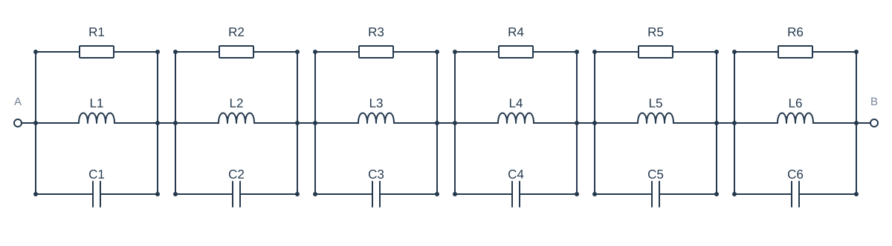
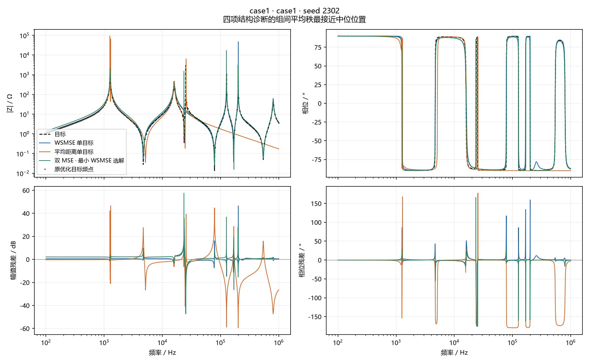

# case1 · seed 2302

选择原因：四项结构诊断的组间平均秩最接近中位位置。这是一个 seed 的三个选中解，不是均值曲线。

## 参数

| 元件 | 目标 | WSMSE | 距离 | 双MSE |
| --- | --- | --- | --- | --- |
| R1 | 2 kΩ | 61.953 Ω | 6.3108 kΩ | 1.521 kΩ |
| L1 | 1.585 mH | 264.97 nH | 4.9371 µH | 478.02 nH |
| C1 | 10 µF | 149.57 nF | 7.8451 µF | 96.552 µF |
| R2 | 3 kΩ | 1.0129 Ω | 92.774 kΩ | 2.163 kΩ |
| L2 | 10 µH | 100.31 nH | 662.67 µH | 2.0261 mH |
| C2 | 3.98 µF | 3.8476 µF | 24.312 µF | 7.7956 µF |
| R3 | 500 Ω | 289.22 Ω | 425.6 Ω | 48.197 Ω |
| L3 | 100 µH | 118.51 µH | 70.729 µH | 271.05 nH |
| C3 | 1 µF | 823.14 nF | 1.3982 µF | 147.41 nF |
| R4 | 1.2 kΩ | 47.734 kΩ | 75.921 Ω | 3.1823 kΩ |
| L4 | 2.512 µH | 1.2639 µH | 580.84 µH | 1.2951 µH |
| C4 | 631 nF | 495.68 nF | 28.045 µF | 492.92 nF |
| R5 | 800 Ω | 7.9216 kΩ | 65.002 kΩ | 342.72 Ω |
| L5 | 1.259 µH | 1.6853 mH | 310.57 µH | 139.18 µH |
| C5 | 501 nF | 9.3493 µF | 48.998 µF | 715.57 nF |
| R6 | 50 Ω | 308.69 Ω | 146.95 Ω | 17.197 kΩ |
| L6 | 251 nH | 2.4163 µH | 14.132 µH | 2.904 µH |
| C6 | 158 nF | 652.14 nF | 7.3442 µF | 550.13 nF |

## 本 seed 的诊断

| 组 | 原幅值MSE / dB² | 原相位MSE / rad² | 原距离 / Ω | 曲线幅值RMSE / dB | 曲线相位RMSE / ° | 幅值漏失/新增 | 相位漏失/新增 | 交互 η |
| --- | --- | --- | --- | --- | --- | --- | --- | --- |
| WSMSE 单目标 | 3.705 | 0.05723 | 3.597 | 2.479 | 16.1 | 2/0 | 2/2 | 0.9406 |
| 平均距离单目标 | 122.6 | 1.095 | 3.351 | 11.07 | 62.25 | 6/4 | 6/6 | 0.9291 |
| 双 MSE · 最小 WSMSE 选解 | 4.367 | 0.05595 | 4.431 | 2.991 | 16.24 | 0/0 | 0/0 | 0.9542 |

Case2仅使用原测量点；其他电路使用经加密复核的解析曲线。下排是同频残差，没有移动曲线来降低误差。
