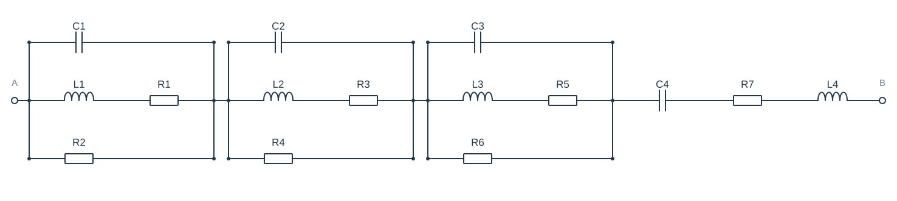
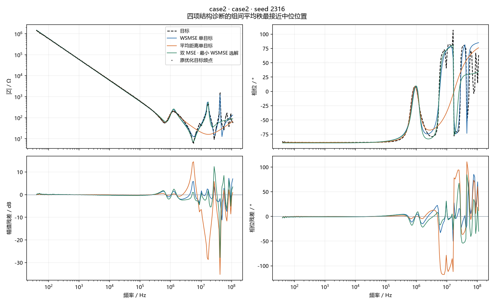

# case2 · seed 2316

选择原因：四项结构诊断的组间平均秩最接近中位位置。这是一个 seed 的三个选中解，不是均值曲线。

## 参数

| 元件 | 目标 | WSMSE | 距离 | 双MSE |
| --- | --- | --- | --- | --- |
| R1 | 实测 · 未知 | 10.468 mΩ | 8.7988 kΩ | 26.062 mΩ |
| R2 | 实测 · 未知 | 2.1229 kΩ | 865.61 Ω | 71.359 Ω |
| R3 | 实测 · 未知 | 19.365 Ω | 31.623 kΩ | 24.928 Ω |
| R4 | 实测 · 未知 | 494.39 Ω | 31.623 kΩ | 8.3954 kΩ |
| R5 | 实测 · 未知 | 10.235 mΩ | 4.6925 Ω | 108.15 mΩ |
| R6 | 实测 · 未知 | 944.8 Ω | 197.82 Ω | 4.0138 kΩ |
| R7 | 实测 · 未知 | 11.099 Ω | 15.765 Ω | 3.9571 Ω |
| L1 | 实测 · 未知 | 47.07 nH | 100.09 nH | 400.77 nH |
| L2 | 实测 · 未知 | 11.338 µH | 771.09 nH | 9.8886 µH |
| L3 | 实测 · 未知 | 457.6 nH | 13.629 µH | 307.13 nH |
| L4 | 实测 · 未知 | 213.28 nH | 95.52 nH | 62.952 nH |
| C1 | 实测 · 未知 | 302.72 pF | 90.667 nF | 1.4109 pF |
| C2 | 实测 · 未知 | 1.5932 nF | 83.728 nF | 1.6654 nF |
| C3 | 实测 · 未知 | 199.97 pF | 1.3959 nF | 294.93 pF |
| C4 | 实测 · 未知 | 2.6793 nF | 2.7718 nF | 2.6852 nF |

## 本 seed 的诊断

| 组 | 原幅值MSE / dB² | 原相位MSE / rad² | 原距离 / Ω | 曲线幅值RMSE / dB | 曲线相位RMSE / ° | 幅值漏失/新增 | 相位漏失/新增 | 交互 η |
| --- | --- | --- | --- | --- | --- | --- | --- | --- |
| WSMSE 单目标 | 3.401 | 0.06877 | 3413 | 1.815 | 15.01 | 5/0 | 8/0 | — |
| 平均距离单目标 | 35.72 | 0.3991 | 1473 | 5.989 | 36.26 | 9/0 | 12/0 | — |
| 双 MSE · 最小 WSMSE 选解 | 8.287 | 0.08169 | 3293 | 2.877 | 16.35 | 7/0 | 10/0 | — |

Case2仅使用原测量点；其他电路使用经加密复核的解析曲线。下排是同频残差，没有移动曲线来降低误差。
