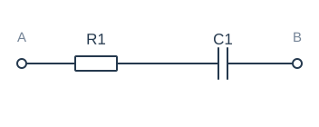
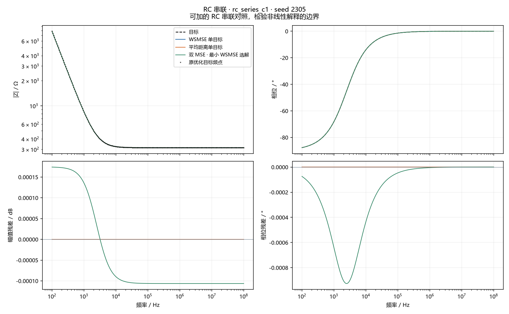

# RC 串联 · seed 2305

选择原因：可加的 RC 串联对照，检验非线性解释的边界。这是一个 seed 的三个选中解，不是均值曲线。

## 参数

| 元件 | 目标 | WSMSE | 距离 | 双MSE |
| --- | --- | --- | --- | --- |
| R1 | 313.91 Ω | 313.91 Ω | 313.91 Ω | 313.9 Ω |
| C1 | 202.85 nF | 202.85 nF | 202.85 nF | 202.85 nF |

## 本 seed 的诊断

| 组 | 原幅值MSE / dB² | 原相位MSE / rad² | 原距离 / Ω | 曲线幅值RMSE / dB | 曲线相位RMSE / ° | 幅值漏失/新增 | 相位漏失/新增 | 交互 η |
| --- | --- | --- | --- | --- | --- | --- | --- | --- |
| WSMSE 单目标 | 5.12e-27 | 1.728e-30 | 3.917e-12 | 7.16e-14 | 7.558e-14 | 0/0 | 0/0 | 0 |
| 平均距离单目标 | 5.522e-26 | 5.089e-29 | 1.194e-11 | 2.356e-13 | 4.096e-13 | 0/0 | 0/0 | 0 |
| 双 MSE · 最小 WSMSE 选解 | 1.295e-08 | 3.76e-11 | 0.01441 | 0.0001136 | 0.0003521 | 0/0 | 0/0 | 0 |

Case2仅使用原测量点；其他电路使用经加密复核的解析曲线。下排是同频残差，没有移动曲线来降低误差。
