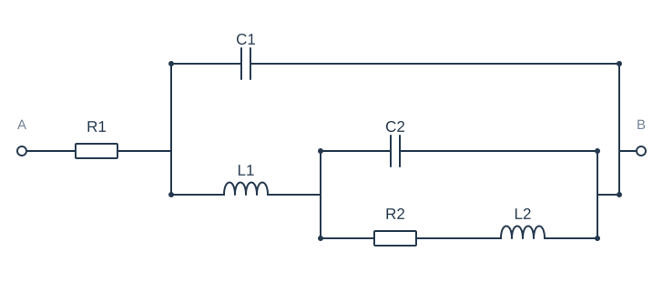
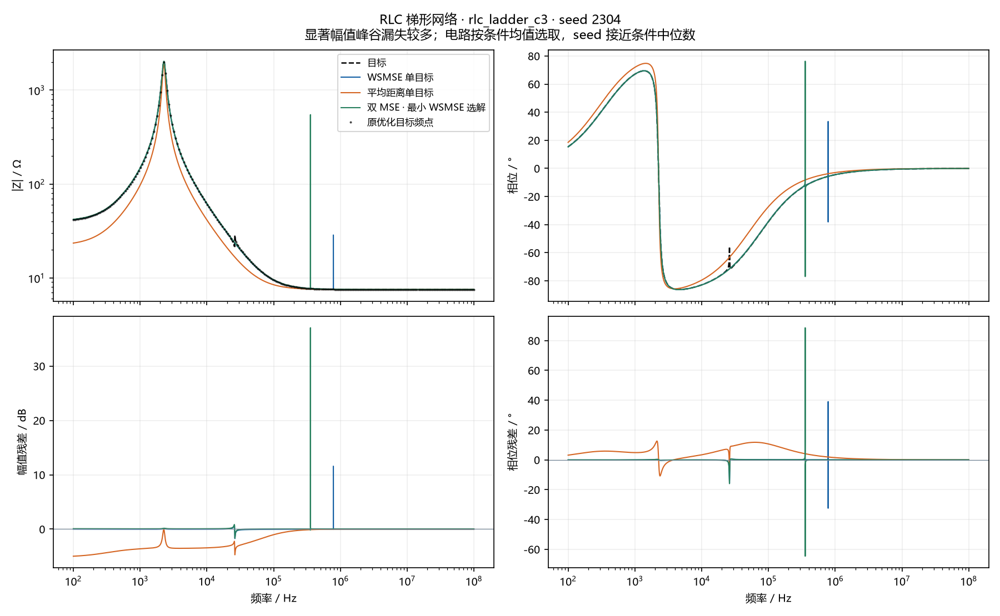

# RLC 梯形网络 · seed 2304

选择原因：显著幅值峰谷漏失较多；电路按条件均值选取，seed 接近条件中位数。这是一个 seed 的三个选中解，不是均值曲线。

## 参数

| 元件 | 目标 | WSMSE | 距离 | 双MSE |
| --- | --- | --- | --- | --- |
| R1 | 7.5048 Ω | 7.495 Ω | 7.518 Ω | 7.5343 Ω |
| C1 | 272.61 nF | 274.55 nF | 411.48 nF | 271.23 nF |
| L1 | 10.657 mH | 488.54 µH | 11.641 mH | 220.53 µH |
| C2 | 8.6419 nF | 86.714 pF | 86.777 pF | 921.43 pF |
| R2 | 32.551 Ω | 32.601 Ω | 14.688 Ω | 32.894 Ω |
| L2 | 7.2133 mH | 17.336 mH | 323.03 µH | 17.766 mH |

## 本 seed 的诊断

| 组 | 原幅值MSE / dB² | 原相位MSE / rad² | 原距离 / Ω | 曲线幅值RMSE / dB | 曲线相位RMSE / ° | 幅值漏失/新增 | 相位漏失/新增 | 交互 η |
| --- | --- | --- | --- | --- | --- | --- | --- | --- |
| WSMSE 单目标 | 0.004633 | 4.369e-05 | 0.3628 | 0.08177 | 0.5252 | 2/2 | 2/2 | 0.9988 |
| 平均距离单目标 | 6.282 | 0.00842 | 23.35 | 2.505 | 5.281 | 2/0 | 2/0 | 0.7727 |
| 双 MSE · 最小 WSMSE 选解 | 0.00703 | 4.49e-05 | 0.8509 | 0.1276 | 0.7802 | 2/2 | 2/2 | 0.9986 |

Case2仅使用原测量点；其他电路使用经加密复核的解析曲线。下排是同频残差，没有移动曲线来降低误差。
