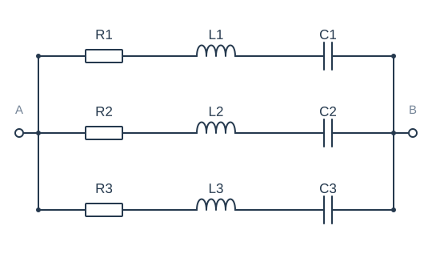
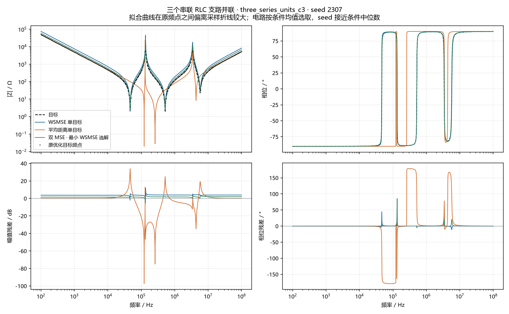

# 三个串联 RLC 支路并联 · seed 2307

选择原因：拟合曲线在原频点之间偏离采样折线较大；电路按条件均值选取，seed 接近条件中位数。这是一个 seed 的三个选中解，不是均值曲线。

## 参数

| 元件 | 目标 | WSMSE | 距离 | 双MSE |
| --- | --- | --- | --- | --- |
| R1 | 2.0129 Ω | 2.9924 Ω | 27.556 mΩ | 2.4665 Ω |
| L1 | 411.79 µH | 40.774 µH | 13.916 µH | 491.57 µH |
| C1 | 28.574 nF | 2.3283 nF | 27.367 nF | 24.059 nF |
| R2 | 1.8641 Ω | 1.9594 Ω | 19.759 mΩ | 26.441 Ω |
| L2 | 25.924 µH | 633.25 µH | 349.88 µH | 16.52 µH |
| C2 | 3.662 nF | 18.773 nF | 4.8709 nF | 47.154 pF |
| R3 | 22.594 Ω | 32.935 Ω | 8.3855 Ω | 2.3676 Ω |
| L3 | 12.968 µH | 20.257 µH | 23.325 µH | 31.621 µH |
| C3 | 59.061 pF | 37.483 pF | 57.698 pF | 2.9958 nF |

## 本 seed 的诊断

| 组 | 原幅值MSE / dB² | 原相位MSE / rad² | 原距离 / Ω | 曲线幅值RMSE / dB | 曲线相位RMSE / ° | 幅值漏失/新增 | 相位漏失/新增 | 交互 η |
| --- | --- | --- | --- | --- | --- | --- | --- | --- |
| WSMSE 单目标 | 14.47 | 0.000164 | 2230 | 3.819 | 2.811 | 0/0 | 0/0 | 0.7702 |
| 平均距离单目标 | 120.9 | 1.283 | 142.8 | 11.05 | 65.54 | 2/2 | 0/0 | 0.9249 |
| 双 MSE · 最小 WSMSE 选解 | 2.974 | 0.0003959 | 837.7 | 1.739 | 2.879 | 0/0 | 0/0 | 0.6923 |

Case2仅使用原测量点；其他电路使用经加密复核的解析曲线。下排是同频残差，没有移动曲线来降低误差。
