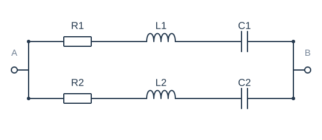
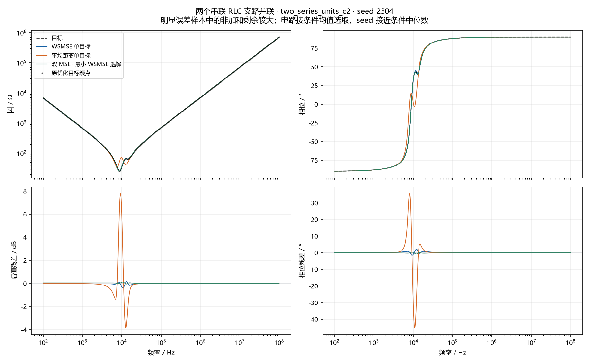

# 两个串联 RLC 支路并联 · seed 2304

选择原因：明显误差样本中的非加和剩余较大；电路按条件均值选取，seed 接近条件中位数。这是一个 seed 的三个选中解，不是均值曲线。

## 参数

| 元件 | 目标 | WSMSE | 距离 | 双MSE |
| --- | --- | --- | --- | --- |
| R1 | 26.183 Ω | 26.198 Ω | 38.318 Ω | 122.76 Ω |
| L1 | 1.6414 mH | 1.5566 mH | 3.007 mH | 3.5571 mH |
| C1 | 198.93 nF | 207.96 nF | 141.41 nF | 37.568 nF |
| R2 | 124.36 Ω | 129.08 Ω | 48.69 Ω | 26.266 Ω |
| L2 | 3.7002 mH | 4.2225 mH | 1.8284 mH | 1.673 mH |
| C2 | 35.704 nF | 30.279 nF | 93.217 nF | 195.66 nF |

## 本 seed 的诊断

| 组 | 原幅值MSE / dB² | 原相位MSE / rad² | 原距离 / Ω | 曲线幅值RMSE / dB | 曲线相位RMSE / ° | 幅值漏失/新增 | 相位漏失/新增 | 交互 η |
| --- | --- | --- | --- | --- | --- | --- | --- | --- |
| WSMSE 单目标 | 0.007278 | 3.205e-05 | 21.62 | 0.08527 | 0.325 | 0/0 | 0/0 | 0.8367 |
| 平均距离单目标 | 0.9447 | 0.0125 | 2.249 | 0.974 | 6.419 | 0/2 | 0/2 | 0.9998 |
| 双 MSE · 最小 WSMSE 选解 | 0.001118 | 3.27e-06 | 39.97 | 0.03342 | 0.1038 | 0/0 | 0/0 | 0.9957 |

Case2仅使用原测量点；其他电路使用经加密复核的解析曲线。下排是同频残差，没有移动曲线来降低误差。
