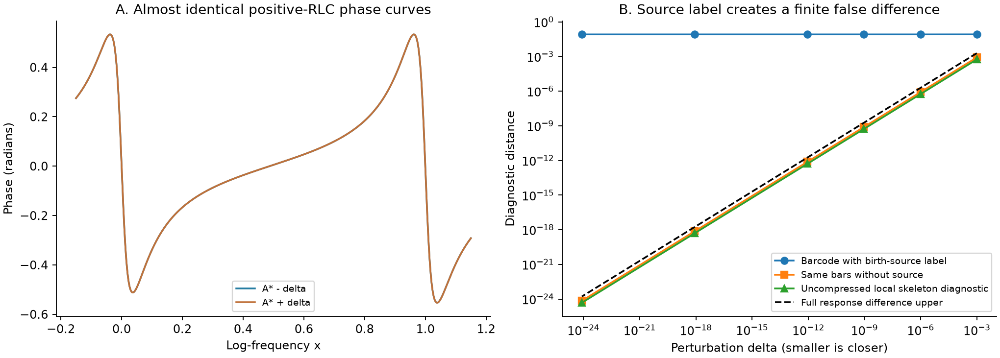

> 2026-11-08 精选归档：以下为原日期研究记录；“active／下一步／完成”等是当时状态。现行结论见[研究现状](../../docs/研究现状_20261108.md)。此目录是核心阅读与复核材料，原运行包未全量附带；JSON中的历史路径/证书不是本次重跑证明。

# 本轮最后一项：成组过程的source标签换序审计

2026-11-02。按用户要求完成本轮并进入总结，不启动下一轮候选实验。研究总体目标未完成。

一个自然的过程表示也被提前排除：把phase上水平集的elder条形图附上birth峰的source频率。两个相位峰几乎等高时，极小物理扰动改变哪个峰继承较长条形；源标签突然互换，造成有限假差异。不是求根或有限精度噪声。

控制来自完整正端口F=1+2/(1+i20sinh(ln10 x))+A/(1+i20sinh(ln10(x−1)))。等高校准A约2.14702234492543，两个峰的x约−.0379171182和.9620881524。A_star±2^-k，k10/20/30/40/60/80，形成12个物理控制状态；80/120两精度共24条state记录、12条成对比较。原SUMMARY的physical_positive_RLC_states=24实际计了精度重复，原文件保留，本收尾记录明确纠正口径。

delta=2^-80时，完整响应的全频差上界只有1.65436e-24，复log差也同界；无source条形距离约7.05e-25，未压缩critical骨架局部诊断约4.76e-25。source标记条形距离仍约.08270857518，其极限等于两处不同合并谷深差的两倍。

每个状态从完整实P/Q的7次critical多项式核查全部7个根，4个正频critical均在观察窗内；用直接正元件网络、mp.diff、80/120位精化和全部部分匹配穷举/SciPy dummy指派复核。不是只追踪两个想要的峰，也不是把高精度重复计成独立电路样本。

拒绝仅限这个elder条形加单birth源标签的表示。普通无标记条形在这批控制中趋于一致，未压缩骨架只是局部诊断，均不能直接升为新的辅助指标；没有证明所有phase树/过程分组不可能。此项只用于避免下一步把不连续的标签误作稳定过程，没有新实际40/440或优化评价。

本轮主要结果另见[复log切向正RLC连续反例](../log_tangent_rlc_witness_20261101/REPORT.md)。所有科学任务已终态，本轮全本地，不占用服务器。源、校准、控制、数值和计数说明全量保留。

