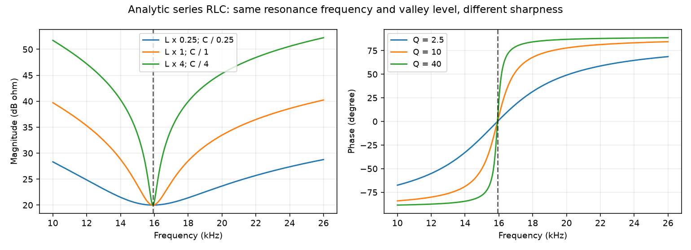
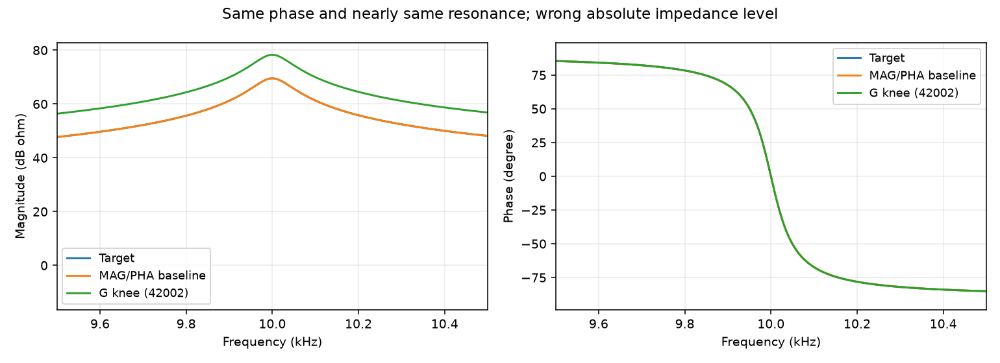
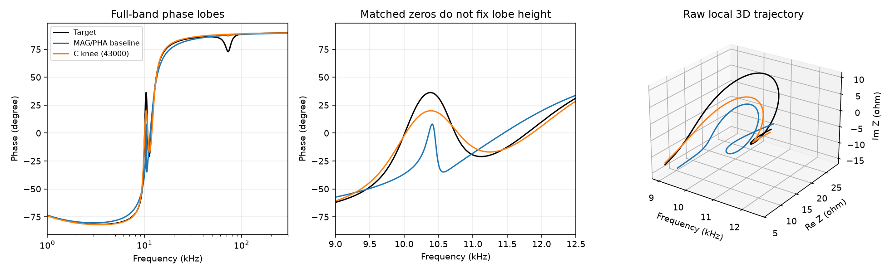
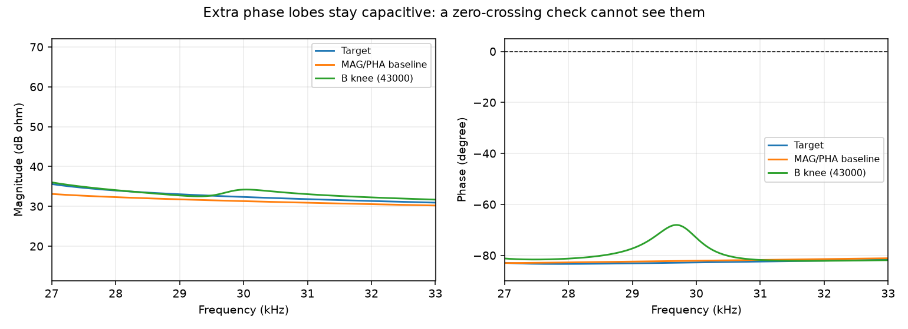

# 继续追问：没拟合好的曲线，对应什么电路状态？

2026年10月11日。本轮在本地完成物理状态诊断和参数干预，没有新增300代拟合优化，也没有上传网站。

**这次得到一个更具体的方向：除了谐振相关的幅值峰谷，还应该检查相位曲线的局部峰谷。它们描述的是端口容性、感性作用的相对强弱；这种强弱变化即使没有产生新的电抗过零，也可能明显拟合错。**

这是得到证据支持的候选方向，尚未证明把它加入优化就能改善结果。另一个发现是：有些错误主要表现为绝对阻抗尺度不对，需要与谐振结构错误、最终选解的影响分别处理。

## 1. 这次做了什么？为什么先在本地做？

我们已经有很多优化后的曲线，可以直接检查，不必先重跑搜索。

本轮用了三轮实验的全部252条最终代表，仍使用原来的MAG/PHA膝点；没有明确膝点的代表仍保留原退化规则。这252条来自不同电路、方法和seed的任务，**不是252个独立seed**。主要统计看最新一轮140条，前两轮用于补充解释，不合并成一个成功率。

另生成105条参数干预响应：在两个简单RLC与五个已有目标上，分别改变电阻、互相反向改变L/C、同向改变L/C，倍率为0.25、0.5、1、2、4。倍率1是重复的参照，不是新的独立样本。

看到第一轮诊断后，又补充35条整体阻抗尺度响应，以及相位峰谷检查。这个补充是**看到结果后提出的探索**，不冒充预先预测成功。复核还用了14个非整倍数尺度变换。

原诊断和补充计算的有效运行时间分别约14秒、12秒，另有绘图与独立核验。本轮不需要服务器；真正验证新辅助指标的搜索效果，才需要另安排优化预算。

电路结构图、目标参数见[电路资料](TARGETS.md)。原优化结论见[膝点版通俗报告](../mse_structure_step3_knee_20261011/FINDINGS.md)。

## 2. 先理解三个“状态”

阻抗写成Z＝R＋jX。这里R、X是整个电路在端口看到的实部和虚部，不是某两个元件的名称。

- **过零位置：** X由负变正，或由正变负的频率。它表示端口容性、感性作用的转换。
- **阻性水平：** 在X＝0处，端口的R是多少。同样呈阻性，10 Ω与100 Ω并不一样。
- **转变陡峭程度：** 经过这个点时，相位变化有多快。用κ表示，单位是弧度/自然对数频率；绝对值越大，局部转向越快。

在两种简单RLC里，κ可以与品质因数Q联系起来。在复杂嵌套电路中，本报告只把它叫端口转变陡峭程度，**不把它直接当成某个内部模式的Q**。

下面的“报警”只是为了说明问题：位置偏差超过0.02 decade、阻性水平偏差超过3 dB、陡峭程度超过目标两倍或低于一半。这些后两项是新的粗诊断标签，不是原实验的成功标准，更不等于已经确定了物理容差。

## 3. 猜想一：谐振的位置、尖锐程度和阻性水平，需要分开检查

### 简单电路支持这个区分

在串联RLC中，L乘4、C除4时，LC的乘积不变，谐振频率保持不变；电阻不变，谷底阻抗也不变。但是Q从10变为40，阻抗谷明显变窄，相位转向更陡。

因此，位置正确不代表尖锐程度正确；高度或深度正确也不代表完整结构正确。30个简单RLC控制结果与解析公式一致。

### Case1的失败曲线也确实有这些问题

最新轮基础MAG/PHA的4条代表中，两条在重点区域内缺少可匹配的同方向过零；另两条能找到过零，但阻性水平和陡峭程度都有明显偏差。

固定seed 43000的一个重点过零如下：

|检查项|目标|基础MAG/PHA代表|
|---|---:|---:|
|过零频率|25.2277 kHz|24.9614 kHz|
|过零处实部|3000.18 Ω|109.68 Ω|
|转变陡峭程度的绝对值|3784.86|159.54|

频率看起来只差约1%，但目标的转向极其集中。按目标局部角度切线尺度衡量，这个频移约为40个尺度，不能因为小于全局频率容差就当成局部对齐。这个数描述局部尺度，**不代表实际相位误差就是40弧度**。

梯形网络的4条基础代表，则都缺少重点区域的两个同方向转换事件。这里“缺少”指固定目标区域内没找到匹配，不保证候选在其他区域完全没有过零。

这使“事件是否存在、位置是否合适、局部转向是否合适”成为有依据的诊断方向，但仍没有证明相应辅助目标能帮助优化。

### 嵌套电路不能直接套用简单RLC的调参规则

例如梯形网络里，把指定L乘2、C除2，即使这对LC的乘积不变，也会使一个可匹配的过零移动约0.123 decade，并使另一个在原区域内无法匹配。其他支路改变了端口响应。

所以，保持某一对LC乘积不变，不保证复杂电路的端口事件位置不变；同一操作也不能只归因于峰宽变化。

## 4. 猜想二：有些错误是整体阻抗尺度不对，相位却可以几乎正确

对本轮的理想线性RLC串并联电路，如果把所有R、L乘s，同时把所有C除s，那么每个元件的阻抗都变成原来的s倍，整个网络也满足：

\[
Z_{新}(f)=sZ_{原}(f).
\]

这会改变幅值，却保持相位和事件频率。它是可以逐层推导的电路关系，不是从少量样本猜出来的统计规律。

七个目标的35条尺度控制均通过；原倍率都是2的整数幂，部分浮点计算能恰好得到零残差。因此又独立检查0.7、1.3这两个非整倍数，14次节点法复核的最大相对偏差约8×10⁻¹²，排除了只依赖整倍数巧合的核验。

修订轮简单并联RLC的G组、seed 42002，正好表现出接近这种尺度偏差：R约为目标2.737倍，L约2.721倍，C约0.368倍。不是完全一致的尺度变换，但非常接近。

它的过零频率和陡峭程度接近目标，过零处实部却为目标2.737倍；相位误差很小，幅值RMSE约8.69 dB。

**这解释了曲线错在哪里，但不解释优化和选解为什么最终留下它。** MAG本来就检查幅值；前一轮已发现膝点归一化可能偏向这种幅相取舍。因此，不能看到这例就说“必须再加一个阻性水平指标”，也不能把选解问题全部归给MSE。

## 5. 猜想三：过零点之间的容感强弱，也可能没有恢复

过零检查告诉我们“什么时候换了一边”。但换边后，电路表现得多感性、多容性，还可以不同。

正弦稳态下，端口无功功率与有功功率的比值为X/R＝tanφ。因此，相位曲线的局部峰谷，可以描述这种相对强弱的局部极值。相关功率关系见[澳大利亚国立大学电路讲义](https://users.cecs.anu.edu.au/~Matthew.James/engn2211-2002/notes/acnode9.html)。这里的无功功率不是品质因数Q，也不是内部电感、电容储能之比。

### 混合支路：过零都能对上，相位峰仍偏低

最新轮C组的固定seed 43000，通过了原重点幅值峰谷和全频幅值事件检查。三个目标过零都可匹配，按本轮粗诊断也没有报警；不过它们并非精确重合，实部和陡峭程度仍有偏差。

进一步看相位极值：

|结构|目标|C组代表|
|---|---:|---:|
|约10.38 kHz的相位峰|36.28°|19.99°|
|约11.12 kHz的相位谷|−21.03°|−16.93°|
|约46.32、72.54 kHz的一组相位起伏|突出程度约13.42°|未检出达到5°门槛的同类事件|

局部相位峰对应的X/R，目标约0.734，候选约0.364。也就是说，虽然两者都进入感性一侧，候选的相对感性程度明显不足。

高频那组起伏更值得注意：目标相位从约86.28°降到72.86°，**始终保持感性，没有新增过零**，但X/R由约15.39降到3.24。这种强弱变化，单看过零存在与方向会漏掉。

“未检出”表示固定区域内没有达到5°显著性门槛的同类事件，不等于候选在那里绝对平直。这个例子也不证明其三个过零的全部特征已经正确；它证明了还有一类可单独描述的非零相位结构。

### 三级网络：额外起伏始终在容性一侧

B组固定seed 43000，在约29.69 kHz出现−68.06°的额外相位峰，在约31.73 kHz出现−82.15°的额外相位谷。两者都为负，局部起伏突出程度约13.55°。

它一直呈容性，电抗没有为这组起伏新增过零。**因此，“没有多出过零”不能代替“没有多出局部响应结构”。** 这4个B组seed都检出了额外的、达到5°门槛的相位极值。

## 6. 这些例子是否反复出现？

最新轮140条代表中，37条通过原全频幅值事件检查，但没有通过原全频相位事件检查。本轮分别看过零状态，以及至少5°显著的相位峰谷：

|电路|上述曲线条数|过零状态粗诊断报警|相位峰谷诊断报警|
|---|---:|---:|---:|
|梯形网络|2|0|1|
|混合支路|15|2|15|
|三级网络|20|2|11|
|合计|37|4|27|

这说明非零相位结构值得单独看，不能把所有相位问题简化为“过零没调好”。但是：

- 两种诊断的特征和阈值不同，27与4不能当作准确率比较，也不证明新指标一定更有效。
- 同一seed、不同方法的曲线相互关联，37条不是37次独立重复。
- 还有10条没有被这项相位峰谷诊断标记。它们可能涉及转变宽度、速度或小于5°的变化，需要进一步区分实际影响。
- 原相位事件检查基于导数，小角度起伏也可能被标记为失败；不能把每个原失败都说成严重物理错误。

## 7. 现在可以提出哪些更有依据的指标方向？

仍然从原始三维线（频率、实部、虚部）提取特征，不自行旋转、平移或缩放候选，不移动目标检查区间。基础目标保持MAG/PHA，最终代表保持当前膝点规则。

|方向|检查什么|这轮提供的依据|当前定位|
|---|---|---|---|
|谐振与转换事件的位置、类型|幅值峰谷、过零是否存在、方向和频率是否合适|Case1、梯形网络存在重复缺失或局部错位|PTC、I-03为已有参考，不当作新发现|
|局部转变陡峭程度|对应过零处相位转向有多快|Case1的转向可远低于目标，简单RLC可推导联系|有物理条件的候选，复杂网络不直接称Q|
|事件处的阻性水平|呈阻性时端口阻抗是多少|尺度控制与简单RLC错误代表|诊断价值明确，优化价值可能与MAG重叠|
|相位极值结构一致性|非零相位峰谷的存在、位置、角度和额外事件|混合支路漏失、偏低；三级网络多出容性起伏|本轮新增的优先候选方向，尚无优化增益证据|

最后一个方向与PTC的关系很直接：PTC关注幅值峰谷及谐振位置；这里关注**相位峰谷及端口容感作用的相对强弱**。这是一种借鉴，不宣称相位极值检查在文献中全新。

它也不同于此前T的宽区间累计角度：要明确保留“有没有对应事件、出现在何处、极值达到多少、有无额外事件”的分项信息。仍可能与T、PHA重叠，是否提供额外帮助需直接对照。

解释时可以使用X/R或X/|Z|；正式评分不应未经验证就改用它们替代角度。X/R在接近±90°时容易放大误差，sinφ在同一区域又会压缩角度差异。物理解释不能取代数值稳定性检查。

本轮没有冻结新优化分数。目标事件的可靠性、缺失惩罚、错位尺度、额外事件处理和聚合规则还需要明确；不能把诊断表直接变成第三个目标开跑。

## 8. 下一步的方向更清楚了，但还剩什么？

1. 先区分剩余缺陷：有些是事件缺失或错位，有些是容感强弱不足，有些是额外起伏，有些主要是阻抗尺度或最终选解。分别记录，不统称“MSE失败”。
2. 为相位极值、局部陡峭程度分别定义一个完整的候选分数，在已知错误和正确曲线上检查反应、缺失时的引导、噪声与采样稳定性。
3. 再进行同seed、同初始化、同预算的配对搜索。对照包含MAG/PHA基础组及PTC、I-03等已有特征参考；各新增项先单独试，证明互补后才组合。
4. 全频检查局部修复和窗口外副作用；区分搜索与膝点选解的影响，再用未参与设计的条件、实测数据检查推广。

与四个主线问题对应：这轮把困难结构细分到了具体端口状态，确认简单电路解释在复杂网络中有条件限制；新增指标是否改善搜索、能否推广及实际成本，仍没有完成验证。

## 9. 怎样复算？有没有故障影响结论？

所有252条代表、105条原干预和35条尺度控制的检查完成，两级网格检查通过。过零特征用解析电路计算和独立节点法核验；1086个相位极值也做了节点法相位核验，最大角度差约1×10⁻⁸度。778项输入哈希已核对，原代表、原分数及成功门槛保持不变。

补充程序发生过两次启动/提取故障，均保留了失败源码和记录；修复后全批重算，没有放宽门槛，也没有修改旧实验数据。详见[问题与处理](ISSUES.md)。

逐曲线与逐事件数据、控制结果、运行约定见[数据索引](DATA.md)。本报告的新增方向仍是开发数据上的探索结果，没有实测、噪声或未见电路的推广结论。
