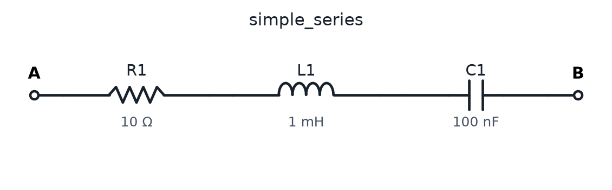
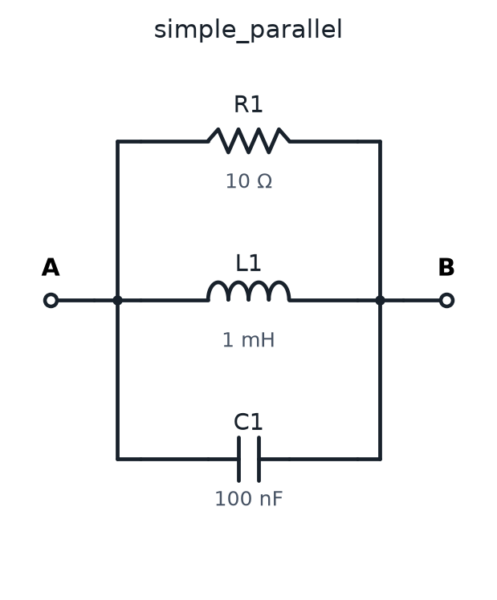
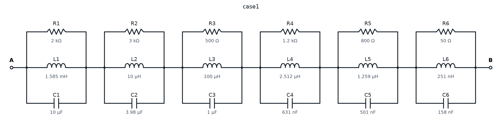
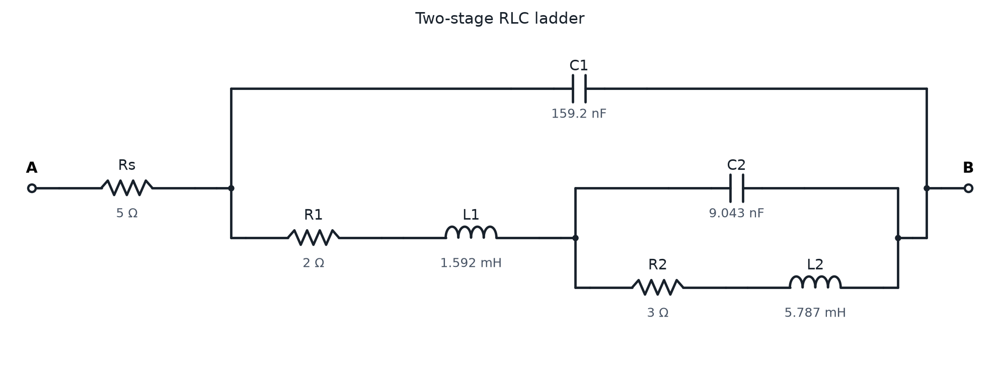
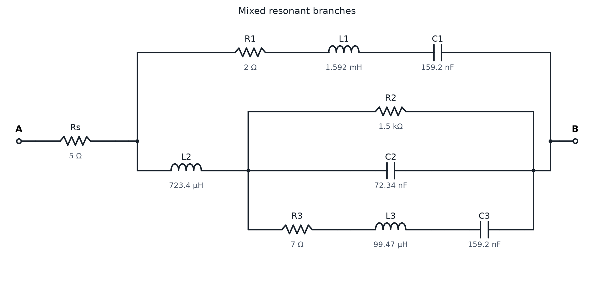
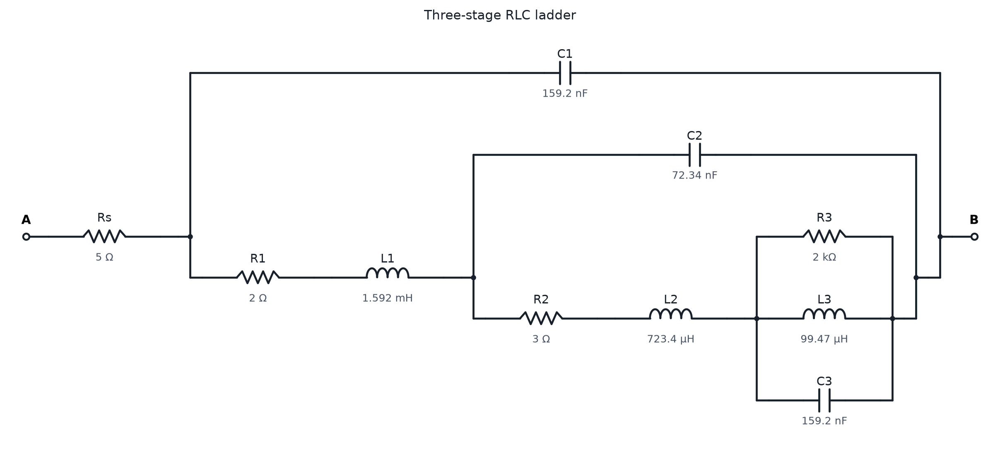
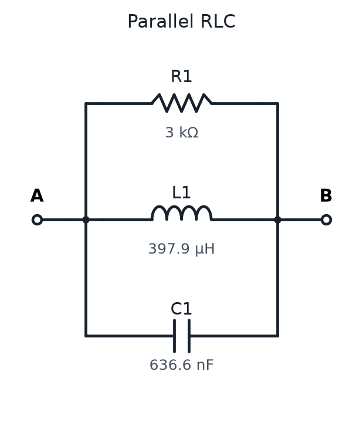

# 本轮的电路与目标参数

2026-10-11。表和普通电路图均从本轮冻结的目标参数、串并联树自动生成；连接关系通过原电路图工具的校验。
目标倍率是前期已生成的目标条件，本轮没有重新改变原优化目标。下面的参数是干预倍率1的参照；105条干预中的变化参数另见各目标details JSON。

## 简单串联RLC控制

标识：simple_series。

|元件|便于阅读的值|原始SI值|
|---|---:|---:|
|R1|10 Ω|10 Ω|
|L1|1 mH|0.001 H|
|C1|100 nF|1e-07 F|

原干预的电阻元件：R1；LC干预元件：L1、C1。
这是选定干预元件的名称，不表示该电阻唯一决定全电路阻尼，也不表示这对LC唯一决定端口谐振。

[完整目标和逐曲线状态](details/simple_series.json)

## 简单并联RLC控制

标识：simple_parallel。

|元件|便于阅读的值|原始SI值|
|---|---:|---:|
|R1|10 Ω|10 Ω|
|L1|1 mH|0.001 H|
|C1|100 nF|1e-07 F|

原干预的电阻元件：R1；LC干预元件：L1、C1。
这是选定干预元件的名称，不表示该电阻唯一决定全电路阻尼，也不表示这对LC唯一决定端口谐振。

[完整目标和逐曲线状态](details/simple_parallel.json)

## Case1：六个并联RLC模块串联

标识：case1。

|元件|便于阅读的值|原始SI值|
|---|---:|---:|
|R1|2 kΩ|2000 Ω|
|L1|1.585 mH|0.001585 H|
|C1|10 µF|1e-05 F|
|R2|3 kΩ|3000 Ω|
|L2|10 µH|1e-05 H|
|C2|3.98 µF|3.98e-06 F|
|R3|500 Ω|500 Ω|
|L3|100 µH|0.0001 H|
|C3|1 µF|1e-06 F|
|R4|1.2 kΩ|1200 Ω|
|L4|2.512 µH|2.512e-06 H|
|C4|631 nF|6.31e-07 F|
|R5|800 Ω|800 Ω|
|L5|1.259 µH|1.259e-06 H|
|C5|501 nF|5.01e-07 F|
|R6|50 Ω|50 Ω|
|L6|251 nH|2.51e-07 H|
|C6|158 nF|1.58e-07 F|

原干预的电阻元件：R2；LC干预元件：L2、C2。
这是选定干预元件的名称，不表示该电阻唯一决定全电路阻尼，也不表示这对LC唯一决定端口谐振。

[完整目标和逐曲线状态](details/case1.json)

## 两级梯形网络（既有倍率8目标）

标识：ladder8。

|元件|便于阅读的值|原始SI值|
|---|---:|---:|
|Rs|5 Ω|5 Ω|
|C1|159.2 nF|1.59154943092e-07 F|
|R1|2 Ω|2 Ω|
|L1|1.592 mH|0.00159154943092 H|
|C2|9.043 nF|9.04289449386e-09 F|
|R2|3 Ω|3 Ω|
|L2|5.787 mH|0.00578745247607 H|

原干预的电阻元件：R2；LC干预元件：L2、C2。
这是选定干预元件的名称，不表示该电阻唯一决定全电路阻尼，也不表示这对LC唯一决定端口谐振。

[完整目标和逐曲线状态](details/ladder8.json)

## 混合嵌套支路（既有倍率0.25目标）

标识：mixed0p25。

|元件|便于阅读的值|原始SI值|
|---|---:|---:|
|Rs|5 Ω|5 Ω|
|R1|2 Ω|2 Ω|
|L1|1.592 mH|0.00159154943092 H|
|C1|159.2 nF|1.59154943092e-07 F|
|L2|723.4 µH|0.000723431559509 H|
|R2|1.5 kΩ|1500 Ω|
|C2|72.34 nF|7.23431559509e-08 F|
|R3|7 Ω|7 Ω|
|L3|99.47 µH|9.94718394324e-05 H|
|C3|159.2 nF|1.59154943092e-07 F|

原干预的电阻元件：R3；LC干预元件：L3、C3。
这是选定干预元件的名称，不表示该电阻唯一决定全电路阻尼，也不表示这对LC唯一决定端口谐振。

[完整目标和逐曲线状态](details/mixed0p25.json)

## 三级嵌套网络（既有倍率0.25目标）

标识：three0p25。

|元件|便于阅读的值|原始SI值|
|---|---:|---:|
|Rs|5 Ω|5 Ω|
|C1|159.2 nF|1.59154943092e-07 F|
|R1|2 Ω|2 Ω|
|L1|1.592 mH|0.00159154943092 H|
|C2|72.34 nF|7.23431559509e-08 F|
|R2|3 Ω|3 Ω|
|L2|723.4 µH|0.000723431559509 H|
|R3|2 kΩ|2000 Ω|
|L3|99.47 µH|9.94718394324e-05 H|
|C3|159.2 nF|1.59154943092e-07 F|

原干预的电阻元件：R3；LC干预元件：L3、C3。
这是选定干预元件的名称，不表示该电阻唯一决定全电路阻尼，也不表示这对LC唯一决定端口谐振。

[完整目标和逐曲线状态](details/three0p25.json)

## 既有简单并联RLC目标（倍率0.25）

标识：control0p25。

|元件|便于阅读的值|原始SI值|
|---|---:|---:|
|R1|3 kΩ|3000 Ω|
|L1|397.9 µH|0.00039788735773 H|
|C1|636.6 nF|6.36619772368e-07 F|

原干预的电阻元件：R1；LC干预元件：L1、C1。
这是选定干预元件的名称，不表示该电阻唯一决定全电路阻尼，也不表示这对LC唯一决定端口谐振。

[完整目标和逐曲线状态](details/control0p25.json)

