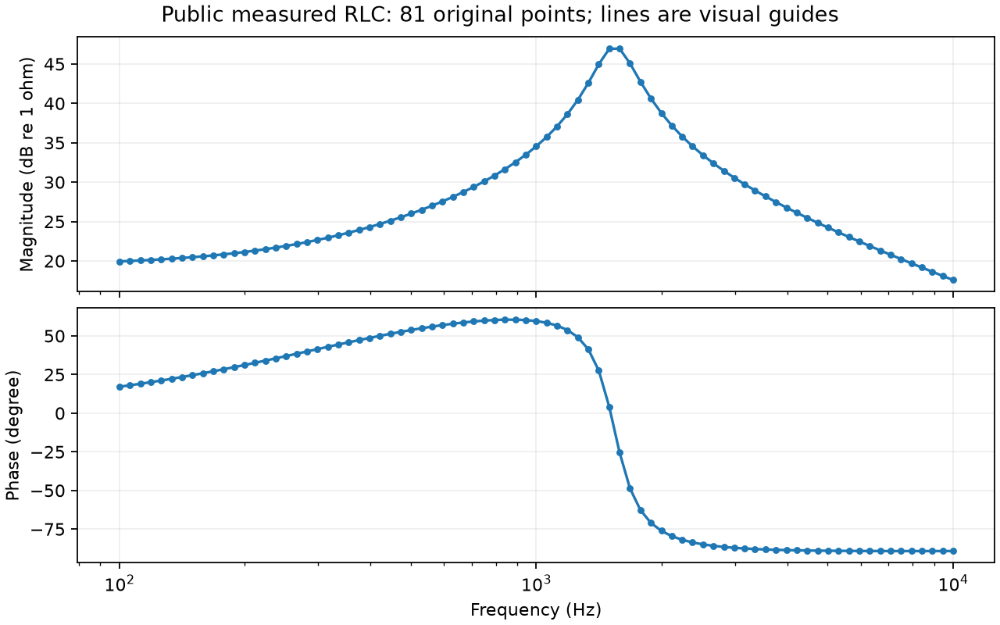

# 下一步怎样做：把“看不见”与“拟合不好”分开

这份说明承接[初学者说明](../../docs/阻抗拟合研究_初学者说明.md)，讨论真实测量的困难，并记录2026年10月8日完成的一次小实验。这里只解释已有曲线的采样检查，并准备公开数据，没有重新运行优化，也没有发布网站。

**你的两点担心都需要保留，但理论电路和实测数据要走两条不同的路线。** 在理论电路上，我们可以随时计算新频率；拿着一份已经测完的数据文件，则不能靠插值补出真正的新测量。另一方面，自己的拟合电路仍然可以随时重新计算，这个能力不受实测目标点数的限制。

## 1. 我们说的“自适应采样”，到底在采谁？

自适应采样，可以理解为：先稀疏地检查，遇到变化快的地方再加密检查。它不是一开始就在所有地方放很多点。

但有三个不同对象：

| 对象 | 能否计算或取得新点？ | 新点代表什么？ |
| --- | --- | --- |
| Case1这样的理论目标 | 能，调用已知电路公式即可 | 该理论目标在新频率上的真实计算值 |
| 已下载的实测目标 | 仅凭文件不能，需要原设备或新的测量 | 插值只是一种估计，不是真正新测量 |
| 我们自己生成的拟合电路 | 能，参数已在程序中 | 当前候选电路在新频率上的响应 |

因此，“实测目标难以自适应采样”是现实限制；但这不意味着所有真实实验都绝对不能加测。能否加测取决于设备、测量机会和成本。对于目前只有离线文件的研究，我们先按不能补测处理。

你提出先在Case1上做，是合适的起点。不过，即使Case1实验成功，也只能证明在“目标可随时计算”的条件下可行，不能直接宣布已解决真实测量的漏峰。

## 2. 先做了一个小实验：我们能否把候选曲线看清楚？

这里的“候选曲线”就是程序已经找到的那条拟合曲线。

本轮不重新调参数，而是拿Case1已有100个seed的300代结果，检查同一条曲线在不同采样方式下，能否被采样点之间的连线正确表达。主图选法和另一种平衡选法各检查100条，两组来自相同100个seed，不能算成200次独立优化。

另外单独检查一条Case1目标曲线。

### 比较了四种方法

1. **原始180点**：仍在原先那180个频率上计算。
2. **固定731点**：使用上一轮根据目标细节准备的频率点，不随候选参数改变。
3. **检查中点，再逐步细分**：从180点开始，在相邻两点中间再算一次。如果中点与端点连线相差较大，就继续细分这段。最多3000点。
4. **用模型结构和参数找重点区域**：使用已有电路诊断程序，根据已知模型可能出现峰谷的位置加密。计算点较多，作为另一种诊断方法。

第三种方法不提前查看目标或候选的真参数、峰的位置，只查询这条曲线在新频率上的值。第四种会使用模型参数，在Case1上可做；它不是给未知实测目标补点的通用办法。

### 怎样判断“看清楚了”？

我们把采样点连成线，再与更细的理论计算比较。要求连线的最大幅值偏差不超过0.2dB，最大相位偏差不超过1°。

注意，这个偏差是**“连线与这条电路曲线本身”的差别**，不是“拟合曲线与目标”的差别。

例如，一条拟合曲线可能与目标相差很大，但如果我们已经准确画出它的真实形状，它仍可以通过这项检查。通过意味着“看清楚它”，不意味着“它拟合得好”。

我们用了两档更细的检查网格，所有804项方法/曲线检查的结果都在预设稳定范围内。它仍是针对已知Case1模型的数值检查，不是对任意连续曲线的严格数学保证。

## 3. 小实验的结果

先看主图选法对应的100条末代曲线：

| 采样方法 | 通过“看清楚”检查的曲线数 | 点数中位数 | 最大幅值连线偏差的中位数 |
| --- | --- | --- | --- |
| 原始180点 | 0/100 | 180 | 53.81dB |
| 目标准备的固定731点 | 0/100 | 731 | 26.08dB |
| 检查中点、逐步细分 | 100/100 | 1087 | 0.030dB |
| 模型参数引导加密 | 100/100 | 14955 | 0.0076dB |

“中位数”是把100个数从小到大排列后，取中间的位置。它描述典型情况，不是最坏情况。

第三种方法的最坏幅值连线偏差约0.097dB，最坏相位偏差约0.209°；没有达到点数上限或细分深度上限。换成平衡选法，另一组100条曲线也全部通过，最坏幅值偏差约0.173dB、相位偏差约0.206°。

目标曲线本身也通过第三种方法的检查：用了1227点，最大幅值偏差约0.029dB，相位偏差约0.150°。

这些结果支持一个具体判断：**在本批Case1曲线上，逐条检查、按变化细分，可以显著减少固定点连线造成的遗漏。**

### 为什么731点能看清目标，却仍看不清候选曲线？

因为这731点是按目标的峰谷位置安排的。候选参数不同，可能在其他位置产生新的窄峰，目标网格未必正好经过那里。

可以类比为：根据一张地图上的山峰安排观测点，不代表换了一张地图后，仍能看到所有山峰。

本次26.08dB来自“原180点训练得到的候选，事后放到731点检查”。它不是上一轮“用731点重新训练”的结果，不能与之前报告中的1.67dB中位数混为一谈。

### 这次还没有证明什么？

- 没有证明加密后搜索出来的答案一定更好，因为本次没有重新搜索。
- 没有证明任意极窄峰都能被中点法发现。如果端点和中点都很正常，其他位置仍可能藏着窄峰。
- 没有证明中点法对所有电路都有效。当前只检查Case1这一种结构和这批结果。
- 没有证明第四种方法计算效率更高。它更精细，但点数也更多；四种方法没有相同点数预算。

这次在本地约10秒完成，不需要服务器。完整逐曲线数据见[采样检查表](per_curve_sampling.csv)，设置见[运行前方案](../../experiments/sampling_feasibility_20261008/PROTOCOL.md)。

## 4. 真实数据的问题：补不出目标，不等于什么都不能做

假设真实目标只有81个测点。我们可以在这81点上比较拟合与目标，也可以在其他频率检查候选电路的预测。

但在没有测量的地方，我们只能说“模型预测这里有尖峰”，不能说“它与真实目标相差多少”，因为真实值还不知道。

还有一个容易走偏的地方：**不能因为候选在测点之间有尖峰，就自动惩罚它。** 那个尖峰可能是假象，也可能真是实际电路里存在、却没有被测到的结构。数据不够时，要保留这种不确定性。

目前实测路线可以做的是：

1. 在原始测点上保持MAG/PHA评分，不把插值当作真值。
2. 额外检查候选在测点之间的行为，报告预测尖峰和明显分歧，而不是直接宣称那里“错了”。
3. 设计局部指标时，优先针对原测点已经支持的细节；避免强迫模型追随插值人为画出的形状。
4. 必要时留出一部分已有测点，检查拟合能否预测这些未参与训练的点。不过，这也不能验证所有尚未测到的窄峰。

“真实曲线究竟有没有那个峰”这一问题，最终可能需要补测、其他测量证据或更明确的物理约束，优化算法无法凭空替代这些信息。

## 5. 已找到并整理了新的公开实测数据

找到的是Bayreuth大学研究团队发布的[公开阻抗数据集](https://zenodo.org/records/10794584)，其中包括实际测量的RLC电路，以及多种电化学系统。已下载六份JSON，保留原文件，整理了335个原测点；许可为CC BY 4.0，来源与校验记录一起保存。

最适合先接入当前研究的是其中的**实际RLC电路**：数据源给出了有损电感与电容并联的结构，以及2.2μF电容、5mH电感和9.7mΩ电阻的标称信息。这些是标称值，不是已经通过拟合确认的精确真值。[来源说明](https://zenodo.org/records/10794584)

该文件有81个测点，实际频率范围约100Hz到10kHz。下面只画原始测点；线段帮助阅读，不证明点间真实响应就是这条线。

上图是幅值，下图是相位。可以看到明显的幅值凸起和相位变化，因此它值得作为下一份真实电路测试，而不仅是为了增加数据量。

本轮下载的数据如下；频率范围按文件中的数值统计：

| 对象 | 测点数 | 当前处理方式 |
| --- | --- | --- |
| RLC电路 | 81 | 优先准备接入，尚未进行优化 |
| 双电层电容 | 29 | 留作后续候选 |
| 高温燃料电池 | 55 | 留作候选，另有字段差异需核查 |
| A123锂电池 | 49 | 留作后续候选 |
| Panasonic锂电池 | 70 | 留作后续候选 |
| 液流电池 | 51 | 留作后续候选 |

**这不是新增了六个可以直接放进当前RLC模型的Case。** 电化学系统的模型可能需要其他元件，不能只为了扩大数量就强行用当前RLC结构解释。它们也来自同一份公开数据集，不代表六个独立实验团队的验证。

下载文件与仓库MD5全部一致；频率、实虚部、数值幅值和数值相位之间也通过了一致性检查。高温燃料电池文件另外保存的复数字符串，与数值实虚部有小差异，最大约1.0×10⁻⁶Ω；原因未确认。整理时采用明确的数值实虚部，同时保留原字符串和警告，不静默改原文件。

这些只是文件完整性和字段检查，不等于测量误差、因果一致性或模型适用性已经全部验证。部分文件的频率范围与网页目录说明也不完全一致，正式入组前仍应核对。

数据位置：[原文件、来源与整理表](../../archive/LOCAL_ONLY.md#ref-0999bc591494)。

## 6. 现在怎样调整下一步？

保持MAG/PHA基础目标，再验证辅助指标，这个最终方向不变。但在它前面补上两个不同的检查步骤。

**理论路线：先做Case1。** 本次已经找到能可靠表达这批候选的方法。下一轮可以验证把自适应检查用于训练后，是否改善曲线。需要特别注意：新点不是简单“每点算一票”，否则点越密的地方会被额外加权，混淆“看得更清楚”和“改变偏好”。应明确频率积分权重，使用共同检查标准，并记录计算成本。

等采样评价稳定后，再从反复出现的缺峰、宽度或相位转变偏差中选一个，测试辅助指标。这样更容易知道改善到底来自采样还是指标。

**实测路线：先接入这份公开RLC数据。** 先用有来源依据的电路结构建立MAG/PHA基线，查看结构是否适用、误差集中在哪里，然后再决定需不需要额外元件或辅助指标。保持原测点，不生成假的新目标点。Case2继续保留，但不能承担所有真实场景的结论。

两条路线的结果不能混成一个“全局有效”的结论。理论路线可以查真实点间误差；实测路线主要检查已测点、模型合理性和预测不确定性。

## 7. 本轮完成到哪里了？

已完成的是：采样诊断、公开数据下载、来源记录、字段核验，以及下一步方案修订。

尚未完成的是：把自适应评价放进优化重新训练、公开RLC实测数据的优化基线、辅助指标的有效性实验。这些结果不能从本次“看清楚曲线”的成功中直接推出来。

本轮所有材料只保存本地，没有更新网站。

- [采样诊断汇总](group_summary.csv)
- [完整结果与输入校验值](SUMMARY.json)
- [实测数据核验记录](PUBLIC_DATA_VALIDATION.json)
