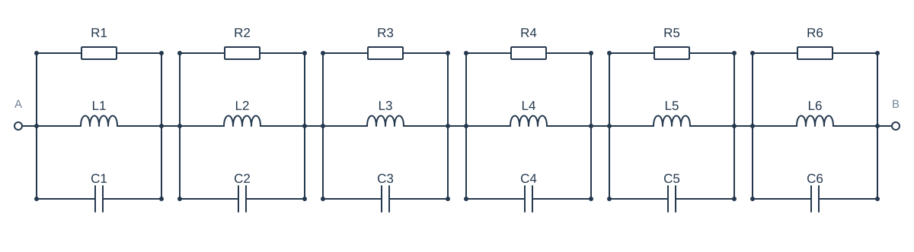
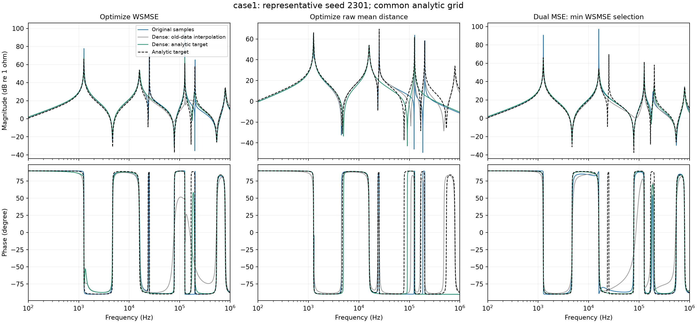

# case1：典型seed 2301

27项原频点幅相MSE/Ω距离排名的平均秩=51.5926，seed中位平均秩=51.5185。本例不是按加密获益最大选择。

三列分别对应WSMSE、原Ω距离、双MSE；每列颜色区分采样条件。所有线由相同解析检查网格计算，未把折线插值当成真实拟合曲线。主报告统计全部seeds，本图仅供解释。

## WSMSE：元件参数

| 参数/SI单位 | 目标值 | 原采样 | 加密插值 | 加密真值 |
| --- | --- | --- | --- | --- |
| R1/Ω | 2000 | 92190.9 | 10.4842 | 50.7749 |
| L1/H | 0.001585 | 4.03965e-06 | 4.36612e-06 | 0.000695565 |
| C1/F | 1e-05 | 3.91532e-07 | 2.20671e-07 | 1.99893e-05 |
| R2/Ω | 3000 | 7723.92 | 52.9445 | 2371.74 |
| L2/H | 1e-05 | 0.00180103 | 3.22276e-07 | 0.00114518 |
| C2/F | 3.98e-06 | 8.72237e-06 | 1.1971e-07 | 1.38129e-05 |
| R3/Ω | 500 | 1832.16 | 8.04494 | 2213.69 |
| L3/H | 0.0001 | 1.11136e-07 | 0.00017856 | 3.29004e-06 |
| C3/F | 1e-06 | 5.54557e-06 | 6.97446e-05 | 4.81236e-07 |
| R4/Ω | 1200 | 261.044 | 12.5189 | 31.3482 |
| L4/H | 2.512e-06 | 0.000121556 | 1.069e-07 | 8.24662e-07 |
| C4/F | 6.31e-07 | 7.93633e-07 | 1.43725e-05 | 8.02332e-07 |
| R5/Ω | 800 | 33.4292 | 253.961 | 49.7016 |
| L5/H | 1.259e-06 | 2.08552e-07 | 0.000118586 | 2.36745e-07 |
| C5/F | 5.01e-07 | 1.89384e-07 | 8.3406e-07 | 1.69048e-07 |
| R6/Ω | 50 | 3981.48 | 431.169 | 488.863 |
| L6/H | 2.51e-07 | 7.32896e-06 | 0.00147145 | 0.000137453 |
| C6/F | 1.58e-07 | 5.5505e-06 | 1.07372e-05 | 7.13575e-07 |

## 原Ω距离：元件参数

| 参数/SI单位 | 目标值 | 原采样 | 加密插值 | 加密真值 |
| --- | --- | --- | --- | --- |
| R1/Ω | 2000 | 1531.93 | 269.645 | 1160.15 |
| L1/H | 0.001585 | 1.0744e-07 | 9.97391e-05 | 1.45603e-06 |
| C1/F | 1e-05 | 1.44724e-05 | 1.0022e-06 | 1.08862e-06 |
| R2/Ω | 3000 | 1851.47 | 45.509 | 265.951 |
| L2/H | 1e-05 | 0.00121476 | 5.66727e-07 | 2.76057e-05 |
| C2/F | 3.98e-06 | 1.313e-05 | 2.85289e-06 | 3.63026e-06 |
| R3/Ω | 500 | 501.021 | 26.445 | 159.784 |
| L3/H | 0.0001 | 9.92541e-05 | 1.94792e-07 | 3.23806e-05 |
| C3/F | 1e-06 | 1.00746e-06 | 2.05728e-07 | 3.12225e-06 |
| R4/Ω | 1200 | 725.94 | 37.7578 | 1828.47 |
| L4/H | 2.512e-06 | 9.04336e-06 | 1.02896e-05 | 0.00121188 |
| C4/F | 6.31e-07 | 4.40059e-06 | 3.8086e-06 | 1.3076e-05 |
| R5/Ω | 800 | 836.389 | 379.363 | 233.913 |
| L5/H | 1.259e-06 | 1.82478e-07 | 0.0014089 | 0.000210141 |
| C5/F | 5.01e-07 | 3.38407e-06 | 1.11266e-05 | 7.57042e-05 |
| R6/Ω | 50 | 358.252 | 35.4542 | 179.233 |
| L6/H | 2.51e-07 | 0.000160489 | 5.92974e-07 | 2.8055e-05 |
| C6/F | 1.58e-07 | 9.43515e-05 | 1.09296e-06 | 3.51601e-06 |

## 双MSE·最小WSMSE：元件参数

| 参数/SI单位 | 目标值 | 原采样 | 加密插值 | 加密真值 |
| --- | --- | --- | --- | --- |
| R1/Ω | 2000 | 27.7093 | 1.00328 | 795.847 |
| L1/H | 0.001585 | 4.22203e-07 | 1.66754e-05 | 2.86795e-06 |
| C1/F | 1e-05 | 1.70145e-06 | 5.98012e-07 | 5.52143e-07 |
| R2/Ω | 3000 | 34235.8 | 599.237 | 1896.25 |
| L2/H | 1e-05 | 0.00176599 | 0.00155652 | 0.00180783 |
| C2/F | 3.98e-06 | 8.91313e-06 | 1.04292e-05 | 8.74907e-06 |
| R3/Ω | 500 | 406.076 | 54.4027 | 48.105 |
| L3/H | 0.0001 | 3.22983e-06 | 2.22674e-07 | 1.72278e-07 |
| C3/F | 1e-06 | 4.94137e-07 | 1.79238e-07 | 2.32322e-07 |
| R4/Ω | 1200 | 50.5773 | 97.7276 | 454.982 |
| L4/H | 2.512e-06 | 1.85373e-07 | 1.47505e-06 | 0.000126375 |
| C4/F | 6.31e-07 | 2.16928e-07 | 1.10877e-06 | 7.81966e-07 |
| R5/Ω | 800 | 73093.4 | 457.732 | 3.23987 |
| L5/H | 1.259e-06 | 9.29294e-05 | 9.00018e-05 | 1.00125e-07 |
| C5/F | 5.01e-07 | 1.0755e-06 | 1.12917e-06 | 1.47969e-08 |
| R6/Ω | 50 | 7.41054 | 62.5053 | 44.3303 |
| L6/H | 2.51e-07 | 3.04089e-05 | 6.15686e-07 | 9.01024e-07 |
| C6/F | 1.58e-07 | 3.00466e-06 | 1.06208e-06 | 7.23437e-07 |

## 同一个seed的原频点误差

| 组 | 采样 | 幅值MSE/dB² | 相位MSE/rad² | WSMSE | 原距离/Ω |
| --- | --- | --- | --- | --- | --- |
| WSMSE | 原采样 | 10.2285 | 0.167829 | 14.4443 | 5.02979 |
| WSMSE | 加密·旧点插值 | 18.6588 | 0.327349 | 26.8818 | 6.12599 |
| WSMSE | 加密·解析真值 | 8.19035 | 0.102429 | 10.7634 | 5.42779 |
| 原Ω距离 | 原采样 | 81.2948 | 0.95865 | 105.376 | 2.2334 |
| 原Ω距离 | 加密·旧点插值 | 37.2248 | 0.449288 | 48.511 | 4.8529 |
| 原Ω距离 | 加密·解析真值 | 68.8782 | 0.770071 | 88.2224 | 3.63537 |
| 双MSE·最小WSMSE | 原采样 | 9.79993 | 0.155686 | 13.7108 | 3.79231 |
| 双MSE·最小WSMSE | 加密·旧点插值 | 12.9355 | 0.182213 | 17.5127 | 6.11712 |
| 双MSE·最小WSMSE | 加密·解析真值 | 6.96885 | 0.0743122 | 8.83558 | 3.57601 |

这里是原频点评分；图中的解析加密检查与原点训练损失不是同一统计口径。

[返回主报告](REPORT.md)
