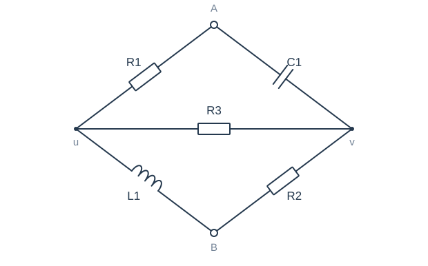
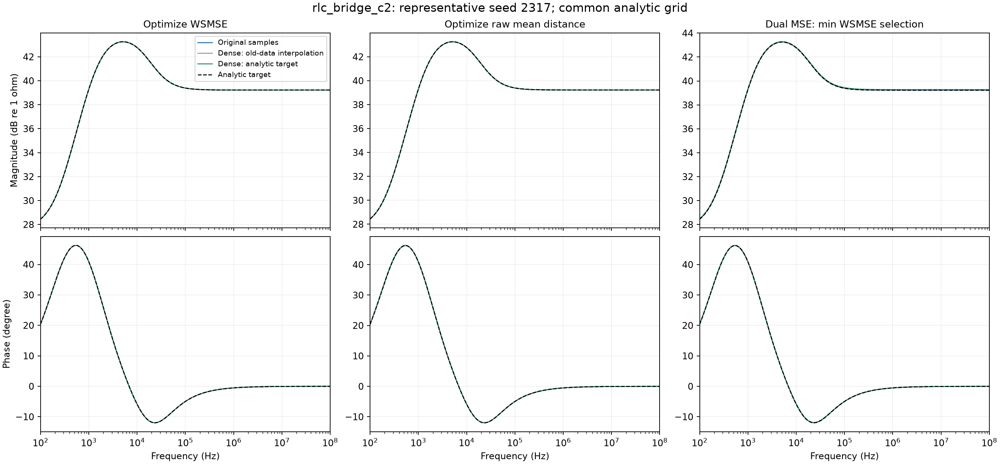

# rlc_bridge_c2：典型seed 2317

27项原频点幅相MSE/Ω距离排名的平均秩=10.8519，seed中位平均秩=10.9444。本例不是按加密获益最大选择。

三列分别对应WSMSE、原Ω距离、双MSE；每列颜色区分采样条件。所有线由相同解析检查网格计算，未把折线插值当成真实拟合曲线。主报告统计全部seeds，本图仅供解释。

## WSMSE：元件参数

| 参数/SI单位 | 目标值 | 原采样 | 加密插值 | 加密真值 |
| --- | --- | --- | --- | --- |
| R1/Ω | 24.1123 | 24.1123 | 24.1142 | 24.1123 |
| L1/H | 0.0148356 | 0.0148356 | 0.0148354 | 0.0148356 |
| C1/F | 1.72802e-07 | 1.72802e-07 | 1.72791e-07 | 1.72802e-07 |
| R2/Ω | 91.4674 | 91.4674 | 91.4677 | 91.4674 |
| R3/Ω | 38.4985 | 38.4985 | 38.4805 | 38.4985 |

## 原Ω距离：元件参数

| 参数/SI单位 | 目标值 | 原采样 | 加密插值 | 加密真值 |
| --- | --- | --- | --- | --- |
| R1/Ω | 24.1123 | 24.1123 | 24.1125 | 24.0317 |
| L1/H | 0.0148356 | 0.0148356 | 0.0148355 | 0.0148598 |
| C1/F | 1.72802e-07 | 1.72802e-07 | 1.72802e-07 | 1.72835e-07 |
| R2/Ω | 91.4674 | 91.4674 | 91.4674 | 91.4674 |
| R3/Ω | 38.4985 | 38.4985 | 38.4982 | 38.5664 |

## 双MSE·最小WSMSE：元件参数

| 参数/SI单位 | 目标值 | 原采样 | 加密插值 | 加密真值 |
| --- | --- | --- | --- | --- |
| R1/Ω | 24.1123 | 24.1123 | 24.1251 | 24.2176 |
| L1/H | 0.0148356 | 0.0148356 | 0.0148583 | 0.014937 |
| C1/F | 1.72802e-07 | 1.72802e-07 | 1.74053e-07 | 1.72411e-07 |
| R2/Ω | 91.4674 | 91.4674 | 91.7991 | 91.9991 |
| R3/Ω | 38.4985 | 38.4985 | 38.5878 | 38.1704 |

## 同一个seed的原频点误差

| 组 | 采样 | 幅值MSE/dB² | 相位MSE/rad² | WSMSE | 原距离/Ω |
| --- | --- | --- | --- | --- | --- |
| WSMSE | 原采样 | 7.44464e-25 | 2.91623e-27 | 1.36359e-24 | 1.05985e-11 |
| WSMSE | 加密·旧点插值 | 8.73672e-08 | 1.01834e-09 | 3.03565e-07 | 0.00323626 |
| WSMSE | 加密·解析真值 | 3.73179e-23 | 1.3891e-25 | 6.6809e-23 | 6.18548e-11 |
| 原Ω距离 | 原采样 | 1.62856e-14 | 2.97646e-16 | 7.94772e-14 | 4.26988e-07 |
| 原Ω距离 | 加密·旧点插值 | 1.72226e-10 | 3.39056e-12 | 8.92055e-10 | 6.62847e-05 |
| 原Ω距离 | 加密·解析真值 | 2.07885e-05 | 4.31372e-07 | 0.000112371 | 0.0174498 |
| 双MSE·最小WSMSE | 原采样 | 2.40746e-20 | 1.58429e-22 | 5.77098e-20 | 1.24166e-09 |
| 双MSE·最小WSMSE | 加密·旧点插值 | 0.000607263 | 3.42848e-07 | 0.000680051 | 0.259585 |
| 双MSE·最小WSMSE | 加密·解析真值 | 0.00215209 | 6.83012e-07 | 0.00229709 | 0.481913 |

这里是原频点评分；图中的解析加密检查与原点训练损失不是同一统计口径。

[返回主报告](REPORT.md)
