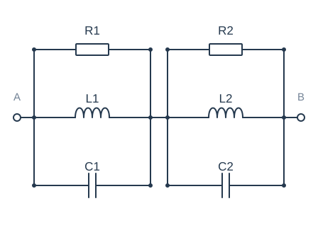
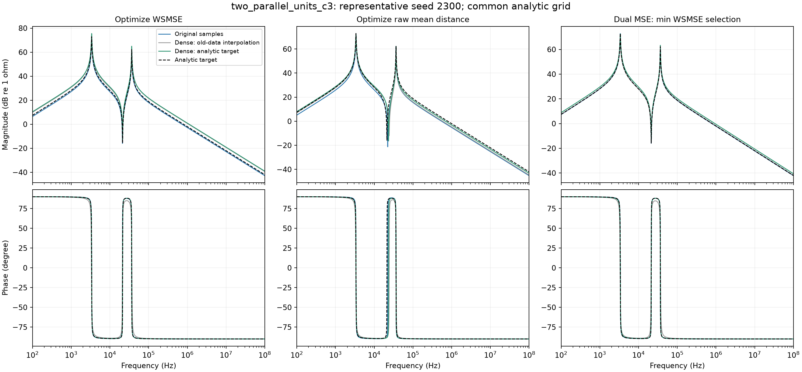

# two_parallel_units_c3：典型seed 2300

27项原频点幅相MSE/Ω距离排名的平均秩=9.92593，seed中位平均秩=10.3704。本例不是按加密获益最大选择。

三列分别对应WSMSE、原Ω距离、双MSE；每列颜色区分采样条件。所有线由相同解析检查网格计算，未把折线插值当成真实拟合曲线。主报告统计全部seeds，本图仅供解释。

## WSMSE：元件参数

| 参数/SI单位 | 目标值 | 原采样 | 加密插值 | 加密真值 |
| --- | --- | --- | --- | --- |
| R1/Ω | 4402.98 | 4343.47 | 634.451 | 5981.27 |
| L1/H | 0.0036812 | 0.00327417 | 8.55071e-05 | 0.005156 |
| C1/F | 6.05023e-07 | 6.78677e-07 | 2.17994e-07 | 4.31605e-07 |
| R2/Ω | 1285.55 | 1016.66 | 3013.13 | 1770.63 |
| L2/H | 6.29457e-05 | 5.792e-05 | 0.00489478 | 8.82642e-05 |
| C2/F | 3.01959e-07 | 3.27631e-07 | 4.63986e-07 | 2.15163e-07 |

## 原Ω距离：元件参数

| 参数/SI单位 | 目标值 | 原采样 | 加密插值 | 加密真值 |
| --- | --- | --- | --- | --- |
| R1/Ω | 4402.98 | 1284.25 | 539.55 | 4402.99 |
| L1/H | 0.0036812 | 4.13991e-05 | 3.90686e-05 | 0.00394239 |
| C1/F | 6.05023e-07 | 4.60351e-07 | 4.77357e-07 | 5.64938e-07 |
| R2/Ω | 1285.55 | 4400.5 | 2471.34 | 1284.91 |
| L2/H | 6.29457e-05 | 0.00281824 | 0.00355301 | 4.88498e-05 |
| C2/F | 3.01959e-07 | 7.87364e-07 | 6.34676e-07 | 3.8912e-07 |

## 双MSE·最小WSMSE：元件参数

| 参数/SI单位 | 目标值 | 原采样 | 加密插值 | 加密真值 |
| --- | --- | --- | --- | --- |
| R1/Ω | 4402.98 | 4362.56 | 2420.52 | 4211.01 |
| L1/H | 0.0036812 | 0.00362815 | 0.00372549 | 0.00433946 |
| C1/F | 6.05023e-07 | 6.13794e-07 | 6.1062e-07 | 5.12279e-07 |
| R2/Ω | 1285.55 | 1267.94 | 457.351 | 1467.34 |
| L2/H | 6.29457e-05 | 6.19323e-05 | 6.46614e-05 | 7.44433e-05 |
| C2/F | 3.01959e-07 | 3.06911e-07 | 2.88854e-07 | 2.55136e-07 |

## 同一个seed的原频点误差

| 组 | 采样 | 幅值MSE/dB² | 相位MSE/rad² | WSMSE | 原距离/Ω |
| --- | --- | --- | --- | --- | --- |
| WSMSE | 原采样 | 0.892722 | 3.89992e-05 | 0.94263 | 4.06593 |
| WSMSE | 加密·旧点插值 | 7.00023 | 0.00123797 | 8.58447 | 16.443 |
| WSMSE | 加密·解析真值 | 8.6092 | 1.43234e-05 | 8.62753 | 17.2875 |
| 原Ω距离 | 原采样 | 9.08177 | 0.0330187 | 51.336 | 6.31414 |
| 原Ω距离 | 加密·旧点插值 | 11.2439 | 0.083001 | 117.461 | 12.5741 |
| 原Ω距离 | 加密·解析真值 | 3.95959 | 0.0701146 | 93.6857 | 3.7247 |
| 双MSE·最小WSMSE | 原采样 | 0.0180601 | 2.60378e-07 | 0.0183933 | 0.540141 |
| 双MSE·最小WSMSE | 加密·旧点插值 | 0.71154 | 0.00128206 | 2.3522 | 12.6565 |
| 双MSE·最小WSMSE | 加密·解析真值 | 2.08647 | 0.000129069 | 2.25164 | 7.61446 |

这里是原频点评分；图中的解析加密检查与原点训练损失不是同一统计口径。

[返回主报告](REPORT.md)
