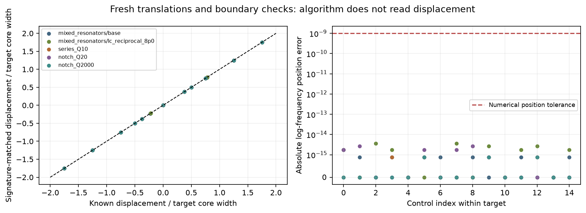
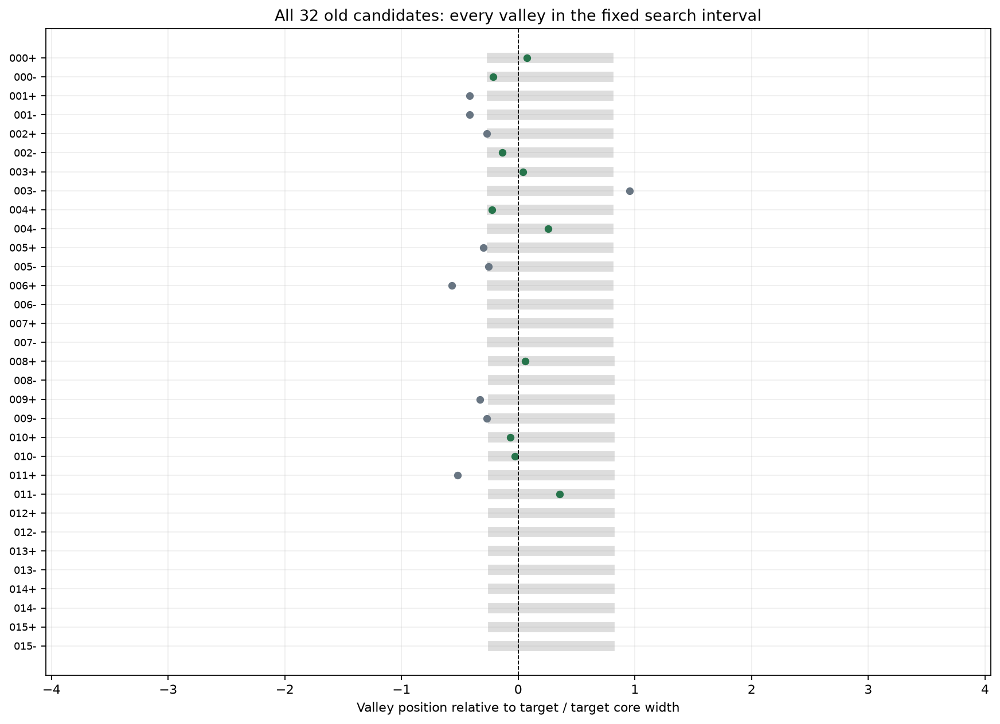
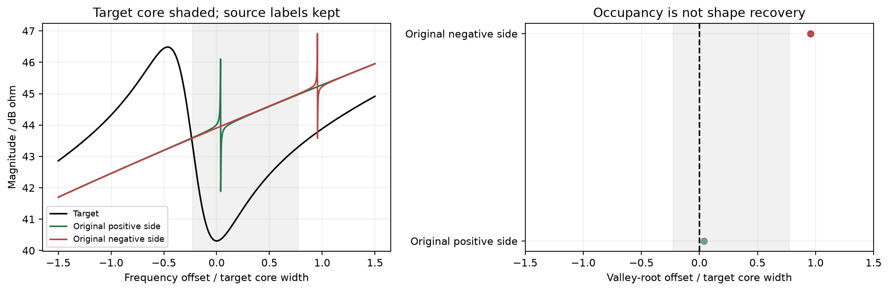

# 谷过程频率归属：实现、核验与适用范围

日期：2026-10-17。性质：本地诊断实现及受控核验；未开展新的参数优化。

## 1. 结论与本次进展

本次将“谷出现在哪里”和“它是否具有目标过程的纯移频特征”拆成两个独立问题，并完成了程序实现。对五个既有理论目标构造的75项移频与边界检查，程序均找到唯一的签名一致候选，且位置分类正确；最大中心误差为 **3.55×10⁻¹⁵ 个 log10(f) 单位**。

这证明本实现能够处理本批可控的纯频率平移及边界情况，不能据此认定一般形变后的对应关系已经解决。对32个既有优化候选，程序可以描述谷的位置，但没有任何一个满足严格移频签名。其含义是“没有获得严格纯移频的一致性证据”，不能解释为32个候选都没有目标谷，或全部拟合失败。

实际进展是：先前笼统的“完整过程有问题”，现在能进一步拆成**核心区未出现谷、谷移到核心区之外、核心区有谷但含额外峰、变化量与状态存在不同方向的偏差**。尚未完成的是：对这些形变建立可信的对应关系与可接受程度。

## 2. 程序具体检查什么

令 x=log10(f)，Z(x)=R(x)+jX(x)。本次以复阻抗轨迹为基础，同时使用复状态 Z 和向量导数 dZ/dx；幅值谷只作为候选过程的定位点。

### 2.1 第一层：固定核心区的占位

目标核心区沿用上一轮目标谷两侧的3 dB边界。固定搜索区为目标谷中心左右各4个目标核心宽度。通过径向变化率 Re(conj(Z)·dZ/dx)/|Z| 的根及两侧符号，枚举搜索区内全部严格局部谷，保存全部候选。

程序分别记录：零变化、搜索区无谷、核心区无谷但搜索区其他位置有谷、仅落在核心边界、核心区一个候选、核心区多个候选。位置距边界不超过10⁻⁹ 个log10(f)单位时单列为边界情况。这是数值判位容差，不是允许结构失真的幅度。

本层不使用1 dB显著性阈值。因此，旧事件检测中不够显著的微弱谷，也可能在这里被列出。“有一个谷”也不等于“只有一个过程”：前面还可能夹着一个峰，峰数需另行保留。

### 2.2 第二层：严格移频签名

对每个候选谷，将其中心与目标谷中心对齐，在目标核心范围内的固定相对位置比较：

- 复状态 Z/S；
- 联合变化向量 (dZ/dx)·W/S。

S为目标谷中心的阻抗幅值，W为目标核心区的对数频率宽度。位置由17个等间隔相对点并入中心后取唯一点组成。所有比较均使用目标尺度，不以候选自身的大小归一化。绝对容差10⁻⁸，相对容差10⁻⁷，要求两类量的每个检查点均通过。

这是严格的**离散签名数值一致性检查**，不是连续函数相等的证明，也不是适用于任意形变的恢复标准。若无候选通过，返回“无严格移频证据”；若多个通过，保留多解，不强行选择最近的谷。本批未出现多个签名同时通过的物理样本，不能宣称该歧义分支已得到充分验证。

频移量单独保存。对齐只用于诊断，没有用于优化，也没有改变既有MAG/PHA二维膝点选解。

## 3. 数据与验证结果

|数据组|记录数|用途|结果|
|---|---:|---|---|
|新构造移频与边界检查|75|核验已知物理移频下的位置与对应证据|75项全部正确|
|前轮物理设置回归|266|检查偏置、Q变化、额外过程等设置的输出|全部数值稳定；仅45项具有严格移频签名|
|既有优化候选|32|解释旧样本的过程争议|全部数值稳定；严格签名均不通过|
|合计|373|候选枚举与加密稳定性检查|373项通过|

新检查由五个目标分别构造9个频移设置（45项），并对左右核心边界各检查边界内、边界上、边界外（30项）。物理构造将所有L、C除以同一个频率缩放因子。匹配函数只接收目标和候选模型，不读取已知频移、预期中心或旧样本标签；已知真值只用于事后核验。

75项中，25项位于核心区内，40项在核心区外，左右边界各5项。75项另行使用独立节点求解核对阻抗响应，均通过。该节点检查用于交叉核对模型响应，不替代归属算法的控制检验。

这75项包含重复基准及相关边界设置，不能视为75个独立样本，也没有增加独立新电路。整个诊断运行约6.64秒，包含匹配和记录输出，不含准备、分析及新节点核验；不能作为辅助优化指标的运行成本结论。

266项回归中，45项签名一致来自5个原基准与40个原纯频移。其余221项通常还改变了状态偏置、宽度或额外过程，不满足纯移频签名并非一般恢复失败。5个背景参照均未被强行分配给目标过程：2个R+L参照的搜索区内无谷，3个常电阻参照为零变化。

## 4. 旧候选究竟揭示了什么

|32个旧候选的占位结果|数量|可作出的判断|
|---|---:|---|
|核心区有一个严格谷|10|有定位候选，仍需检查额外峰、状态及过程展开|
|核心区无谷，搜索区其他位置有谷|10|谷出现在目标核心之外，不能自动认定它与目标同源|
|固定搜索区内无严格谷|12|仅说明有限搜索区内未检出，不能推断全频段不存在|

灰线表示各自目标核心区；绿点在核心区内，其他点在核心区外。没有点表示固定搜索区内未检出严格谷。图中“+”“−”只沿用原样本两侧标签，不表示本次重新评出的优劣。

### 五组争议样本

下表better、worse均为原来源标签。本次不修改标签，也不把多个连续误差重新压成一个胜负分数。状态误差是前轮保存锚点的复阻抗误差均值除以目标尺度；路程为核心区内复轨迹的变化总量。

|原样本|核心内谷数|核心内峰数|搜索区谷数|核心路程/目标路程|状态误差/目标尺度|
|---|---:|---:|---:|---:|---:|
|000_better|1|1|1|1.8234|0.7027|
|000_worse|1|1|1|0.5565|0.7016|
|003_better|1|1|1|2.0663|0.7080|
|003_worse|0|0|1|0.2037|0.7057|
|009_better|0|0|1|0.0848|1.1344|
|009_worse|0|0|1|0.0911|1.1263|
|010_better|1|0|1|1.4828|0.8641|
|010_worse|1|0|1|0.8324|0.8686|
|011_better|0|0|1|0.0608|1.1108|
|011_worse|1|1|1|1.3169|1.1228|

1. **000组：两侧都有微弱谷，也都有额外峰。**原worse侧此前未被旧显著性事件匹配接受，本次严格解析谷枚举仍能检出它。这体现检测定义不同；不能据此宣称旧标签错误。
2. **003组：一侧在核心内，另一侧在核心外。**原better侧核心内存在额外峰与狭窄谷过程，路程约为目标的2.07倍；原worse侧谷已在核心外。两侧缺陷不同，单凭占位不能认定原better侧已恢复完整形态。
3. **009组：两侧谷均在核心外。**原better侧曾在较宽的位置容差下满足旧事件标准，固定核心占位回答的是更窄的问题。
4. **010组：两侧谷均在核心内，但不同量给出不同排序。**原better侧状态误差略小，原worse侧的路程更接近目标。不能由其中一个量独立宣布整体胜负。
5. **011组：原better侧核心内无谷，原worse侧有谷但多出峰。**前者核心内变化很少，后者又存在额外过程和状态偏差；有谷并不等于过程已正确恢复。

右图只画谷根的位置，额外峰需看左图与上表。32项严格移频签名均不通过，说明此签名不足以处理这些一般形变，不能称为“识别率0%”。

## 5. 对研究主线的影响

|持续追踪的问题|本次增加的证据|仍不能回答的部分|
|---|---|---|
|哪类结构反复难恢复？|谷的位置、夹杂的峰、局部变化总量与状态偏差可以分别定位|尚无一般形变的完整对应判据|
|什么条件使其更难？|移频会改变固定窗口占位；核心内有谷仍可能含额外过程|本次没有分离优化搜索、选解及目标引导的因果贡献|
|针对性指标能改善吗？|提供了更可复查的缺陷描述|未加入优化，不能主张已提高拟合表现，也不改变此前JV未通过检验的结果|
|能推广吗，代价是什么？|本批理论模型运行较快；受控移频与背景检查通过|没有新实测、新电路推广或优化内成本验证|

## 6. 下一步应如何限定

下一项需要解决的具体问题是：**当谷的宽度、深度和复状态发生变化时，哪些变化仍允许把它视为目标过程，哪些变化应判为另一个过程或额外过程？**目前的严格签名只回答“是否接近纯移频”，无法承担这个任务。

后续应先定义可接受的形变范围及独立依据，再考虑一般归属或新的辅助指标：

1. 保留本次占位输出、全部候选及纯移频核验作为回归基线，不使用最近谷替代不确定性。
2. 分别规定位置、复状态、联合变化量、展开宽度和额外峰谷的报告方式。容差须有独立结构依据，不能为使旧32项通过而反向放宽。
3. 只有一般形变的对应关系能在有明确物理构造的正反例上成立后，才讨论把某项诊断转成优化目标。当前不直接开展新一轮服务器优化。

以上是待解决的定义与验证任务，没有自动启动后续实验。

## 7. 可复算记录

- [冻结方案](../../docs/谷过程频率归属_实现与核验方案_20261017.md)、[输入计划](PLAN.json)、[冻结来源哈希](SOURCE_MANIFEST.json)。
- [逐记录归属表](ATTRIBUTION_TABLE.csv)、[全部候选谷及签名残差](ALL_VALLEY_CANDIDATES.csv)、[75项控制核验](CONTROL_CHECKS.csv)。
- [可读全表](ALL_TABLES.md)、[独立节点核验](NODAL_CONTROL_AUDIT.json)、[分析汇总](ANALYSIS.json)、[问题与影响](ISSUES.md)。
- [匹配实现](../../experiments/valley_attribution_20261017/correspondence.py)、[分析实现](../../experiments/valley_attribution_20261017/analyze.py)、[最终来源及输出哈希](PROVENANCE.json)。

全部原始层级输出保存在records目录。前两轮来源、记录及报告哈希已复核保持不变。本次没有新增优化、改变旧阈值或标签、上传网站、连接服务器或创建监控。
