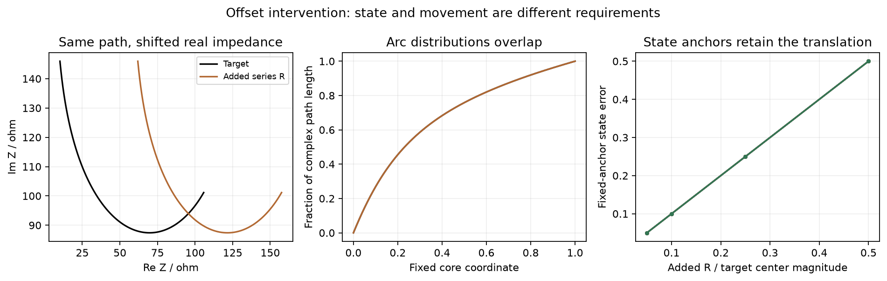
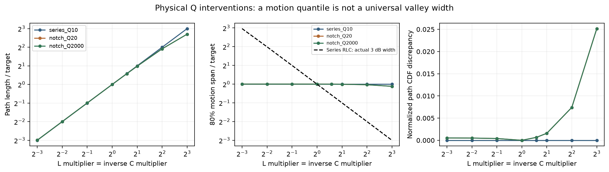
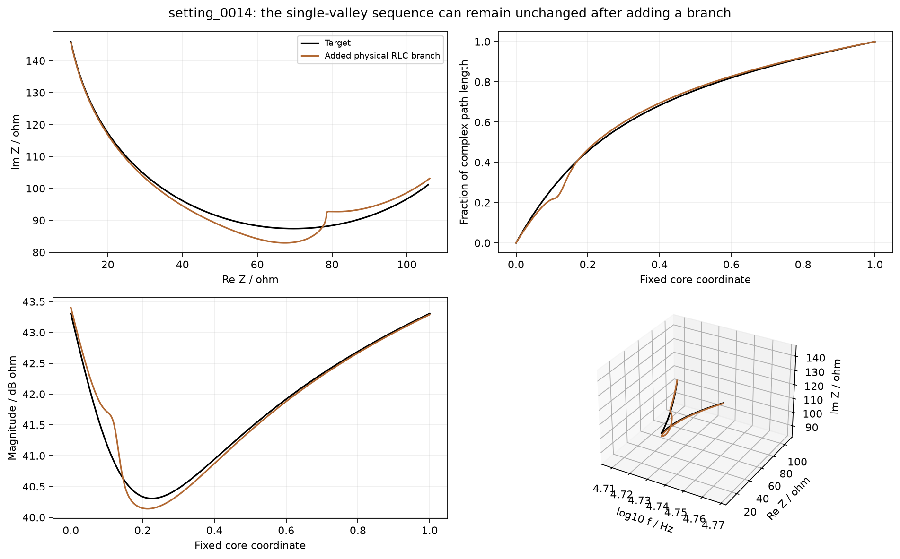
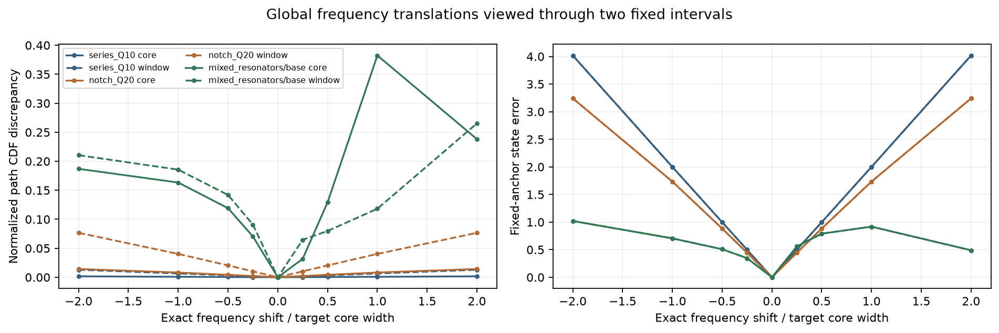

# 谷过程判据的物理扰动检验

日期：2026年10月17日。状态：266个理想物理设置、数值复核和人工图形检查完成；未设计新优化分数或运行优化。

## 摘要

本轮根据[预先固定方案](../../docs/谷过程判据_物理扰动检验方案_20261017.md)，用新生成的正R/L/C电路参数检验过程诊断，不再依据旧32条候选挑选指标。五个目标包含两个已用混合网络、一个串联RLC和两个陷波参照；266个设置覆盖移频、串联偏置、Q、附加窄支路、背景替代、实际阻尼耦合和组合操作。全部266项数值检查通过，250项具有解析参照关系的操作通过，独立节点抽样全部双精度通过。

**结果支持联合检查，也明确否定了几种单量替代方案。**串联电阻偏置不改变弧长和累计比例；串联RLC的Q增至8倍，实际3 dB谷宽约为原1/8，归一化弧长分布却完全不变；135个附加窄支路设置中，8个仍保持单谷顺序；混合谷移频增大时，固定核心区的累计比例差及三个状态锚点误差都可能下降。

因此，上一轮的运动分位宽度只能描述特定区间的运动分布，不能升级为通用谷宽或独立优化指标。当前可保留的是**带绝对状态、运动量和频率归属的联合记录**；比例分布、切向和极值序列作为补充。缺失、移出区间和零运动必须显式标明，不能用剩余背景的相似程度代替目标过程恢复。

## 1. 对象、设置与证据范围

目标为：已有混合网络原条件与LC条件；串联RLC（R=25 Ω、f0=25 kHz、Q=10）；陷波网络Rs+Rp//(Rm+L+C)，Rs=5 Ω、Rp=200 Ω、Rm=20 Ω、f0=25 kHz，Q分别为20、2000。陷波的Q是本方案定义的支路频率尺度，并非通用于复杂端口曲线的品质因数。

|操作|设置数|
|---|---|
|Q|21|
|background|5|
|baseline|5|
|combined|24|
|damping|16|
|extra|135|
|offset|20|
|shift|40|

这266项是物理参数设置，不是266次优化，也不是266个独立统计重复。两个混合目标已参与开发，简单电路是机制参照；虽然参数不同于旧32条候选，仍不能称独立方法推广。

混合网络的核心区和外窗口沿用上一轮目标；简单电路的核心区取目标谷底上升3 dB的连续交点，外窗口取谷中心左右各4个核心宽度。频率使用log10 f，候选不对齐、不按自己的幅度归一化。所有目标、参数、源文件和输入哈希先于新响应计算冻结。

## 2. 偏置：运动不变，状态仍然错误

增加串联电阻ΔR时有精确关系Znew=Ztarget+ΔR，dZnew/dx=dZtarget/dx。20个偏置设置中，弧长比偏离1的最大值3.34×10^-15，归一化累计弧长差最大7.84×10^-16；运动描述基本不变。

三个固定目标频率的平均复状态误差除以目标谷底幅值，则准确返回预设的0.05、0.1、0.25、0.5偏置比例，最大偏差2.23×10^-16。这不是新评分获胜，而是说明绝对状态信息不可被平移不变的形态量替代。

幅值谷的位置在这种操作下仍可能改变，因为径向最小值取决于复平面原点；本实验不把它称作只改幅值而不改其他性质的操作。

## 3. Q：运动分位宽度不是通用谷宽

串联RLC满足Z=R+jRQ(f/f0−f0/f)。在固定R、f0下改变Q为k倍，在同一频率处有Xnew=kXtarget、|vnew|=k|vtarget|，因而：

\[
L_{new}=kL_{target},\qquad
F_{new}(x)=F_{target}(x),
\quad F(x)=\frac{\int_{a}^{x}|dZ/d\xi|d\xi}{\int_a^b|dZ/d\xi|d\xi}.
\]

归一化把Q造成的整体运动幅度变化消掉了。Q增至8倍时：

|模型|Q因子|实际3dB宽度比|运动跨度比|弧长比|累计比例差|
|---|---|---|---|---|---|
|series_Q10|8|0.125051|1.000000|8.000000|0|
|notch_Q20|8|0.125000|0.921853|6.508904|0.0251612|
|notch_Q2000|8|0.125000|0.921853|6.508904|0.0251612|

串联模型的实际3 dB宽度只有原12.505%，但运动10%到90%分位跨度仍为原100%。这不是采样分辨率不足，而是解析等式所决定的盲区。

陷波模型则保留完整复平面路径，通过非线性频率重参数改变沿路径的推进。固定目标核心区只观察完整路径的一部分，所以其实际谷宽与运动分位宽度同样不成等比例。Q=20、2000两个参照的响应接近，也不能当成两次独立推广成功。

因此，上一轮1.91%的运动跨度可以诊断那个窄往返案例，但不能作为所有电路中谷宽的统一代理。弧长总量在本组串联RLC中能识别被比例归一化消掉的变化，仍不代表单独使用弧长就足够。

## 4. 附加支路：单谷序列不保证没有额外过程

135个设置将一个并联RLC支路串入目标端口。支路峰阻抗为目标谷底幅值的0.1、0.5、1倍，中心在目标核心宽度的−0.1、0、+0.1位置，支路对数半功率宽度为核心宽度的0.01、0.05、0.2倍。

其中8个在固定核心区仍是一次负→正径向转换，即单谷序列。新增支路可以改变复路径而不产生新的幅值峰谷计数，所以“极值数没增加”不能证明没有副作用。反过来，增加一个物理支路也不等于一定出现一个额外环。

按冻结源顺序取首个序列不变的案例setting_0014作图：附加支路峰阻抗10.36 Ω、中心约51.96 kHz；核心弧长增至1.0539倍，归一化累计差约0.01083，复路径出现局部偏折，但仍是单谷。该例只是解释计数盲区，不等于根据任意小变化给出“不合格”的新阈值。

附加支路使用正R/L/C；最窄档是理想模型压力测试，不能据其元件值声称真实器件可实现。支路半功率宽度与目标字面3 dB宽度是不同定义，均按方案分别记录。

## 5. 移频：有限窗口及少数锚点也有盲区

全部L、C同时除以s时，严格有Znew(f·s)=Ztarget(f)。因此目标过程究竟移动多少是已知的，不需要从新分数猜测。但只看固定核心区，观察到的可能变成背景或邻近结构，而不再是同一个谷过程。

在混合网络正向移频测试中：

|目标|移频从→到/目标核心宽|累计分布差从→到|
|---|---|---|
|mixed_resonators/base|1→2|0.382412→0.238131|
|mixed_resonators/lc_reciprocal_8p0|1→2|0.359116→0.317930|

原条件从1移到2个核心宽度，目标谷都已离开核心区，累计比例差却下降约37.7%；三个锚点的平均复状态误差也由0.9168降至0.4888。LC条件还出现了另外两处锚点误差下降。**绝对状态信息必须保留，但少数状态锚点本身仍不能保证对任意错位单调。**

本批所测外窗口的累计比例切片没有出现相同的反转，不能据此认为扩大窗口必然解决：窗口仍有限，且扩大后会混入其它过程。应先记录目标过程在区间内是否存在、频率归属是否仍对应，之后再解释状态与运动差。

该诊断不是对完整曲线传输距离单调性的证明，也不是优化器局部极值实验。没有把观察到的反转通过改窗口或调权重修掉。

## 6. 只剩背景及耦合操作

5个背景参照用纯电阻或R+L匹配目标中心状态，均没有严格谷转换。三个简单模型的背景是常量电阻，弧长为0；累计比例、分位跨度和切向方向正确记录为不适用，而非分数0或完美匹配。两个混合背景仍随频率变化，分布有定义，却没有目标谷过程，说明分布有定义不代表目标结构存在。

16个混合网络R1/R3操作、24个简单模型组合操作完整保留。前者会耦合改变多个特征，不给它套上纯Q或纯宽度标签；后者检查同时移频、偏置与Q改变时数值和物理关系仍一致。没有只保留响应单调或符合直觉的参数档位。

## 7. 检查框架应怎样修订

|诊断信息|本轮支持的用途|已经确认的限制|
|绝对Re/Im状态|保留偏置、局部阻抗水平及同频状态|少数锚点对大错位也可能反转，不能独立确认过程归属|
|运动总量|发现归一化掩盖的强度变化与零运动|对串联实部偏置完全不敏感，不是独立完整性评分|
|频率位置及过程归属|明确目标谷是否移出当前区间、当前描述是否仍对应同一过程|多谷匹配与附加过程需要明确协议，不能仅取最近一个根就宣布正确|
|累计比例与分位|在过程、区间和总量已交代后，描述变化分布|不是普适谷宽，对串联Q变换可完全失明，有限窗口下可反向|
|径向极值顺序|报告明显缺失或多余的进入/离开过程|8/135附加支路仍是单谷；小起伏显著性也需另定|
|切向与端点效率|补充路径方向、往返程度|平移不敏感，零运动时未定义；不能单独代表物理谐振正确|

这不是将所有量简单相加的理由。下一版评价应先形成**状态、总量、频率归属**三项并列记录；比例分布、切向与计数用于解释。若多项发生取舍，保留取舍，不根据本批结果拟合一个总权重。

关于频率归属，需要明确区分“对应谷存在且在区间内”“谷已移出”“出现多个可能对应过程”“零运动/无谷”，不能把后三者留在区间里的剩余片段当作完整恢复。当前记录已能展示这些情形，但尚未把它们变成经独立检验的自动匹配和验收程序。

## 8. 数值、范围及下一步

266个设置在核心区和外窗口全部完成128/256折线核验，没有使用512/1024上限；32/64阶Gauss弧长复核、径向根稳定性和独立节点抽样全部通过，均无高精度回退。250项可写出参照关系的操作全部通过，最大相对偏差1.81×10^-10；其余16项阻尼耦合操作未伪设纯变换等式。三个简单目标的核心边界也与独立3 dB幅值关系一致。

本地响应、核验及档案生成约15.47秒，不含环境导入准备和后续图表分析。没有服务器任务、优化seed或60000评价预算；这不是新辅助目标的求值成本基准。原代码、参数、标签和结果台账未改。

下一步可以明确收缩为：**先实现目标过程的频率归属和缺失状态记录，再以固定目标尺度保留复状态及非归一化运动量；检验这些联合记录是否能解释旧反例中的取舍。**先不把累计比例、运动分位宽度或数峰谷直接推进为新辅助目标，也不靠改3 dB阈值补齐旧通过率。

这些是机制和评价对象的进展，不是新指标有效或优化成功。两个原混合目标均参与开发，简单RLC是理论参照，没有新实测、噪声、同时间预算或独立拓扑推广验证。方法创新仍需证明联合处理相对原复误差或匹配权重的附加收益，不能把坐标分解本身当作创新。

|四个主问题|本轮更新|
|---|---|
|哪类结构困难？|谷移出后剩余背景被误当过程、窄支路改路而不改计数、运动尺度改变却被比例归一化消掉。|
|什么条件更难？|有限窗口、归一化、稀疏锚点及特征耦合；这些因素分别有物理参照证据。|
|针对性指标能改善吗？|本轮筛查诊断的能力边界，没有提出或优化新指标，旧失败保持不变。|
|能推广，代价是什么？|只有无噪声理论开发与机制参照；本地可算，不需要为本步租用服务器，实际优化和推广代价仍未知。|

## 9. 数据入口

- [物理检验后的修订建议](../../docs/谷过程判据_物理检验后修订建议_20261017.md)、[全部诊断表](ALL_TABLES.md)。
- [冻结参数与设置](PLAN.json)、[全部连续量](ALL_DIAGNOSTICS.csv)、[解析及响应核对](INTERVENTION_CHECKS.json)。
- [响应档案](../../archive/LOCAL_ONLY.md#ref-5b78a1f1de7c)、[每设置记录目录](records)、[问题及影响](ISSUES.md)。
- [执行前源/输入哈希](SOURCE_MANIFEST.json)、[来源台账](PROVENANCE.json)、[最终状态](REVIEW_STATUS.json)。

本轮未重标旧样本，未修改旧报告，未拼接新优化目标，未运行优化，未连接服务器，未发布网站或创建监控。
