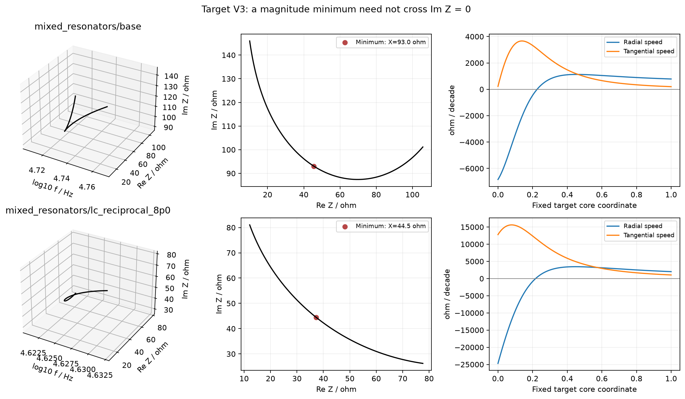
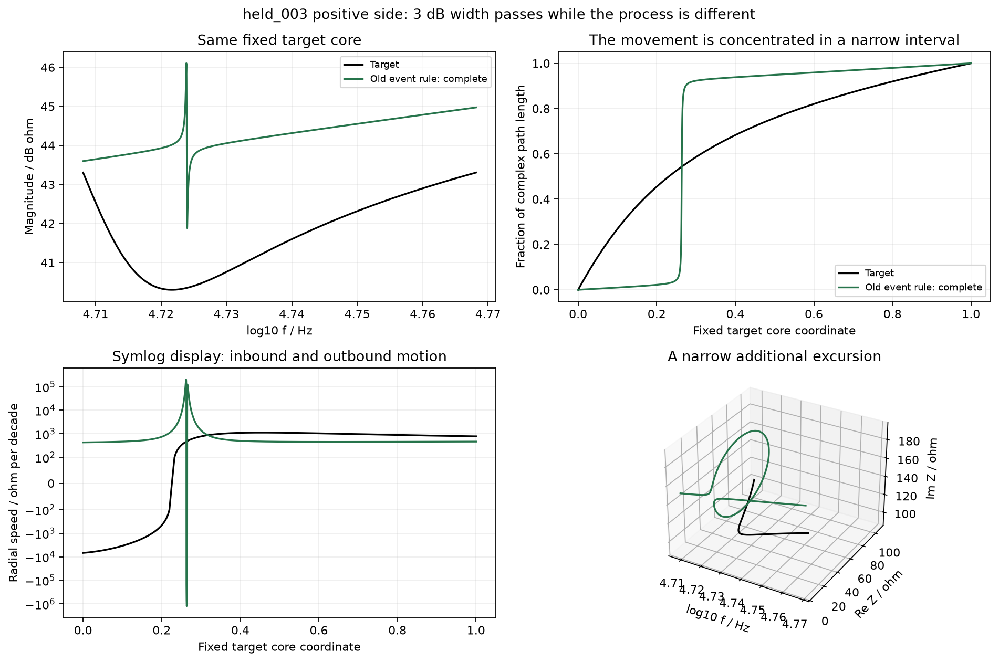
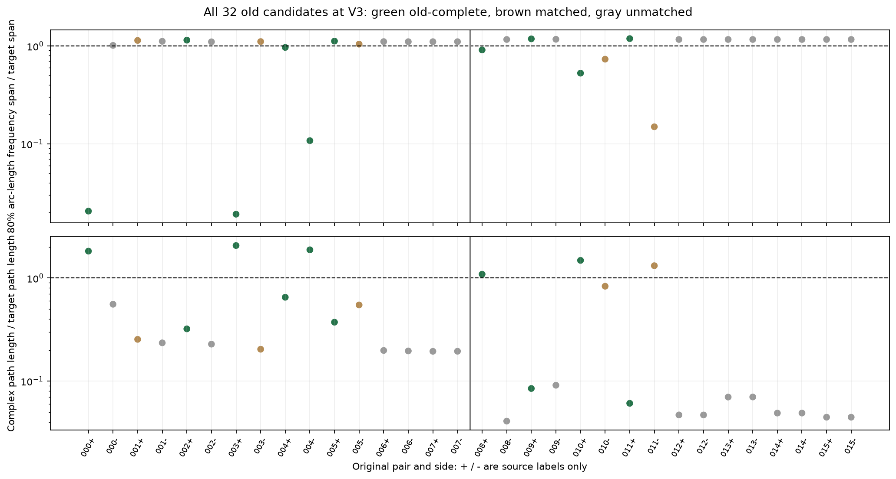
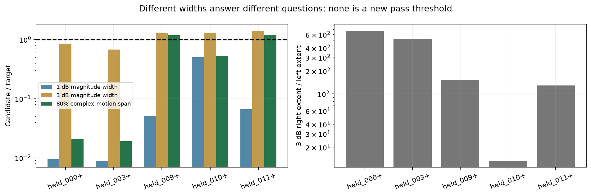

# 混合网络谷结构：应恢复怎样的复轨迹过程

日期：2026年10月17日。范围：本地诊断现有理论电路及已保存候选；未运行新优化，未设计新的优化辅助目标。

## 摘要与直接判断

**这类谷需要恢复的是：在正确的频率区间，复阻抗沿目标所示路径逐步接近谷底状态，再按目标过程离开；谷底一个点及一个3 dB宽度不足以代表完成恢复。**具体应同时检查绝对Re/Im状态、进入/离开的方向与频率持续范围、附加往返过程，以及核心区外副作用。

本轮固定检查两个混合网络条件的全部32条旧候选及两个目标。34条响应的128/256细分、弧长独立Gauss积分、径向极值根和节点电路抽样全部通过。10条候选被旧规则判为V3完整；其中在固定目标核心区内，4条没有径向谷转换，3条是额外峰后接谷，仅3条与目标同为单谷顺序。这三个子类不是新的合格率，更不能据此宣布仅3条真正恢复；它们仍需状态和持续过程检查。

代表样本held_003正侧的3 dB宽度是目标的67.3%，但1 dB宽度只有0.897%，中间80%复轨迹弧长对应的频率跨度只有目标的1.91%。3 dB右侧距离约为左侧525倍。**宽度数字达标可以由窄谷与缓慢背景共同产生，无法保证宽谷过程恢复。**

另一个关键事实：两个目标的V3谷中心电抗分别约+93.0 Ω和+44.5 Ω，并非电抗过零或纯阻性点。因此，不能统一把这类谷的恢复设为ImZ=0，也不能要求它必须形成圆环。本文形成的是待冻结的过程检查框架，不追改旧标签或之前指标失败结论。

## 1. 分析对象和固定条件

执行前已保存[诊断方案](../../docs/混合网络谷结构完整过程_诊断方案_20261017.md)。样本来自上一轮冻结24对库中两个混合网络条件的16对、32条候选。原先配对关注P2、V1、V3或间隙的候选，本轮均检查同一个目标V3；没有按本轮诊断结果再挑样本。两个目标另作基准。

这些候选已经参与过开发，且并非32个独立随机样本。这里只研究已见缺陷，不作总体发生率、显著性或独立推广结论。源码、样本参数、旧标签和来源哈希先于本次诊断输出冻结。

固定两种区间：原目标V3窗口；以及目标左/右3 dB交点之间的核心区。候选在相同绝对频率上分析，不移动频率或按候选宽度对齐。核心区边界沿用旧目标记录；另精化目标驻点用于解释，二者没有混成一套新标签。

旧“完整”的门槛是位置偏差≤0.02 decade、高度偏差≤3 dB、3 dB宽度比在0.5至2之间。它并未要求候选谷中心落在目标3 dB核心区内，也未约束整段Re/Im运动。这能解释部分核心区无谷的样本，无需假设旧事件检测发生数值故障。

## 2. 先明确目标自身的过程

设x=log10 f、Z=R+jX、v=dZ/dx，定义：

\[
v_r=\frac{\operatorname{Re}(\overline Z v)}{|Z|},\qquad
v_t=\frac{\operatorname{Im}(\overline Z v)}{|Z|}.
\]

vr表示沿复平面原点径向的变化速度：负值时|Z|减小，正值时增大。vt表示横向推进。这里的“速度”指随对数频率变化，不是空间中的物体运动或电路时域暂态。

幅值谷的驻点满足：

\[
RR'+XX'=0,\qquad v_r:\text{负}\rightarrow\text{正}.
\]

**这个条件不等于X=0。**本例两个目标在谷中心的数值为：

|目标|精化谷频率/Hz|ReZ/Ω|ImZ/Ω|相位/°|RR'/Ω²每decade|XX'/Ω²每decade|
|---|---|---|---|---|---|---|
|mixed_resonators/base|52681.58|45.532|93.044|63.92|-125391.310|125391.310|
|mixed_resonators/lc_reciprocal_8p0|42004.28|37.226|44.489|50.08|-334345.805|334345.805|

两个目标在核心区都只有一次负到正的径向转换。谷中心处RR'为负、XX'为正，二者平衡；复阻抗仍处于正电抗区域。该描述来自端口复函数，尚未把现象归因到唯一内部支路或唯一储能模态。

作为代数参照，串联RLC的Z=R+j(ωL−1/(ωC))也有幅值谷，但其Re/Im路径是一条直线，谷底X=0。这说明谷可以对应不同的复轨迹，不能把有圆环、无圆环或纯阻性作为统一判据。

径向/切向量分别等价于d|Z|/dx和|Z|dargZ/dx。因此该分解是解释工具，本身不是新的数学创新或替代幅相拟合的独立信息来源。后续方法若要有特点，需要证明对频率顺序、状态与联合路径的处理提供实际附加作用。

## 3. 一个3 dB宽度为什么会误导

held_003正侧旧记录：位置偏差0.00235 decade、高度偏差+1.58 dB、3 dB宽度比0.673，因而被旧规则判为完整。连续曲线精化得到：

|诊断|目标|该候选|
|---|---|---|
|1 dB谷宽/decade|0.0227146|0.000203662|
|3 dB谷宽/decade|0.0600644|0.0404207|
|3 dB右/左距离比|3.43|524.57|
|固定核心区复弧长/Ω|130.66|269.98|
|端点位移/弧长|0.808|0.096|
|中间80%弧长所占频率跨度/目标|1|0.0191|

它不是将目标宽谷略微压窄，而是在背景上出现很窄的峰—谷及复平面往返。1 dB交点都靠近局部谷底；3 dB右交点则延伸到后面的缓慢背景，使总宽度看起来仍接近目标。这里背景的作用由同一连续曲线交点直接体现，不是推测采样漏峰。

图中累计弧长比例按候选自身总弧长显示，用于观察变化集中在哪里；总弧长另列，不能只看归一化比例而忽略运动量。中间80%指10%到90%的弧长分位范围，不是最短80%区间，也不是电路能量宽度。

上述结果不能证明旧配对负侧更好：held_003负侧的谷偏到核心区之外，固定核心区主要是背景，同样没有恢复目标过程。它说明正侧符合旧局部标签，也仍存在明显三维过程缺陷；不能用标签局限倒过来宣布JV已经成功。

## 4. 全部32条候选的检查

在32条候选中，旧V3匹配15条、完整10条。下表完整保留这10条，不只展示极端反例。原配对的正/负侧标签只针对原配对关注结构；例如P2配对的负侧也可能满足V3旧规则。

|旧完整候选|原配对关注位置|1dB宽比|3dB宽比|运动跨度比|弧长比|核心区径向极值顺序|
|---|---|---|---|---|---|---|
|held_000_better|V3|0.0095|0.8505|0.0206|1.8234|peak valley|
|held_002_better|P2|0.1374|0.7315|1.1468|0.3211|无|
|held_003_better|V3|0.0090|0.6730|0.0191|2.0663|peak valley|
|held_004_better|P2|0.0682|0.7546|0.9666|0.6503|valley|
|held_004_worse|P2|0.0750|0.8875|0.1078|1.8780|peak valley|
|held_005_better|P2|0.3593|0.8022|1.1218|0.3726|无|
|held_008_better|P2|1.1009|1.3490|0.9111|1.0892|valley|
|held_009_better|V3|0.0506|1.2845|1.1825|0.0848|无|
|held_010_better|V3|0.4987|1.2901|0.5276|1.4828|valley|
|held_011_better|V3|0.0661|1.4078|1.1894|0.0608|无|

四条旧完整候选在固定目标核心区内没有谷转换，三条出现peak→valley，三条只出现valley。前一类不代表整个频带没有谷；后一类也不等于其状态、宽度或复轨迹已经正确。统计基于无噪声模型解析导数的全部稳定根，没有用新的显著性阈值删去小起伏。

10条旧完整候选的核心区弧长比范围为0.0608至2.066，运动跨度比为0.0191至1.189。跨度接近1也不能单独代表恢复：一条几乎只剩背景的曲线，可能在整个核心区缓慢变化，比例跨度很宽但总量很小。因此必须联合检查**量、位置、持续范围、方向和绝对状态**，不能只换一个“新宽度”代替旧宽度。

## 5. 完整过程的可检查定义：待冻结版本

建议将“完整”拆成以下互补检查；本轮只报告连续量，不从这32条样本反向挑选新合格线。

|检查层|具体检查什么|避免哪种误判|
|谷处状态|目标左侧、谷中心、右侧三个固定频率的ReZ、ImZ；保留平均背景偏置|形状相似但整段处于错误阻抗位置|
|频率位置及顺序|目标区域内径向负→正转换是否存在；额外正→负及负→正如何排列|谷偏到窗口外，或先出现多余峰再形成窄谷|
|过程持续范围|在固定区间比较累计弧长分布及10/50/90%频率位置，同时保留总弧长|用一瞬间的窄往返冒充持续的宽谷；或只剩背景却分位跨度很宽|
|联合方向|左侧进入、中心经过、右侧离开时的复切向方向与分量变化|幅值三点接近，但Re/Im沿不同路线变化|
|往返与外部副作用|弧长、端点位移/弧长、径向极值顺序及核心区外结构|局部补谷后多出环路、峰或谷|

其中三个固定频率的状态和切向夹角已逐候选记录，原窗口与核心区的弧长、位移效率及根序列也均保留。方向在零速度处无定义，后续协议需处理这类退化点；本次三个固定锚点没有依赖强行赋值获得通过结论。

这一定义以**目标实际复轨迹**为准：目标是直线就不能强迫拟合形成环，目标不是纯阻性就不能强迫电抗过零；频率坐标必须保留，不能通过对齐后说位置已经恢复。它是评价对象的定义，不是已经验证有效的辅助目标。

## 6. 下一步的明确顺序

1. 将旧完整标签在后续报告中称为“位置/高度/3 dB事件达标”，保留原字段和值；另列过程诊断。原报告不追改。
2. 为状态、频率顺序、总量与分位分布分别形成目标参照，保留各项连续误差；涉及多项取舍的样本明确标为取舍，不强行生成一个总排名。
3. 用独立于当前32条候选的物理扰动对检验诊断：位置移动、阻抗偏置、频率压缩、额外窄往返分别处理；涉及真实电路时承认这些因素不能全部独立控制。先判断诊断是否真的区分所声明缺陷，再设新的容差或辅助目标。
4. 只有评价定义冻结后，才讨论轻量辅助指标及配对优化。新指标必须同时面对“窄往返”和“仅剩背景”两类反例，不能靠修复其中一类宣布成功。

以上第3、4项是后续安排，本轮没有新增扰动实验、优化或服务器任务。当前证据不足以确定各过程量如何加权，更不足以宣布某个新指标可用。

## 7. 复核与局限

34条目标/候选全部通过128/256折线弧长和分位稳定检查；解析导数的32阶加密、64阶更密Gauss弧长独立复核通过；核心区及原窗口的径向根数、类型和位置稳定。最大驻点归一化径向点积约7.61×10^-12。每条响应在17个分布位置及三个固定锚点的独立节点解抽样通过，均无需高精度回退。

旧宽度解释另用全频带模态锚点寻找最近绝对高度交点，再以连续电路式精化；该诊断不是重跑原SciPy事件匹配。它不能把不显著的极值强行当作旧规则匹配事件；只对源记录确实匹配的谷补充交点解释。核心区外谷仍明确区分。

这32条来自旧搜索历史、两个目标均参与开发；没有新拓扑、实测或噪声验证。弧长及导数会受实测噪声影响；核心区的目标3 dB边界也只是当前既有物理尺度，不能自动变成普适窗口。端口诊断没有证明某个内部谐振支路的因果，也没有证明MSE理论不能拟合。

|持续追踪的问题|本轮进展|
|---|---|
|哪类结构困难？|在背景上用窄峰—谷/往返替代目标宽谷，或谷偏出目标核心区但事件仍达标。|
|什么条件更难？|幅值阈值交点受到背景影响；绝对位置容差大于局部核心尺度；归一化形状可能掩盖总量不足。|
|针对性指标能改善吗？|本轮只确定评价对象，未提出或验证新辅助目标，JV旧失败保持不变。|
|能推广、代价是什么？|仍是两个已用目标；本地可复算，无需服务器，尚无实测噪声和推广结论。|

## 8. 文件入口

- [过程检查框架](../../docs/谷结构完整过程_检查框架_20261017.md)、[全部候选表](ALL_TABLES.md)。
- [固定样本](COHORT.json)、[连续诊断](DIAGNOSTICS.json)、[简表CSV](COHORT_TABLE.csv)、[数值响应档案](PROFILES.npz)。
- [物理参照](PHYSICAL_REFERENCE.json)、[问题及影响](ISSUES.md)、[来源哈希](PROVENANCE.json)、[最终状态](REVIEW_STATUS.json)。

本轮未修改旧标签或旧报告，未合成新辅助分数，未运行优化，未连接或操作服务器，未发布网站或创建监控自动化。
